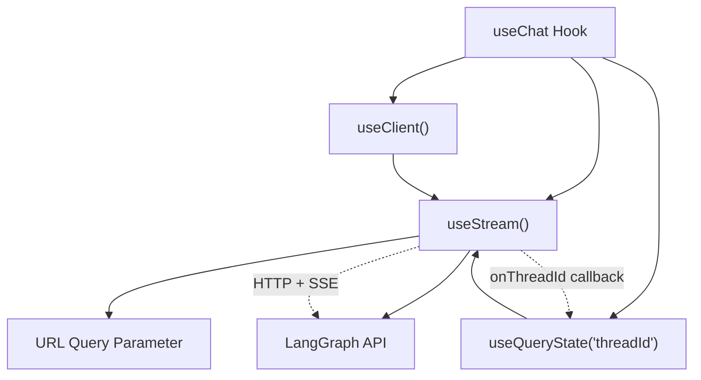
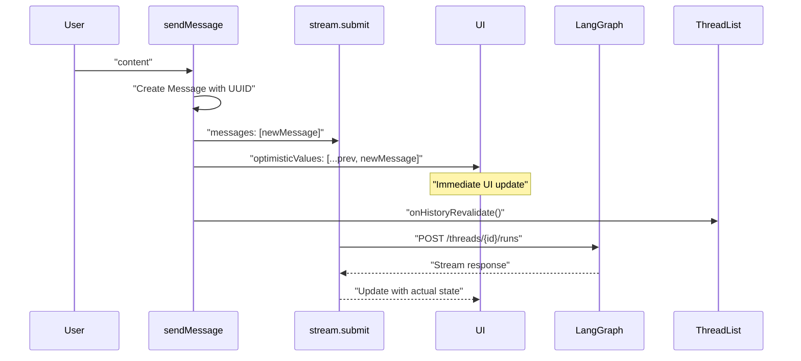
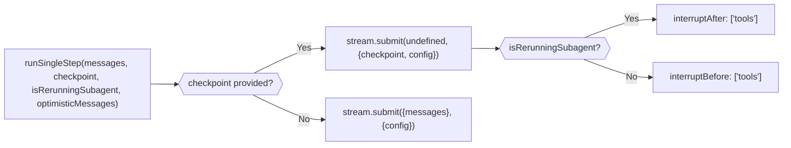
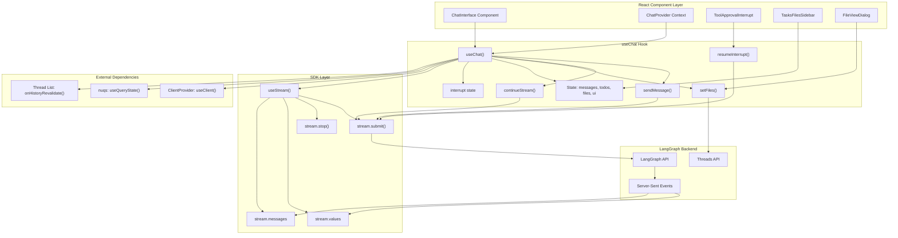

<!-- source: DeepWiki mcp.deepwiki.com · repo langchain-ai/deep-agents-ui · page 4.2 useChat Hook · fetched 2026-10-26 -->

# useChat Hook

<details>
<summary>Relevant source files</summary>

The following files were used as context for generating this wiki page:

- [src/app/hooks/useChat.ts](src/app/hooks/useChat.ts)
- [src/app/utils/utils.ts](src/app/utils/utils.ts)

</details>


## Purpose and Scope

The `useChat` hook is a custom React hook that manages real-time streaming communication with LangGraph agents. It wraps the `@langchain/langgraph-sdk/react` library's `useStream` hook and provides a higher-level interface for message submission, stream control, interrupt handling, and state synchronization. This hook serves as the primary data layer for the chat interface.

For information about the UI components that consume this hook, see [ChatInterface Component](#4.1). For details on how messages are processed and displayed, see [Message Processing and Display](#4.3). For tool approval workflows that use the interrupt system, see [Tool Approval and Interrupts](#5.2).

**Sources**: [src/app/hooks/useChat.ts:1-166]()

## Hook Interface

### Parameters

The `useChat` hook accepts a configuration object with three parameters:

| Parameter | Type | Required | Description |
|-----------|------|----------|-------------|
| `activeAssistant` | `Assistant \| null` | Yes | The active LangGraph assistant configuration from the API |
| `onHistoryRevalidate` | `() => void` | No | Callback to revalidate the thread list when state changes |
| `thread` | `UseStreamThread<StateType>` | No | Optional pre-loaded thread data for initial hydration |

### Return Values

The hook returns an object containing stream state and control functions:

| Property | Type | Description |
|----------|------|-------------|
| `stream` | `Stream<StateType>` | The underlying stream object from `useStream` |
| `messages` | `Message[]` | Array of conversation messages |
| `todos` | `TodoItem[]` | Array of agent-generated tasks |
| `files` | `Record<string, string>` | Map of file paths to contents |
| `email` | `object \| undefined` | Optional email state |
| `ui` | `any \| undefined` | Custom UI state from agent |
| `isLoading` | `boolean` | Whether stream is actively processing |
| `isThreadLoading` | `boolean` | Whether thread data is loading |
| `interrupt` | `object \| undefined` | Current interrupt state requiring user action |
| `getMessagesMetadata` | `function` | Function to retrieve message metadata |
| `sendMessage` | `(content: string) => void` | Submit a new user message |
| `runSingleStep` | `function` | Execute agent with step-level control |
| `continueStream` | `function` | Resume stream execution |
| `stopStream` | `() => void` | Stop current stream execution |
| `markCurrentThreadAsResolved` | `() => void` | Mark thread as complete |
| `resumeInterrupt` | `(value: any) => void` | Resume from interrupt with decision |
| `setFiles` | `(files: Record<string, string>) => void` | Update file state |

**Sources**: [src/app/hooks/useChat.ts:28-165]()

## State Type Definition

The hook manages a `StateType` interface that defines the shape of agent state:

```typescript
type StateType = {
  messages: Message[];
  todos: TodoItem[];
  files: Record<string, string>;
  email?: {
    id?: string;
    subject?: string;
    page_content?: string;
  };
  ui?: any;
};
```

This state is synchronized between the UI and the LangGraph backend, with updates streaming in real-time as the agent executes.

**Sources**: [src/app/hooks/useChat.ts:16-26]()

## Stream Initialization and Configuration

### useStream Integration

The hook initializes the `useStream` hook from the LangGraph SDK with specific configuration:



**Diagram: Stream Initialization Dependencies**

The `useStream` hook is configured with the following key parameters:

| Parameter | Value | Purpose |
|-----------|-------|---------|
| `assistantId` | `activeAssistant?.assistant_id` | Identifies which LangGraph assistant to use |
| `client` | `client` from `useClient()` | LangGraph SDK client instance |
| `reconnectOnMount` | `true` | Automatically reconnect to active streams on component mount |
| `threadId` | `threadId` from URL query | Current conversation thread ID |
| `onThreadId` | `setThreadId` | Synchronize thread ID changes to URL |
| `defaultHeaders` | `{ "x-auth-scheme": "langsmith" }` | Authentication headers for LangSmith |
| `onFinish` | `onHistoryRevalidate` | Revalidate thread list when stream completes |
| `onError` | `onHistoryRevalidate` | Revalidate thread list on errors |
| `onCreated` | `onHistoryRevalidate` | Revalidate thread list when new thread created |
| `experimental_thread` | `thread` | Pre-loaded thread data for hydration |
| `fetchStateHistory` | `true` | Enables fetching history when switching threads |

**Sources**: [src/app/hooks/useChat.ts:37-54]()

## Message Submission

### sendMessage Function

The `sendMessage` function handles user message submission with optimistic updates:



**Diagram: Message Submission Flow**

The implementation uses optimistic updates to immediately display the user's message before receiving server confirmation:

- Generates a unique message ID using `uuidv4()` [src/app/hooks/useChat.ts:58]()
- Creates a `Message` object with `type: "human"` [src/app/hooks/useChat.ts:58]()
- Submits to stream with `optimisticValues` that append the new message to existing messages [src/app/hooks/useChat.ts:62-64]()
- Includes assistant configuration with `recursion_limit: 100` [src/app/hooks/useChat.ts:65]()
- Triggers thread list revalidation immediately [src/app/hooks/useChat.ts:69]()

**Sources**: [src/app/hooks/useChat.ts:56-72]()

## Stream Control Operations

The hook provides several functions for controlling stream execution:

### continueStream

Resumes stream execution after an interrupt or pause, with optional tool execution control:

```typescript
continueStream(hasTaskToolCall?: boolean)
```

- If `hasTaskToolCall` is true, sets `interruptAfter: ["tools"]` to pause after tool execution [src/app/hooks/useChat.ts:119-120]()
- Otherwise, sets `interruptBefore: ["tools"]` to pause before tool execution [src/app/hooks/useChat.ts:121]()
- Applies `recursion_limit: 100` to prevent infinite loops [src/app/hooks/useChat.ts:117]()
- Triggers thread list revalidation [src/app/hooks/useChat.ts:124]()

**Sources**: [src/app/hooks/useChat.ts:112-127]()

### runSingleStep

Executes a single agent step with fine-grained control over checkpoint state and interrupts:



**Diagram: runSingleStep Decision Logic**

This function supports two execution modes:

1. **Checkpoint-based execution**: Resumes from a specific checkpoint state, useful for replaying or debugging [src/app/hooks/useChat.ts:81-91]()
2. **Message-based execution**: Starts fresh with provided messages [src/app/hooks/useChat.ts:93-96]()

**Sources**: [src/app/hooks/useChat.ts:74-100]()

### stopStream

Immediately stops the current stream execution:

```typescript
stopStream()
```

Calls `stream.stop()` to abort the active request and halt agent execution. [src/app/hooks/useChat.ts:145]()

**Sources**: [src/app/hooks/useChat.ts:144-146]()

### markCurrentThreadAsResolved

Marks the current thread as complete and navigates to the end state:

```typescript
markCurrentThreadAsResolved()
```

- Submits `null` input with command `{ goto: "__end__", update: null }` [src/app/hooks/useChat.ts:130]()
- Triggers thread list revalidation to update thread status [src/app/hooks/useChat.ts:132]()
- Used when user wants to explicitly close a conversation.

**Sources**: [src/app/hooks/useChat.ts:129-133]()

## Interrupt Handling

### resumeInterrupt Function

Resumes stream execution after an interrupt that required user action:

```typescript
resumeInterrupt(value: any)
```

The `value` parameter contains the user's decision or input:
- For tool approval interrupts, this is the approval decision object.
- For other interrupts, this is the user's response value.

Submits to stream with command `{ resume: value }` [src/app/hooks/useChat.ts:137]() and triggers thread list revalidation [src/app/hooks/useChat.ts:139]().

**Sources**: [src/app/hooks/useChat.ts:135-142]()

### Interrupt State Access

The hook exposes interrupt state via `stream.interrupt`, which is populated when the agent execution pauses for user action. [src/app/hooks/useChat.ts:158]()

The interrupt state is consumed by components like `ToolApprovalInterrupt` (see [Tool Approval and Interrupts](#5.2)).

**Sources**: [src/app/hooks/useChat.ts:158]()

## State Synchronization

### File State Management

The `setFiles` function provides a mechanism to update file state outside the normal stream flow:

```typescript
async setFiles(files: Record<string, string>)
```

This function:
- Requires an active thread ID [src/app/hooks/useChat.ts:104]()
- Directly calls `client.threads.updateState()` to persist file changes [src/app/hooks/useChat.ts:107]()
- Does not automatically revalidate internal stream state (noted as TODO in code comments) [src/app/hooks/useChat.ts:105-106]()
- Used by file editing interfaces to save changes.

**Sources**: [src/app/hooks/useChat.ts:102-110]()

### State Value Extraction

The hook exposes state values from `stream.values`, providing fallback empty values:

| Exposed Value | Source | Fallback |
|--------------|--------|----------|
| `todos` | `stream.values.todos` | `[]` |
| `files` | `stream.values.files` | `{}` |
| `email` | `stream.values.email` | `undefined` |
| `ui` | `stream.values.ui` | `undefined` |

**Sources**: [src/app/hooks/useChat.ts:150-153]()

## Integration Architecture



**Diagram: useChat Integration Architecture**

The hook serves as an intermediary layer between:

1. **UI Components** that need to display and interact with agent state.
2. **LangGraph SDK** that provides the underlying streaming infrastructure.
3. **External Systems** including URL state management, client configuration, and thread list synchronization.

**Sources**: [src/app/hooks/useChat.ts:1-166]()

## Thread List Revalidation

The hook integrates deeply with thread list management through the `onHistoryRevalidate` callback. This callback is triggered in multiple scenarios:

| Trigger Point | Function | Purpose |
|--------------|----------|---------|
| Stream finish | `useStream` `onFinish` | Update thread status when agent completes [src/app/hooks/useChat.ts:50]() |
| Stream error | `useStream` `onError` | Update thread status on errors [src/app/hooks/useChat.ts:51]() |
| Thread created | `useStream` `onCreated` | Add new thread to list [src/app/hooks/useChat.ts:52]() |
| Message sent | `sendMessage` | Update thread's last message and timestamp [src/app/hooks/useChat.ts:69]() |
| Stream continued | `continueStream` | Update thread activity timestamp [src/app/hooks/useChat.ts:124]() |
| Thread resolved | `markCurrentThreadAsResolved` | Update thread status to resolved [src/app/hooks/useChat.ts:132]() |
| Interrupt resumed | `resumeInterrupt` | Update thread activity timestamp [src/app/hooks/useChat.ts:139]() |

**Sources**: [src/app/hooks/useChat.ts:48-52](), [src/app/hooks/useChat.ts:69](), [src/app/hooks/useChat.ts:124](), [src/app/hooks/useChat.ts:132](), [src/app/hooks/useChat.ts:139]()

---

