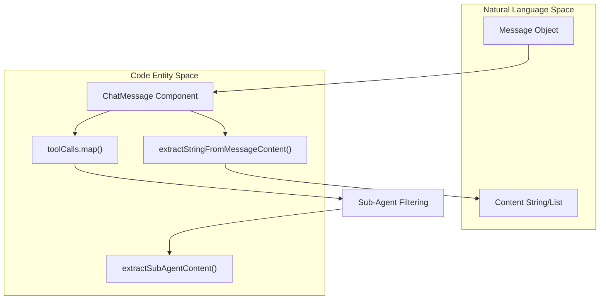

<!-- source: DeepWiki mcp.deepwiki.com · repo langchain-ai/deep-agents-ui · page 4.3 Message Processing and Display · fetched 2026-10-26 -->

# Message Processing and Display

<details>
<summary>Relevant source files</summary>

The following files were used as context for generating this wiki page:

- [postcss.config.cjs](postcss.config.cjs)
- [src/app/components/ChatMessage.tsx](src/app/components/ChatMessage.tsx)
- [src/app/components/MarkdownContent.tsx](src/app/components/MarkdownContent.tsx)
- [src/app/hooks/useThreads.ts](src/app/hooks/useThreads.ts)

</details>


The `ChatMessage` component is the primary unit for rendering agentic interactions. It handles the transformation of raw LangGraph `Message` objects into structured UI elements, including markdown text, executable tool calls, and nested sub-agent workflows.

## Message Processing Logic

The component distinguishes between human and AI messages, applying different layout strategies and content extraction methods.

### Data Flow and Extraction



**Content Extraction**
The component utilizes utility functions to normalize message content. `extractStringFromMessageContent` handles both simple strings and complex content arrays from the LangChain SDK [src/app/components/ChatMessage.tsx:45]().

Sources: [src/app/components/ChatMessage.tsx:14-17](), [src/app/components/ChatMessage.tsx:44-46]()

## Rendering Different Message Types

### 1. Human (User) Messages
User messages are right-aligned and styled with a distinct background color defined by the CSS variable `--color-user-message-bg` [src/app/components/ChatMessage.tsx:111](). They render raw text with preserved whitespace [src/app/components/ChatMessage.tsx:116]().

### 2. AI (Assistant) Messages
Assistant messages are left-aligned and process their content through the `MarkdownContent` component [src/app/components/ChatMessage.tsx:120]().

| Feature | User Message | Assistant Message |
| :--- | :--- | :--- |
| **Alignment** | `flex-row-reverse` [src/app/components/ChatMessage.tsx:91]() | Default (left) [src/app/components/ChatMessage.tsx:89]() |
| **Width** | `max-w-[70%]` [src/app/components/ChatMessage.tsx:97]() | `w-full` [src/app/components/ChatMessage.tsx:97]() |
| **Content Type** | `whitespace-pre-wrap` [src/app/components/ChatMessage.tsx:116]() | `MarkdownContent` [src/app/components/ChatMessage.tsx:120]() |
| **Background** | `var(--color-user-message-bg)` [src/app/components/ChatMessage.tsx:111]() | Transparent/Inherit [src/app/components/ChatMessage.tsx:107]() |

Sources: [src/app/components/ChatMessage.tsx:88-124]()

## Tool Call Visualization

The component iterates through `toolCalls` to render specialized UI components. It filters out internal orchestration tools (like `task`) from the standard tool list to prevent redundant display [src/app/components/ChatMessage.tsx:128]().

```mermaid
graph LR
    subgraph "Code Entity Space"
        ToolArray["toolCalls[]"]
        ToolCallBox["ToolCallBox"]
        ActionReq["actionRequestsMap"]
        ReviewCfg["reviewConfigsMap"]
    end

    ToolArray -->|filter: name != 'task'| ToolCallBox
    ActionReq -->|get(tool.name)| ToolCallBox
    ReviewCfg -->|get(tool.name)| ToolCallBox
```

**Tool Call Configuration**
For each tool call, the component lookups associated metadata:
- **UI Components**: Matches `tool_call_id` from the `ui` stream [src/app/components/ChatMessage.tsx:129-131]().
- **Action/Review**: Maps tool names to specific `ActionRequest` or `ReviewConfig` objects to handle human-in-the-loop requirements [src/app/components/ChatMessage.tsx:132-133]().

Sources: [src/app/components/ChatMessage.tsx:125-149]()

## Sub-Agent Workflows

Sub-agents are identified within the `toolCalls` array where the tool name is `task` and a `subagent_type` argument is present [src/app/components/ChatMessage.tsx:50-57]().

### Sub-Agent Data Transformation
The component uses `useMemo` to transform tool calls into `SubAgent` objects:
- **ID**: The tool call ID [src/app/components/ChatMessage.tsx:63]().
- **Input/Output**: Extracted from `toolCall.args` and `toolCall.result` [src/app/components/ChatMessage.tsx:66-67]().
- **Status**: Reflects the current execution state of the sub-task [src/app/components/ChatMessage.tsx:68]().

### Display and Interaction
Sub-agents are rendered using the `SubAgentIndicator` component [src/app/components/ChatMessage.tsx:159](). Users can toggle the visibility of sub-agent details (Input/Output) via a local state `expandedSubAgents` [src/app/components/ChatMessage.tsx:73-85]().

Sources: [src/app/components/ChatMessage.tsx:48-71](), [src/app/components/ChatMessage.tsx:150-193]()

## Markdown and Code Syntax
The `MarkdownContent` component provides high-fidelity rendering for AI responses:
- **GFM Support**: Uses `remark-gfm` for tables and task lists [src/app/components/MarkdownContent.tsx:25]().
- **Syntax Highlighting**: Implements `react-syntax-highlighter` with the `oneDark` theme for code blocks [src/app/components/MarkdownContent.tsx:39-41]().
- **Custom Primitives**: Overrides default HTML elements (like `<a>`, `<table>`, `<blockquote>`) to match the application's design system [src/app/components/MarkdownContent.tsx:78-125]().

Sources: [src/app/components/MarkdownContent.tsx:15-133]()

---

