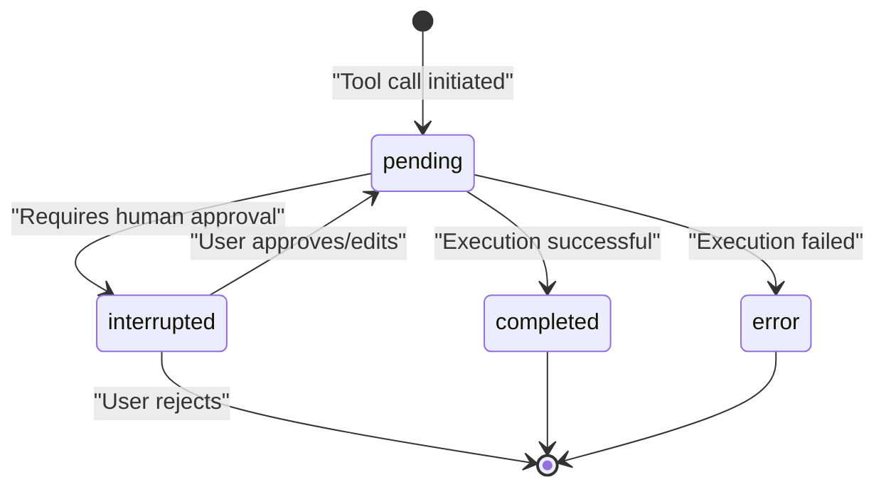
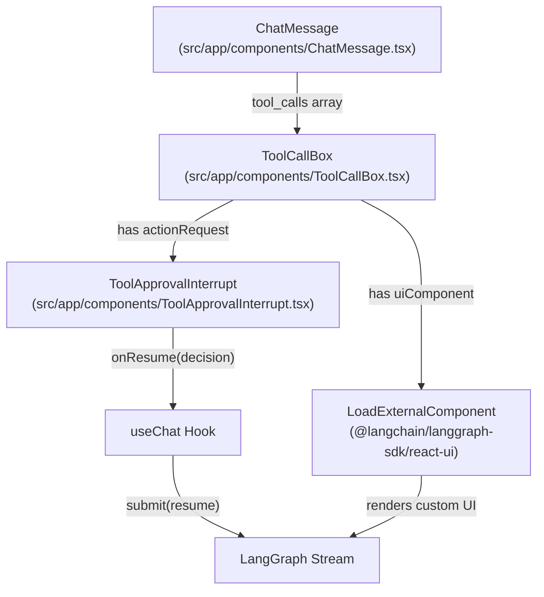
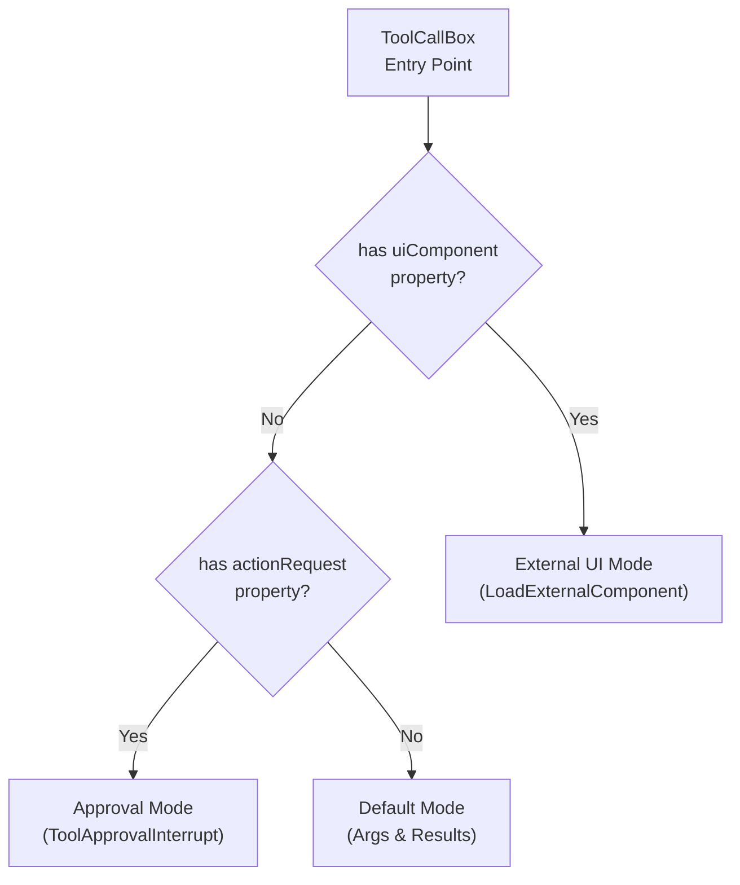
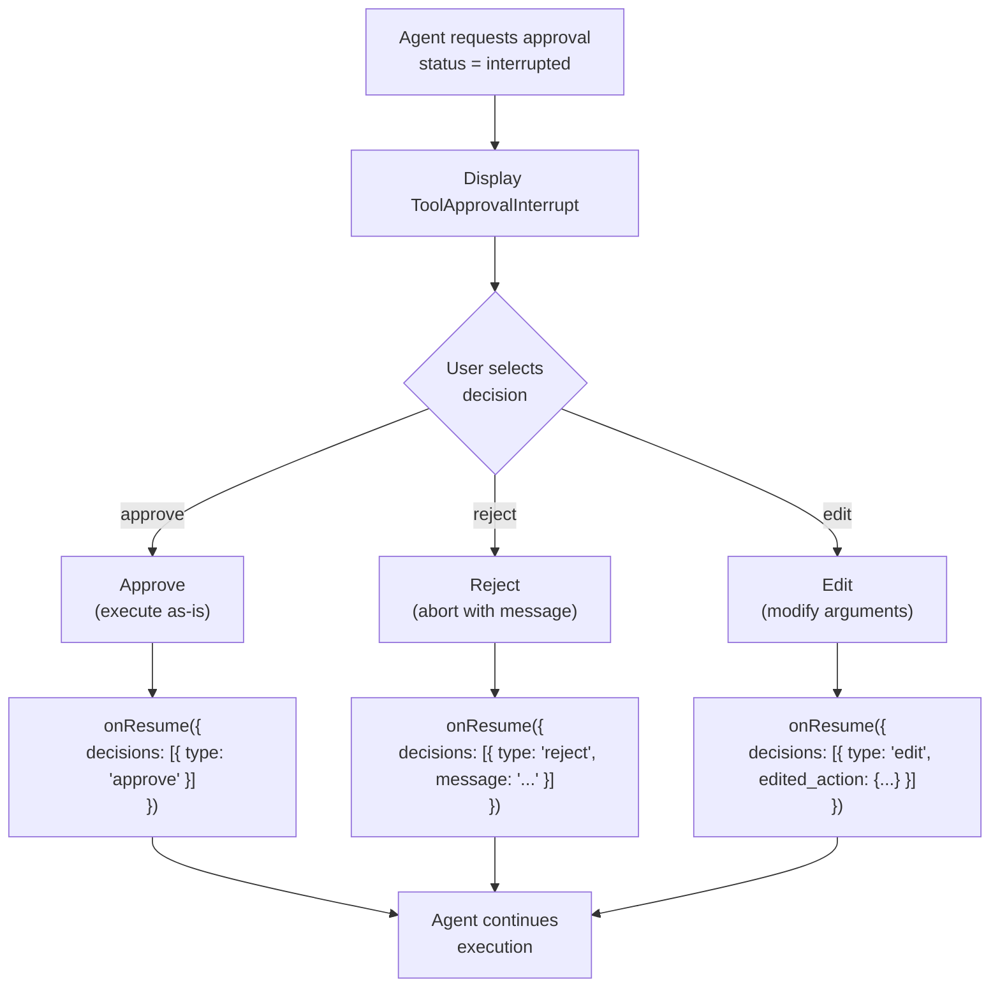
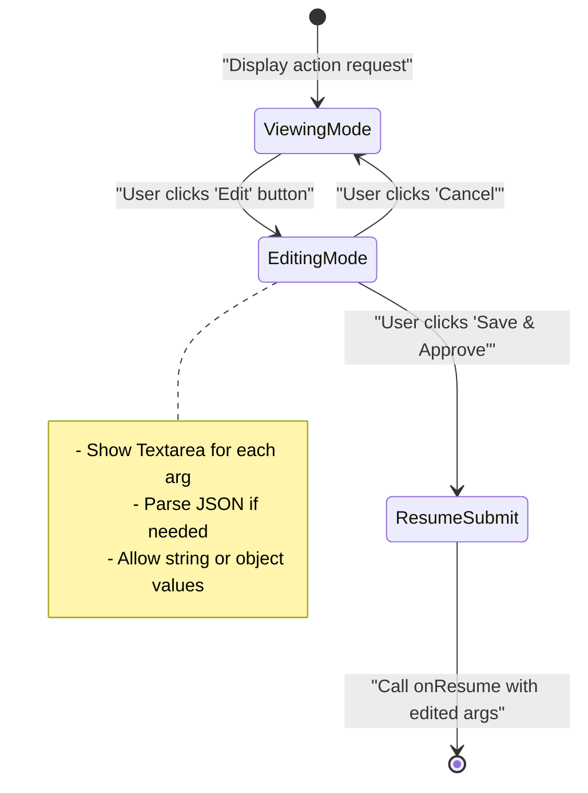

<!-- source: DeepWiki mcp.deepwiki.com · repo langchain-ai/deep-agents-ui · page 5 Agent Tools and Execution · fetched 2026-10-26 -->

# Agent Tools and Execution

<details>
<summary>Relevant source files</summary>

The following files were used as context for generating this wiki page:

- [src/app/components/ToolApprovalInterrupt.tsx](src/app/components/ToolApprovalInterrupt.tsx)
- [src/app/components/ToolCallBox.tsx](src/app/components/ToolCallBox.tsx)

</details>


## Purpose and Scope

This page explains how the Deep Agents UI visualizes tool execution and implements human-in-the-loop approval mechanisms for agent actions. Tool calls represent discrete operations that LangGraph agents perform during execution, such as searching the web, reading files, or executing code. This page covers the tool execution lifecycle, visualization components, and approval workflows.

For information about how tool calls are embedded within chat messages, see [Message Processing and Display](#4.3). For details about how tool call data streams from the backend, see [useChat Hook](#4.2). Detailed documentation of individual components is provided in [Tool Call Visualization](#5.1) and [Tool Approval and Interrupts](#5.2).

## Tool Execution Lifecycle

Tool execution in the Deep Agents UI follows a well-defined state machine. Each tool call progresses through states that reflect its execution status:



**Tool Call States**

| State | Description | Visual Indicator | User Actions |
|-------|-------------|------------------|--------------|
| `pending` | Tool is currently executing | `Loader2` spinning icon | None (wait) |
| `completed` | Tool executed successfully | `CircleCheckBigIcon` | Can view args/results |
| `error` | Tool execution failed | `AlertCircle` icon | Can view error details |
| `interrupted` | Waiting for user approval | `StopCircle` icon | Approve, reject, or edit |

Sources: [src/app/components/ToolCallBox.tsx:57-90]()

## Architecture Overview

The tool execution system consists of three primary components that work together to display tool calls and handle approvals:



**Component Responsibilities:**

- **ToolCallBox**: Container component that displays tool execution details and routes to appropriate display mode based on available data (external UI, approval interface, or default args/results view) [src/app/components/ToolCallBox.tsx:30-40]().
- **ToolApprovalInterrupt**: Specialized component for human-in-the-loop approval, providing approve/reject/edit actions [src/app/components/ToolApprovalInterrupt.tsx:17-22]().
- **LoadExternalComponent**: LangChain SDK component that renders custom UI components from the agent's graph definition (GenUI) [src/app/components/ToolCallBox.tsx:147-153]().

Sources: [src/app/components/ToolCallBox.tsx:19-28](), [src/app/components/ToolApprovalInterrupt.tsx:10-15]()

## Tool Call Data Structure

Tool calls are represented by the `ToolCall` interface, which contains all information about a tool's execution:

```typescript
interface ToolCall {
  name: string;           // Tool identifier (e.g., "search_web", "read_file")
  args: Record<string, unknown>;  // Input parameters
  result?: unknown;       // Execution result (present when completed)
  status?: "pending" | "completed" | "error" | "interrupted";
}
```

When a tool requires human approval, additional metadata is provided via `ActionRequest` and `ReviewConfig`:

```typescript
interface ActionRequest {
  name: string;           // Tool name requiring approval
  args: Record<string, unknown>;  // Proposed arguments
  description?: string;   // Human-readable explanation
}

interface ReviewConfig {
  allowedDecisions: Array<"approve" | "reject" | "edit">;
}
```

Sources: [src/app/types/types.ts]() (referenced in [src/app/components/ToolCallBox.tsx:14]())

## Tool Display Modes

The `ToolCallBox` component supports three distinct display modes, selected automatically based on available data:



| Display Mode | Condition | Purpose | Implementation |
|--------------|-----------|---------|----------------|
| **External UI Mode** | `uiComponent` present | Render custom agent-defined UI (GenUI) | Uses `LoadExternalComponent` from SDK [src/app/components/ToolCallBox.tsx:147]() |
| **Approval Mode** | `actionRequest` present | Show human-in-the-loop approval interface | Renders `ToolApprovalInterrupt` [src/app/components/ToolCallBox.tsx:158]() |
| **Default Mode** | No special properties | Display standard args/results view | Built-in expandable args/results display [src/app/components/ToolCallBox.tsx:167]() |

Sources: [src/app/components/ToolCallBox.tsx:143-224]()

## Tool Call Visualization

The `ToolCallBox` component provides a collapsible interface for viewing tool execution details. By default, it auto-expands when external UI or approval is required (`!!uiComponent || !!actionRequest`), otherwise users can manually expand it to view arguments and results.

**Key Features:**

1. **Status Indicators**: Visual icons (`CircleCheckBigIcon`, `AlertCircle`, `Loader2`, `StopCircle`) communicate execution state at a glance [src/app/components/ToolCallBox.tsx:57-90]().
2. **Collapsible Design**: Minimizes screen space when details aren't needed via `setIsExpanded` [src/app/components/ToolCallBox.tsx:92-94]().
3. **Argument Inspection**: Each argument can be individually expanded for large payloads using `toggleArgExpanded` [src/app/components/ToolCallBox.tsx:96-101]().
4. **Result Display**: Shows execution results formatted as JSON or plain text [src/app/components/ToolCallBox.tsx:209-220]().

The component uses React hooks to manage expansion state independently for the main content and individual arguments, preventing unnecessary re-renders.

Sources: [src/app/components/ToolCallBox.tsx:41-101](), [src/app/components/ToolCallBox.tsx:167-208]()

## Human-in-the-Loop Approval

When agents request permission before executing sensitive operations, the tool enters the `interrupted` state and displays the `ToolApprovalInterrupt` interface.

**Approval Workflow:**



**Decision Types:**

1. **Approve**: Execute the tool with proposed arguments unchanged [src/app/components/ToolApprovalInterrupt.tsx:34-38]().
2. **Reject**: Abort the tool execution and provide feedback to the agent via `rejectionMessage` [src/app/components/ToolApprovalInterrupt.tsx:40-64]().
3. **Edit**: Modify tool arguments before execution using `editedArgs` [src/app/components/ToolApprovalInterrupt.tsx:66-82]().

The `ReviewConfig` interface allows backend agents to constrain which decisions users can make for specific tools via `allowedDecisions` [src/app/components/ToolApprovalInterrupt.tsx:28-32]().

Sources: [src/app/components/ToolApprovalInterrupt.tsx:28-82]()

## Editing Tool Arguments

When users choose to edit a tool's arguments, the approval interface transitions to an editing mode with dedicated `Textarea` components for each argument:



The edit flow includes intelligent value parsing in `updateEditedArg`: if a user enters valid JSON (objects or arrays), the component parses it; otherwise, it treats the input as a plain string [src/app/components/ToolApprovalInterrupt.tsx:95-105]().

Sources: [src/app/components/ToolApprovalInterrupt.tsx:84-105](), [src/app/components/ToolApprovalInterrupt.tsx:138-169]()

## External UI Components (GenUI)

LangGraph agents can define custom UI components that render alongside tool calls, known as Generative UI (GenUI). When a tool call includes a `uiComponent` property, the `ToolCallBox` delegates rendering to the LangChain SDK's `LoadExternalComponent` [src/app/components/ToolCallBox.tsx:145-154]().

**LoadExternalComponent Properties:**

- `stream`: The active LangGraph stream instance [src/app/components/ToolCallBox.tsx:149]().
- `message`: The UI component message (`uiComponent`) from the agent [src/app/components/ToolCallBox.tsx:150]().
- `namespace`: The `graphId` for component scoping [src/app/components/ToolCallBox.tsx:151]().
- `meta`: Additional context including tool status, args, and results [src/app/components/ToolCallBox.tsx:152]().

This architecture enables agents to provide rich, interactive UI experiences without requiring UI changes to be deployed to the frontend application.

Sources: [src/app/components/ToolCallBox.tsx:145-154]()

## Integration with Chat System

Tool calls are embedded within chat messages and rendered as part of the message flow. Each `ChatMessage` component receives an array of tool calls and renders a `ToolCallBox` for each one.

When interrupts occur, the `useChat` hook extracts `ActionRequest` data from the interrupt state and passes it through the component hierarchy to enable the approval workflow. The `onResume` callback provided to `ToolCallBox` and `ToolApprovalInterrupt` is the primary mechanism for sending user decisions back to the LangGraph stream [src/app/components/ToolCallBox.tsx:26]().

Sources: [src/app/components/ToolCallBox.tsx:30-40](), [src/app/components/ToolApprovalInterrupt.tsx:17-22]()

---

