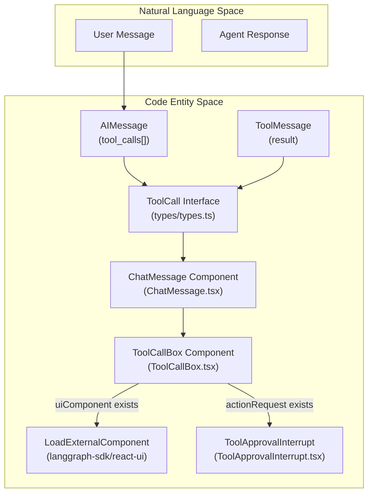
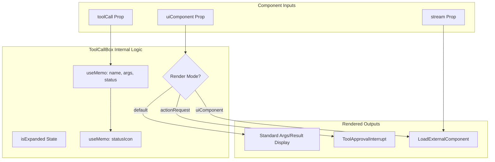

<!-- source: DeepWiki mcp.deepwiki.com · repo langchain-ai/deep-agents-ui · page 5.1 Tool Call Visualization · fetched 2026-10-26 -->

# Tool Call Visualization

<details>
<summary>Relevant source files</summary>

The following files were used as context for generating this wiki page:

- [src/app/components/ToolCallBox.tsx](src/app/components/ToolCallBox.tsx)

</details>


## Purpose and Scope

This document details how agent tool calls are visualized in the Deep Agents UI. It covers the `ToolCallBox` component, the `ToolCall` data structure, status icon rendering, argument and result display, and integration with external UI components streamed from the agent.

For information about the tool approval workflow and interrupt handling, see [Tool Approval and Interrupts](#5.2). For broader context on message processing, see [Message Processing and Display](#4.3).

---

## Overview

Tool call visualization transforms structured `ToolCall` objects into interactive, expandable UI elements that display tool execution details. The `ToolCallBox` component serves as the primary visualization layer, rendering tool names, execution status, arguments, results, and optionally custom UI components streamed from the agent.

The visualization system supports four rendering modes:
1. **External UI Components** - Custom components streamed via LangGraph's GenUI system.
2. **Tool Approval UI** - Manual approval interface for interrupted tools (delegates to `ToolApprovalInterrupt`).
3. **Standard Display** - Collapsible arguments and results for completed tools.
4. **Minimal Display** - Tool name and status icon only for tools with no content.

**Sources:** [src/app/components/ToolCallBox.tsx:1-40](), [src/app/components/ToolCallBox.tsx:145-224]()

---

## Tool Call Data Structure

The `ToolCall` interface defines the data contract for tool visualization:

| Field | Type | Description |
|-------|------|-------------|
| `id` | `string` | Unique identifier matching `tool_call_id` from LangGraph messages. |
| `name` | `string` | Tool name displayed to the user. |
| `args` | `Record<string, unknown>` | Tool input arguments. |
| `result` | `string \| unknown` (optional) | Tool execution result. |
| `status` | `"pending" \| "completed" \| "error" \| "interrupted"` | Execution status. |

The component extracts these fields in its memoized computation at [src/app/components/ToolCallBox.tsx:48-55]():

```typescript
const { name, args, result, status } = useMemo(() => {
  return {
    name: toolCall.name || "Unknown Tool",
    args: toolCall.args || {},
    result: toolCall.result,
    status: toolCall.status || "completed",
  };
}, [toolCall]);
```

The `status` field drives visual presentation:
- **`pending`** - Tool invoked but not yet executed (shows `Loader2` spinning icon).
- **`completed`** - Tool executed successfully, result available (shows `CircleCheckBigIcon`).
- **`error`** - Tool execution failed (shows `AlertCircle` in destructive color).
- **`interrupted`** - Tool execution paused, awaiting user approval (shows `StopCircle` in orange).

**Sources:** [src/app/components/ToolCallBox.tsx:14](), [src/app/components/ToolCallBox.tsx:48-90]()

---

## Data Flow: Messages to Visualization



**Diagram: Tool Call Data Flow from LangGraph Messages to UI Components**

Tool calls originate in AI messages as `tool_calls` arrays. The parent message processing layer extracts these calls, creates `ToolCall` objects, and matches them with results from subsequent Tool messages. The `ChatMessage` component passes each `ToolCall` object to a `ToolCallBox` instance, which uses `useMemo` hooks to optimize rendering of status icons and extracted fields.

**Sources:** [src/app/components/ToolCallBox.tsx:19-28](), [src/app/components/ToolCallBox.tsx:48-90](), [src/app/types/types.ts:1-7]()

---

## ToolCallBox Component Architecture

The `ToolCallBox` component ([src/app/components/ToolCallBox.tsx:30-231]()) is defined as a memoized functional component with the `ToolCallBoxProps` interface ([src/app/components/ToolCallBox.tsx:19-28]()):

| Prop | Type | Required | Description |
|------|------|----------|-------------|
| `toolCall` | `ToolCall` | Yes | Tool call data to visualize. |
| `uiComponent` | `any` | No | External UI component streamed from agent via GenUI. |
| `stream` | `any` | No | LangGraph stream for `LoadExternalComponent` rendering. |
| `graphId` | `string` | No | Graph namespace for loading external components. |
| `actionRequest` | `ActionRequest` | No | Action request for tool approval (interrupt state). |
| `reviewConfig` | `ReviewConfig` | No | Configuration for `ToolApprovalInterrupt` workflow. |
| `onResume` | `(value: any) => void` | No | Callback to resume interrupted execution. |
| `isLoading` | `boolean` | No | Loading state for approval actions. |



**Diagram: ToolCallBox Internal Structure and Component Routing**

The component uses React hooks for state management: `useState` for expansion state ([src/app/components/ToolCallBox.tsx:41-46]()), `useMemo` for derived values ([src/app/components/ToolCallBox.tsx:48-90]()), and `useCallback` for stable event handlers ([src/app/components/ToolCallBox.tsx:92-101]()). The rendering decision tree evaluates conditions in priority order: external UI → tool approval → standard display → minimal display.

**Sources:** [src/app/components/ToolCallBox.tsx:30-101](), [src/app/components/ToolCallBox.tsx:143-224]()

---

## Status Icon Visualization

The component maps each `status` value to a corresponding icon using a `useMemo` hook at [src/app/components/ToolCallBox.tsx:57-90]():

| Status | Icon Component | Visual Treatment | Code Location |
|--------|---------------|------------------|---------------|
| `pending` | `<Loader2 size={14} />` | `className="animate-spin"` | [src/app/components/ToolCallBox.tsx:69-74]() |
| `completed` | `<CircleCheckBigIcon />` | Default foreground color | [src/app/components/ToolCallBox.tsx:60]() |
| `error` | `<AlertCircle size={14} />` | `className="text-destructive"` | [src/app/components/ToolCallBox.tsx:62-67]() |
| `interrupted` | `<StopCircle size={14} />` | `className="text-orange-500"` | [src/app/components/ToolCallBox.tsx:76-80]() |
| Default | `<Terminal size={14} />` | `className="text-muted-foreground"` | [src/app/components/ToolCallBox.tsx:83-88]() |

The icon is rendered in the button alongside the tool name at [src/app/components/ToolCallBox.tsx:122-126]():

```typescript
<div className="flex items-center gap-2">
  {statusIcon}
  <span className="text-[15px] font-medium tracking-[-0.6px] text-foreground">
    {name}
  </span>
</div>
```

**Sources:** [src/app/components/ToolCallBox.tsx:57-90](), [src/app/components/ToolCallBox.tsx:122-126]()

---

## Content Rendering Modes

### External UI Component Rendering (GenUI)

When `uiComponent`, `stream`, and `graphId` are all provided ([src/app/components/ToolCallBox.tsx:145-154]()), the component renders a `LoadExternalComponent` from `@langchain/langgraph-sdk/react-ui` ([src/app/components/ToolCallBox.tsx:16]()):

```typescript
<LoadExternalComponent
  key={uiComponent.id}
  stream={stream}
  message={uiComponent}
  namespace={graphId}
  meta={{ status, args, result: result ?? "No Result Yet" }}
/>
```

This system allows agents to stream custom React components for rich, domain-specific visualizations. The `meta` object provides tool execution context to the external component.

**Sources:** [src/app/components/ToolCallBox.tsx:145-154](), [src/app/components/ToolCallBox.tsx:16]()

### Tool Approval UI

When `actionRequest` and `onResume` are provided without an external UI component ([src/app/components/ToolCallBox.tsx:155-164]()), the component renders the `ToolApprovalInterrupt` component ([src/app/components/ToolCallBox.tsx:17]()):

```typescript
<ToolApprovalInterrupt
  actionRequest={actionRequest}
  reviewConfig={reviewConfig}
  onResume={onResume}
  isLoading={isLoading}
/>
```

This mode handles **interrupted tool execution** requiring manual user approval. For detailed documentation of the approval workflow, see [Tool Approval and Interrupts](#5.2).

**Sources:** [src/app/components/ToolCallBox.tsx:155-164](), [src/app/components/ToolCallBox.tsx:17]()

### Standard Display: Arguments and Results

For tools without external UI or approval requirements, the component renders a standard collapsible view ([src/app/components/ToolCallBox.tsx:166-221]()):

*   **Arguments Section**: Checks `Object.keys(args).length > 0` ([src/app/components/ToolCallBox.tsx:167]()). Each argument is rendered as an independently collapsible section using `Object.entries(args).map()` ([src/app/components/ToolCallBox.tsx:173]()).
*   **Result Section**: If `result` is present ([src/app/components/ToolCallBox.tsx:209-220]()), it's rendered in a single non-collapsible pre-formatted block. String values are rendered directly, while objects are JSON stringified ([src/app/components/ToolCallBox.tsx:216-218]()).

**Sources:** [src/app/components/ToolCallBox.tsx:166-221]()

---

## Expansion Behavior

The component implements two-level expansion state management.

### Top-Level Expansion
The initial expansion state ([src/app/components/ToolCallBox.tsx:41-43]()) uses a function initializer to compute the default:
```typescript
const [isExpanded, setIsExpanded] = useState(
  () => !!uiComponent || !!actionRequest
);
```
Tools with external UI components or action requests default to expanded. The toggle button is disabled if `hasContent` is false ([src/app/components/ToolCallBox.tsx:119]()).

### Argument-Level Expansion
Each argument maintains independent expansion state in the `expandedArgs` record ([src/app/components/ToolCallBox.tsx:44-46]()). The `toggleArgExpanded` callback ([src/app/components/ToolCallBox.tsx:96-101]()) updates individual argument expansion, allowing users to selectively view specific parameters.

**Sources:** [src/app/components/ToolCallBox.tsx:41-46](), [src/app/components/ToolCallBox.tsx:92-101](), [src/app/components/ToolCallBox.tsx:119]()

---

## Performance Optimizations

The component employs React performance optimizations to minimize re-renders in chat interfaces:

1.  **`React.memo`**: The entire component is wrapped in `React.memo` to prevent re-renders when props haven't changed ([src/app/components/ToolCallBox.tsx:30]()).
2.  **`useMemo`**: Used for extracting tool call fields ([src/app/components/ToolCallBox.tsx:48-55]()) and computing the `statusIcon` ([src/app/components/ToolCallBox.tsx:57-90]()).
3.  **`useCallback`**: Used for `toggleExpanded` ([src/app/components/ToolCallBox.tsx:92-94]()) and `toggleArgExpanded` ([src/app/components/ToolCallBox.tsx:96-101]()) to maintain referential equality of event handlers.

**Sources:** [src/app/components/ToolCallBox.tsx:30-101]()

---

