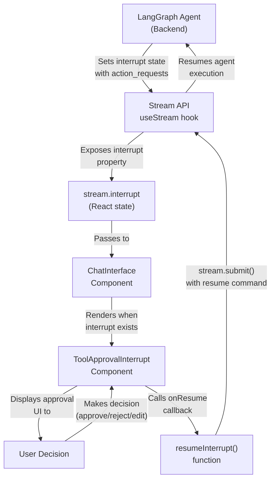
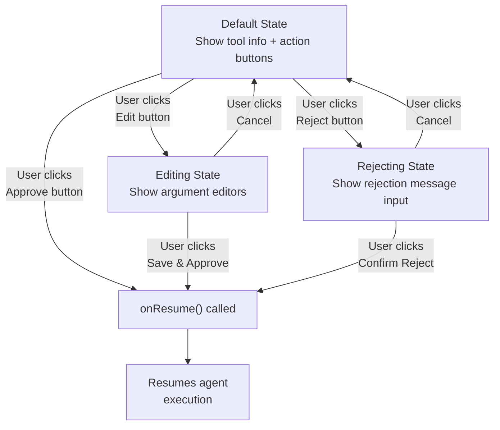
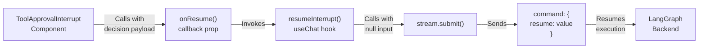
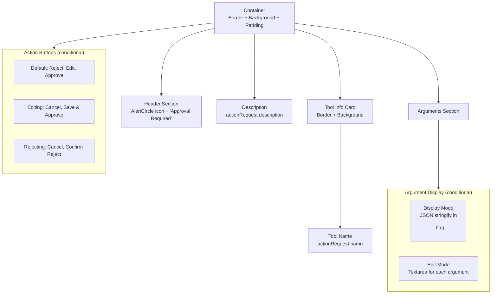
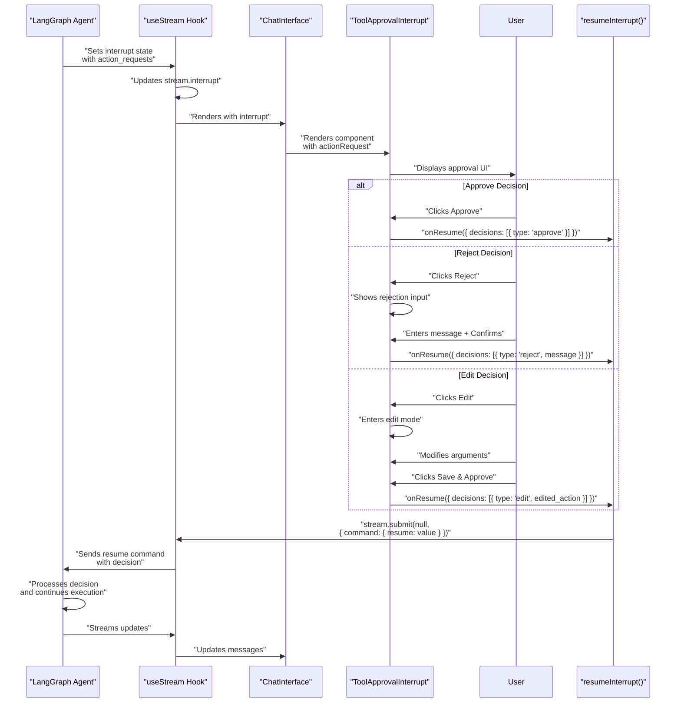
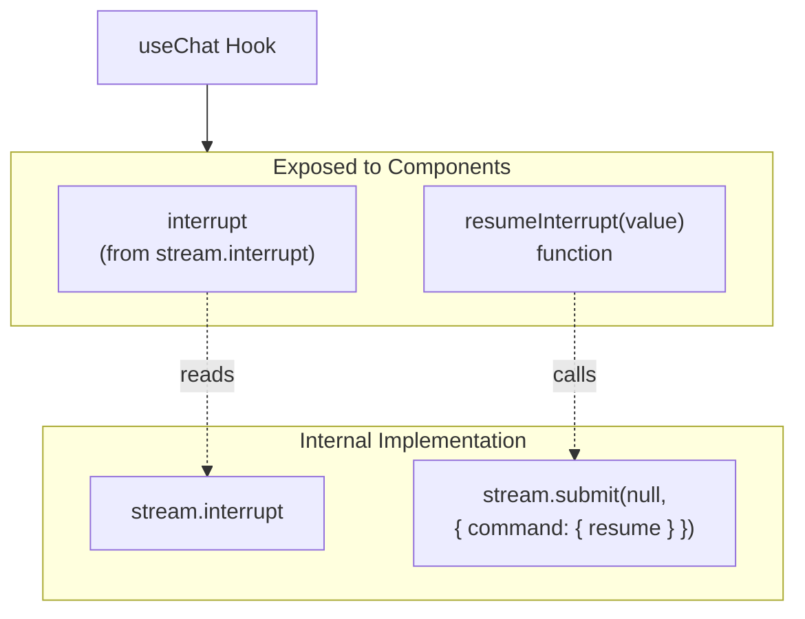

<!-- source: DeepWiki mcp.deepwiki.com · repo langchain-ai/deep-agents-ui · page 5.2 Tool Approval and Interrupts · fetched 2026-10-26 -->

# Tool Approval and Interrupts

<details>
<summary>Relevant source files</summary>

The following files were used as context for generating this wiki page:

- [src/app/components/ToolApprovalInterrupt.tsx](src/app/components/ToolApprovalInterrupt.tsx)
- [src/app/hooks/useChat.ts](src/app/hooks/useChat.ts)
- [src/app/utils/utils.ts](src/app/utils/utils.ts)

</details>


## Purpose and Scope

This document explains the human-in-the-loop approval mechanism for tool execution in Deep Agents UI. When a LangGraph agent requires user approval before executing a tool, the system enters an interrupt state that pauses execution and displays approval UI to the user. This page covers the interrupt data structure, the `ToolApprovalInterrupt` component, decision types (approve, reject, edit), and the resume workflow.

For information about how tool calls are displayed after execution, see [Tool Call Visualization](#5.1). For the general streaming communication mechanism, see [useChat Hook](#4.2).

## Interrupt Mechanism Overview

The interrupt mechanism allows agents to pause execution and request human approval before performing potentially sensitive operations. The interrupt state is managed by the LangGraph backend and communicated to the UI through the streaming API.

### Interrupt Data Flow



Sources: [src/app/hooks/useChat.ts:135-142](), [src/app/components/ToolApprovalInterrupt.tsx:1-28]()

The interrupt object is exposed through the `stream.interrupt` property from the `useStream` hook and passed down through the component hierarchy. When an interrupt exists, the UI displays the `ToolApprovalInterrupt` component instead of normal message flow.

## Interrupt State Structure

The interrupt state contains action requests that require approval. Each action request describes a tool call that the agent wants to execute.

### ActionRequest Interface

| Field | Type | Description |
|-------|------|-------------|
| `name` | `string` | The name of the tool to be executed |
| `args` | `Record<string, unknown>` | The arguments to pass to the tool |
| `description` | `string` (optional) | Human-readable description of what the action will do |

### ReviewConfig Interface

| Field | Type | Description |
|-------|------|-------------|
| `allowedDecisions` | `string[]` | Array of allowed decision types, defaults to `["approve", "reject", "edit"]` |

Sources: [src/app/components/ToolApprovalInterrupt.tsx:7-15](), [src/app/components/ToolApprovalInterrupt.tsx:28-32]()

## ToolApprovalInterrupt Component

The `ToolApprovalInterrupt` component renders the approval UI when an interrupt occurs. It displays the tool information, allows users to make decisions, and handles the workflow for each decision type.

### Component Props

```typescript
interface ToolApprovalInterruptProps {
  actionRequest: ActionRequest;      // The tool call requiring approval
  reviewConfig?: ReviewConfig;       // Configuration for allowed decisions
  onResume: (value: any) => void;    // Callback to resume execution
  isLoading?: boolean;               // Loading state during submission
}
```

Sources: [src/app/components/ToolApprovalInterrupt.tsx:10-15]()

### Component State Management



Sources: [src/app/components/ToolApprovalInterrupt.tsx:23-26](), [src/app/components/ToolApprovalInterrupt.tsx:84-105]()

The component maintains internal state for:
- `rejectionMessage` - Optional message explaining rejection [src/app/components/ToolApprovalInterrupt.tsx:23-23]()
- `isEditing` - Boolean indicating edit mode is active [src/app/components/ToolApprovalInterrupt.tsx:24-24]()
- `editedArgs` - Modified arguments when editing [src/app/components/ToolApprovalInterrupt.tsx:25-25]()
- `showRejectionInput` - Boolean showing rejection message input [src/app/components/ToolApprovalInterrupt.tsx:26-26]()

## Decision Types

The component supports three decision types that users can make when reviewing a tool call. The available decisions can be configured through the `reviewConfig.allowedDecisions` property.

### Approve Decision

Approves the tool call with its original arguments, allowing the agent to execute the tool immediately.

**Payload Structure:**
```json
{
  "decisions": [
    {
      "type": "approve"
    }
  ]
}
```

**Implementation:**
The `handleApprove` function [src/app/components/ToolApprovalInterrupt.tsx:34-38]() sends this payload when the user clicks the Approve button.

### Reject Decision

Rejects the tool call and optionally provides a message explaining why. The agent will receive the rejection and can adjust its approach.

**Payload Structure:**
```json
{
  "decisions": [
    {
      "type": "reject",
      "message": "Optional rejection reason"
    }
  ]
}
```

**Implementation:**
The `handleReject` and `handleRejectConfirm` functions [src/app/components/ToolApprovalInterrupt.tsx:40-64]() handle the two-step rejection flow: first showing the rejection message input, then confirming and sending the decision.

### Edit Decision

Allows the user to modify the tool arguments before approval. The edited arguments are sent to the agent, which will execute the tool with the modified values.

**Payload Structure:**
```json
{
  "decisions": [
    {
      "type": "edit",
      "edited_action": {
        "name": "tool_name",
        "args": {
          "modified": "arguments"
        }
      }
    }
  ]
}
```

**Implementation:**
The editing flow [src/app/components/ToolApprovalInterrupt.tsx:66-105]() includes:
- `startEditing()` - Enters edit mode and clones current arguments [src/app/components/ToolApprovalInterrupt.tsx:84-88]()
- `updateEditedArg()` - Updates individual argument values with JSON parsing support [src/app/components/ToolApprovalInterrupt.tsx:95-105]()
- `handleEdit()` - Sends the edited decision payload [src/app/components/ToolApprovalInterrupt.tsx:66-82]()
- `cancelEditing()` - Returns to default state without changes [src/app/components/ToolApprovalInterrupt.tsx:90-93]()

Sources: [src/app/components/ToolApprovalInterrupt.tsx:34-105]()

## Resume Execution Flow

After the user makes a decision, the `onResume` callback is invoked with the decision payload. This callback is connected to the `resumeInterrupt` function from the `useChat` hook.

### resumeInterrupt Function



Sources: [src/app/hooks/useChat.ts:135-142]()

The `resumeInterrupt` function implementation [src/app/hooks/useChat.ts:135-142]():

```typescript
const resumeInterrupt = useCallback(
  (value: any) => {
    stream.submit(null, { command: { resume: value } });
    // Update thread list when resuming from interrupt
    onHistoryRevalidate?.();
  },
  [stream, onHistoryRevalidate]
);
```

**Key Points:**
- Takes any decision payload as input.
- Calls `stream.submit(null, ...)` with `null` as the first argument, indicating no new message is being submitted [src/app/hooks/useChat.ts:137-137]().
- Passes the decision payload through the `command.resume` property [src/app/hooks/useChat.ts:137-137]().
- Triggers thread list revalidation after resuming [src/app/hooks/useChat.ts:139-139]().

Sources: [src/app/hooks/useChat.ts:135-142]()

## UI Layout and Styling

The `ToolApprovalInterrupt` component renders a bordered card with distinct sections for tool information, arguments, and action buttons.

### Component Structure



Sources: [src/app/components/ToolApprovalInterrupt.tsx:107-200]()

### Key UI Elements

| Element | Location | Description |
|---------|----------|-------------|
| Header | Lines 110-118 | Yellow alert icon with "Approval Required" label |
| Description | Lines 121-125 | Optional description text from `actionRequest.description` |
| Tool Name | Lines 129-136 | Monospace font displaying `actionRequest.name` |
| Arguments Display | Lines 171-178 | JSON-formatted arguments in code block |
| Arguments Editor | Lines 138-169 | Textarea inputs for each argument when editing |
| Rejection Input | Lines 183-197 | Textarea for optional rejection message |
| Action Buttons | Lines 200-220 | Context-sensitive buttons based on current state |

Sources: [src/app/components/ToolApprovalInterrupt.tsx:107-220]()

## Complete Interrupt/Resume Workflow

The following sequence diagram shows the complete flow from agent interrupt to user decision and execution resume.



Sources: [src/app/hooks/useChat.ts:135-142](), [src/app/components/ToolApprovalInterrupt.tsx:34-105]()

## Integration with useChat Hook

The `useChat` hook exposes both the interrupt state and the resume function, creating a complete interrupt/resume cycle.

### Exposed Properties and Functions



**Usage Pattern:**
```typescript
const { interrupt, resumeInterrupt } = useChat({...});

// In ChatInterface (Conceptual)
{interrupt && (
  <ToolApprovalInterrupt 
    actionRequest={interrupt.value.action_requests[0]}
    onResume={resumeInterrupt}
  />
)}
```

Sources: [src/app/hooks/useChat.ts:158-158](), [src/app/hooks/useChat.ts:165-165](), [src/app/hooks/useChat.ts:135-142]()

## Argument Editing Details

The edit functionality supports modifying complex argument values, including nested objects and arrays, with automatic JSON parsing.

### Argument Update Logic

The `updateEditedArg` function [src/app/components/ToolApprovalInterrupt.tsx:95-105]() handles argument modifications:

1. **String Detection**: If the input starts with `{` or `[`, attempts JSON parsing [src/app/components/ToolApprovalInterrupt.tsx:98-99]().
2. **Parse Success**: Stores the parsed object/array [src/app/components/ToolApprovalInterrupt.tsx:101-101]().
3. **Parse Failure**: Stores the raw string value in the `catch` block [src/app/components/ToolApprovalInterrupt.tsx:103-103]().
4. **Type Preservation**: Maintains argument types when possible.

### Edit UI Layout

The edit mode displays a textarea for each argument [src/app/components/ToolApprovalInterrupt.tsx:138-169]():

- Label shows the argument key name [src/app/components/ToolApprovalInterrupt.tsx:146-148]().
- Textarea displays current value (stringified if object/array) [src/app/components/ToolApprovalInterrupt.tsx:150-158]().
- Textarea height adjusts based on value length (2 rows for short strings, 4 rows for longer content) [src/app/components/ToolApprovalInterrupt.tsx:161-163]().
- Monospace font for code-like appearance [src/app/components/ToolApprovalInterrupt.tsx:160-160]().
- Disabled state when `isLoading` is true [src/app/components/ToolApprovalInterrupt.tsx:164-164]().

Sources: [src/app/components/ToolApprovalInterrupt.tsx:95-105](), [src/app/components/ToolApprovalInterrupt.tsx:138-169]()

---

