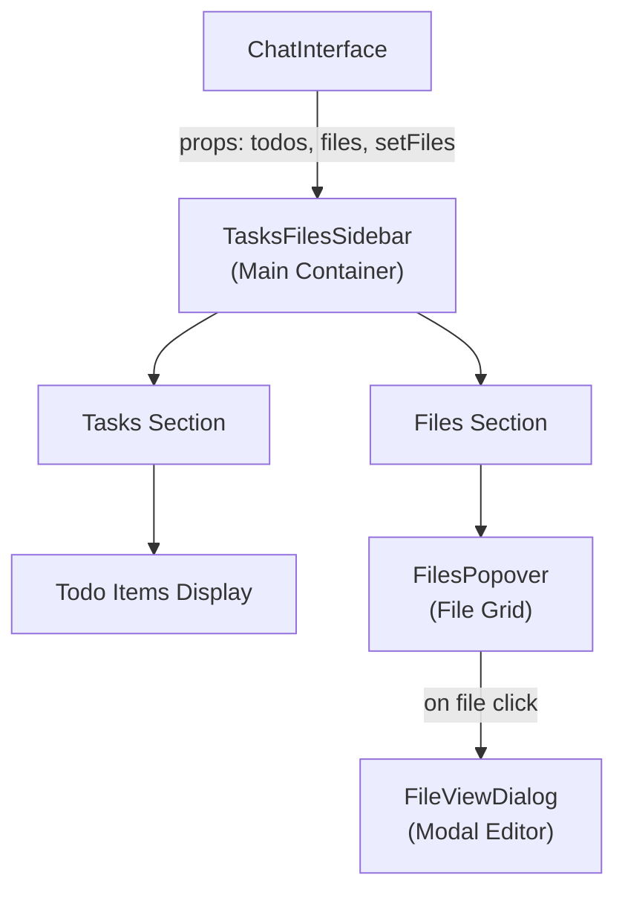
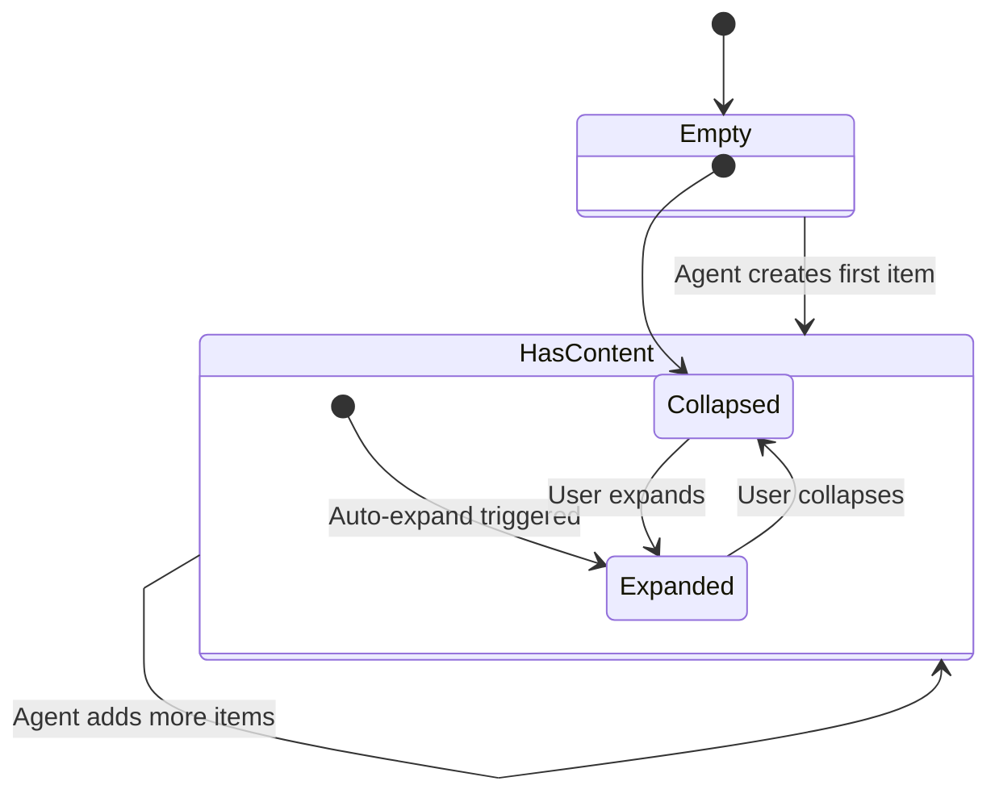
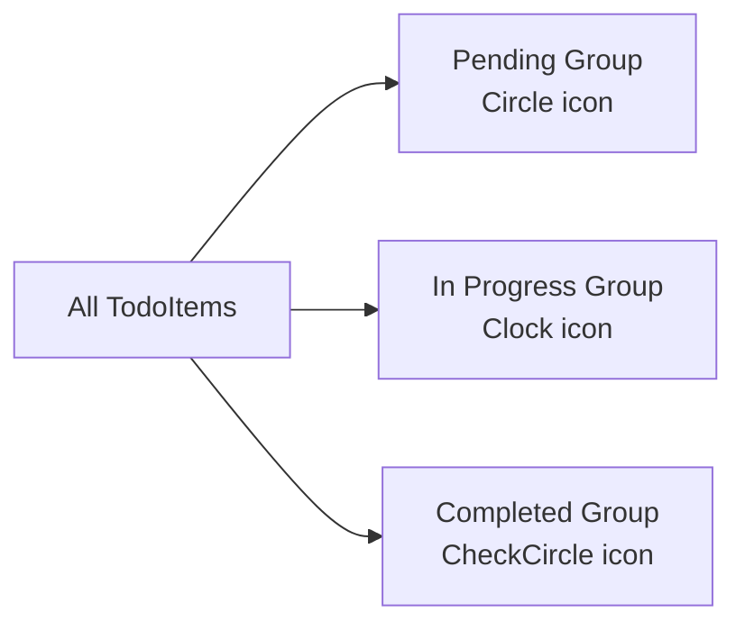
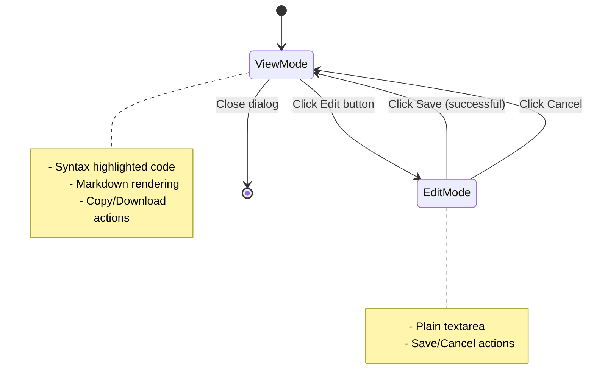

<!-- source: DeepWiki mcp.deepwiki.com · repo langchain-ai/deep-agents-ui · page 6 Files and Tasks · fetched 2026-10-26 -->

# Files and Tasks

<details>
<summary>Relevant source files</summary>

The following files were used as context for generating this wiki page:

- [src/app/components/FileViewDialog.tsx](src/app/components/FileViewDialog.tsx)
- [src/app/components/SubAgentIndicator.tsx](src/app/components/SubAgentIndicator.tsx)
- [src/app/components/TasksFilesSidebar.tsx](src/app/components/TasksFilesSidebar.tsx)

</details>


## Purpose and Scope

This document describes the file management and task tracking systems in the Deep Agents UI. These systems provide visual representations of agent-generated files and task lists (todos), allowing users to view, edit, and monitor agent work products in real-time. The `TasksFilesSidebar` component displays both systems in a collapsible sidebar adjacent to the chat interface.

For information about how files and tasks are updated during agent execution, see [useChat Hook](#4.2). For details on the chat interface that contains this sidebar, see [ChatInterface Component](#4.1).

**Sources:** [src/app/components/TasksFilesSidebar.tsx:1-267]()

---

## Component Architecture

The files and tasks system consists of three primary components that work together to provide a complete file and task management interface:

### Component Hierarchy Diagram



**Sources:** [src/app/components/TasksFilesSidebar.tsx:114-267](), [src/app/components/FileViewDialog.tsx:53-297]()

---

## TasksFilesSidebar Component

The `TasksFilesSidebar` is the main container component that manages the display of both agent tasks and files. It receives data from the chat context and provides collapsible sections for each type of content.

### Component Props and State

| Prop | Type | Description |
|------|------|-------------|
| `todos` | `TodoItem[]` | Array of task items with status [src/app/types/types.ts]() |
| `files` | `Record<string, string>` | Key-value pairs of file paths to content |
| `setFiles` | `(files: Record<string, string>) => Promise<void>` | Function to update file state |

**Internal State:**
- `tasksOpen`: `boolean` - Controls tasks section expansion [src/app/components/TasksFilesSidebar.tsx:120]()
- `filesOpen`: `boolean` - Controls files section expansion [src/app/components/TasksFilesSidebar.tsx:121]()
- `prevTodosCount`: `useRef<number>` - Tracks previous todo count for auto-expansion [src/app/components/TasksFilesSidebar.tsx:124]()
- `prevFilesCount`: `useRef<number>` - Tracks previous file count for auto-expansion [src/app/components/TasksFilesSidebar.tsx:125]()

**Sources:** [src/app/components/TasksFilesSidebar.tsx:114-127]()

### Auto-Expansion Behavior

The sidebar automatically expands sections when content transitions from empty to populated, providing immediate visibility of new agent work products:



**Implementation:** The component tracks previous counts using refs and triggers expansion when count transitions from 0 to positive:

```typescript
// Auto-expand when todos go from empty to having content
useEffect(() => {
  if (prevTodosCount.current === 0 && todos.length > 0) {
    setTasksOpen(true);
  }
  prevTodosCount.current = todos.length;
}, [todos.length]);
```

**Sources:** [src/app/components/TasksFilesSidebar.tsx:124-142]()

---

## Task Display System

### TodoItem Type Structure

The `TodoItem` interface defines the structure of agent-generated tasks:

| Field | Type | Description |
|-------|------|-------------|
| `id` | `string` | Unique identifier for the task |
| `content` | `string` | Task description text |
| `status` | `"pending" \| "in_progress" \| "completed"` | Current task status |

**Sources:** [src/app/types/types.ts](), referenced in [src/app/components/TasksFilesSidebar.tsx:18]()

### Status Grouping and Icons

Tasks are grouped by status and displayed with distinct visual indicators:



**Status Icon Mapping:**

| Status | Icon Component | Visual Style |
|--------|---------------|--------------|
| `pending` | `Circle` | Hollow circle, tertiary color [src/app/components/TasksFilesSidebar.tsx:161-166]() |
| `in_progress` | `Clock` | Clock icon, warning color [src/app/components/TasksFilesSidebar.tsx:153-159]() |
| `completed` | `CheckCircle` | Filled check circle, success color [src/app/components/TasksFilesSidebar.tsx:146-152]() |

**Sources:** [src/app/components/TasksFilesSidebar.tsx:144-168](), [src/app/components/TasksFilesSidebar.tsx:170-182]()

---

## File Management System

### FilesPopover Component

The `FilesPopover` component renders a grid of file buttons that opens the file editor dialog when clicked. It handles different file content formats that may be received from the agent.

**File Content Normalization:**

The component handles two content formats:
1. **String format:** Direct string content [src/app/components/TasksFilesSidebar.tsx:66]()
2. **Object format:** `{ content: string[] | string }` - Content arrays are joined with newlines [src/app/components/TasksFilesSidebar.tsx:54-64]()

**Sources:** [src/app/components/TasksFilesSidebar.tsx:23-112](), [src/app/components/TasksFilesSidebar.tsx:49-68]()

### File Grid Layout

Files are displayed in a responsive CSS Grid with auto-fill columns:

```css
grid-cols-[repeat(auto-fill,minmax(256px,1fr))]
```

Each file button displays a `FileText` icon and the file path, with hover effects managed via CSS variables like `--color-file-button-hover`.

**Sources:** [src/app/components/TasksFilesSidebar.tsx:49-99]()

---

## FileViewDialog Component

The `FileViewDialog` provides a modal interface for viewing and editing files with syntax highlighting and markdown rendering capabilities.

### Dialog States and Modes



**Sources:** [src/app/components/FileViewDialog.tsx:53-297]()

### File Type Detection and Rendering

The dialog uses file extensions to determine the appropriate rendering strategy. The `LANGUAGE_MAP` constant maps extensions like `.py`, `.ts`, and `.json` to their respective Prism languages [src/app/components/FileViewDialog.tsx:17-51]().

**Special Rendering:**
- **Markdown:** Files with `.md` or `.markdown` extensions use the `MarkdownContent` component [src/app/components/FileViewDialog.tsx:86-88](), [src/app/components/FileViewDialog.tsx:218-222]().
- **Code:** Other recognized extensions use `SyntaxHighlighter` with the `oneDark` theme [src/app/components/FileViewDialog.tsx:224-241]().

**Sources:** [src/app/components/FileViewDialog.tsx:17-51](), [src/app/components/FileViewDialog.tsx:81-92](), [src/app/components/FileViewDialog.tsx:217-241]()

### File Operations

| Operation | Implementation |
|-----------|----------------|
| **Edit** | Switches `isEditingMode` to true [src/app/components/FileViewDialog.tsx:114-116]() |
| **Copy** | Uses `navigator.clipboard.writeText(fileContent)` [src/app/components/FileViewDialog.tsx:94-98]() |
| **Download** | Creates a `Blob` and triggers an `<a>` tag click [src/app/components/FileViewDialog.tsx:100-112]() |
| **Save** | Uses `useSWRMutation` to trigger `onSaveFile` [src/app/components/FileViewDialog.tsx:63-73]() |

**Sources:** [src/app/components/FileViewDialog.tsx:63-127]()

---

## Data Flow and State Management

### Integration with Chat Context

The `TasksFilesSidebar` component integrates with the `ChatProvider` context to access loading and interrupt states:

```typescript
const { isLoading, interrupt } = useChatContext();
```

These states control file editing capabilities via the `editDisabled` prop. Files cannot be edited when the agent is processing (`isLoading`) or awaiting user approval (`interrupt` is defined) [src/app/components/TasksFilesSidebar.tsx:257]().

**Sources:** [src/app/components/TasksFilesSidebar.tsx:119](), [src/app/components/TasksFilesSidebar.tsx:257]()

### File Update Implementation

When a file is saved in `FileViewDialog`, it triggers a callback chain:
1. `FileViewDialog` calls `onSaveFile` [src/app/components/FileViewDialog.tsx:67]().
2. `FilesPopover` handles this via `handleSaveFile`, which calls the `setFiles` prop [src/app/components/TasksFilesSidebar.tsx:34-40]().
3. `setFiles` (passed from `useChat`) updates the LangGraph thread state [src/app/components/TasksFilesSidebar.tsx:117]().

**Sources:** [src/app/components/FileViewDialog.tsx:63-73](), [src/app/components/TasksFilesSidebar.tsx:34-40](), [src/app/components/TasksFilesSidebar.tsx:117]()

---

