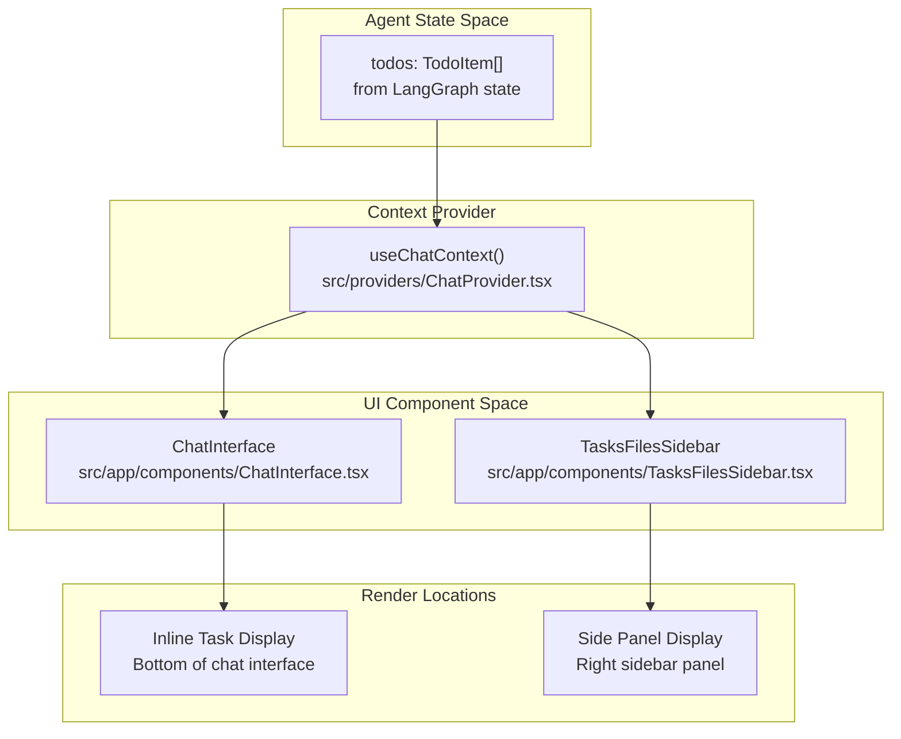
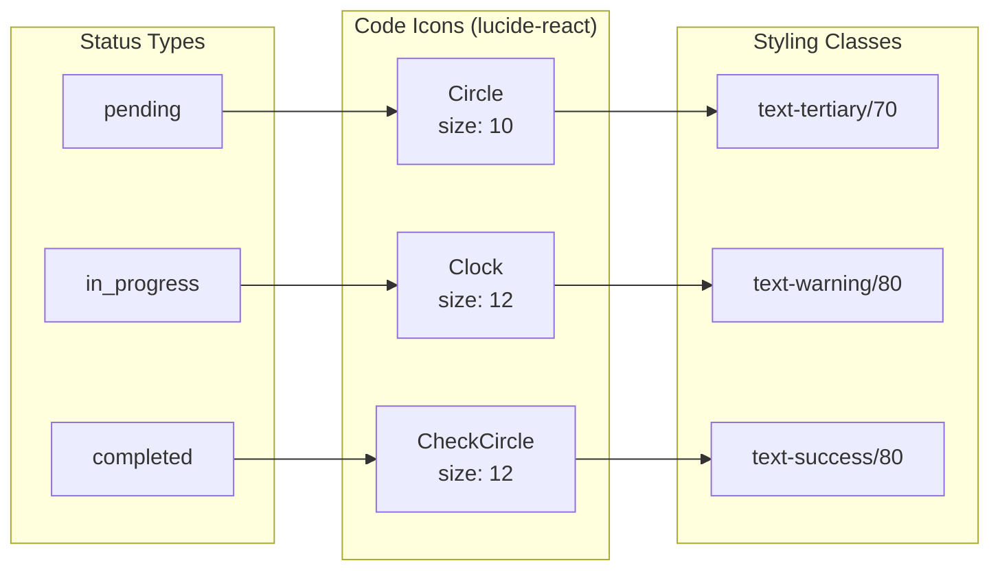
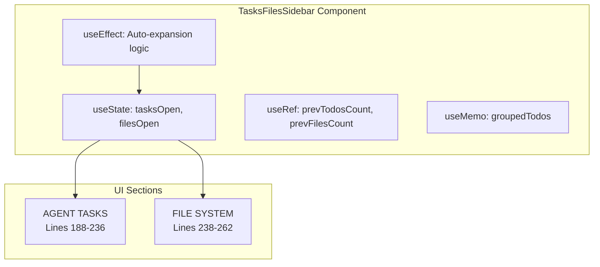

<!-- source: DeepWiki mcp.deepwiki.com · repo langchain-ai/deep-agents-ui · page 6.2 Task Sidebar · fetched 2026-10-26 -->

# Task Sidebar

<details>
<summary>Relevant source files</summary>

The following files were used as context for generating this wiki page:

- [src/app/components/TasksFilesSidebar.tsx](src/app/components/TasksFilesSidebar.tsx)

</details>


This document describes the task display and management functionality in Deep Agents UI, including the `TodoItem` data structure, task status visualization, and the two different UI locations where tasks are displayed: the inline task display within `ChatInterface` and the separate `TasksFilesSidebar` component. For information about file management in the sidebar, see [File Management](#6.1).

## Purpose and Scope

The task sidebar displays agent-generated tasks (todos) to users, showing their status and content. Tasks are streamed from the LangGraph agent execution and organized by status (pending, in_progress, completed). The system provides two distinct UI presentations for these tasks: an inline display within the chat interface and a dedicated sidebar panel. This document covers the `TodoItem` data structure, status management, grouping logic, auto-expansion behavior, and the implementation of both task display components.

**Sources:** [src/app/components/ChatInterface.tsx:1-546](), [src/app/components/TasksFilesSidebar.tsx:1-267](), [src/app/types/types.ts:23-28]()

## Task Data Structure

Tasks are represented by the `TodoItem` interface, which defines core properties used for tracking agent progress:

| Property | Type | Description |
|----------|------|-------------|
| `id` | `string` | Unique identifier for the task |
| `content` | `string` | Text description of the task |
| `status` | `"pending" \| "in_progress" \| "completed"` | Current execution status |
| `updatedAt` | `Date` (optional) | Timestamp of last update |

Tasks are streamed from the agent as part of the overall state updates and accessed via the `useChatContext` hook's `todos` property. The status field drives both the visual presentation (icon selection) and organizational grouping of tasks throughout the UI.

**Sources:** [src/app/types/types.ts:23-28](), [src/app/components/ChatInterface.tsx:72-85]()

## Task Display Architecture

The application provides two distinct locations for displaying tasks, each serving different user interaction patterns:



**Inline Task Display** appears at the bottom of the chat interface, above the message input field, and shows either a collapsed single-line summary or an expanded full task list.

**Side Panel Display** appears in the dedicated `TasksFilesSidebar` component, typically shown on the right side of the screen, with independent expand/collapse controls for the tasks section.

**Sources:** [src/app/components/ChatInterface.tsx:296-501](), [src/app/components/TasksFilesSidebar.tsx:184-236]()

## Status Management and Icons

Tasks are grouped by their status and displayed with corresponding status icons. The status determines both visual presentation and organizational structure:

### Status Icon Mapping



The `getStatusIcon` function in `TasksFilesSidebar` [src/app/components/TasksFilesSidebar.tsx:144-168]() maps status values to their respective icons with appropriate styling. A similar implementation exists in `ChatInterface` [src/app/components/ChatInterface.tsx:38-62]().

### Status Grouping Logic

Tasks are grouped into three categories for display using `useMemo` to optimize performance:

| Status Group | Filter Condition | Label |
|--------------|------------------|-------|
| `pending` | `status === "pending"` | Pending |
| `in_progress` | `status === "in_progress"` | In Progress |
| `completed` | `status === "completed"` | Completed |

**In TasksFilesSidebar:**
[src/app/components/TasksFilesSidebar.tsx:170-182]()
```typescript
const groupedTodos = useMemo(() => {
  return {
    pending: todos.filter((t) => t.status === "pending"),
    in_progress: todos.filter((t) => t.status === "in_progress"),
    completed: todos.filter((t) => t.status === "completed"),
  };
}, [todos]);
```

**Sources:** [src/app/components/ChatInterface.tsx:218-222](), [src/app/components/TasksFilesSidebar.tsx:170-182]()

## Inline Task Display (ChatInterface)

The inline task display within `ChatInterface` provides a compact view of tasks at the bottom of the chat interface. It supports two display modes controlled by the `metaOpen` state:

### Collapsed State Display

When `metaOpen` is `null`, the component renders a compact single-line summary [src/app/components/ChatInterface.tsx:300-379](). It calculates `totalTasks`, `remainingTasks`, and identifies the `activeTask` (the first one with `in_progress` status).

The view uses a grid layout with three columns `grid-cols-[auto_auto_1fr]` for icon, label, and content alignment.

### Expanded State Display

When `metaOpen === "tasks"`, the component renders the full task list grouped by status [src/app/components/ChatInterface.tsx:413-500](). This view includes a sticky header with tab buttons for Tasks and Files, and iterates over `groupedTodos` to render each section.

**Sources:** [src/app/components/ChatInterface.tsx:296-501]()

## Side Panel Display (TasksFilesSidebar)

The `TasksFilesSidebar` component provides a dedicated sidebar panel for displaying tasks and files. It is designed for persistent visibility in a side panel layout and is wrapped in `React.memo` for performance [src/app/components/TasksFilesSidebar.tsx:114-267]().

### Component Structure and State



### Auto-Expansion Behavior

The `TasksFilesSidebar` implements automatic expansion when new content appears, improving user experience by making newly created tasks immediately visible [src/app/components/TasksFilesSidebar.tsx:124-142]().

It uses `useRef` to track previous counts and `useEffect` to detect transitions from 0 to >0 items:

```typescript
// Auto-expand when todos go from empty to having content
useEffect(() => {
  if (prevTodosCount.current === 0 && todos.length > 0) {
    setTasksOpen(true);
  }
  prevTodosCount.current = todos.length;
}, [todos.length]);
```

**Sources:** [src/app/components/TasksFilesSidebar.tsx:114-142](), [src/app/components/TasksFilesSidebar.tsx:188-267]()

## Integration with Chat Context

Both task display components retrieve task data from the `ChatProvider` context via the `useChatContext` hook. This ensures that task updates streamed from the LangGraph agent are reflected in both UI locations simultaneously.

```typescript
// In TasksFilesSidebar.tsx
const { isLoading, interrupt } = useChatContext();

// In ChatInterface.tsx
const {
  todos,
  files,
  isLoading,
  interrupt,
  // ...
} = useChatContext();
```

The `isLoading` and `interrupt` values are used to determine if the UI should be in a read-only state, specifically for file editing within the sidebar [src/app/components/TasksFilesSidebar.tsx:119]().

**Sources:** [src/app/components/ChatInterface.tsx:72-85](), [src/app/components/TasksFilesSidebar.tsx:119]()

## Empty States and Conditional Rendering

The components handle empty states by displaying placeholder text when no tasks have been created by the agent yet:

- **Sidebar:** Displays "No tasks created yet" in a centered container [src/app/components/TasksFilesSidebar.tsx:206-211]().
- **Chat Interface:** Uses the `hasTasks` boolean to determine if the task section should be rendered at all [src/app/components/ChatInterface.tsx:224-225]().

**Sources:** [src/app/components/ChatInterface.tsx:224-225](), [src/app/components/TasksFilesSidebar.tsx:206-211]()

---

