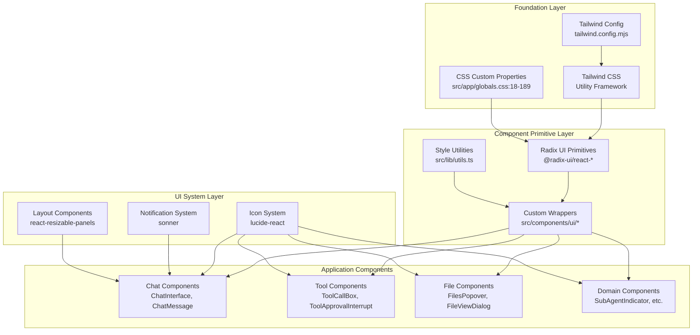
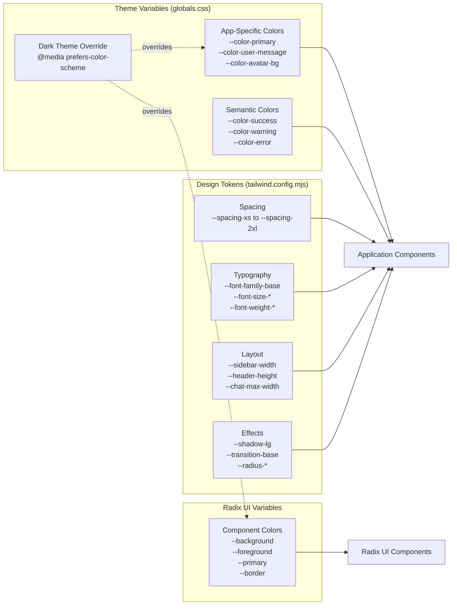

<!-- source: DeepWiki mcp.deepwiki.com · repo langchain-ai/deep-agents-ui · page 7 User Interface Components · fetched 2026-10-26 -->

# User Interface Components

Relevant source files

The following files were used as context for generating this wiki page:

- [src/app/components/ThreadList.tsx](src/app/components/ThreadList.tsx)
- [src/app/globals.css](src/app/globals.css)
- [src/components/ui/button.tsx](src/components/ui/button.tsx)
- [src/components/ui/dialog.tsx](src/components/ui/dialog.tsx)
- [src/components/ui/input.tsx](src/components/ui/input.tsx)
- [src/components/ui/scroll-area.tsx](src/components/ui/scroll-area.tsx)
- [src/components/ui/tabs.tsx](src/components/ui/tabs.tsx)
- [src/components/ui/tooltip.tsx](src/components/ui/tooltip.tsx)
- [tailwind.config.mjs](tailwind.config.mjs)

This page documents the user interface component system of Deep Agents UI, including the styling architecture, component libraries, and UI primitives. This covers the foundational building blocks used throughout the application to create a consistent, accessible, and maintainable user interface.

For detailed information about:
- Global styling approach, Tailwind CSS configuration, and theming system, see [Styling System](#7.1)
- Radix UI primitives and custom component implementations, see [UI Component Library](#7.2)
- Domain-specific components like SubAgentIndicator, see [Specialized Components](#7.3)

## UI Component Architecture

The application's user interface is built using a layered architecture that separates concerns between styling, primitive components, and domain logic.

**Sources:** [src/app/globals.css:1-189](), [tailwind.config.mjs:1-216](), [src/components/ui/button.tsx:1-60](), [src/components/ui/dialog.tsx:1-164]()

## Styling System Overview

The styling system uses a hybrid approach combining Tailwind CSS utility classes with CSS custom properties for theming. This enables rapid development with utility classes while maintaining design consistency through centralized theme variables.

### CSS Custom Properties Architecture

**Sources:** [src/app/globals.css:18-189](), [tailwind.config.mjs:14-197]()

The CSS custom properties are organized into several categories:

| Category | Variables | Purpose |
|----------|-----------|---------|
| **App Colors** | `--color-primary`, `--color-user-message`, `--color-avatar-bg` | Application-specific color palette [src/app/globals.css:20-23]() |
| **Semantic Colors** | `--color-success`, `--color-warning`, `--color-error` | Status and feedback colors [src/app/globals.css:25-27]() |
| **Spacing** | `--spacing-xs` through `--spacing-2xl` | Consistent spacing scale [src/app/globals.css:57-62]() |
| **Typography** | `--font-family-base`, `--font-size-*`, `--font-weight-*` | Font system [src/app/globals.css:65-82]() |
| **Layout** | `--sidebar-width`, `--header-height`, `--chat-max-width` | Layout dimensions [src/app/globals.css:104-108]() |
| **Radix UI** | `--background`, `--foreground`, `--primary`, `--border` | Radix component theming [src/app/globals.css:112-128]() |

## Component Library Stack

The application uses multiple component libraries and utilities that work together to provide a robust UI experience.

| Library | Role | Usage Example |
|---------|------|---------------|
| `Radix UI` | Accessible Primitives | `DialogPrimitive.Root` [src/components/ui/dialog.tsx:13]() |
| `Lucide React` | Iconography | `MessageSquare`, `X`, `Loader2` [src/app/components/ThreadList.tsx:5]() |
| `CVA` | Variant Management | `buttonVariants` definition [src/components/ui/button.tsx:7-36]() |
| `Tailwind Merge` | Class Resolution | `cn("base", className)` [src/components/ui/input.tsx:10-14]() |
| `date-fns` | Date Formatting | `format(date, "HH:mm")` [src/app/components/ThreadList.tsx:49]() |

**Sources:** [src/components/ui/button.tsx:3-8](), [src/app/components/ThreadList.tsx:3-22]()

## Radix UI Component Integration

Radix UI provides unstyled, accessible component primitives. The application wraps these into styled, reusable components located in `src/components/ui/`.

### Example: Dialog Component
The `Dialog` component wraps `@radix-ui/react-dialog`, providing a standardized layout for modals like the configuration and file views. It includes sub-components for headers, footers, and content overlays [src/components/ui/dialog.tsx:9-164]().

### Example: Tabs Component
The `Tabs` component uses `@radix-ui/react-tabs` to manage state between different views, such as switching between "Files" and "Tasks" in the sidebar [src/components/ui/tabs.tsx:4-66]().

## Styling Utility Functions

The application uses primary utility functions for managing CSS classes, centralized in `src/lib/utils.ts`.

### class-variance-authority (CVA)
Used for creating component variants with type-safe APIs. For example, the `Button` component defines variants for `default`, `destructive`, `outline`, `secondary`, `ghost`, and `link` [src/components/ui/button.tsx:11-23]().

### tailwind-merge & clsx
Combined into a `cn` utility to resolve conflicts when merging Tailwind CSS classes. This is used in almost every UI component to allow external `className` props to override internal styles safely [src/components/ui/input.tsx:10-15]().

## Tailwind CSS Configuration

The `tailwind.config.mjs` file extends the default Tailwind theme to match the application's design system.

- **Font Sizes**: Customizes `xxs` through `xl` with specific line heights [tailwind.config.mjs:15-54]().
- **Colors**: Maps Tailwind color names (like `primary`, `muted`, `accent`) to the CSS variables defined in `globals.css` [tailwind.config.mjs:154-187]().
- **Border Radius**: Links Tailwind's `rounded-*` utilities to the `--radius` variable [tailwind.config.mjs:81-86]().

## Global Base Styles

The `src/app/globals.css` file provides foundational styles beyond the theme variables:

- **Focus Resets**: Removes default browser focus box-shadows on inputs and textareas [src/app/globals.css:6-11]().
- **Base Elements**: Sets default font family, line height, and background color for the `html` and `body` tags [src/app/globals.css:198-209]().
- **Typography**: Defines standard sizes for `h1` through `h6` [src/app/globals.css:211-239]().
- **Code Blocks**: Styles `code` elements with a surface background and monospace font [src/app/globals.css:259-266]().

## Theme System

The application supports both light and dark themes through CSS custom properties and media queries.

### Light Theme (Default)
Variables are defined in the `:root` selector [src/app/globals.css:18-137]().

### Dark Theme (Auto-detected)
Overrides are applied via `@media (prefers-color-scheme: dark)`. This updates variables like `--background`, `--foreground`, and `--primary` to appropriate dark-mode equivalents [src/app/globals.css:139-189]().

**Sources:** [src/app/globals.css:18-189]()

---

