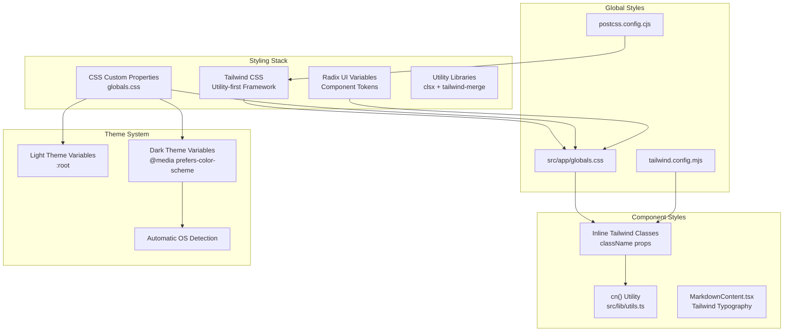
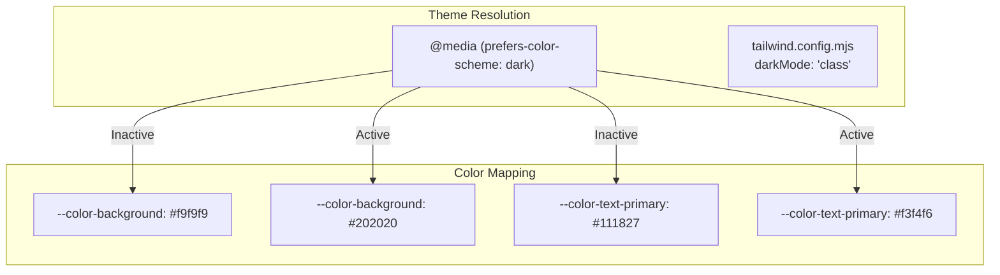
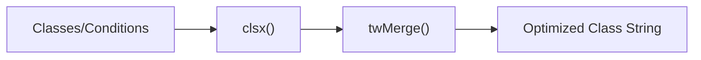

<!-- source: DeepWiki mcp.deepwiki.com · repo langchain-ai/deep-agents-ui · page 7.1 Styling System · fetched 2026-10-26 -->

# Styling System

Relevant source files

The following files were used as context for generating this wiki page:

- [postcss.config.cjs](postcss.config.cjs)
- [src/app/components/MarkdownContent.tsx](src/app/components/MarkdownContent.tsx)
- [src/app/components/ThreadList.tsx](src/app/components/ThreadList.tsx)
- [src/app/globals.css](src/app/globals.css)
- [src/lib/utils.ts](src/lib/utils.ts)
- [tailwind.config.mjs](tailwind.config.mjs)

## Purpose and Scope

This document describes the styling architecture of Deep Agents UI, including Tailwind CSS integration, CSS custom properties, the theming system, and global styles. The styling system provides a consistent design language across the application with support for automatic dark mode adaptation and integration with Radix UI components.

For information about specific UI component implementations, see [7.2 UI Component Library](). For documentation on specialized visual elements, see [7.3 Specialized Components]().

---

## Styling Architecture Overview

The application uses a multi-layered styling approach that combines multiple technologies for flexibility and maintainability:

**Sources:** [src/app/globals.css:1-190](), [tailwind.config.mjs:10-220](), [src/lib/utils.ts:1-7]()

---

## Tailwind CSS Integration

The application uses Tailwind CSS as its primary styling framework with three core directives imported at the top of the global stylesheet [src/app/globals.css:1-3]().

### Configuration and Plugins
The Tailwind configuration extends the default theme with custom font sizes, spacing, and colors that map to CSS variables [tailwind.config.mjs:14-197](). Key plugins integrated include:
*   `@tailwindcss/typography`: Powering the `prose` classes in `MarkdownContent` [src/app/components/MarkdownContent.tsx:20]().
*   `tailwindcss-animate`: Providing standard animation utilities [tailwind.config.mjs:6]().
*   `@tailwindcss/container-queries`: Enabling responsive styling based on parent container size [tailwind.config.mjs:3]().

### Base Layer Customizations
The `@layer base` directive defines global style overrides [src/app/globals.css:5]():
*   **Focus Resets**: Removes default browser box-shadows on `input`, `textarea`, and `select` [src/app/globals.css:7-11]().
*   **Outline Styling**: Sets the default `outline-color` to the primary brand color [src/app/globals.css:14-16]().

**Sources:** [src/app/globals.css:1-16](), [tailwind.config.mjs:1-8](), [postcss.config.cjs:1-7]()

---

## CSS Custom Properties System

The styling system relies on CSS custom properties defined in the `:root` selector.

### Variable Categories

| Category | Description | Reference |
|----------|-------------|-----------|
| **App Colors** | Semantic colors like `--color-user-message` and `--color-error` | [src/app/globals.css:19-37]() |
| **Typography** | Font stacks and size scales | [src/app/globals.css:64-82]() |
| **Layout** | Fixed dimensions for sidebars and headers | [src/app/globals.css:103-109]() |
| **Radix/Shadcn** | HSL tokens used by the component library | [src/app/globals.css:110-137]() |

### Layout Variables
Layout-related dimensions are centralized to ensure consistent spacing across the application shell:
*   `--sidebar-width`: 320px [src/app/globals.css:104]()
*   `--header-height`: 64px [src/app/globals.css:106]()
*   `--chat-max-width`: 900px [src/app/globals.css:108]()

**Sources:** [src/app/globals.css:18-137]()

---

## Dark Mode System

The application implements automatic dark mode support using the `prefers-color-scheme` media query [src/app/globals.css:139]().

### Dark Mode Transformations
When dark mode is active, color variables are reassigned to their dark variants. For example, `--color-surface` shifts from `#f9fafb` to `#2a2a2a` [src/app/globals.css:30,152](). Radix tokens also transition, such as `--primary` changing from `180 35% 17%` to `174 72% 56%` [src/app/globals.css:118,169]().

**Sources:** [src/app/globals.css:139-189](), [tailwind.config.mjs:12]()

---

## Component-Specific Styling

### Markdown and Code Rendering
The `MarkdownContent` component utilizes the Tailwind Typography `prose` class, customized for the chat interface [src/app/components/MarkdownContent.tsx:20]().

*   **Syntax Highlighting**: Uses `react-syntax-highlighter` with the `oneDark` theme [src/app/components/MarkdownContent.tsx:6-7,39-40]().
*   **Inline Code**: Styled with `bg-surface` and `font-mono` [src/app/components/MarkdownContent.tsx:63-68]().

### Thread Status Colors
Thread items use a specific color mapping for their status indicators:
*   `idle`: `bg-green-500` [src/app/components/ThreadList.tsx:35]()
*   `busy`: `bg-blue-500` [src/app/components/ThreadList.tsx:36]()
*   `interrupted`: `bg-orange-500` [src/app/components/ThreadList.tsx:37]()
*   `error`: `bg-red-600` [src/app/components/ThreadList.tsx:38]()

**Sources:** [src/app/components/MarkdownContent.tsx:19-70](), [src/app/components/ThreadList.tsx:34-43]()

---

## Styling Utilities

### The `cn` Function
The application uses a standard utility for merging Tailwind classes safely, preventing style conflicts [src/lib/utils.ts:4-6]().

This utility is used throughout the codebase to handle conditional styling, such as active thread states or status badges [src/app/components/ThreadList.tsx:20,67,70]().

**Sources:** [src/lib/utils.ts:1-7](), [src/app/components/ThreadList.tsx:20]()

---

