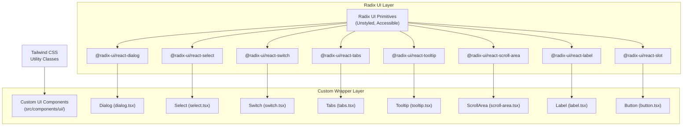
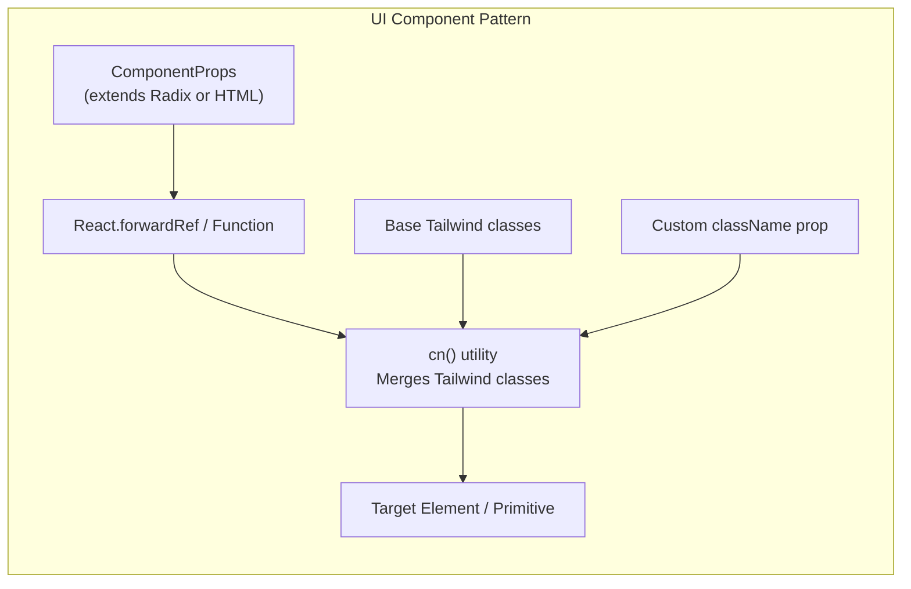

<!-- source: DeepWiki mcp.deepwiki.com · repo langchain-ai/deep-agents-ui · page 7.2 UI Component Library · fetched 2026-10-26 -->

# UI Component Library

<details>
<summary>Relevant source files</summary>

The following files were used as context for generating this wiki page:

- [components.json](components.json)
- [src/components/ui/button.tsx](src/components/ui/button.tsx)
- [src/components/ui/dialog.tsx](src/components/ui/dialog.tsx)
- [src/components/ui/input.tsx](src/components/ui/input.tsx)
- [src/components/ui/label.tsx](src/components/ui/label.tsx)
- [src/components/ui/resizable.tsx](src/components/ui/resizable.tsx)
- [src/components/ui/scroll-area.tsx](src/components/ui/scroll-area.tsx)
- [src/components/ui/select.tsx](src/components/ui/select.tsx)
- [src/components/ui/skeleton.tsx](src/components/ui/skeleton.tsx)
- [src/components/ui/switch.tsx](src/components/ui/switch.tsx)
- [src/components/ui/tabs.tsx](src/components/ui/tabs.tsx)
- [src/components/ui/textarea.tsx](src/components/ui/textarea.tsx)
- [src/components/ui/tooltip-icon-button.tsx](src/components/ui/tooltip-icon-button.tsx)
- [src/components/ui/tooltip.tsx](src/components/ui/tooltip.tsx)

</details>


This page documents the reusable UI component library that provides accessible, composable primitives for building the Deep Agents UI interface. The library is built on top of Radix UI primitives and styled using Tailwind CSS utility classes. For information about the global styling system and theme configuration, see [Styling System (7.1)](). For domain-specific components like SubAgentIndicator, see [Specialized Components (7.3)]().

## Overview

The UI component library consists of two main layers:

1.  **Radix UI Primitives**: Unstyled, accessible React components that provide behavior and accessibility.
2.  **Custom Wrappers**: Styled wrapper components that combine Radix UI primitives with Tailwind CSS classes and `class-variance-authority` for variant management.

This architecture provides a consistent, accessible foundation for all UI elements while maintaining flexibility for customization.

## Radix UI Integration

### Installed Radix UI Packages

The application uses the following Radix UI packages to provide accessible UI primitives:

| Package | Version | Purpose |
| :--- | :--- | :--- |
| `@radix-ui/react-dialog` | ^1.1.15 | Modal dialogs and overlays [src/components/ui/dialog.tsx:4]() |
| `@radix-ui/react-label` | ^2.1.8 | Accessible form labels [src/components/ui/label.tsx:4]() |
| `@radix-ui/react-scroll-area` | ^1.2.9 | Custom scrollable areas [src/components/ui/scroll-area.tsx:4]() |
| `@radix-ui/react-select` | ^2.2.6 | Dropdown select components [src/components/ui/select.tsx:4]() |
| `@radix-ui/react-slot` | ^1.2.4 | Composition utility for merging props [src/components/ui/button.tsx:2]() |
| `@radix-ui/react-switch` | ^1.2.6 | Toggle switch controls [src/components/ui/switch.tsx:4]() |
| `@radix-ui/react-tabs` | ^1.1.12 | Tab navigation components [src/components/ui/tabs.tsx:4]() |
| `@radix-ui/react-tooltip` | ^1.2.7 | Hover tooltips [src/components/ui/tooltip.tsx:4]() |

### Radix UI Architecture



**Diagram: Radix UI Integration Architecture**

Sources: [src/components/ui/dialog.tsx:4](), [src/components/ui/button.tsx:2](), [src/components/ui/select.tsx:4](), [src/components/ui/switch.tsx:4](), [src/components/ui/tabs.tsx:4](), [src/components/ui/tooltip.tsx:4](), [src/components/ui/scroll-area.tsx:4](), [src/components/ui/label.tsx:4]()

## Custom UI Primitives

### Component Structure Pattern

All custom UI primitive components follow a consistent pattern. Functional components are either standard functions or use `React.forwardRef` to expose underlying DOM nodes.



**Diagram: UI Component Construction Pattern**

Sources: [src/components/ui/textarea.tsx:7-20](), [src/components/ui/input.tsx:5-19]()

### Button Component

The `Button` component uses `class-variance-authority` (CVA) to manage multiple visual styles and sizes.

- **Variants**: `default`, `destructive`, `outline`, `secondary`, `ghost`, `link` [src/components/ui/button.tsx:11-23]()
- **Sizes**: `default`, `sm`, `lg`, `icon` [src/components/ui/button.tsx:24-29]()
- **Polymorphism**: Uses the `Slot` primitive to allow rendering as a different element (e.g., an `<a>` tag) when `asChild` is true [src/components/ui/button.tsx:48-51]().

Sources: [src/components/ui/button.tsx:7-59]()

### Dialog Component

The `Dialog` implementation breaks down the Radix `DialogPrimitive` into manageable sub-components:
- `DialogContent`: Automatically includes `DialogOverlay` and an optional close button [src/components/ui/dialog.tsx:69-101]().
- `DialogHeader` / `DialogFooter`: Provide standardized flex layouts for modal content [src/components/ui/dialog.tsx:103-124]().

Sources: [src/components/ui/dialog.tsx:9-163]()

### Input and Textarea

These components wrap standard HTML elements with the system's design tokens.
- **Input**: A standard single-line input with consistent focus-visible rings and border styling [src/components/ui/input.tsx:5-19]().
- **Textarea**: A multi-line input using `forwardRef` to allow parent components to manage focus or scroll [src/components/ui/textarea.tsx:7-21]().

Sources: [src/components/ui/input.tsx:5-21](), [src/components/ui/textarea.tsx:7-24]()

## Specialized UI Primitives

### Resizable Panels

The `Resizable` components wrap `react-resizable-panels` to provide the main application layout's draggable split-screen functionality.
- `ResizableHandle`: Includes an optional `GripVertical` icon for visual affordance [src/components/ui/resizable.tsx:23-43]().

Sources: [src/components/ui/resizable.tsx:8-46]()

### Tooltip and TooltipIconButton

The Tooltip system is configured with a default `delayDuration` of 0 for immediate feedback [src/components/ui/tooltip.tsx:9]().
- `TooltipContent`: Includes a styled `TooltipPrimitive.Arrow` for directional pointing [src/components/ui/tooltip.tsx:63]().

Sources: [src/components/ui/tooltip.tsx:8-67]()

## Component Inventory

| Component File | Primary Technology | Key Feature |
| :--- | :--- | :--- |
| `button.tsx` | CVA + Radix Slot | Multiple variants (ghost, outline, etc.) [src/components/ui/button.tsx:11-23]() |
| `dialog.tsx` | Radix Dialog | Portal-based modal with overlay [src/components/ui/dialog.tsx:78-80]() |
| `input.tsx` | HTML Input | Standardized focus-visible rings [src/components/ui/input.tsx:12]() |
| `resizable.tsx` | react-resizable-panels | Draggable layout handles [src/components/ui/resizable.tsx:30]() |
| `scroll-area.tsx` | Radix Scroll Area | Custom styled scrollbars [src/components/ui/scroll-area.tsx:31-56]() |
| `select.tsx` | Radix Select | Custom viewport with scroll buttons [src/components/ui/select.tsx:87-96]() |
| `switch.tsx` | Radix Switch | Animated toggle with CSS variables [src/components/ui/switch.tsx:15-30]() |
| `tabs.tsx` | Radix Tabs | Accessible tabbed navigation [src/components/ui/tabs.tsx:44-49]() |
| `textarea.tsx` | HTML Textarea | `forwardRef` for imperative access [src/components/ui/textarea.tsx:7]() |

## Styling and Accessibility

### The `cn` Utility

Every component utilizes the `cn` utility to merge Tailwind classes. This ensures that custom `className` props passed to components can override default styles without conflict.

Example from `Skeleton`:
```typescript
className={cn("animate-pulse rounded-md bg-muted", className)}
```
Sources: [src/components/ui/skeleton.tsx:9]()

### Accessibility

By leveraging Radix UI, the library inherits:
1.  **Keyboard Navigation**: Managed focus for Dialogs and Selects.
2.  **ARIA Attributes**: Correct roles (e.g., `role="dialog"`) and states (e.g., `aria-invalid`).
3.  **Focus Management**: `focus-visible` styles are applied across all interactive elements like `Input` and `Button` [src/components/ui/input.tsx:12](), [src/components/ui/button.tsx:8]().

Sources: [src/components/ui/input.tsx:12-13](), [src/components/ui/button.tsx:8](), [src/components/ui/dialog.tsx:92-96]()

---

