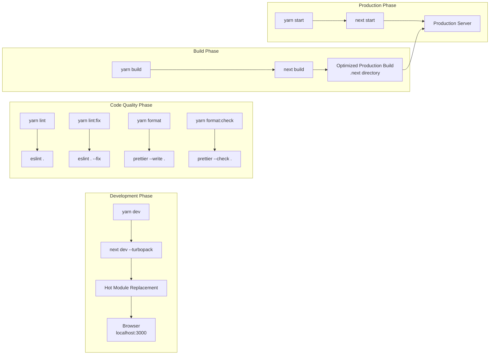
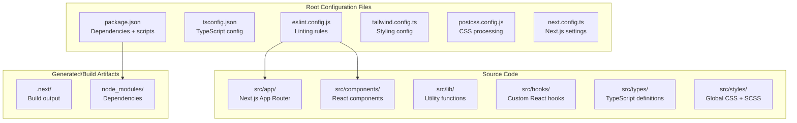
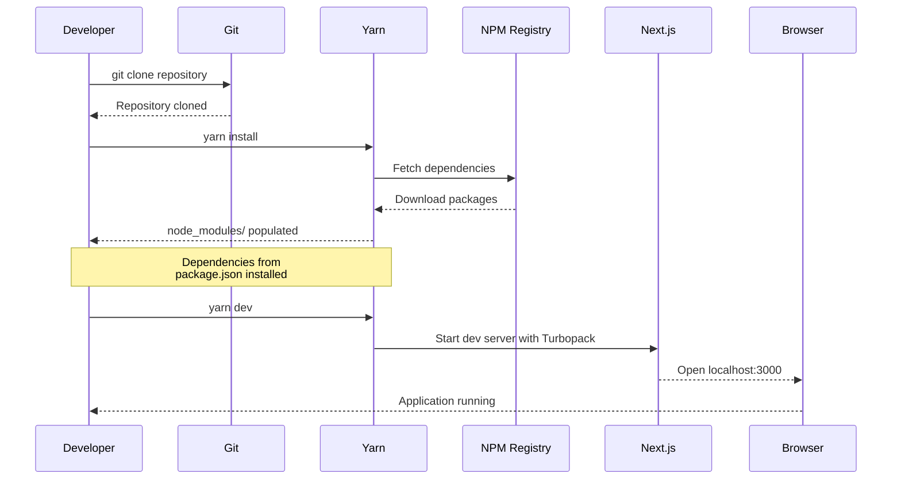
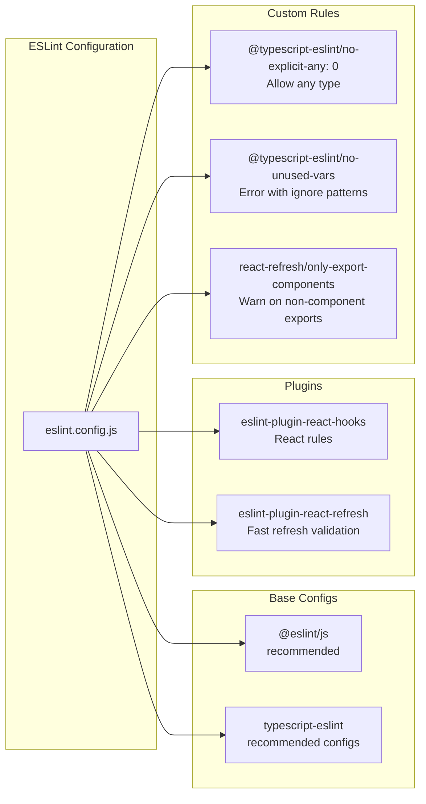
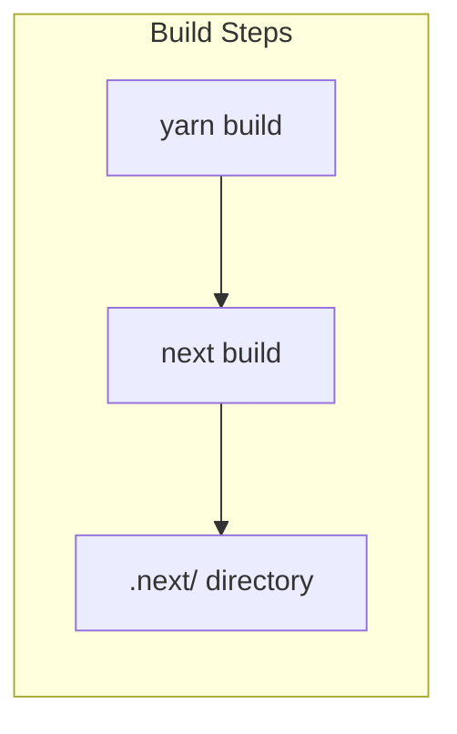

<!-- source: DeepWiki mcp.deepwiki.com · repo langchain-ai/deep-agents-ui · page 8 Development Guide · fetched 2026-10-26 -->

# Development Guide

Relevant source files

The following files were used as context for generating this wiki page:

- [.github/workflows/ci.yml](.github/workflows/ci.yml)
- [eslint.config.js](eslint.config.js)
- [package.json](package.json)

This document provides essential information for developers working on the Deep Agents UI codebase. It covers the development workflow, technology stack overview, project structure, and tooling configuration. For detailed information about specific development topics, see:
- Package dependencies and build configuration: [Dependencies and Build Configuration](#8.1)
- TypeScript types and interfaces: [Type System](#8.2)
- Linting, formatting, and CI/CD: [Code Quality and CI](#8.3)

## Development Workflow

The application uses standard Node.js development practices with Yarn as the package manager [package.json:76](). The development workflow centers around Next.js's build system with Turbopack for fast development iteration [package.json:7]().

### Development Commands

**Sources:** [package.json:6-13]()

### Script Descriptions

| Script | Command | Purpose |
|--------|---------|---------|
| `yarn dev` | `next dev --turbopack` | Start development server with Turbopack for fast HMR |
| `yarn build` | `next build` | Create optimized production build |
| `yarn start` | `next start` | Run production server (requires prior build) |
| `yarn lint` | `eslint .` | Run ESLint to check code quality |
| `yarn lint:fix` | `eslint . --fix` | Auto-fix ESLint issues where possible |
| `yarn format` | `prettier --write .` | Format all code with Prettier |
| `yarn format:check` | `prettier --check .` | Verify code formatting without modifying files |

**Sources:** [package.json:6-13]()

## Technology Stack

The application is built on a modern React and Next.js foundation with specialized libraries for LangGraph integration and UI components.

### Core Dependencies Architecture

```mermaid
graph TB
    subgraph "Application Layer"
        AppCode["Application Code<br/>src/ components/"]
    end
    
    subgraph "Framework Layer"
        Next["next@16.2.5<br/>App Router + Turbopack"]
        React["react@19.1.0<br/>react-dom@19.1.0"]
        
        Next --> React
    end
    
    subgraph "LangChain Integration"
        LGSDKReact["@langchain/langgraph-sdk<br/>React hooks"]
        LGSDK["@langchain/langgraph-sdk@1.0.3<br/>Client library"]
        LGCore["@langchain/langgraph@1.0.2<br/>Graph library"]
        LCCore["@langchain/core@1.1.19<br/>Base abstractions"]
        
        LGSDKReact --> LGSDK
        LGSDK --> LGCore
        LGCore --> LCCore
    end
    
    subgraph "State Management"
        SWR["swr@2.4.1<br/>Data fetching + caching"]
        Nuqs["nuqs@2.8.8<br/>URL state management"]
    end
    
    subgraph "UI Component Layer"
        RadixUI["Radix UI Components<br/>@radix-ui/react-*"]
        Lucide["lucide-react@0.539.0<br/>Icons"]
        Sonner["sonner@2.0.7<br/>Toast notifications"]
        ResizablePanels["react-resizable-panels@3.0.6<br/>Panel layout"]
    end
    
    subgraph "Styling System"
        TailwindCSS["tailwindcss@3.4.4"]
        TailwindMerge["tailwind-merge@2.6<br/>Class merging"]
        CVA["class-variance-authority@0.7.1<br/>Variant styles"]
        Sass["sass@1.99.0<br/>SCSS support"]
    end
    
    subgraph "Content Rendering"
        ReactMarkdown["react-markdown@9.0.1"]
        RemarkGFM["remark-gfm@4.0.0<br/>GitHub Flavored Markdown"]
        SyntaxHighlighter["react-syntax-highlighter@15.6.1<br/>Code highlighting"]
    end
    
    subgraph "Utilities"
        DateFns["date-fns@4.1.0<br/>Date formatting"]
        Lodash["lodash@4.18.1<br/>Utility functions"]
        UUID["uuid@9.0.1<br/>ID generation"]
        Diff["diff@8.0.3<br/>Text diffing"]
        JSYAML["js-yaml@4.1.0<br/>YAML parsing"]
    end
    
    AppCode --> Next
    AppCode --> LGSDKReact
    AppCode --> SWR
    AppCode --> Nuqs
    AppCode --> RadixUI
    AppCode --> TailwindCSS
    AppCode --> ReactMarkdown
    AppCode --> DateFns
```

**Sources:** [package.json:15-51]()

### Key Technology Decisions

| Technology | Version | Purpose |
|------------|---------|---------|
| Next.js | 16.2.5 | React framework with App Router and server components [package.json:38]() |
| React | 19.1.0 | UI library with latest concurrent features [package.json:40]() |
| @langchain/langgraph-sdk | 1.0.3 | Official SDK for LangGraph agent integration [package.json:18]() |
| Radix UI | Various | Accessible, unstyled component primitives [package.json:19-27]() |
| Tailwind CSS | 3.4.4 | Utility-first CSS framework [package.json:71]() |
| TypeScript | 5.9.3 | Type-safe JavaScript with strong typing [package.json:73]() |
| Yarn | 1.22.22 | Package manager [package.json:76]() |

**Sources:** [package.json:15-76]()

## Project Structure

**Sources:** [package.json:1-78](), [eslint.config.js:1-34]()

## Development Environment Setup

### Prerequisites

- **Node.js**: Version 20.x or higher [package.json:60]().
- **Yarn**: Version 1.22.22 (specified in `packageManager` field) [package.json:76]().
- **Git**: For version control.

### Initial Setup Steps

**Sources:** [package.json:6-7](), [package.json:76]()

## Development Tools Configuration

### TypeScript Configuration

The project uses TypeScript 5.9.3 [package.json:73]() with strict type checking enabled. Configuration is found in the project root.

### ESLint Configuration

**Sources:** [eslint.config.js:1-34]()

The ESLint configuration extends recommended presets and adds custom rules:

| Rule | Setting | Purpose |
|------|---------|---------|
| `@typescript-eslint/no-explicit-any` | `0` (disabled) | Allow `any` type when necessary [eslint.config.js:22]() |
| `@typescript-eslint/no-unused-vars` | Error with patterns | Ignore vars/args starting with `_` [eslint.config.js:23-26]() |
| `react-refresh/only-export-components` | Warn | Ensure fast refresh compatibility [eslint.config.js:27-30]() |

**Sources:** [eslint.config.js:1-34]()

### Prettier Configuration

Code formatting is handled by Prettier 2.8.8 [package.json:69]() with the Tailwind CSS plugin for class sorting [package.json:70](). Run `yarn format` to format all files [package.json:12]().

## Build and CI/CD

### Production Build Process

**Sources:** [package.json:8]()

### Continuous Integration

The project uses GitHub Actions for CI. The workflow executes on every push to `main` and on pull requests [.github/workflows/ci.yml:5-9]().

| Job | Task |
|-----|------|
| `format` | Checks code formatting with Prettier [.github/workflows/ci.yml:25-40]() |
| `lint` | Runs ESLint checks [.github/workflows/ci.yml:42-57]() |
| `build` | Verifies the production build [.github/workflows/ci.yml:59-74]() |
| `check-spelling` | Checks for spelling errors in `src` [.github/workflows/ci.yml:86-95]() |

**Sources:** [.github/workflows/ci.yml:1-95]()

## Next Steps

For detailed information about specific development topics:
- **Dependencies and Build**: See [Dependencies and Build Configuration](#8.1)
- **Type System**: See [Type System](#8.2)
- **Code Quality**: See [Code Quality and CI](#8.3)

---

