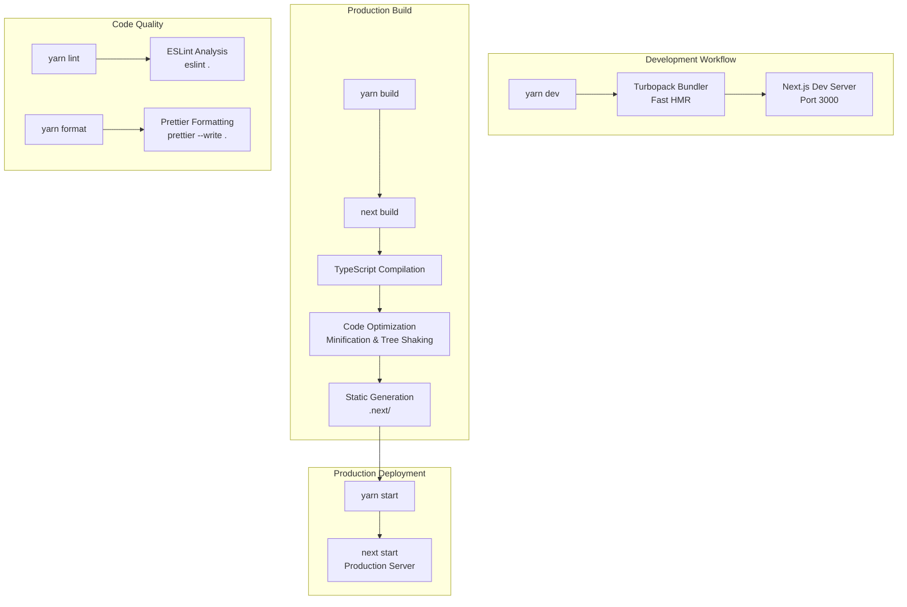
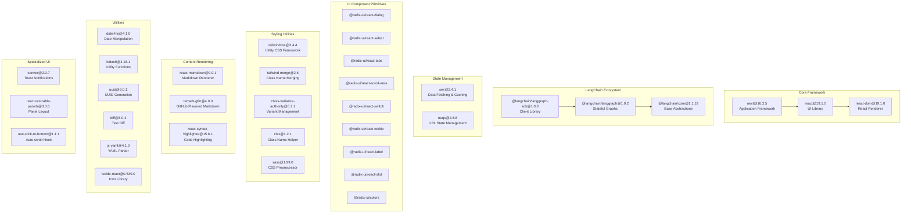
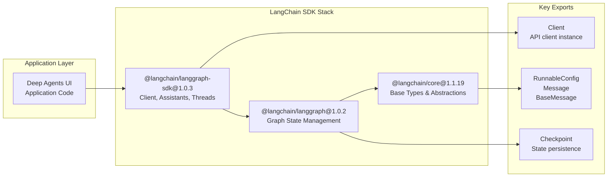
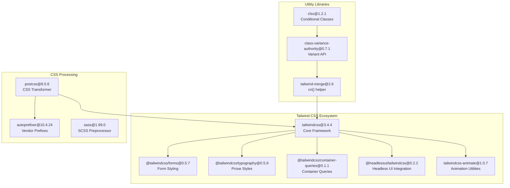
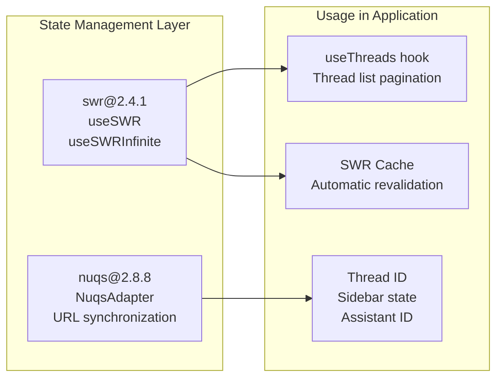
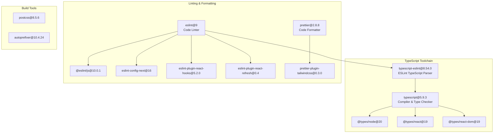

<!-- source: DeepWiki mcp.deepwiki.com · repo langchain-ai/deep-agents-ui · page 8.1 Dependencies and Build Configuration · fetched 2026-10-26 -->

# Dependencies and Build Configuration

<details>
<summary>Relevant source files</summary>

The following files were used as context for generating this wiki page:

- [.gitignore](.gitignore)
- [next.config.ts](next.config.ts)
- [package.json](package.json)
- [src/app/layout.tsx](src/app/layout.tsx)
- [tsconfig.json](tsconfig.json)
- [yarn.lock](yarn.lock)

</details>


This page documents the dependency structure, build configuration, and package management setup for Deep Agents UI. It covers the production dependencies, development tools, build scripts, and the overall dependency architecture. For information about TypeScript types used throughout the application, see [Type System](#8.2). For CI/CD and code quality configuration, see [Code Quality and CI](#8.3).

## Package Manager and Build System

Deep Agents UI uses **Yarn 1.22.22** as its package manager, specified in [package.json:76]().

```json
"packageManager": "yarn@1.22.22"
```

The application is built on **Next.js 16** with **React 19.1.0**, utilizing Next.js's App Router architecture. The development environment uses **Turbopack**, Next.js's Rust-based bundler, for fast hot module replacement (HMR).

Sources: [package.json:1-77]()

## Build Scripts

The application defines several npm scripts for development, production, and code quality workflows:

| Script | Command | Purpose |
|--------|---------|---------|
| `dev` | `next dev --turbopack` | Starts development server with Turbopack for fast HMR |
| `build` | `next build` | Creates production build with optimizations |
| `start` | `next start` | Runs production server |
| `lint` | `eslint .` | Runs ESLint checks on codebase |
| `lint:fix` | `eslint . --fix` | Runs ESLint with automatic fixes |
| `format` | `prettier --write .` | Formats code with Prettier |
| `format:check` | `prettier --check .` | Checks code formatting without modifying |

Sources: [package.json:6-13]()

### Build Process Flow



Sources: [package.json:6-13]()

## Dependency Architecture

The application's dependencies are organized into distinct categories based on their purpose in the system.



Sources: [package.json:15-51]()

## LangChain SDK Dependencies

The application's core functionality depends on the LangChain ecosystem for agent communication:



**LangChain Dependencies Breakdown:**

| Package | Version | Purpose |
|---------|---------|---------|
| `@langchain/core` | ^1.1.19 | Provides base abstractions, message types, and core interfaces |
| `@langchain/langgraph` | ^1.0.2 | Stateful graph execution and checkpoint management |
| `@langchain/langgraph-sdk` | ^1.0.3 | Client library for API communication, thread management |

Sources: [package.json:16-18]()

## UI Component Libraries

The application uses Radix UI for accessible, unstyled component primitives:

| Package | Version | Usage |
|---------|---------|-------|
| `@radix-ui/react-dialog` | ^1.1.15 | `ConfigDialog`, `FileViewDialog` |
| `@radix-ui/react-select` | ^2.2.6 | Dropdown selections in UI |
| `@radix-ui/react-tabs` | ^1.1.12 | `TasksFilesSidebar` tab navigation |
| `@radix-ui/react-scroll-area` | ^1.2.9 | Scrollable containers |
| `@radix-ui/react-switch` | ^1.2.6 | Toggle switches in settings |
| `@radix-ui/react-tooltip` | ^1.2.7 | Hover tooltips throughout UI |
| `@radix-ui/react-label` | ^2.1.8 | Form labels |
| `@radix-ui/react-slot` | ^1.2.4 | Component composition utility |
| `@radix-ui/colors` | ^1.0.0 | Color palette system |

Additional UI libraries:

- **lucide-react** (^0.539.0): Icon library used throughout the interface
- **sonner** (^2.0.7): Toast notification system via the `Toaster` component in `RootLayout` [src/app/layout.tsx:23]()
- **react-resizable-panels** (^3.0.6): Resizable layout panels for `ThreadList` and `ChatInterface`

Sources: [package.json:19-27](), [package.json:37](), [package.json:43](), [package.json:47](), [src/app/layout.tsx:23]()

## Styling System Dependencies



**Styling Dependencies:**

| Package | Version | Purpose |
|---------|---------|---------|
| `tailwindcss` | ^3.4.4 | Utility-first CSS framework |
| `tailwind-merge` | ^2.6 | Merge Tailwind classes without conflicts |
| `class-variance-authority` | ^0.7.1 | Type-safe variant API for components |
| `clsx` | ^1.2.1 | Conditional class name construction |
| `sass` | ^1.99.0 | SCSS preprocessing for global styles |
| `postcss` | ^8.5.6 | CSS transformation pipeline |
| `autoprefixer` | ^10.4.24 | Automatic vendor prefixes |

**Tailwind Plugins:**

- `@tailwindcss/forms`: Styled form controls
- `@tailwindcss/typography`: Prose content styling
- `@tailwindcss/container-queries`: Container query support
- `@headlessui/tailwindcss`: Headless UI state variants
- `tailwindcss-animate`: Animation utilities

Sources: [package.json:31-32](), [package.json:46](), [package.json:49](), [package.json:55-58](), [package.json:63](), [package.json:68](), [package.json:71-72]()

## Content Rendering Dependencies

The application renders markdown content with syntax highlighting:

| Package | Version | Purpose |
|---------|---------|---------|
| `react-markdown` | ^9.0.1 | Main markdown rendering engine |
| `remark-gfm` | ^4.0.0 | GitHub Flavored Markdown plugin (tables, strikethrough, task lists) |
| `react-syntax-highlighter` | ^15.6.1 | Code block syntax highlighting |
| `@types/react-syntax-highlighter` | ^15.5.13 | TypeScript definitions |

These dependencies work together to render agent responses with formatted code blocks.

Sources: [package.json:29](), [package.json:42](), [package.json:44-45]()

## State Management and Data Fetching



**State Dependencies:**

| Package | Version | Purpose |
|---------|---------|---------|
| `swr` | ^2.4.1 | Data fetching with caching, revalidation, and optimistic updates |
| `nuqs` | ^2.8.8 | Type-safe URL query string state management |

- **SWR** is used for fetching threads and assistants with built-in caching.
- **nuqs** manages URL parameters for shareable state, initialized via `NuqsAdapter` in `RootLayout` [src/app/layout.tsx:22]().

Sources: [package.json:39](), [package.json:48](), [src/app/layout.tsx:22]()

## Utility Dependencies

| Package | Version | Purpose |
|---------|---------|---------|
| `date-fns` | ^4.1.0 | Date formatting and manipulation (thread grouping by time) |
| `lodash` | ^4.18.1 | Utility functions (debounce, throttle, deep cloning) |
| `uuid` | ^9.0.1 | UUID generation for messages and client-side entities |
| `diff` | ^8.0.3 | Text diffing for file change visualization |
| `js-yaml` | ^4.1.0 | YAML parsing for configuration files |
| `use-stick-to-bottom` | ^1.1.1 | Auto-scroll behavior for chat messages |

**Type Definitions:**

- `@types/diff`: ^5.0.3
- `@types/uuid`: ^9.0.8
- `@types/js-yaml`: ^4.0.9

Sources: [package.json:28](), [package.json:30](), [package.json:33-36](), [package.json:50-51](), [package.json:59]()

## Development Tools



**Development Dependencies:**

| Category | Packages | Purpose |
|----------|----------|---------|
| **TypeScript** | `typescript@^5.9.3` | Type checking and compilation (target ES2017) [tsconfig.json:3]() |
| **Type Definitions** | `@types/node`, `@types/react`, `@types/react-dom` | TypeScript types for core libraries |
| **ESLint Core** | `eslint@^9`, `@eslint/js@^10.0.1` | JavaScript/TypeScript linting |
| **ESLint Plugins** | `eslint-config-next`, `eslint-plugin-react-hooks`, `eslint-plugin-react-refresh`, `typescript-eslint` | Framework-specific linting rules |
| **Prettier** | `prettier@^2.8.8`, `prettier-plugin-tailwindcss@^0.3.0` | Code formatting with Tailwind class sorting |
| **CSS Tools** | `postcss@^8.5.6`, `autoprefixer@^10.4.24` | CSS processing and vendor prefixing |

Sources: [package.json:53-75](), [tsconfig.json:1-27]()

## Specialized UI Behavior

| Package | Version | Usage Location |
|---------|---------|----------------|
| `react-resizable-panels` | ^3.0.6 | `ResizablePanelGroup` for thread list and chat layout |
| `use-stick-to-bottom` | ^1.1.1 | `ChatInterface` for auto-scrolling to new messages |
| `sonner` | ^2.0.7 | Toast notifications via `Toaster` component in `RootLayout` [src/app/layout.tsx:23]() |

Sources: [package.json:43](), [package.json:47](), [package.json:50](), [src/app/layout.tsx:23]()

## Dependency Version Strategy

The application uses **caret (`^`) version ranges** for most dependencies, allowing automatic patch and minor version updates while preventing breaking major version changes.

Example from [package.json:38-40]():
```json
"next": "^16.2.5",
"nuqs": "^2.8.8",
"react": "19.1.0"
```

Note that `react` and `react-dom` use exact versions (`19.1.0`) to ensure consistent behavior with React 19 features.

Sources: [package.json:15-51]()

## Lock File Management

The `yarn.lock` file contains exact versions and integrity hashes for all transitive dependencies, ensuring reproducible builds across environments.

1. **Deterministic Installs**: Same dependency tree on all machines.
2. **Security**: Integrity checksums prevent tampering.
3. **Performance**: Pre-resolved dependency graph speeds up installs.

The lock file is managed by Yarn 1.22.22 and should be committed to version control.

Sources: [yarn.lock:1-18](), [package.json:76]()

---

