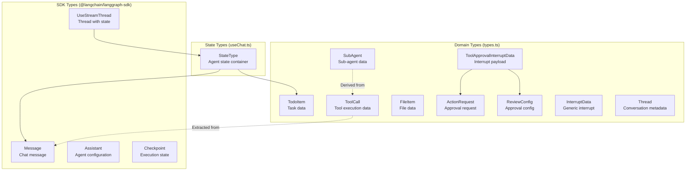
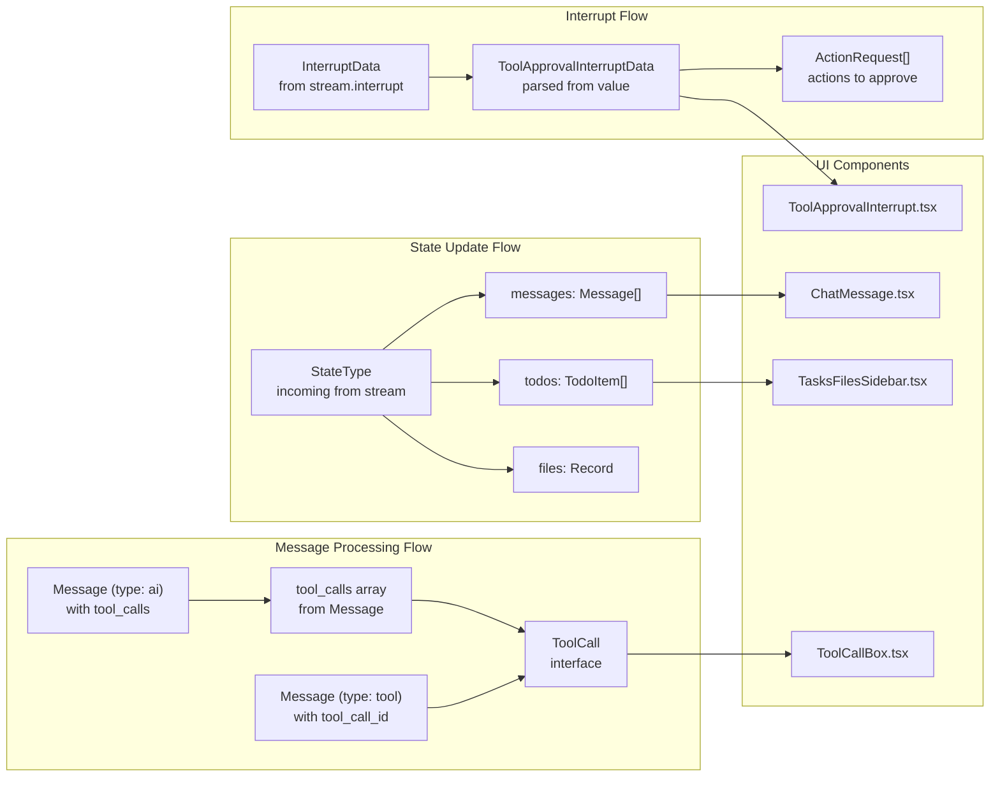

<!-- source: DeepWiki mcp.deepwiki.com · repo langchain-ai/deep-agents-ui · page 8.2 Type System · fetched 2026-10-26 -->

# Type System

Relevant source files

The following files were used as context for generating this wiki page:

- [src/app/types/types.ts](src/app/types/types.ts)
- [tsconfig.json](tsconfig.json)

This document details the core TypeScript types and interfaces used throughout the Deep Agents UI application. These types define the data structures for agent execution state, tool calls, interrupts, tasks, files, and LangGraph SDK integration. Understanding this type system is essential for working with agent state, message processing, and UI rendering.

For information about how these types are used in the chat system, see [Chat System](#4). For details on tool execution visualization, see [Tool Call Visualization](#5.1).

---

## Core Type Organization

The application's type system is organized into three layers:

1. **Domain Types** - Application-specific types defined in [src/app/types/types.ts:1-57]()
2. **State Types** - Agent state structures defined in [src/app/hooks/useChat.ts:16-26]()
3. **Integration Types** - LangGraph SDK types imported from `@langchain/langgraph-sdk`

Title: Type System Architecture

**Sources:** [src/app/types/types.ts:1-57](), [src/app/hooks/useChat.ts:16-26]()

---

## Domain Types

### ToolCall

Represents a single tool invocation by the agent, including its execution status and results.

| Property | Type | Description |
|----------|------|-------------|
| `id` | `string` | Unique identifier matching `tool_call_id` from LangGraph messages |
| `name` | `string` | Name of the tool being called (e.g., `"read_file"`, `"write_file"`) |
| `args` | `Record<string, unknown>` | Tool input arguments as key-value pairs |
| `result` | `string` (optional) | Tool execution result, present when status is `"completed"` |
| `status` | `"pending" \| "completed" \| "error" \| "interrupted"` | Current execution state |

**Status Values:**
- `"pending"`: Tool call initiated but not yet executed [src/app/types/types.ts:6]()
- `"completed"`: Tool executed successfully with result available [src/app/types/types.ts:6]()
- `"error"`: Tool execution failed [src/app/types/types.ts:6]()
- `"interrupted"`: Tool requires user approval before execution [src/app/types/types.ts:6]()

**Sources:** [src/app/types/types.ts:1-7]()

---

### SubAgent

Represents a sub-agent spawned via the special `"task"` tool, enabling hierarchical agent workflows.

| Property | Type | Description |
|----------|------|-------------|
| `id` | `string` | Tool call identifier from the parent agent |
| `name` | `string` | Display name for the sub-agent |
| `subAgentName` | `string` | Internal identifier for the sub-agent type |
| `input` | `Record<string, unknown>` | Input parameters passed to the sub-agent |
| `output` | `Record<string, unknown>` (optional) | Sub-agent execution results |
| `status` | `"pending" \| "active" \| "completed" \| "error"` | Sub-agent execution state |

**Sources:** [src/app/types/types.ts:9-16]()

---

### TodoItem

Represents a task in the agent's task list, tracked in the sidebar.

| Property | Type | Description |
|----------|------|-------------|
| `id` | `string` | Unique task identifier |
| `content` | `string` | Task description or title |
| `status` | `"pending" \| "in_progress" \| "completed"` | Task completion state |
| `updatedAt` | `Date` (optional) | Timestamp of last status update |

**Sources:** [src/app/types/types.ts:23-28]()

---

### FileItem

Represents a file managed by the agent, typically created or modified through tool calls.

| Property | Type | Description |
|----------|------|-------------|
| `path` | `string` | File path relative to project root |
| `content` | `string` | Full file contents as text |

**Sources:** [src/app/types/types.ts:18-21]()

---

### Thread

Represents metadata for a conversation thread, used in the thread list.

| Property | Type | Description |
|----------|------|-------------|
| `id` | `string` | Unique thread identifier (UUID) |
| `title` | `string` | Thread title |
| `createdAt` | `Date` | Thread creation timestamp |
| `updatedAt` | `Date` | Last message timestamp |

**Sources:** [src/app/types/types.ts:30-35]()

---

## Interrupt Types

### ActionRequest

Represents a single action awaiting user approval in the tool approval interrupt workflow.

| Property | Type | Description |
|----------|------|-------------|
| `name` | `string` | Name of the tool/action requiring approval |
| `args` | `Record<string, unknown>` | Tool arguments for user review |
| `description` | `string` (optional) | Human-readable description of the action |

**Sources:** [src/app/types/types.ts:43-47]()

---

### ReviewConfig

Configuration for how a specific action should be reviewed by the user.

| Property | Type | Description |
|----------|------|-------------|
| `actionName` | `string` | Name of the action being configured |
| `allowedDecisions` | `string[]` (optional) | Valid decision options (e.g., `["approve", "reject", "edit"]`) |

**Sources:** [src/app/types/types.ts:49-52]()

---

### ToolApprovalInterruptData

Container for tool approval interrupt payload, sent from agent when human approval is required.

| Property | Type | Description |
|----------|------|-------------|
| `action_requests` | `ActionRequest[]` | List of actions requiring approval |
| `review_configs` | `ReviewConfig[]` (optional) | Configuration for each action's review process |

**Sources:** [src/app/types/types.ts:54-57]()

---

### InterruptData

Generic interrupt data structure used by LangGraph for various interrupt types.

| Property | Type | Description |
|----------|------|-------------|
| `value` | `any` | Interrupt payload (type varies by interrupt kind) |
| `ns` | `string[]` (optional) | Namespace path for the interrupt |
| `scope` | `string` (optional) | Scope identifier for the interrupt |

**Sources:** [src/app/types/types.ts:37-41]()

---

## State Types

### StateType

The primary agent state container, representing the complete state structure streamed from LangGraph.

| Property | Type | Description |
|----------|------|-------------|
| `messages` | `Message[]` | Complete message history (human, AI, tool messages) |
| `todos` | `TodoItem[]` | Active task list managed by agent |
| `files` | `Record<string, string>` | Map of file paths to file contents |
| `email` | `object` (optional) | Email draft state for email-related agents |
| `ui` | `any` (optional) | Custom UI component state from agent |

**Sources:** [src/app/hooks/useChat.ts:16-26]()

---

## Type Relationships and Data Flow

Title: State and Message Data Flow

**Sources:** [src/app/hooks/useChat.ts:16-26](), [src/app/types/types.ts:1-57]()

---

## Type Extraction and Transformation

### Extracting ToolCall from Messages

Tool calls are extracted from AI messages and matched with tool messages. AI messages contain a `tool_calls` array [src/app/hooks/useChat.ts:6](). Each call is represented as a `ToolCall` with status `"pending"` [src/app/types/types.ts:6](). When a tool message arrives with a matching `tool_call_id`, the status updates to `"completed"` and the `result` field is populated [src/app/types/types.ts:5-6]().

**Sources:** [src/app/types/types.ts:1-7](), [src/app/hooks/useChat.ts:6]()

---

### Deriving SubAgent from ToolCall

Sub-agents are identified by tool calls where the tool name is `"task"`. The `SubAgent` interface [src/app/types/types.ts:9-16]() maps the tool call `id` to `SubAgent.id` and uses the tool's input arguments to populate `SubAgent.input` [src/app/types/types.ts:13]().

**Sources:** [src/app/types/types.ts:9-16]()

---

### Parsing Interrupt Data

Tool approval interrupts contain structured data in the `value` property of `InterruptData` [src/app/types/types.ts:38](). This is typically cast to `ToolApprovalInterruptData` [src/app/types/types.ts:54-57]() to access the `action_requests` and `review_configs`.

**Sources:** [src/app/types/types.ts:37-57]()

---

## Type Safety and Compilation

The project uses TypeScript with strict mode enabled [tsconfig.json:7](). The configuration targets `ES2017` [tsconfig.json:3]() and uses `bundler` module resolution [tsconfig.json:11](). Path aliases are configured to use `@/*` for the `src` directory [tsconfig.json:21-23]().

**Sources:** [tsconfig.json:1-27]()

---

