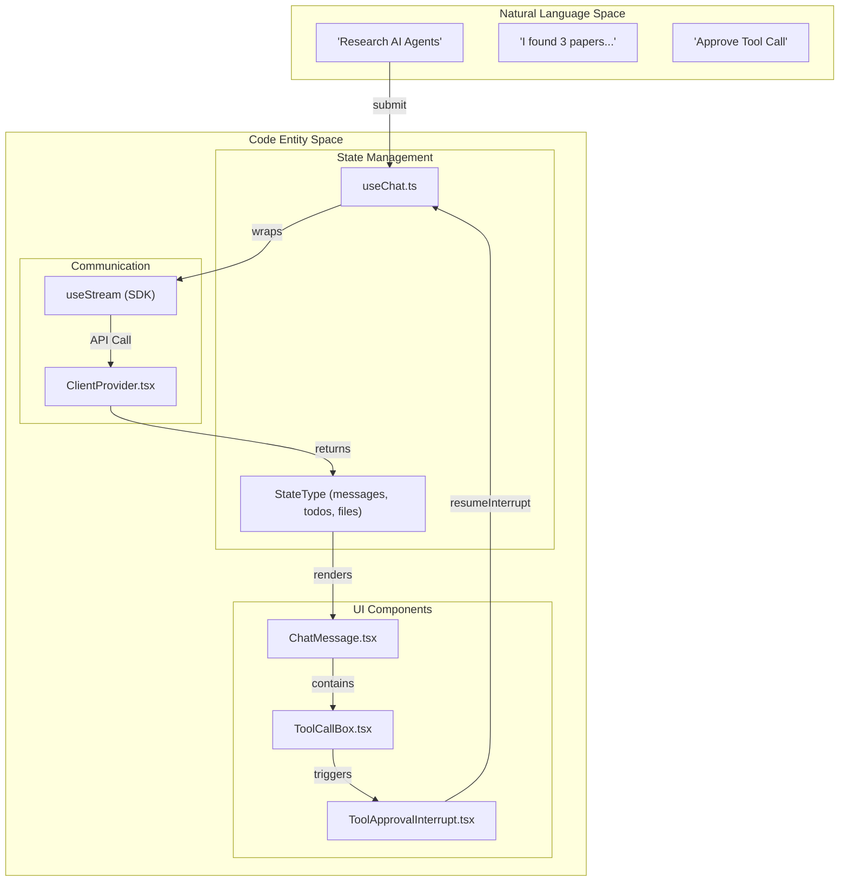
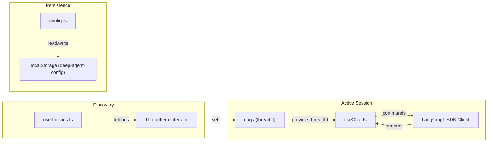

<!-- source: DeepWiki mcp.deepwiki.com · repo langchain-ai/deep-agents-ui · page 9 Glossary · fetched 2026-10-26 -->

# Glossary

Relevant source files

The following files were used as context for generating this wiki page:

- [README.md](README.md)
- [package.json](package.json)
- [src/app/components/ChatMessage.tsx](src/app/components/ChatMessage.tsx)
- [src/app/components/ConfigDialog.tsx](src/app/components/ConfigDialog.tsx)
- [src/app/components/ThreadList.tsx](src/app/components/ThreadList.tsx)
- [src/app/components/ToolCallBox.tsx](src/app/components/ToolCallBox.tsx)
- [src/app/globals.css](src/app/globals.css)
- [src/app/hooks/useChat.ts](src/app/hooks/useChat.ts)
- [src/app/hooks/useThreads.ts](src/app/hooks/useThreads.ts)
- [src/app/utils/utils.ts](src/app/utils/utils.ts)
- [src/lib/config.ts](src/lib/config.ts)

This page defines codebase-specific terms, jargon, and domain concepts used in the Deep Agents UI. It serves as a technical reference for engineers to understand how LangGraph primitives map to UI components and state management.

## Core Concepts

### 1. Assistant and Deployment
In the context of this application, an **Assistant** is a specific instance of a LangGraph agent. A **Deployment** refers to the LangGraph API server hosting one or more assistants.

*   **Assistant ID**: A unique identifier (UUID for cloud, string for local) that specifies which graph to interact with [src/app/hooks/useThreads.ts:72-75]().
*   **Deployment URL**: The base URL of the LangGraph API (e.g., `http://127.0.0.1:2024`) [README.md:50-51]().

### 2. Thread
A **Thread** represents a single conversation session with an assistant. It persists state, including messages, checkpoints, and custom values.

*   **Thread State**: Managed via the `useChat` hook, which uses the `useStream` hook from the LangGraph SDK [src/app/hooks/useChat.ts:40-54]().
*   **Checkpoint**: A saved state of the graph at a specific point in time, allowing the UI to resume or re-run steps [src/app/hooks/useChat.ts:77-91]().

### 3. Interrupt and Resume
LangGraph allows agents to pause execution for human intervention.

*   **Interrupt**: A state where the graph stops before or after a specific node (usually `tools`) to wait for input or approval [src/app/hooks/useChat.ts:89-95]().
*   **Resume**: The action of providing the required input to the graph to continue execution [src/app/hooks/useChat.ts:135-142]().

---

## Technical Terminology

| Term | Definition | Code Pointer |
| :--- | :--- | :--- |
| **GenUI** | Generative UI components rendered dynamically based on tool metadata. | [src/app/components/ToolCallBox.tsx:145-154]() |
| **Sub-Agent** | A specialized tool call (named `task`) that delegates work to another agent logic. | [src/app/components/ChatMessage.tsx:48-70]() |
| **Recursion Limit** | A safety setting to prevent infinite loops in agent execution (defaulted to 100). | [src/app/hooks/useChat.ts:65-65]() |
| **Optimistic Values** | UI state updates applied immediately before the server confirms the transition. | [src/app/hooks/useChat.ts:62-64]() |

---

## Architecture Diagrams

### From Natural Language to Code Entities
This diagram bridges the gap between user interaction (Natural Language Space) and the internal code structures (Code Entity Space).

**Sources:** [src/app/hooks/useChat.ts:16-26](), [src/app/hooks/useChat.ts:40-54](), [src/app/components/ChatMessage.tsx:135-147](), [src/app/components/ToolCallBox.tsx:158-164]()

### Thread Lifecycle and Data Flow
This diagram tracks how a thread transitions from discovery to active streaming.

**Sources:** [src/lib/config.ts:7-25](), [src/app/hooks/useThreads.ts:6-13](), [src/app/hooks/useThreads.ts:77-86](), [src/app/hooks/useChat.ts:37-45]()

---

## Domain Concepts

### Sub-Agent Delegation
The "Deep Agents" pattern relies on delegating tasks. In the UI, this is identified by a tool call named `task` [src/app/utils/utils.ts:68-70](). These calls are rendered with a `SubAgentIndicator` and can be expanded to show nested inputs and outputs [src/app/components/ChatMessage.tsx:150-193]().

### File Management
Agents can produce files in their state. These are stored as a `Record<string, string>` in the `files` key of the thread state [src/app/hooks/useChat.ts:19-19](). The UI provides mechanisms to view and edit these files directly [src/app/hooks/useChat.ts:102-110]().

### Status Filters
Threads are categorized by their execution status to help users find sessions requiring attention:
*   `idle`: Execution finished.
*   `busy`: Currently running.
*   `interrupted`: Waiting for human input.
*   `error`: Execution failed.
[src/app/components/ThreadList.tsx:24-39]()

**Sources:**
- [src/app/hooks/useChat.ts:16-167]()
- [src/app/components/ChatMessage.tsx:48-193]()
- [src/app/components/ToolCallBox.tsx:48-164]()
- [src/app/hooks/useThreads.ts:6-136]()
- [src/app/components/ThreadList.tsx:24-39]()
- [src/lib/config.ts:1-26]()
- [src/app/utils/utils.ts:64-73]()