# Page: Overview

# Overview

<details>
<summary>Relevant source files</summary>

The following files were used as context for generating this wiki page:

- [README.md](README.md)
- [package.json](package.json)
- [src/app/layout.tsx](src/app/layout.tsx)
- [yarn.lock](yarn.lock)

</details>


## Purpose and Scope

Deep Agents UI is a Next.js-based web application that provides a frontend interface for interacting with LangGraph agent deployments. The application enables users to chat with AI agents, view real-time execution progress, approve tool calls, manage agent-generated files, and track task completion status. This document provides a high-level overview of the system architecture, core capabilities, and technology stack.

For detailed information about specific subsystems, see:
- Quick start and setup: [Quick Start Guide](#1.1)
- High-level architecture and hierarchy: [System Architecture](#1.2)

**Sources:** [README.md:1-4](), [README.md:59-72]()

## Core Capabilities

Deep Agents UI provides the following key features:

| Feature | Description | Primary Code Entities |
|---------|-------------|-------------------|
| **Real-time Chat** | Stream agent responses and tool execution updates | `ChatInterface`, `useChat` hook |
| **Thread Management** | Browse and search conversation history with time-based grouping | `ThreadList`, `useThreads` hook |
| **Tool Approval** | Human-in-the-loop approval for sensitive tool executions | `ToolApprovalInterrupt` |
| **File Viewing** | View and edit agent-generated files from LangGraph state | `FilesPopover`, `FileViewDialog` |
| **Task Tracking** | Monitor todo items grouped by status (pending/completed/failed) | `TasksFilesSidebar` |
| **Deployment Configuration** | Configure and persist connection settings to LangGraph deployments | `ConfigDialog`, `StandaloneConfig` |

The application supports two deployment modes:
- **Production Mode**: Connect to deployed LangGraph applications using UUID-based assistant IDs.
- **Development Mode**: Connect to local LangGraph instances (e.g., via `langgraph dev`) using graph IDs like `research`.

**Sources:** [README.md:16-58](), [package.json:15-51]()

## System Architecture

### High-Level Component Structure

This diagram maps the high-level application flow to the specific React components and providers that manage the system state.

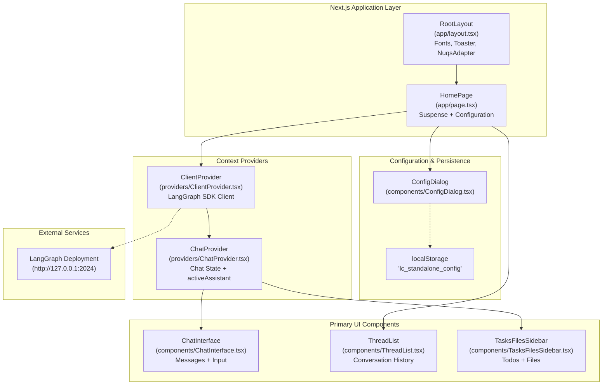

For details, see [System Architecture](#1.2).

**Sources:** [app/layout.tsx:8-27](), [package.json:15-51](), [README.md:53-58]()

### Data Flow and SDK Integration

This diagram illustrates how the frontend interacts with the LangGraph SDK and manages real-time streaming data.

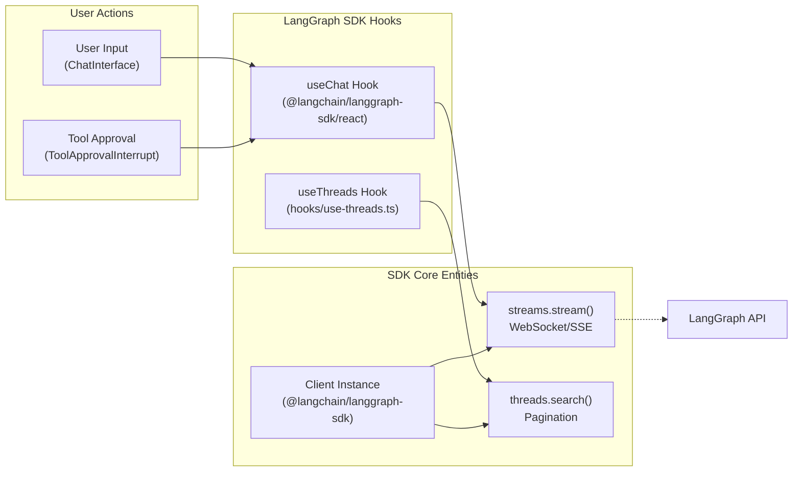

**Sources:** [package.json:16-18](), [README.md:42-51]()

## Technology Stack

### Core Framework
Deep Agents UI is built on **Next.js 16** using the App Router architecture and **React 19**. It leverages **Turbopack** for optimized development performance.

**Sources:** [package.json:7-9](), [package.json:38-41]()

### LangChain Integration
The application is tightly integrated with the LangChain ecosystem:
- **`@langchain/langgraph-sdk`**: Provides the core `Client` for communicating with deployments.
- **`@langchain/langgraph`**: Handles graph state and message structures.
- **`@langchain/core`**: Base abstractions for messages and tool calls.

**Sources:** [package.json:16-18]()

### UI and Styling
- **Styling**: **Tailwind CSS** for utility-first styling and **Sass** for complex stylesheets.
- **Components**: **Radix UI** primitives (Dialog, Select, Tabs, etc.) for accessible UI patterns.
- **Icons**: **Lucide React**.
- **State/URL**: **nuqs** for managing search params (like `threadId`) as synchronized React state.

**Sources:** [package.json:19-27](), [package.json:31-51](), [app/layout.tsx:1-4]()

## Next Steps

- **Quick Start Guide**: See [Quick Start Guide](#1.1) for installation and deployment instructions.
- **System Architecture**: See [System Architecture](#1.2) for detailed component hierarchies and provider structures.

**Sources:** [README.md:5-14]()

---

# Page: Quick Start Guide

# Quick Start Guide

<details>
<summary>Relevant source files</summary>

The following files were used as context for generating this wiki page:

- [.nvmrc](.nvmrc)
- [README.md](README.md)
- [package.json](package.json)

</details>


## Purpose and Scope

This guide provides step-by-step instructions for setting up and running the Deep Agents UI from a fresh clone to your first agent interaction. It covers repository cloning, dependency installation, LangGraph deployment setup, connection configuration, and basic usage patterns.

For detailed information about the system architecture and component interactions, see **1.2 System Architecture**. For configuration persistence and management details, see **2.1 Configuration Management**. For LangGraph SDK integration patterns, see **2.2 LangGraph Integration**.

---

## Prerequisites

Before starting, ensure you have the following installed on your system:

| Requirement | Version | Purpose |
|-------------|---------|---------|
| Node.js | 20.x | JavaScript runtime (defined in `.nvmrc`) |
| Yarn | 1.22.22 | Package manager (defined in `package.json`) |
| Python | ≥ 3.11 | Required for LangGraph deployment |
| LangGraph CLI | Latest | For deploying and managing agents |

**Sources:** [.nvmrc:1-1](), [package.json:76-76]()

---

## Installation Workflow

The setup process follows a three-part workflow: (1) installing and running the UI application, (2) deploying a LangGraph agent that the UI will connect to, and (3) configuring the connection.

### Installation & Execution Diagram

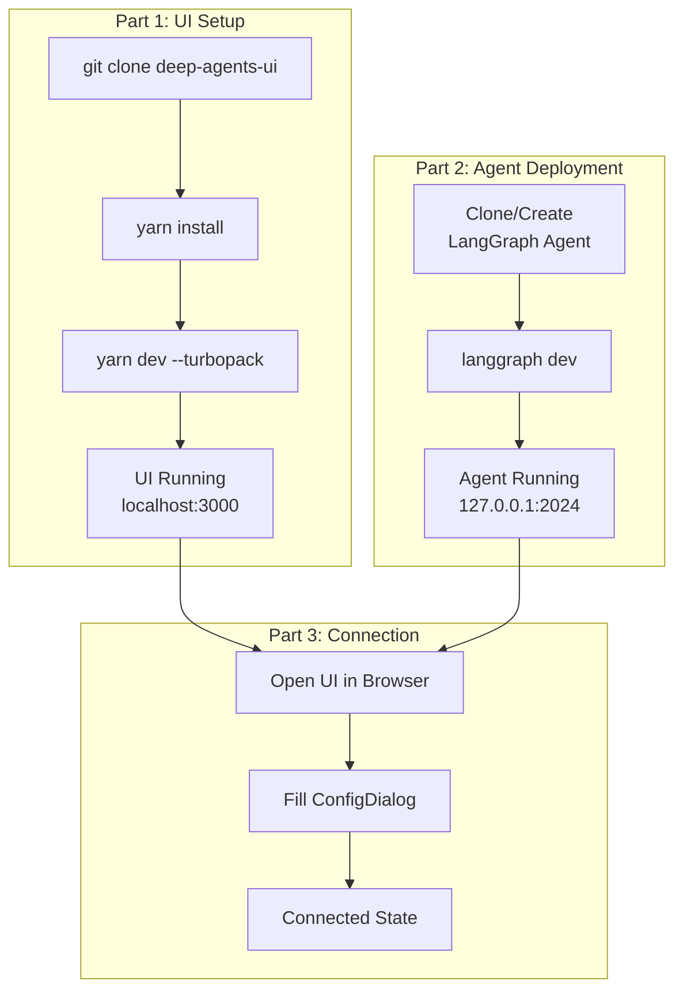

**Sources:** [README.md:9-14](), [package.json:7-7]()

---

## Step 1: Clone and Install UI Application

Clone the repository and install dependencies using Yarn:

```bash
git clone https://github.com/langchain-ai/deep-agents-ui.git
cd deep-agents-ui
yarn install
```

Start the development server using the `dev` script:

```bash
yarn dev
```

The application will be available at `http://localhost:3000`. At this point, the UI is running but not yet configured to connect to any agent deployment.

**Sources:** [README.md:9-14](), [package.json:7-7]()

---

## Step 2: Deploy a LangGraph Agent

The UI requires a running LangGraph deployment to connect to. This can be a local deployment (for development) or a remote hosted deployment.

### Local Development Deployment

For local development, use the LangGraph CLI to start a development server. For example, using the `deep_research` agent from the [deepagents](https://github.com/langchain-ai/deepagents) repository:

```bash
cd deepagents-quickstarts/deep_research
langgraph dev
```

The LangGraph CLI will output deployment information:

```
- 🚀 API: http://127.0.0.1:2024
- 🎨 Studio UI: https://smith.langchain.com/studio/?baseUrl=http://127.0.0.1:2024
```

Note the API URL (`http://127.0.0.1:2024`) - this will be your **Deployment URL**.

### Identifying the Assistant ID

The Assistant ID is defined in the agent's `langgraph.json` file under the `graphs` key:

```json
  "graphs": {
    "research": "./agent.py:agent"
  }
```

In this example, the **Assistant ID** is `research`.

**Sources:** [README.md:16-52]()

---

## Step 3: Configure Connection Settings

When you first open the UI at `http://localhost:3000`, the application will detect that no configuration exists and automatically display the `ConfigDialog`.

### Configuration Logic Diagram

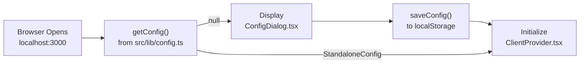

### Configuration Fields

The `ConfigDialog` component requires the following fields:

| Field | Required | Purpose | Example |
|-------|----------|---------|---------|
| **Deployment URL** | Yes | The URL for the LangGraph deployment | `http://127.0.0.1:2024` |
| **Assistant ID** | Yes | The ID of the assistant/graph to use | `research` |
| **LangSmith API Key** | No | Key for accessing LangGraph apps | `lsv2_pt_...` |

The configuration is persisted to `localStorage` using the key `"deep-agent-config"` via the `saveConfig()` function.

**Sources:** [README.md:53-58](), [src/lib/config.ts:7-25]()

---

## Step 4: Configuration Flow Detail

The configuration system operates through a multi-step initialization flow:

1. **Retrieval**: The app calls `getConfig()` from `src/lib/config.ts` to check for an existing `StandaloneConfig` object.
2. **Input**: If missing, `ConfigDialog.tsx` is rendered. It manages internal state for `deploymentUrl`, `assistantId`, and `langsmithApiKey`.
3. **Persistence**: Upon clicking "Save", `handleSave` validates the inputs and calls `saveConfig(config)` to persist the data.

**Sources:** [src/app/components/ConfigDialog.tsx:48-60](), [src/lib/config.ts:1-26]()

---

## Step 5: Optional Environment Variables

Instead of using the UI configuration dialog, you can pre-configure settings via environment variables. Create a `.env.local` file:

```env
NEXT_PUBLIC_LANGSMITH_API_KEY="lsv2_xxxx"
```

**Precedence:** Settings configured through the `ConfigDialog` UI take precedence over environment variables.

**Sources:** [README.md:73-81]()

---

## Step 6: First Interaction

Once connected, you can interact with the agent through the chat interface.

### Chat Execution Flow

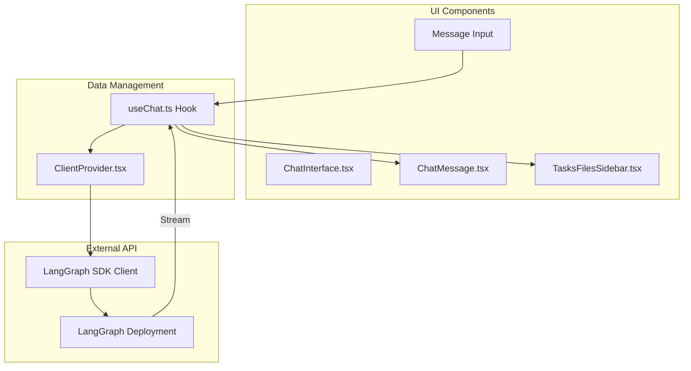

### Basic Usage Pattern

1. **Send Message**: Type a request in the chat interface and submit.
2. **Real-time Streaming**: The agent processes the request and streams updates (messages, tool calls, and state changes) back to the UI.
3. **File Interaction**: Files created by the agent appear in the LangGraph state and are accessible via the `TasksFilesSidebar`.
4. **Debug Mode**: You can toggle "Debug Mode" to execute the agent step-by-step, allowing for granular control and re-running of specific steps.

**Sources:** [README.md:59-88]()

---

## Troubleshooting Common Issues

| Issue | Potential Cause | Solution |
|-------|-----------------|----------|
| **Connection Failed** | LangGraph deployment is not running | Verify `langgraph dev` is active and the URL matches. |
| **Assistant Not Found** | Incorrect Assistant ID | Check the `graphs` key in your `langgraph.json` file. |
| **Config Not Saving** | Browser localStorage disabled | Ensure browser allows persistence for the UI domain. |

**Sources:** [README.md:1-52](), [src/lib/config.ts:7-15]()

---

# Page: System Architecture

# System Architecture

<details>
<summary>Relevant source files</summary>

The following files were used as context for generating this wiki page:

- [src/app/layout.tsx](src/app/layout.tsx)
- [src/app/page.tsx](src/app/page.tsx)
- [src/providers/ChatProvider.tsx](src/providers/ChatProvider.tsx)
- [src/providers/ClientProvider.tsx](src/providers/ClientProvider.tsx)
- [yarn.lock](yarn.lock)

</details>


## Purpose and Scope

This document describes the high-level architecture of Deep Agents UI, a Next.js-based frontend application for interacting with LangGraph agent deployments. It covers the layered structure of the application, the role of context providers in managing state, the component hierarchy, and the communication patterns with the LangGraph backend.

For specific implementation details about configuration management, see [Configuration Management](#2.1). For details about the LangGraph SDK integration, see [LangGraph Integration](#2.2). For UI-specific concerns like styling and components, see [User Interface Components](#7).

---

## Architectural Layers

Deep Agents UI follows a strict layered architecture where each layer has specific responsibilities and dependencies flow downward. The application is organized into five distinct layers:

### Layer Diagram

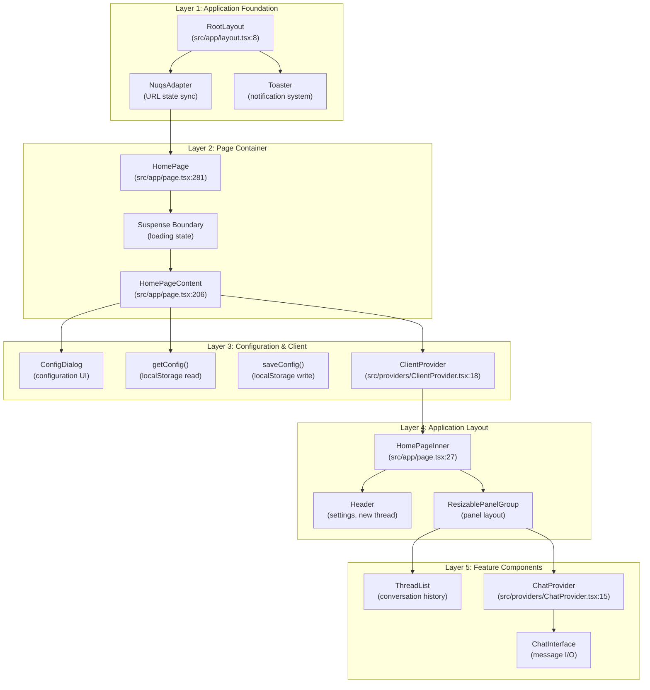

**Sources:** [src/app/layout.tsx:8-27](), [src/app/page.tsx:1-293](), [src/providers/ClientProvider.tsx:18-38](), [src/providers/ChatProvider.tsx:15-23]()

### Layer Responsibilities

| Layer | Components | Responsibilities |
|-------|-----------|------------------|
| **Layer 1: Foundation** | `RootLayout`, `NuqsAdapter`, `Toaster` | Global HTML structure, font loading, URL state synchronization, toast notifications |
| **Layer 2: Page Container** | `HomePage`, `Suspense`, `HomePageContent` | Suspense boundary for loading states, configuration loading from localStorage |
| **Layer 3: Configuration & Client** | `ConfigDialog`, `getConfig/saveConfig`, `ClientProvider` | Configuration persistence, LangGraph SDK client initialization |
| **Layer 4: Application Layout** | `HomePageInner`, `Header`, `ResizablePanelGroup` | UI chrome (header, settings button), resizable panel system, assistant fetching |
| **Layer 5: Feature Components** | `ThreadList`, `ChatProvider`, `ChatInterface` | Thread navigation, chat state management, message display and input |

**Sources:** [src/app/page.tsx:27-293](), [src/app/layout.tsx:1-27]()

---

## Application Bootstrap Flow

The application follows a strict initialization sequence that ensures configuration is validated before establishing connections to the LangGraph backend.

### Bootstrap Sequence Diagram

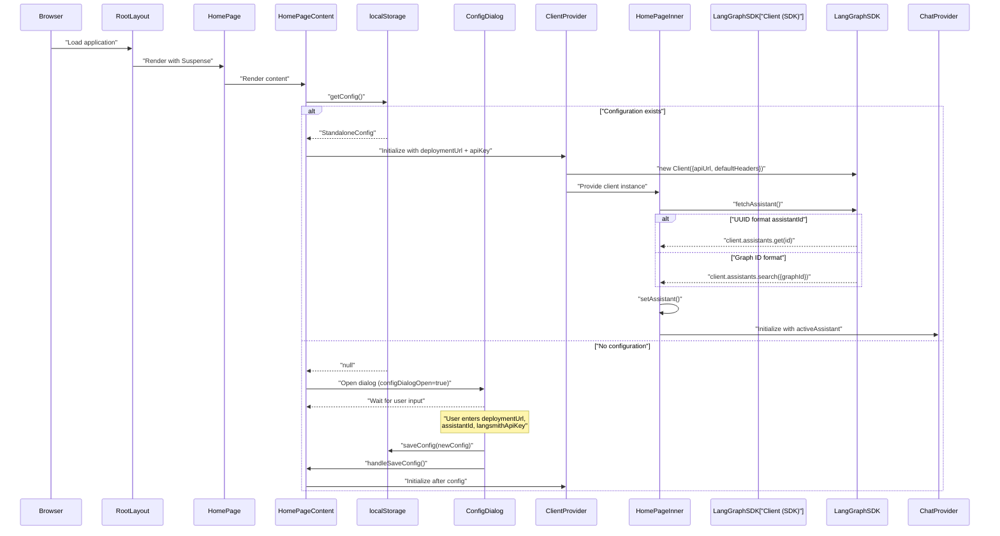

**Sources:** [src/app/page.tsx:206-279](), [src/app/page.tsx:41-99](), [src/providers/ClientProvider.tsx:23-31]()

### Bootstrap Steps

1. **Layer 1 Initialization** ([src/app/layout.tsx:8-27]()): `RootLayout` renders with `NuqsAdapter` wrapping all children to enable URL state synchronization and `Toaster` for notifications.

2. **Suspense Boundary** ([src/app/page.tsx:281-293]()): `HomePage` wraps `HomePageContent` in a Suspense boundary to handle async operations during initialization.

3. **Configuration Loading** ([src/app/page.tsx:212-223]()): `HomePageContent` calls `getConfig()` on mount to retrieve stored configuration from localStorage. If no configuration exists, `configDialogOpen` is set to true.

4. **Client Initialization** ([src/providers/ClientProvider.tsx:23-31]()): Once valid configuration exists, `ClientProvider` is rendered. It uses `useMemo` to instantiate a new `@langchain/langgraph-sdk` `Client` with the provided `apiUrl` and `X-Api-Key` header.

5. **Assistant Fetching** ([src/app/page.tsx:41-99]()): `HomePageInner` determines if `config.assistantId` is a UUID or graph name, then either calls `client.assistants.get()` or `client.assistants.search()` to retrieve assistant metadata.

6. **Chat Session Initialization** ([src/app/page.tsx:192-197]()): `ChatProvider` is rendered with the fetched `activeAssistant`, enabling chat functionality.

**Sources:** [src/app/page.tsx:206-293](), [src/app/page.tsx:27-204](), [src/providers/ClientProvider.tsx:1-48]()

---

## State Management Architecture

Deep Agents UI employs four distinct state management strategies, each serving a specific purpose:

### State Management Layers

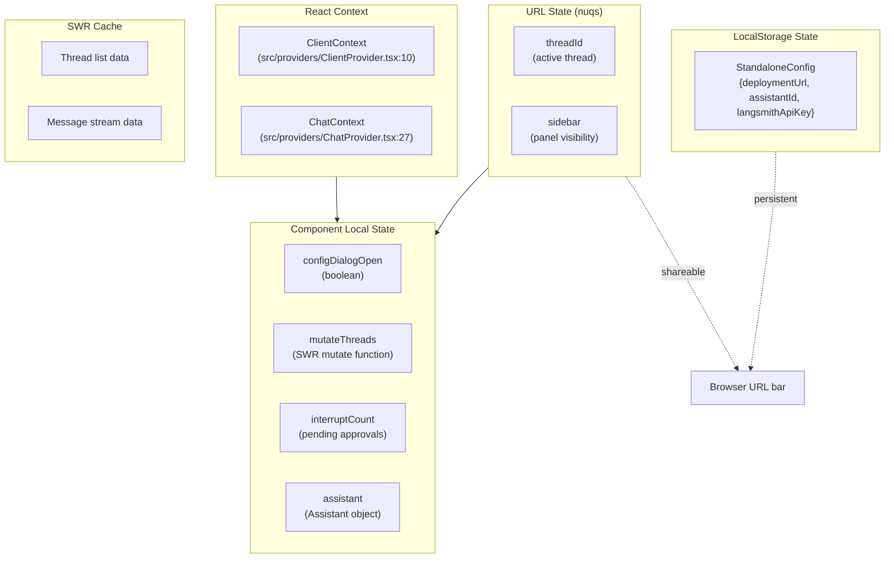

**Sources:** [src/app/page.tsx:34-38](), [src/providers/ClientProvider.tsx:10](), [src/providers/ChatProvider.tsx:27]()

### State Strategy Table

| State Type | Storage Location | Purpose | Persistence | Example |
|------------|------------------|---------|-------------|---------|
| **URL State** | Query parameters (via `useQueryState`) | Shareable UI state | Until URL changes | `threadId`, `sidebar` |
| **LocalStorage** | Browser localStorage | Configuration persistence | Across sessions | `deploymentUrl`, `assistantId` |
| **React Context** | Provider components | Cross-component shared state | Component lifecycle | `client` instance, `useChat` hook return value |
| **Local State** | `useState` hooks | Component-specific state | Component lifecycle | `configDialogOpen`, `interruptCount` |

**Sources:** [src/app/page.tsx:1-293](), [src/providers/ChatProvider.tsx:21-22]()

### State Initialization Flow

1. **URL State** ([src/app/page.tsx:34-35]()): `useQueryState` hooks create synchronized state with URL query parameters. Changes to these values automatically update the URL and vice versa.

2. **Configuration State** ([src/app/page.tsx:212-223]()): On mount, `getConfig()` reads from localStorage. If not found, the welcome screen is shown with `ConfigDialog`.

3. **Context State** ([src/providers/ClientProvider.tsx:33-36]()): `ClientProvider` wraps its children in `ClientContext.Provider`, exposing the `client` instance via the `useClient` hook ([src/providers/ClientProvider.tsx:40-47]()).

4. **Derived Chat State** ([src/providers/ChatProvider.tsx:21-22]()): `ChatProvider` initializes the `useChat` hook and provides its results (messages, submission handlers, etc.) to the entire chat subtree via `ChatContext`.

**Sources:** [src/app/page.tsx:27-204](), [src/providers/ClientProvider.tsx:1-48](), [src/providers/ChatProvider.tsx:1-37]()

---

## Component Hierarchy

The component tree follows a clear parent-child relationship that mirrors the architectural layers:

### Component Tree Structure

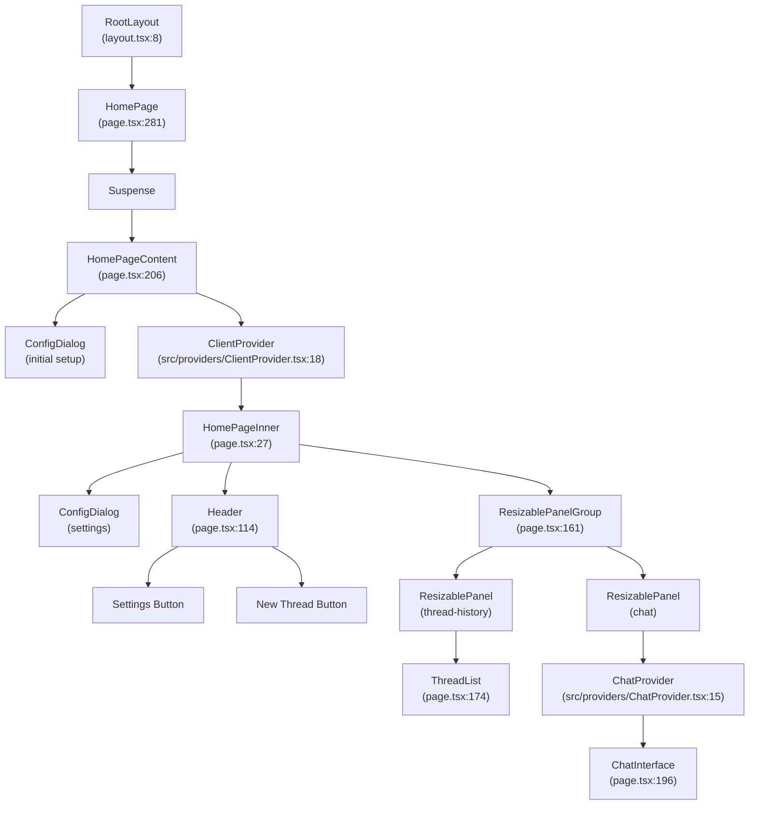

**Sources:** [src/app/page.tsx:1-293](), [src/app/layout.tsx:1-27](), [src/providers/ClientProvider.tsx:1-48]()

### Component Responsibility Matrix

| Component | File Location | Primary Responsibilities |
|-----------|---------------|-------------------------|
| `RootLayout` | [src/app/layout.tsx:8-27]() | HTML structure, Inter font, `NuqsAdapter`, `Toaster` |
| `HomePageContent` | [src/app/page.tsx:206-279]() | Configuration loading, `getConfig()`/`saveConfig()`, conditional rendering |
| `ClientProvider` | [src/providers/ClientProvider.tsx:18-38]() | LangGraph client initialization and distribution via `ClientContext` |
| `HomePageInner` | [src/app/page.tsx:27-204]() | Layout orchestration, assistant fetching, URL state management |
| `ChatProvider` | [src/providers/ChatProvider.tsx:15-23]() | Chat state, message management, providing `useChat` hook data to context |
| `ChatInterface` | [src/app/page.tsx:196]() | Message display, input handling, tasks/files sidebar |

**Sources:** [src/app/page.tsx:27-293](), [src/providers/ChatProvider.tsx:1-37]()

---

## Communication Architecture

The application communicates with the LangGraph backend through a layered API architecture:

### Communication Flow

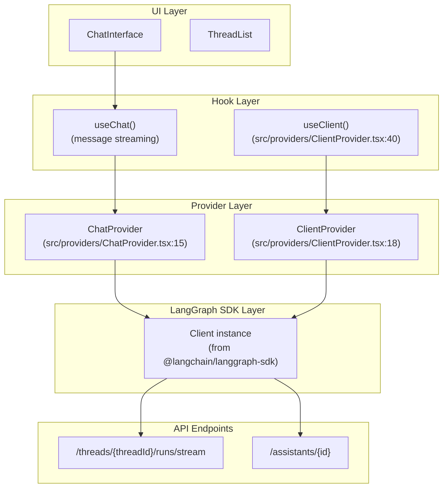

**Sources:** [src/app/page.tsx:27-204](), [src/providers/ClientProvider.tsx:1-48](), [src/providers/ChatProvider.tsx:1-37]()

### Client Initialization

The `ClientProvider` creates a single LangGraph client instance that is shared across the application:

1. **Provider Setup** ([src/providers/ClientProvider.tsx:23-31]()): `ClientProvider` receives `deploymentUrl` and `apiKey` as props. It instantiates a new `Client` from the `@langchain/langgraph-sdk`.

2. **Context Distribution** ([src/providers/ClientProvider.tsx:33-37]()): The client instance is exposed via `ClientContext.Provider`, accessible through the `useClient()` hook ([src/providers/ClientProvider.tsx:40-47]()).

3. **Assistant Resolution** ([src/app/page.tsx:41-99]()): `HomePageInner` uses the client to resolve the assistant:
   - **UUID format**: Direct call to `client.assistants.get(assistantId)` ([src/app/page.tsx:50]()).
   - **Graph ID format**: Call to `client.assistants.search({graphId: assistantId})` ([src/app/page.tsx:70-73]()), then selecting the system default assistant ([src/app/page.tsx:74-76]()).

**Sources:** [src/app/page.tsx:41-99](), [src/providers/ClientProvider.tsx:1-48]()

---

## Layout System

The application uses a resizable two-panel layout managed by the `ResizablePanelGroup` component:

### Panel Configuration

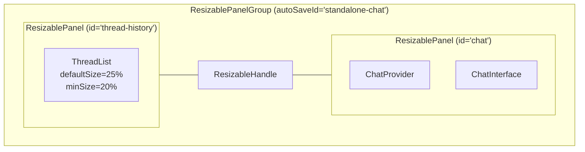

**Sources:** [src/app/page.tsx:161-200]()

### Panel Behavior

| Panel | Properties | Visibility Control |
|-------|-----------|-------------------|
| **Thread History** | `id="thread-history"`, `order={1}`, `defaultSize={25}`, `minSize={20}` | Conditional render based on `sidebar` query param ([src/app/page.tsx:165-184]()) |
| **Chat** | `id="chat"`, `order={2}` | Always visible |

**Key Features:**

1. **Persistent Sizing** ([src/app/page.tsx:163]()): The `autoSaveId="standalone-chat"` prop saves panel sizes to localStorage.

2. **Conditional Thread Panel** ([src/app/page.tsx:165]()): The thread list panel only renders when the `sidebar` state is truthy.

3. **Toggle Control** ([src/app/page.tsx:117-132]()): Header contains a "Threads" button that sets `sidebar="1"` to show the panel.

**Sources:** [src/app/page.tsx:161-200](), [src/app/page.tsx:117-132]()

---

# Page: Configuration and Connection

# Configuration and Connection

<details>
<summary>Relevant source files</summary>

The following files were used as context for generating this wiki page:

- [src/app/components/ConfigDialog.tsx](src/app/components/ConfigDialog.tsx)
- [src/lib/config.ts](src/lib/config.ts)
- [src/providers/ClientProvider.tsx](src/providers/ClientProvider.tsx)

</details>


This document describes the system for configuring and establishing connections to LangGraph deployments. It covers the configuration data structure, persistence mechanism, initialization flow, and how configuration parameters are used to establish API connectivity. For detailed information about the configuration UI components and persistence layer, see [Configuration Management](#2.1). For details on LangGraph SDK integration and API communication, see [LangGraph Integration](#2.2).

## Overview

The configuration system manages three essential connection parameters that enable the Deep Agents UI to communicate with a LangGraph deployment. Configuration data is persisted in browser `localStorage` and loaded on application startup. If no configuration exists, the application displays a `ConfigDialog` to collect the required settings before proceeding.

The configuration flow consists of three phases:

1.  **Loading**: On mount, `HomePageContent` attempts to retrieve configuration from `localStorage` via `getConfig()` [src/lib/config.ts:9-20]().
2.  **Validation**: If configuration exists, it initializes the `ClientProvider` with the deployment URL and API key [src/providers/ClientProvider.tsx:18-38]().
3.  **Initialization**: The `ClientProvider` creates a LangGraph SDK `Client` instance for all subsequent API communication [src/providers/ClientProvider.tsx:23-31]().

Sources: [src/lib/config.ts:1-26](), [src/providers/ClientProvider.tsx:1-48]()

## Configuration Data Structure

The `StandaloneConfig` interface defines the required and optional connection parameters:

| Field | Type | Required | Description |
| :--- | :--- | :--- | :--- |
| `deploymentUrl` | `string` | Yes | Base URL of the LangGraph deployment (e.g., `https://my-deployment.langchain.app`) |
| `assistantId` | `string` | Yes | Either a UUID assistant ID or a graph ID string |
| `langsmithApiKey` | `string` | No | API key for authentication, typically used for LangSmith or hosted LangGraph |

Sources: [src/lib/config.ts:1-5]()

## Configuration Storage and Retrieval

Configuration persistence uses the browser's `localStorage` API with the key `"deep-agent-config"` [src/lib/config.ts:7](). The system provides two functions:

**`getConfig(): StandaloneConfig | null`**
- Retrieves configuration from `localStorage.getItem(CONFIG_KEY)` [src/lib/config.ts:12]().
- Parses the JSON string into a `StandaloneConfig` object [src/lib/config.ts:16]().
- Returns `null` if no configuration exists, parsing fails, or in server-side rendering contexts [src/lib/config.ts:10-19]().

**`saveConfig(config: StandaloneConfig): void`**
- Serializes the configuration object to JSON and stores it in `localStorage` [src/lib/config.ts:24]().
- No-op in server-side rendering contexts [src/lib/config.ts:23]().

Sources: [src/lib/config.ts:7-25]()

## Configuration Initialization Flow

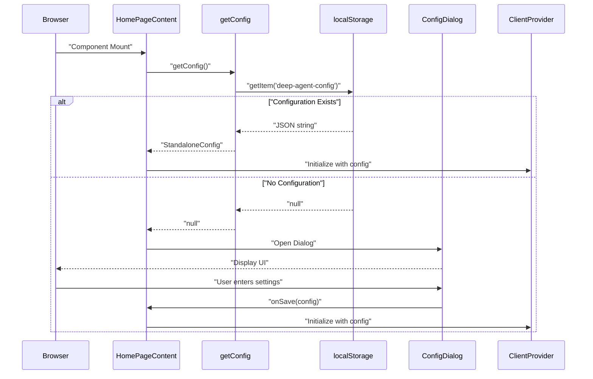

**Configuration Initialization Code Path**

The initialization logic follows this sequence:
1.  **Retrieval**: `getConfig()` is called to check for existing settings [src/lib/config.ts:9-20]().
2.  **State Management**: `ConfigDialog` manages local state for `deploymentUrl`, `assistantId`, and `langsmithApiKey` before saving [src/app/components/ConfigDialog.tsx:30-38]().
3.  **Persistence**: `handleSave` in the dialog calls the `onSave` callback, which typically triggers `saveConfig()` [src/app/components/ConfigDialog.tsx:48-60]().

Sources: [src/lib/config.ts:9-25](), [src/app/components/ConfigDialog.tsx:24-60]()

## Client Provider Initialization

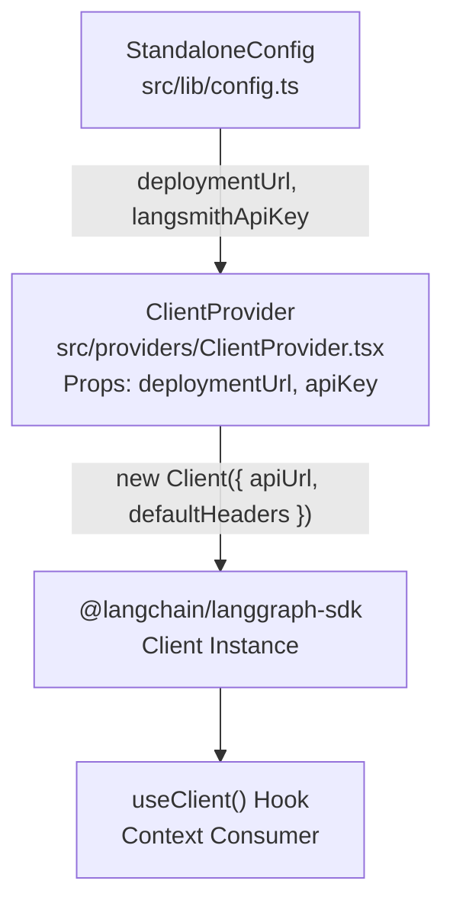

The `ClientProvider` is initialized with connection parameters. It uses `useMemo` to instantiate a new LangGraph `Client` [src/providers/ClientProvider.tsx:23-31](). This client includes the `apiUrl` and an `X-Api-Key` header if an API key is provided [src/providers/ClientProvider.tsx:28]().

The resulting `Client` instance is made available to the rest of the application via the `useClient` hook [src/providers/ClientProvider.tsx:40-47]().

Sources: [src/providers/ClientProvider.tsx:18-47]()

## Configuration Management UI

The `ConfigDialog` component provides the interface for users to input and modify their connection settings [src/app/components/ConfigDialog.tsx:24]().

*   **Validation**: The dialog ensures that `deploymentUrl` and `assistantId` are present before allowing a save [src/app/components/ConfigDialog.tsx:49-52]().
*   **Persistence Message**: The UI explicitly informs users that settings are saved in the browser's local storage [src/app/components/ConfigDialog.tsx:71-73]().
*   **Optional Fields**: `langsmithApiKey` is marked as optional and uses a password input type for security [src/app/components/ConfigDialog.tsx:95-105]().

Sources: [src/app/components/ConfigDialog.tsx:48-118]()

## Configuration Dependencies

The configuration system has dependencies on the following components and utilities:

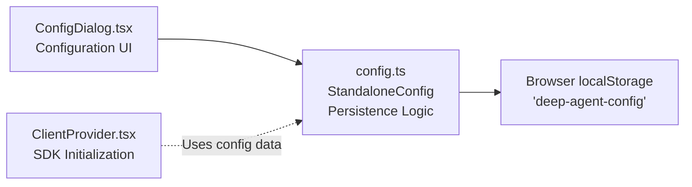

The `StandaloneConfig` interface serves as the shared type definition across all configuration-related components, ensuring type safety throughout the configuration lifecycle [src/lib/config.ts:1-5]().

Sources: [src/lib/config.ts:1-26](), [src/app/components/ConfigDialog.tsx:15-22](), [src/providers/ClientProvider.tsx:6-8]()

---

# Page: Configuration Management

# Configuration Management

<details>
<summary>Relevant source files</summary>

The following files were used as context for generating this wiki page:

- [src/app/components/ConfigDialog.tsx](src/app/components/ConfigDialog.tsx)
- [src/lib/config.ts](src/lib/config.ts)

</details>


This document covers the configuration management system in Deep Agents UI, which handles deployment connection settings and their persistence in browser local storage. The configuration system collects and stores the necessary parameters to connect to a LangGraph deployment.

For information about how configuration is used to initialize the LangGraph client, see page 2.2. For details about the overall application layout and initialization flow, see page 3.1.

## Configuration Architecture

Deep Agents UI requires configuration to establish a connection to a LangGraph deployment. The configuration system is built around three key components: the `StandaloneConfig` type definition, the `ConfigDialog` UI component, and browser local storage persistence functions.

### Configuration Flow Diagram

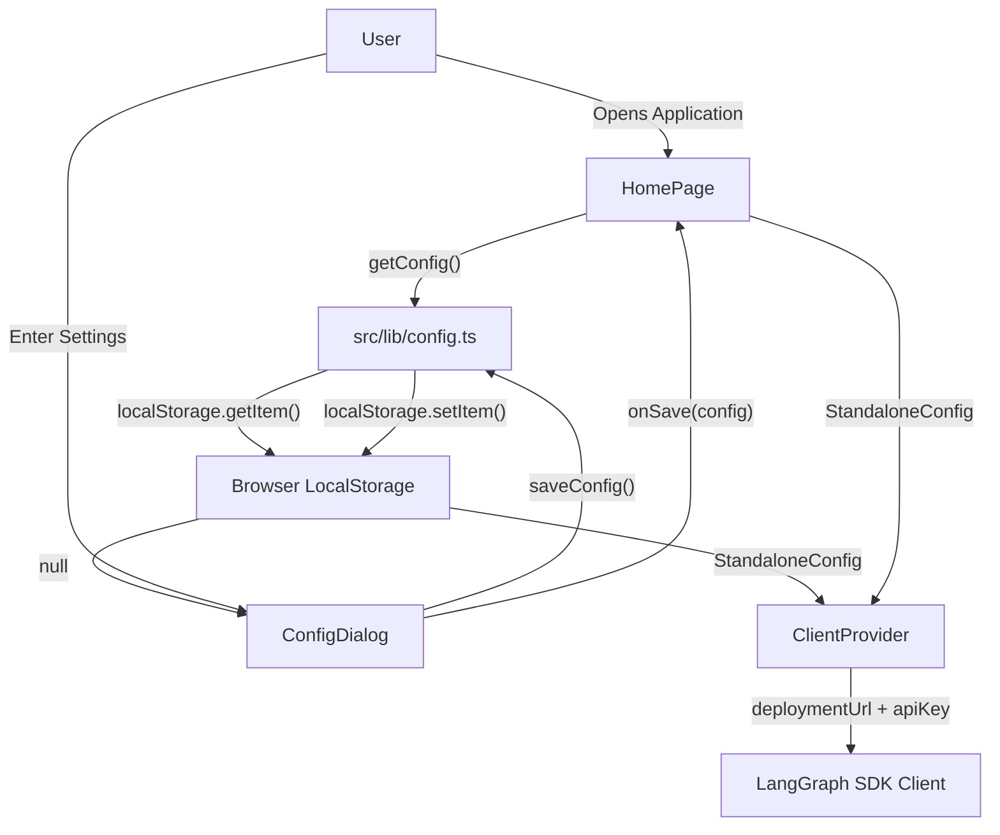

The configuration flow operates as follows:
1. Application checks for existing configuration in local storage using `getConfig()` [src/lib/config.ts:9-20]().
2. If not found, the UI triggers the `ConfigDialog` [src/app/components/ConfigDialog.tsx:24-120]().
3. User inputs deployment URL, assistant ID, and optional LangSmith API key.
4. Configuration is saved to local storage via `saveConfig()` [src/lib/config.ts:22-25]() and passed to the application state.
5. The `ClientProvider` initializes the LangGraph SDK client with the provided configuration.

Sources: [src/lib/config.ts:9-25](), [src/app/components/ConfigDialog.tsx:24-60]()

## Configuration Data Model

The configuration system is defined by the `StandaloneConfig` interface, which specifies the parameters required to connect to a LangGraph deployment.

### StandaloneConfig Interface

The `StandaloneConfig` interface in [src/lib/config.ts:1-5]() defines the configuration structure:

| Field | Type | Required | Purpose |
|-------|------|----------|---------|
| `deploymentUrl` | `string` | Yes | URL of the LangGraph deployment server |
| `assistantId` | `string` | Yes | UUID or graph ID identifying the target assistant |
| `langsmithApiKey` | `string` | No | Optional API key for LangSmith analytics integration |

### Configuration Fields Explained

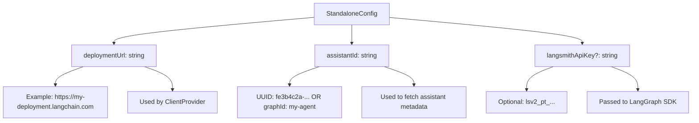

The `deploymentUrl` specifies the target LangGraph server endpoint. The `assistantId` can be either a full UUID for production deployments or a graph name/ID for development environments. The optional `langsmithApiKey` enables analytics and tracing features when provided.

Sources: [src/lib/config.ts:1-5]()

## Local Storage Persistence

Configuration is persisted in browser local storage under the key `"deep-agent-config"`, allowing settings to survive page refreshes and browser sessions.

### Storage Functions

The [src/lib/config.ts]() module provides two utility functions for configuration persistence:

| Function | Parameters | Returns | Purpose |
|----------|------------|---------|---------|
| `getConfig()` | None | `StandaloneConfig \| null` | Retrieves stored configuration from local storage |
| `saveConfig(config)` | `StandaloneConfig` | `void` | Saves configuration to local storage |

### Storage Implementation Details

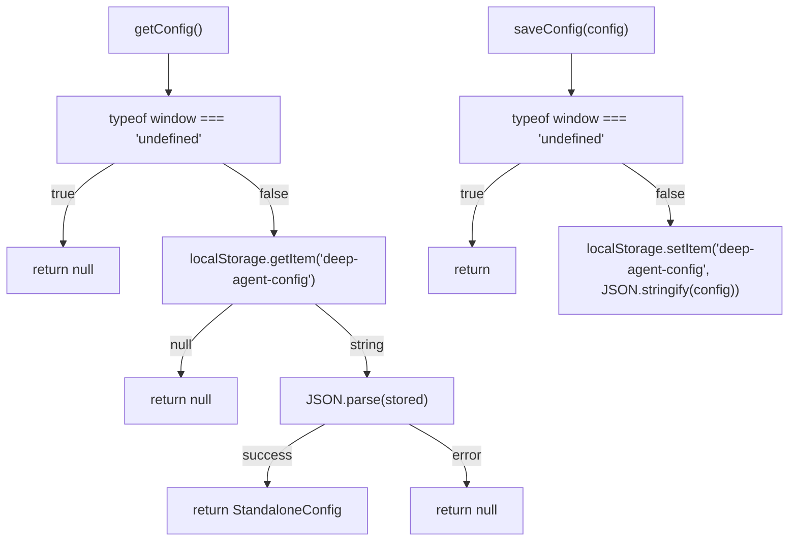

The `getConfig()` function in [src/lib/config.ts:9-20]() performs the following operations:
1. Checks if running in browser environment (`window` is defined) [src/lib/config.ts:10-10]().
2. Attempts to retrieve the stored configuration string using the `CONFIG_KEY` ("deep-agent-config") [src/lib/config.ts:7-12]().
3. Parses the JSON string, catching any parsing errors [src/lib/config.ts:15-19]().
4. Returns `null` if configuration doesn't exist or parsing fails.

The `saveConfig()` function in [src/lib/config.ts:22-25]() serializes the configuration object to JSON and stores it in local storage. Both functions include server-side rendering guards to prevent errors during Next.js pre-rendering.

Sources: [src/lib/config.ts:7-25]()

## ConfigDialog Component

The `ConfigDialog` component provides a modal dialog interface for collecting configuration parameters from the user. It is displayed when no valid configuration exists in local storage or when the user chooses to edit settings.

### ConfigDialog Component Structure

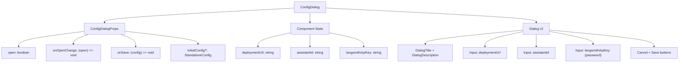

### Configuration Input Fields

The dialog presents three input fields to the user:

| Field Label | Input ID | Validation | Placeholder |
|-------------|----------|------------|-------------|
| Deployment URL | `deploymentUrl` | Required | `https://<deployment-url>` |
| Assistant ID | `assistantId` | Required | `<assistant-id>` |
| LangSmith API Key | `langsmithApiKey` | Optional | `lsv2_pt_...` |

The component in [src/app/components/ConfigDialog.tsx:24-120]() maintains local state for each input field using `useState` [src/app/components/ConfigDialog.tsx:30-38]() and synchronizes with `initialConfig` via `useEffect` when the dialog opens [src/app/components/ConfigDialog.tsx:40-46](). The LangSmith API Key input uses `type="password"` to mask the entered value [src/app/components/ConfigDialog.tsx:101-101]().

### ConfigDialog Interaction Flow

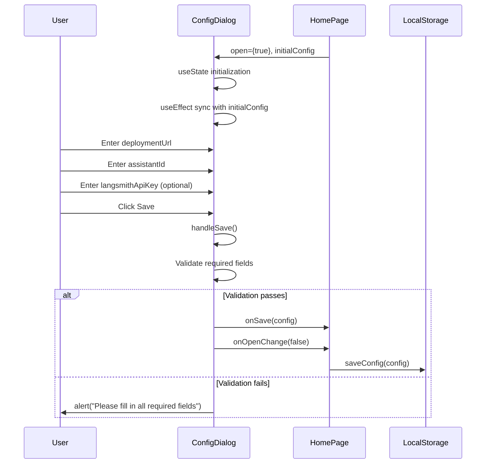

The `handleSave` function in [src/app/components/ConfigDialog.tsx:48-60]() performs validation to ensure both `deploymentUrl` and `assistantId` are provided before invoking the `onSave` callback with the configuration object [src/app/components/ConfigDialog.tsx:54-58]().

Sources: [src/app/components/ConfigDialog.tsx:17-120](), [src/lib/config.ts:22-25]()

---

# Page: LangGraph Integration

# LangGraph Integration

<details>
<summary>Relevant source files</summary>

The following files were used as context for generating this wiki page:

- [src/app/page.tsx](src/app/page.tsx)
- [src/providers/ClientProvider.tsx](src/providers/ClientProvider.tsx)

</details>


This document covers how the Deep Agents UI integrates with the LangGraph SDK to connect to LangGraph deployments. The integration includes client initialization, assistant fetching, and API communication patterns managed through the `ClientProvider`.

For configuration management and localStorage persistence, see page 2.1. For the chat system that utilizes these connections, see page 4.2.

## Client Initialization

The `ClientProvider` component initializes the LangGraph SDK client and makes it available throughout the application via the `useClient()` hook. It uses the `deploymentUrl` and `apiKey` provided by the application configuration.

### Client Provider Architecture

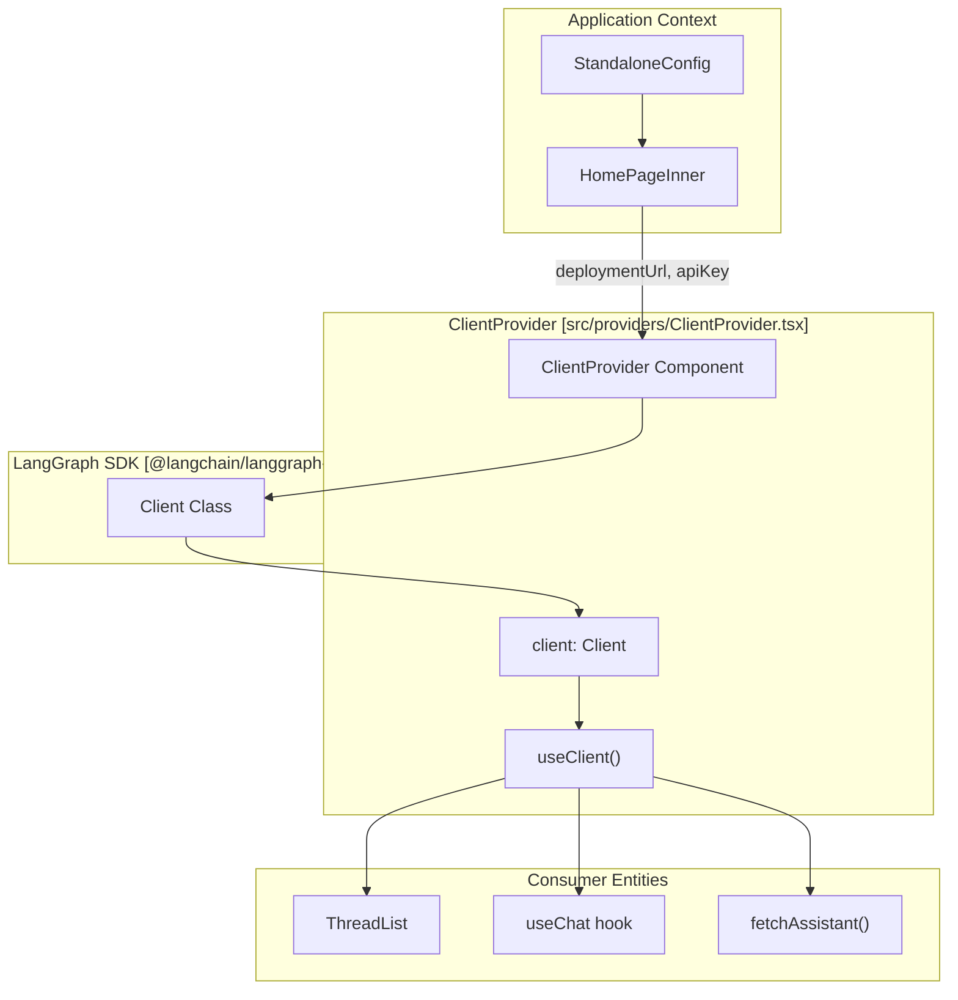

The `ClientProvider` initializes the client using a `useMemo` hook to ensure the instance is only recreated when the `deploymentUrl` or `apiKey` changes [src/providers/ClientProvider.tsx:23-31]().

**Sources:** [src/providers/ClientProvider.tsx:18-38](), [src/app/page.tsx:9](), [src/app/page.tsx:33]()

## Assistant Fetching

The application fetches assistant metadata after client initialization to validate the connection and retrieve assistant configuration. This logic resides in the `fetchAssistant` function within `HomePageInner` [src/app/page.tsx:41-99]().

### Assistant Resolution Flow

```mermaid
graph TB
    subgraph "Config State [src/lib/config.ts]"
        config["StandaloneConfig.assistantId"]
    end
    
    subgraph "Resolution Logic [src/app/page.tsx]"
        checkUUID{"Is assistantId<br/>a UUID?"}
        directFetch["client.assistants.get()"]
        searchFetch["client.assistants.search()"]
        findDefault{"Find metadata<br/>created_by: 'system'"}
    end
    
    subgraph "Result State"
        setAssistant["setAssistant(Assistant)"]
        fallback["Fallback Assistant Object"]
    end
    
    config --> checkUUID
    checkUUID -->|"Yes (Regex Match)"| directFetch
    checkUUID -->|"No (Graph ID)"| searchFetch
    
    directFetch -->|"Success"| setAssistant
    directFetch -.->|"Error"| fallback
    
    searchFetch --> findDefault
    findDefault -->|"Found"| setAssistant
    findDefault -.->|"Not Found / Error"| fallback
    
    fallback --> setAssistant
```

### UUID-Based Resolution
If the `assistantId` matches a UUID regex pattern, the system attempts a direct fetch using `client.assistants.get(config.assistantId)` [src/app/page.tsx:42-51]().

### Graph Name-Based Resolution
If the `assistantId` is a graph name (not a UUID), the system:
1. Searches for assistants associated with that `graphId` [src/app/page.tsx:70-73]().
2. Filters the results to find the default assistant where `metadata["created_by"] === "system"` [src/app/page.tsx:74-76]().

### Fallback Behavior
If the assistant cannot be found or an error occurs during fetching, the system constructs a manual `Assistant` object. This ensures the UI remains functional by providing a valid object structure with default names and IDs [src/app/page.tsx:54-64](), [src/app/page.tsx:86-96]().

**Sources:** [src/app/page.tsx:41-103](), [src/providers/ClientProvider.tsx:40-47]()

## Data Flow and SDK Usage

The application interacts with the LangGraph SDK through the client instance provided by `useClient()`. Key interaction points include:

### Client API Methods

| Area | Code Entity | SDK Method | Purpose |
| :--- | :--- | :--- | :--- |
| **Assistant Management** | `fetchAssistant` | `client.assistants.get` | Retrieve specific assistant details [src/app/page.tsx:50]() |
| **Assistant Discovery** | `fetchAssistant` | `client.assistants.search` | Find assistants by graph name [src/app/page.tsx:70]() |
| **Thread History** | `ThreadList` | `client.threads.search` | (Internal to ThreadList) List user threads |

### System Integration Summary

```mermaid
graph LR
    subgraph "Code Entities"
        CP["ClientProvider"]
        UC["useClient()"]
        HI["HomePageInner"]
        FA["fetchAssistant()"]
    end

    subgraph "External SDK"
        SDK["@langchain/langgraph-sdk"]
    end

    CP -->|"Initializes"| SDK
    UC -->|"Exposes"| SDK
    HI -->|"Calls"| FA
    FA -->|"Uses"| UC
    FA -->|"Queries"| SDK
```

**Sources:** [src/providers/ClientProvider.tsx:4-38](), [src/app/page.tsx:33-41]()

---

# Page: Application Layout

# Application Layout

<details>
<summary>Relevant source files</summary>

The following files were used as context for generating this wiki page:

- [src/app/components/ThreadList.tsx](src/app/components/ThreadList.tsx)
- [src/app/globals.css](src/app/globals.css)
- [src/app/layout.tsx](src/app/layout.tsx)
- [src/app/page.tsx](src/app/page.tsx)
- [yarn.lock](yarn.lock)

</details>


This page describes the high-level organization of the Deep Agents UI. The application uses a modern Next.js structure with a focus on resizable panels and real-time state management via URL query parameters. The layout is designed to facilitate complex agent interactions by providing dedicated areas for thread history, chat execution, and configuration.

For details on specific areas of the layout, see the following child pages:
- [Main Application Shell](#3.1) — Documents the `RootLayout`, `HomePage`, and `HomePageInner` components, including the resizable panel system.
- [Thread Navigation](#3.2) — Explains the `ThreadList` component, thread filtering, grouping by time, and the `useThreads` hook.

## Layout Structure Overview

The application follows a standard Next.js App Router structure. The `RootLayout` establishes the global provider context, while the `HomePageInner` component manages the primary visual segments using a resizable panel system.

```mermaid
graph TD
    subgraph "Root Context"
        RL["RootLayout (src/app/layout.tsx)"] --> NA["NuqsAdapter"]
        NA --> T["Toaster (sonner)"]
    end

    RL --> HP["HomePage (src/app/page.tsx)"]
    HP --> HPI["HomePageInner"]

    subgraph "Main UI (HomePageInner)"
        HPI --> H["Header (Nav & Settings)"]
        HPI --> RPG["ResizablePanelGroup"]
        
        RPG --> P1["ResizablePanel: Thread History"]
        RPG --> P2["ResizablePanel: Chat Area"]
        
        P1 --> TL["ThreadList (src/app/components/ThreadList.tsx)"]
        P2 --> CP["ChatProvider"]
        CP --> CI["ChatInterface (src/app/components/ChatInterface.tsx)"]
    end
```

**Layout Organization**

The interface is divided into three primary vertical zones:
1.  **Header**: Contains the application title, current assistant ID, settings toggle, and "New Thread" action [src/app/page.tsx:114-158]().
2.  **Thread Sidebar**: A collapsible and resizable panel on the left that lists historical and active chat threads [src/app/page.tsx:167-182]().
3.  **Chat Interface**: The main workspace where message streaming and agent tool execution occur [src/app/page.tsx:187-198]().

Sources: [src/app/layout.tsx:8-27](), [src/app/page.tsx:27-204]()

## State and Persistence

The layout state is largely driven by URL query parameters using the `nuqs` library. This ensures that the UI state (such as which thread is open or whether the sidebar is visible) is bookmarkable and persists across refreshes.

| Parameter | Hook / Usage | Description |
|-----------|--------------|-------------|
| `threadId` | `useQueryState("threadId")` | Determines the active conversation context [src/app/page.tsx:34](). |
| `sidebar` | `useQueryState("sidebar")` | Controls the visibility of the `ThreadList` panel [src/app/page.tsx:35](). |

The resizable panel positions are persisted locally using the `autoSaveId="standalone-chat"` attribute on the `ResizablePanelGroup` [src/app/page.tsx:163]().

Sources: [src/app/page.tsx:33-35](), [src/app/page.tsx:161-164]()

## Global Styling

The application uses Tailwind CSS for styling, with a comprehensive set of CSS variables defined in `globals.css` to handle theming and layout constants.

```mermaid
graph LR
    subgraph "Styling System (src/app/globals.css)"
        V["CSS Variables (:root)"] --> C["Colors (Primary, Surface, Border)"]
        V --> L["Layout (Sidebar Width, Header Height)"]
        V --> T["Typography (Inter Font)"]
    end
    
    C --> TM["Theme Support (Light/Dark)"]
    TM --> TW["Tailwind Utility Classes"]
```

**Theming and Variables**
- **Colors**: Defines semantic colors like `--color-primary`, `--color-user-message`, and status colors for threads [src/app/globals.css:20-54]().
- **Layout Constants**: Defines standard dimensions such as `--header-height: 64px` and `--sidebar-width: 320px` [src/app/globals.css:104-106]().
- **Dark Mode**: Supports system-level dark mode preferences using the `@media (prefers-color-scheme: dark)` block [src/app/globals.css:139-189]().

Sources: [src/app/globals.css:18-137](), [src/app/layout.tsx:4-6]()

## Navigation and Actions

The layout provides global actions in the header that interact with the application state:
- **Settings**: Opens the `ConfigDialog` to manage LangGraph connection strings [src/app/page.tsx:142-146]().
- **New Thread**: Clears the `threadId` query parameter, effectively resetting the chat interface for a new session [src/app/page.tsx:147-156]().
- **Thread Toggle**: When the sidebar is hidden, a "Threads" button appears in the header to restore it [src/app/page.tsx:117-132]().

Sources: [src/app/page.tsx:107-112](), [src/app/page.tsx:134-157]()

---

# Page: Main Application Shell

# Main Application Shell

<details>
<summary>Relevant source files</summary>

The following files were used as context for generating this wiki page:

- [src/app/layout.tsx](src/app/layout.tsx)
- [src/app/page.tsx](src/app/page.tsx)
- [src/components/ui/resizable.tsx](src/components/ui/resizable.tsx)
- [yarn.lock](yarn.lock)

</details>


## Purpose and Scope

The Main Application Shell encompasses the top-level page components responsible for initializing the application, managing configuration, orchestrating the layout, and providing context to child components. This document covers the `RootLayout` in [src/app/layout.tsx](), and the `HomePage`, `HomePageContent`, and `HomePageInner` components located in [src/app/page.tsx]().

The shell provides the fundamental UI structure, including the resizable panel system, the header bar, and the integration of the LangGraph SDK client via context providers.

---

## Component Hierarchy

The application shell consists of a root layout followed by three nested page components, each with distinct responsibilities:

```mermaid
graph TB
    RootLayout["RootLayout (src/app/layout.tsx)"]
    NuqsAdapter["NuqsAdapter (Query State)"]
    HomePage["HomePage (Default Export)"]
    Suspense["Suspense Boundary"]
    HomePageContent["HomePageContent (Config Management)"]
    ClientProvider["ClientProvider (LangGraph SDK)"]
    HomePageInner["HomePageInner (Layout Orchestration)"]
    
    RootLayout --> NuqsAdapter
    NuqsAdapter --> HomePage
    HomePage --> Suspense
    Suspense --> HomePageContent
    HomePageContent --> ClientProvider
    ClientProvider --> HomePageInner
    
    HomePageContent -.->|"manages"| ConfigDialog["ConfigDialog"]
    
    HomePageInner --> Header["Header Bar"]
    HomePageInner --> ResizablePanelGroup["ResizablePanelGroup"]
    
    ResizablePanelGroup --> ThreadPanel["ThreadList Panel"]
    ResizablePanelGroup --> ChatPanel["Chat Panel"]
    
    ThreadPanel --> ThreadList["ThreadList"]
    ChatPanel --> ChatProvider["ChatProvider"]
```

**Sources**: [src/app/layout.tsx:8-27](), [src/app/page.tsx:27-293]()

---

## Root Layout

The `RootLayout` is the entry point for the Next.js application. It configures the global environment for all routes.

| Entity | Role |
|--------|------|
| `NuqsAdapter` | Wraps the application to enable URL query state management using the `nuqs` library [src/app/layout.tsx:22-22](). |
| `Toaster` | Provides global toast notification support via `sonner` [src/app/layout.tsx:23-23](). |
| `Inter` | Applies the Inter font subset to the entire document body [src/app/layout.tsx:19-19](). |

**Sources**: [src/app/layout.tsx:1-27]()

---

## HomePage Component

The `HomePage` component serves as the default export for the root route. Its primary responsibility is to wrap the content in a `Suspense` boundary to handle asynchronous query state initialization.

| Aspect | Details |
|--------|---------|
| **Location** | [src/app/page.tsx:281-293]() |
| **Responsibilities** | Provide Suspense boundary with a "Loading..." fallback [src/app/page.tsx:287-287](). |
| **Children** | `HomePageContent` |

---

## HomePageContent Component

The `HomePageContent` component manages the application's configuration lifecycle. It determines whether to show the configuration dialog or render the main application interface based on the presence of a valid configuration.

### Configuration Lifecycle

1.  **Loading**: On mount, it calls `getConfig()` to retrieve settings from local storage [src/app/page.tsx:212-212]().
2.  **Validation**: If no configuration exists, it defaults `configDialogOpen` to `true` [src/app/page.tsx:216-216]().
3.  **Client Initialization**: Once configuration is available, it wraps the application in the `ClientProvider` [src/app/page.tsx:267-277](), passing the `deploymentUrl` and `apiKey` (resolved from config or environment variables) [src/app/page.tsx:237-238]().

**Sources**: [src/app/page.tsx:206-279]()

---

## HomePageInner Component

`HomePageInner` is the core layout orchestrator. It fetches assistant information from the LangGraph API and manages the resizable panel system.

### Assistant Fetching Logic

The component uses `useClient()` to access the LangGraph SDK [src/app/page.tsx:33-33]() and fetches assistant details via `fetchAssistant` [src/app/page.tsx:41-99]().

```mermaid
graph TD
    Start["fetchAssistant()"]
    CheckID{"Is config.assistantId a UUID?"}
    GetDirect["client.assistants.get()"]
    SearchGraph["client.assistants.search() by graphId"]
    SetAssistant["setAssistant(data)"]
    Fallback["Set Fallback Assistant Object"]

    Start --> CheckID
    CheckID -- "Yes" --> GetDirect
    CheckID -- "No" --> SearchGraph
    GetDirect -- "Success" --> SetAssistant
    GetDirect -- "Error" --> Fallback
    SearchGraph -- "Find 'system' assistant" --> SetAssistant
    SearchGraph -- "Not Found" --> Fallback
```

**Sources**: [src/app/page.tsx:41-103]()

### Resizable Panel System

The UI is divided using a `ResizablePanelGroup` from the local UI library [src/components/ui/resizable.tsx](), which wraps `react-resizable-panels`.

| Panel ID | Role | Configuration |
|----------|------|---------------|
| `thread-history` | Displays the `ThreadList` [src/app/page.tsx:174-181](). | `defaultSize={25}`, `minSize={20}` [src/app/page.tsx:170-171](). |
| `chat` | Displays the `ChatInterface` wrapped in a `ChatProvider` [src/app/page.tsx:192-197](). | `order={2}` [src/app/page.tsx:190-190](). |

The panels are separated by a `ResizableHandle` [src/app/page.tsx:183-183](). The `autoSaveId="standalone-chat"` attribute ensures that user-adjusted panel sizes persist across sessions [src/app/page.tsx:163-163]().

**Sources**: [src/app/page.tsx:161-199](), [src/components/ui/resizable.tsx:8-45]()

### Header Bar

The header provides global controls and status information:
*   **Threads Toggle**: Visible only when the sidebar is hidden; clicking it sets the `sidebar` query state to `"1"` [src/app/page.tsx:117-132]().
*   **Interrupt Badge**: Displays the `interruptCount` (number of threads requiring human intervention) [src/app/page.tsx:126-130]().
*   **Settings**: Opens the `ConfigDialog` [src/app/page.tsx:142-142]().
*   **New Thread**: Resets the `threadId` query state to `null` to start a fresh conversation [src/app/page.tsx:150-150]().

**Sources**: [src/app/page.tsx:114-158]()

---

## Data Flow: Shell to Context

The shell orchestrates data flow between the LangGraph SDK and the application's feature providers.

```mermaid
graph LR
    subgraph "Application Shell (HomePageInner)"
        SDK_Client["LangGraph Client (useClient)"]
        Assistant_State["Assistant Data"]
        Mutate_Threads["mutateThreads Callback"]
    end

    subgraph "Chat Context (ChatProvider)"
        Chat_Logic["useChat Hook"]
    end

    subgraph "Thread Context (ThreadList)"
        Thread_Fetch["fetchThreads"]
    end

    Assistant_State -->|"passed as prop"| Chat_Logic
    Mutate_Threads -->|"passed as onHistoryRevalidate"| Chat_Logic
    SDK_Client -->|"used in"| Thread_Fetch
    Chat_Logic -.->|"calls onHistoryRevalidate"| Mutate_Threads
    Mutate_Threads -.->|"triggers"| Thread_Fetch
```

**Sources**: [src/app/page.tsx:174-197]()

---

# Page: Thread Navigation

# Thread Navigation

<details>
<summary>Relevant source files</summary>

The following files were used as context for generating this wiki page:

- [src/app/components/ChatMessage.tsx](src/app/components/ChatMessage.tsx)
- [src/app/components/ThreadList.tsx](src/app/components/ThreadList.tsx)
- [src/app/globals.css](src/app/globals.css)
- [src/app/hooks/useThreads.ts](src/app/hooks/useThreads.ts)

</details>


## Purpose and Scope

This document covers the thread navigation system, which allows users to browse, filter, and select conversation threads in the Deep Agents UI. The primary components are the `ThreadList` component [src/app/components/ThreadList.tsx:120-125]() and the `useThreads` hook [src/app/hooks/useThreads.ts:17-20](), which together implement a searchable, filterable list of conversation threads with infinite scroll pagination.

For information about the chat interface and message display within a selected thread, see **4. Chat System**. For the overall application layout and panel system, see **3. Application Layout**.

## Thread Data Model

The thread navigation system operates on a normalized data structure called `ThreadItem`, which represents a conversation thread with display-optimized metadata.

### ThreadItem Interface

```typescript
export interface ThreadItem {
  id: string;
  updatedAt: Date;
  status: Thread["status"];
  title: string;
  description: string;
  assistantId?: string;
}
```

**Key Fields:**
- **id**: The unique thread identifier (`thread_id`) from the LangGraph SDK [src/app/hooks/useThreads.ts:122]().
- **updatedAt**: Timestamp for sorting and time-based grouping [src/app/hooks/useThreads.ts:123]().
- **status**: Current execution state (`idle`, `busy`, `interrupted`, `error`), used for filtering and visual indicators [src/app/hooks/useThreads.ts:124]().
- **title**: Extracted from the first human message (first 50 characters) [src/app/hooks/useThreads.ts:103]().
- **description**: Extracted from the first AI response (first 100 characters) [src/app/hooks/useThreads.ts:113]().
- **assistantId**: Associated assistant for thread filtering [src/app/hooks/useThreads.ts:127]().

**Sources:** [src/app/hooks/useThreads.ts:6-13]()

### Thread Data Transformation Flow

```mermaid
graph LR
    subgraph "LangGraph SDK Entity Space"
        RawThread["Thread Object<br/>(from SDK)"]
    end
    
    subgraph "useThreads Hook Logic"
        Transform["map() Logic<br/>[src/app/hooks/useThreads.ts:88-129]"]
        ExtractTitle["Extract Title<br/>(first human message)"]
        ExtractDesc["Extract Description<br/>(first AI message)"]
    end
    
    subgraph "Natural Language / UI Space"
        ThreadItem["ThreadItem<br/>{title, description, status}"]
    end
    
    RawThread --> Transform
    Transform --> ExtractTitle
    Transform --> ExtractDesc
    ExtractTitle --> ThreadItem
    ExtractDesc --> ThreadItem
```

**Sources:** [src/app/hooks/useThreads.ts:88-129]()

## Data Fetching Architecture

### useThreads Hook Implementation

The `useThreads` hook uses `useSWRInfinite` from the SWR library to implement infinite scroll pagination with automatic caching and revalidation.

```mermaid
graph TB
    subgraph "Configuration Entities"
        Config["getConfig()<br/>[src/lib/config.ts]"]
        Client["Client Instance<br/>[src/app/hooks/useThreads.ts:66]"]
    end
    
    subgraph "Fetching Logic"
        SWR["useSWRInfinite<br/>[src/app/hooks/useThreads.ts:23]"]
        Search["client.threads.search()<br/>[src/app/hooks/useThreads.ts:77]"]
    end
    
    subgraph "Parameters"
        Limit["pageSize (default 20)"]
        Offset["pageIndex * pageSize"]
        Metadata["metadata: { assistant_id }"]
    end
    
    Config --> Client
    Client --> Search
    SWR --> Search
    Search --> Limit
    Search --> Offset
    Search --> Metadata
```

**Sources:** [src/app/hooks/useThreads.ts:17-136]()

### Pagination Strategy

| Parameter | Value | Purpose |
|-----------|-------|---------|
| `DEFAULT_PAGE_SIZE` | 20 | Number of threads per page [src/app/hooks/useThreads.ts:15]() |
| `offset` | `pageIndex * pageSize` | Pagination offset for fetching [src/app/hooks/useThreads.ts:79]() |
| `sortBy` | `"updated_at"` | Sort field [src/app/hooks/useThreads.ts:80]() |
| `sortOrder` | `"desc"` | Most recent threads first [src/app/hooks/useThreads.ts:81]() |

**Pagination Logic:**
1. Initial page (index 0) loads first 20 threads.
2. User clicks "Load More" button, triggering `setSize(size + 1)` [src/app/components/ThreadList.tsx:349]().
3. SWR fetches next page with `offset = pageIndex * 20` [src/app/hooks/useThreads.ts:79]().
4. Stop fetching when a page returns fewer items than the `pageSize` [src/app/components/ThreadList.tsx:141]().

**Sources:** [src/app/hooks/useThreads.ts:15-86](), [src/app/components/ThreadList.tsx:138-142]()

### Assistant Filtering Strategy

The hook implements different filtering strategies based on whether the `assistantId` is a UUID (deployed graph) or a graph name (local development):

- **Deployed Graph**: If `assistantId` is a UUID, it adds a metadata filter: `{ metadata: { assistant_id: assistantId } }` [src/app/hooks/useThreads.ts:85]().
- **Local Graph**: No metadata filter is applied, as local dev graphs do not set this metadata [src/app/hooks/useThreads.ts:84]().

**Sources:** [src/app/hooks/useThreads.ts:72-86]()

## ThreadList Component Architecture

### Component Structure

The `ThreadList` component manages the UI for thread browsing, including status filtering and time-based grouping.

- **URL State**: The `currentThreadId` is synced with the `threadId` query parameter using `useQueryState` [src/app/components/ThreadList.tsx:126]().
- **Status Filter**: Local state `statusFilter` determines which threads are fetched [src/app/components/ThreadList.tsx:127]().
- **Grouping**: Threads are grouped by status (interrupted) and time (Today, Yesterday, etc.) [src/app/components/ThreadList.tsx:144-175]().

**Sources:** [src/app/components/ThreadList.tsx:1-369]()

### Props Interface

```typescript
interface ThreadListProps {
  onThreadSelect: (id: string) => void;
  onMutateReady?: (mutate: () => void) => void;
  onClose?: () => void;
  onInterruptCountChange?: (count: number) => void;
}
```

| Prop | Type | Purpose |
|------|------|---------|
| `onThreadSelect` | `(id: string) => void` | Callback when user selects a thread [src/app/components/ThreadList.tsx:114]() |
| `onMutateReady` | `(mutate: () => void) => void` | Exposes revalidation function to parent [src/app/components/ThreadList.tsx:115]() |
| `onClose` | `() => void` | Optional callback to close the sidebar [src/app/components/ThreadList.tsx:116]() |
| `onInterruptCountChange` | `(count: number) => void` | Notifies parent of threads needing attention [src/app/components/ThreadList.tsx:117]() |

**Sources:** [src/app/components/ThreadList.tsx:113-118]()

## Thread Grouping and Organization

### Grouping Algorithm

Threads are organized into groups based on their status and age. The `interrupted` status takes precedence, placing threads in the "Requiring Attention" group [src/app/components/ThreadList.tsx:155-158]().

**Group Labels:**
- `interrupted`: "Requiring Attention"
- `today`: "Today"
- `yesterday`: "Yesterday"
- `week`: "This Week"
- `older`: "Older"

**Sources:** [src/app/components/ThreadList.tsx:26-32](), [src/app/components/ThreadList.tsx:144-175]()

### Time Calculation Logic

The grouping logic calculates the number of days between the thread's `updatedAt` timestamp and the current time:

```typescript
const diff = now.getTime() - thread.updatedAt.getTime();
const days = Math.floor(diff / (1000 * 60 * 60 * 24));
```

**Time Display Format:**
- **Same day**: `HH:mm` (e.g., "14:35") [src/app/components/ThreadList.tsx:49]()
- **Yesterday**: "Yesterday" [src/app/components/ThreadList.tsx:50]()
- **Within week**: Day name (e.g., "Monday") [src/app/components/ThreadList.tsx:51]()
- **Older**: `MM/dd` (e.g., "12/15") [src/app/components/ThreadList.tsx:52]()

**Sources:** [src/app/components/ThreadList.tsx:45-53](), [src/app/components/ThreadList.tsx:160-171]()

## Status Filtering

### Status Color Scheme

The UI uses a consistent color mapping for thread statuses:

```typescript
const STATUS_COLORS: Record<ThreadItem["status"], string> = {
  idle: "bg-green-500",
  busy: "bg-blue-500",
  interrupted: "bg-orange-500",
  error: "bg-red-600",
};
```

**Sources:** [src/app/components/ThreadList.tsx:34-39]()

### Filter Dropdown Implementation

The `Select` component allows users to filter by `all`, `idle`, `busy`, `interrupted`, or `error` [src/app/components/ThreadList.tsx:215-258](). When a status is selected, it is passed to the `useThreads` hook to filter the API search results [src/app/components/ThreadList.tsx:129-132]().

**Sources:** [src/app/components/ThreadList.tsx:24](), [src/app/components/ThreadList.tsx:127-132](), [src/app/components/ThreadList.tsx:215-258]()

## Visual States

### State Components

- **LoadingState**: Displays `Skeleton` components during initial data fetch [src/app/components/ThreadList.tsx:91-102]().
- **ErrorState**: Displays an error message if the fetch fails [src/app/components/ThreadList.tsx:82-89]().
- **EmptyState**: Displays a message when no threads match the criteria [src/app/components/ThreadList.tsx:104-111]().

**Sources:** [src/app/components/ThreadList.tsx:82-111]()

## Integration Points

### Revalidation Mechanism

The `ThreadList` component exposes the SWR `mutate` function to its parent through the `onMutateReady` prop [src/app/components/ThreadList.tsx:181-202](). This allows the application to refresh the thread list when new messages are sent or thread statuses change elsewhere in the UI.

**Sources:** [src/app/components/ThreadList.tsx:181-202]()

### Interrupt Count Notification

The component tracks the number of threads with the `interrupted` status and notifies the parent via `onInterruptCountChange` [src/app/components/ThreadList.tsx:177-207](). This is typically used to display a notification badge in the application shell.

**Sources:** [src/app/components/ThreadList.tsx:177-207]()

---

# Page: Chat System

# Chat System

<details>
<summary>Relevant source files</summary>

The following files were used as context for generating this wiki page:

- [src/app/components/ChatInterface.tsx](src/app/components/ChatInterface.tsx)
- [src/app/components/ChatMessage.tsx](src/app/components/ChatMessage.tsx)
- [src/app/hooks/useChat.ts](src/app/hooks/useChat.ts)
- [src/app/hooks/useThreads.ts](src/app/hooks/useThreads.ts)
- [src/app/utils/utils.ts](src/app/utils/utils.ts)

</details>


## Purpose and Scope

The Chat System is the core functionality layer of Deep Agents UI responsible for managing real-time communication between users and LangGraph agents. It handles message submission, streaming responses, tool execution visualization, and state synchronization including tasks and files.

This document covers the overall chat architecture, message flow, and state management. For details on specific components, see:
- **ChatInterface UI component and input handling**: [ChatInterface Component](#4.1)
- **useChat hook internals and streaming**: [useChat Hook](#4.2)
- **Message rendering and tool call display**: [Message Processing and Display](#4.3)

For information about the context providers that wrap the chat system, see [Configuration and Connection](#2) and [System Architecture](#1.2). For tool approval mechanisms, see [Tool Approval and Interrupts](#5.2).

---

## System Architecture

The Chat System is organized into three primary layers: the `useChat` hook for state management and API communication, the `ChatProvider` context for sharing chat state across components, and the `ChatInterface` component for user interaction and display.

### Component and Hook Structure

```mermaid
graph TB
    ChatProvider["ChatProvider<br/>(providers/ChatProvider)"]
    useChat["useChat hook<br/>(app/hooks/useChat.ts)"]
    useStream["useStream<br/>(@langchain/langgraph-sdk/react)"]
    ChatInterface["ChatInterface<br/>(app/components/ChatInterface.tsx)"]
    ChatMessage["ChatMessage<br/>(app/components/ChatMessage.tsx)"]
    
    subgraph "Context Layer"
        ChatProvider
    end
    
    subgraph "Hook Layer"
        useChat
        useStream
    end
    
    subgraph "UI Layer"
        ChatInterface
        ChatMessage
    end
    
    ChatProvider -->|"provides context"| ChatInterface
    ChatProvider -->|"uses"| useChat
    useChat -->|"wraps"| useStream
    ChatInterface -->|"renders list of"| ChatMessage
    useStream -->|"manages WebSocket<br/>to LangGraph API"| LangGraphAPI["LangGraph<br/>Stream API"]
    
    useChat -->|"exposes"| ChatState["Chat State:<br/>messages, todos,<br/>files, interrupt"]
    useChat -->|"exposes"| ChatActions["Chat Actions:<br/>sendMessage,<br/>continueStream,<br/>resumeInterrupt"]
    
    ChatInterface -->|"calls"| ChatActions
    ChatInterface -->|"renders"| ChatState
```

**Sources:** [src/app/hooks/useChat.ts:1-168](), [src/app/components/ChatInterface.tsx:1-546]()

---

## Data Flow Architecture

The following diagram shows how user actions flow through the chat system, including the key functions and state transformations at each stage.

```mermaid
sequenceDiagram
    participant User
    participant ChatInterface
    participant sendMessage
    participant useStream
    participant LangGraphAPI
    participant StreamProcessor
    participant UIUpdate
    
    User->>ChatInterface: "Types message + submits"
    ChatInterface->>sendMessage: "handleSubmit() → sendMessage(content)"
    
    Note over sendMessage: "useChat.ts:56-72<br/>Creates Message object<br/>with uuid"
    
    sendMessage->>sendMessage: "Create newMessage<br/>{id: uuidv4(), type: 'human', content}"
    sendMessage->>useStream: "stream.submit({messages: [newMessage]},<br/>{optimisticValues, config})"
    
    Note over useStream: "Optimistic update:<br/>adds message to UI<br/>immediately"
    
    useStream->>UIUpdate: "Update messages array"
    UIUpdate->>ChatInterface: "Re-render with new message"
    
    useStream->>LangGraphAPI: "POST /threads/{threadId}/input"
    
    loop "Streaming Response"
        LangGraphAPI-->>StreamProcessor: "Stream chunks<br/>(messages, todos, files)"
        StreamProcessor-->>useStream: "Update stream.values"
        useStream-->>ChatInterface: "Re-render with updates"
    end
    
    alt "Agent completes normally"
        LangGraphAPI-->>useStream: "Stream end"
        useStream->>useStream: "onFinish() → onHistoryRevalidate()"
    else "Tool requires approval"
        LangGraphAPI-->>useStream: "Interrupt signal"
        useStream->>ChatInterface: "stream.interrupt populated"
        ChatInterface->>User: "Show ToolApprovalInterrupt UI"
        User->>ChatInterface: "Approve/Reject/Edit"
        ChatInterface->>useStream: "resumeInterrupt(decision)"
    end
```

**Sources:** [src/app/hooks/useChat.ts:56-72](), [src/app/components/ChatInterface.tsx:89-100]()

---

## State Management

The Chat System manages multiple types of state through the `useChat` hook, which wraps the LangGraph SDK's `useStream` hook.

### State Type Definition

The primary state interface is `StateType`, defined in [src/app/hooks/useChat.ts:16-26]():

| Field | Type | Description |
|-------|------|-------------|
| `messages` | `Message[]` | Array of chat messages (human, ai, tool) |
| `todos` | `TodoItem[]` | Task list tracked by agent |
| `files` | `Record<string, string>` | File content keyed by path |
| `email` | `object` (optional) | Email context with id, subject, page_content |
| `ui` | `any` (optional) | Custom UI components from agent |

### State Initialization

```mermaid
graph LR
    URLParams["URL Query Parameter<br/>threadId"]
    useStream["useStream hook<br/>initialization"]
    ThreadHistory["Fetch Thread History<br/>fetchStateHistory: true"]
    InitialState["Initial State<br/>messages, todos, files"]
    
    URLParams -->|"threadId ?? null"| useStream
    useStream -->|"if threadId exists"| ThreadHistory
    ThreadHistory --> InitialState
    
    useStream -->|"onThreadId callback"| setThreadId["setThreadId<br/>(updates URL)"]
    
    Note1["useChat.ts:37-54<br/>Configuration"]
    Note2["reconnectOnMount: true<br/>enables reconnection<br/>to existing threads"]
```

The `useChat` hook initializes with configuration from [src/app/hooks/useChat.ts:40-54]():

- **assistantId**: From `activeAssistant.assistant_id` [src/app/hooks/useChat.ts:41]()
- **client**: LangGraph SDK client instance [src/app/hooks/useChat.ts:42]()
- **reconnectOnMount**: `true` - reconnects to WebSocket on component mount [src/app/hooks/useChat.ts:43]()
- **threadId**: From URL query parameter via `nuqs` [src/app/hooks/useChat.ts:37, 44]()
- **onThreadId**: Callback to update URL when thread changes [src/app/hooks/useChat.ts:45]()
- **fetchStateHistory**: `true` - fetches existing messages when switching threads [src/app/hooks/useChat.ts:48]()
- **defaultHeaders**: `{ "x-auth-scheme": "langsmith" }` [src/app/hooks/useChat.ts:46]()

**Sources:** [src/app/hooks/useChat.ts:16-54]()

---

## Message Submission Flow

### sendMessage Function

The `sendMessage` function handles user message submission with optimistic updates:

```mermaid
graph TB
    Input["User Input<br/>(string content)"]
    CreateMsg["Create Message Object<br/>{id: uuidv4(),<br/>type: 'human',<br/>content}"]
    Optimistic["Optimistic Update<br/>optimisticValues: (prev) => ({<br/>messages: [...prev.messages, newMessage]})"]
    Submit["stream.submit()<br/>with messages + config"]
    Revalidate["onHistoryRevalidate()<br/>(update thread list)"]
    
    Input --> CreateMsg
    CreateMsg --> Optimistic
    CreateMsg --> Submit
    Submit --> Revalidate
    
    Config["Assistant Config<br/>+ recursion_limit: 100"]
    Config --> Submit
    
    Note["useChat.ts:56-72"]
```

**Implementation details:**

1. **Message Creation** [src/app/hooks/useChat.ts:58](): Creates a new `Message` object with UUID, type "human", and user content
2. **Optimistic Update** [src/app/hooks/useChat.ts:62-64](): Immediately adds message to UI before server response
3. **Submit to Stream** [src/app/hooks/useChat.ts:59-67](): Sends message with assistant config and recursion limit of 100
4. **Thread List Update** [src/app/hooks/useChat.ts:69](): Triggers revalidation to update thread list sidebar

**Sources:** [src/app/hooks/useChat.ts:56-72]()

---

## Stream Control Functions

The `useChat` hook exposes several functions for controlling the agent execution stream:

### Function Reference

| Function | Parameters | Purpose | Location |
|----------|-----------|---------|----------|
| `sendMessage` | `content: string` | Submit user message | [src/app/hooks/useChat.ts:56-72]() |
| `runSingleStep` | `messages, checkpoint?, isRerunningSubagent?, optimisticMessages?` | Execute single step with interrupt | [src/app/hooks/useChat.ts:74-100]() |
| `continueStream` | `hasTaskToolCall?: boolean` | Resume agent execution | [src/app/hooks/useChat.ts:112-127]() |
| `stopStream` | none | Stop streaming execution | [src/app/hooks/useChat.ts:144-146]() |
| `resumeInterrupt` | `value: any` | Resume from human approval interrupt | [src/app/hooks/useChat.ts:135-142]() |
| `markCurrentThreadAsResolved` | none | Mark thread complete and goto `__end__` | [src/app/hooks/useChat.ts:129-133]() |
| `setFiles` | `files: Record<string, string>` | Update file state | [src/app/hooks/useChat.ts:102-110]() |

### runSingleStep Configuration

The `runSingleStep` function [src/app/hooks/useChat.ts:74-100]() supports stepping through agent execution with interrupts:

```mermaid
graph TB
    runSingleStep["runSingleStep()"]
    
    HasCheckpoint{{"checkpoint<br/>provided?"}}
    IsRerunning{{"isRerunningSubagent<br/>flag?"}}
    
    runSingleStep --> HasCheckpoint
    
    HasCheckpoint -->|"Yes"| WithCheckpoint["stream.submit(undefined,<br/>{config, checkpoint})"]
    HasCheckpoint -->|"No"| WithoutCheckpoint["stream.submit({messages},<br/>{config})"]
    
    WithCheckpoint --> IsRerunning
    IsRerunning -->|"Yes"| InterruptAfter["interruptAfter: ['tools']"]
    IsRerunning -->|"No"| InterruptBefore["interruptBefore: ['tools']"]
    
    WithoutCheckpoint --> InterruptBefore2["interruptBefore: ['tools']"]
    
    Note1["Used for:<br/>- Step-by-step debugging<br/>- Sub-agent re-execution<br/>- Tool approval flow"]
```

**Sources:** [src/app/hooks/useChat.ts:74-100]()

---

## Message Processing

The `ChatInterface` component processes messages from the stream into a renderable format with tool calls attached.

### Message-to-ToolCall Association

```mermaid
graph TB
    Messages["messages array<br/>(from useStream)"]
    ProcessLoop["useMemo() loop<br/>ChatInterface.tsx:114-216"]
    MessageMap["Map<string, {message, toolCalls}>"]
    
    Messages --> ProcessLoop
    
    subgraph "Processing Steps"
        AIMsg["AI Message:<br/>Extract tool_calls from<br/>additional_kwargs or<br/>message.tool_calls"]
        ToolMsg["Tool Message:<br/>Find matching tool_call<br/>by tool_call_id"]
        HumanMsg["Human Message:<br/>Add with empty toolCalls"]
        
        ProcessLoop --> AIMsg
        ProcessLoop --> ToolMsg
        ProcessLoop --> HumanMsg
    end
    
    AIMsg --> AddToMap["Add to Map with<br/>status: 'pending'"]
    ToolMsg --> UpdateMap["Update existing tool<br/>status: 'completed'<br/>add result"]
    HumanMsg --> AddToMap
    
    AddToMap --> MessageMap
    UpdateMap --> MessageMap
    
    MessageMap --> ProcessedArray["Array of<br/>{message, toolCalls, showAvatar}"]
    ProcessedArray --> Render["Render ChatMessage<br/>components"]
```

**Implementation details** [src/app/components/ChatInterface.tsx:114-216]():

1. **Create Message Map**: Initialize `Map<string, {message, toolCalls}>` to associate tool calls with AI messages.
2. **Process AI Messages**: Extract tool calls from `additional_kwargs.tool_calls` [src/app/components/ChatInterface.tsx:135](), `message.tool_calls` [src/app/components/ChatInterface.tsx:139](), or content blocks with type `"tool_use"` [src/app/components/ChatInterface.tsx:146]().
3. **Handle Tool Messages**: Find matching tool call by `tool_call_id` [src/app/components/ChatInterface.tsx:183]() and update status to "completed" with result extracted via `extractStringFromMessageContent` [src/app/components/ChatInterface.tsx:197]().
4. **Determine Avatar Display**: Compare current message type with previous to decide whether to show avatar [src/app/components/ChatInterface.tsx:213]().
5. **Return Processed Array**: Convert map to array with tool call associations preserved.

**Sources:** [src/app/components/ChatInterface.tsx:114-216](), [src/app/utils/utils.ts:9-31]()

---

## Interrupt Handling

The Chat System supports human-in-the-loop interrupts for tool approval. When an agent requests approval, the `interrupt` state is populated with `action_requests` and optional `review_configs`.

### Interrupt State Structure

```mermaid
graph LR
    Interrupt["stream.interrupt"]
    
    ActionRequests["action_requests array<br/>List of tools awaiting approval"]
    ReviewConfigs["review_configs array<br/>(optional)<br/>Approval UI configuration"]
    
    Interrupt --> ActionRequests
    Interrupt --> ReviewConfigs
    
    ActionRequestsMap["Map<string, ActionRequest><br/>Keyed by tool name"]
    ReviewConfigsMap["Map<string, ReviewConfig><br/>Keyed by actionName"]
    
    ActionRequests --> ActionRequestsMap
    ReviewConfigs --> ReviewConfigsMap
    
    PassToMessage["Pass to ChatMessage<br/>for last message only"]
    
    ActionRequestsMap --> PassToMessage
    ReviewConfigsMap --> PassToMessage
```

The interrupt parsing logic [src/app/components/ChatInterface.tsx:228-242]():

1. Extract `action_requests` from `interrupt.value` [src/app/components/ChatInterface.tsx:229-230]().
2. Extract `review_configs` (if present) from `interrupt.value` [src/app/components/ChatInterface.tsx:234-235]().
3. Create maps keyed by tool name / action name for efficient lookup.
4. Pass maps only to the last message for rendering approval UI.

**Sources:** [src/app/components/ChatInterface.tsx:228-242]()

---

## Tasks and Files UI

The `ChatInterface` includes an embedded UI section above the input box for displaying tasks and files.

### UI State Management

```mermaid
graph TB
    MetaState["metaOpen state<br/>'tasks' | 'files' | null"]
    
    Collapsed["Collapsed View<br/>(metaOpen === null)"]
    Expanded["Expanded View<br/>(metaOpen !== null)"]
    
    MetaState --> Collapsed
    MetaState --> Expanded
    
    subgraph "Collapsed Display"
        ActiveTask["Show active task<br/>(status: 'in_progress')"]
        TaskProgress["Task X of Y"]
        FilesCount["Files count badge"]
    end
    
    subgraph "Expanded Display"
        TabButtons["Tab buttons:<br/>Tasks | Files"]
        TaskGroups["Grouped todos by status:<br/>pending, in_progress, completed"]
        FilesPopover["FilesPopover component<br/>with edit capability"]
    end
    
    Collapsed --> ActiveTask
    Collapsed --> TaskProgress
    Collapsed --> FilesCount
    
    Expanded --> TabButtons
    Expanded --> TaskGroups
    Expanded --> FilesPopover
```

**Key features** [src/app/components/ChatInterface.tsx:296-501]():

- **Conditional Rendering**: Only shows when `hasTasks || hasFiles` is true.
- **Collapsed State**: Displays single-line summary of active task and file count.
- **Expanded State**: Shows full task list grouped by status or file list with editing via `FilesPopover` [src/app/components/ChatInterface.tsx:456]().
- **Max Height**: `max-h-72` with scroll for long lists [src/app/components/ChatInterface.tsx:327]().
- **Edit Locking**: File editing disabled when `isLoading === true || interrupt !== undefined` [src/app/components/ChatInterface.tsx:459]().

**Sources:** [src/app/components/ChatInterface.tsx:296-501]()

---

## Input Handling

The message input uses a `<textarea>` with auto-resizing via CSS `field-sizing-content` property.

### Input Component Structure

```mermaid
graph TB
    Textarea["textarea element<br/>field-sizing-content<br/>resize-none"]
    InputState["input state<br/>(local component state)"]
    
    subgraph "Event Handlers"
        OnChange["onChange:<br/>setInput(e.target.value)"]
        OnKeyDown["onKeyDown:<br/>Enter submits (if !Shift)"]
        OnSubmit["form onSubmit:<br/>handleSubmit()"]
    end
    
    Textarea --> OnChange
    Textarea --> OnKeyDown
    
    OnChange --> InputState
    OnKeyDown --> HandleSubmit["handleSubmit()<br/>useCallback"]
    OnSubmit --> HandleSubmit
    
    HandleSubmit --> Validation{{"Validation:<br/>!messageText.trim() ||<br/>isLoading ||<br/>submitDisabled"}}
    
    Validation -->|"Valid"| SendMsg["sendMessage(messageText)<br/>setInput('')"]
    Validation -->|"Invalid"| Return["return (no-op)"]
    
    SendMsg --> StreamAPI["Submit to stream"]
```

**Implementation details** [src/app/components/ChatInterface.tsx:503-539]():

- **Auto-resize**: CSS property `field-sizing-content` enables automatic height adjustment based on content [src/app/components/ChatInterface.tsx:511]().
- **Enter Key**: Submits message; Shift+Enter adds newline [src/app/components/ChatInterface.tsx:105-108]().
- **Submit Button**: Toggles between "Send" (with `ArrowUp` icon) and "Stop" (with `Square` icon) based on `isLoading` state [src/app/components/ChatInterface.tsx:526-533]().
- **Disabled State**: Submit disabled when `!isLoading && (submitDisabled || !input.trim())` [src/app/components/ChatInterface.tsx:524]().
- **Placeholder**: Changes to "Running..." when `isLoading === true` [src/app/components/ChatInterface.tsx:516]().

**Sources:** [src/app/components/ChatInterface.tsx:89-111, 503-539]()

---

## Exposed API

The `useChat` hook returns an object with the following properties and methods:

### Return Value Structure

```typescript
{
  // Stream management
  stream: UseStreamThread<StateType>
  
  // State values (from stream.values)
  todos: TodoItem[]
  files: Record<string, string>
  email?: { id?: string; subject?: string; page_content?: string }
  ui?: any
  
  // Message management
  messages: Message[]
  isLoading: boolean
  isThreadLoading: boolean
  interrupt: Interrupt | undefined
  getMessagesMetadata: () => MessagesMetadata
  
  // Actions
  sendMessage: (content: string) => void
  runSingleStep: (messages, checkpoint?, isRerunningSubagent?, optimisticMessages?) => void
  continueStream: (hasTaskToolCall?: boolean) => void
  stopStream: () => void
  markCurrentThreadAsResolved: () => void
  resumeInterrupt: (value: any) => void
  setFiles: (files: Record<string, string>) => Promise<void>
}
```

**Sources:** [src/app/hooks/useChat.ts:148-167]()

---

## Integration with ChatProvider

The `useChat` hook is consumed by `ChatProvider` context, which makes the chat state and actions available to all descendant components via the `useChatContext()` hook.

```mermaid
graph TB
    CP["ChatProvider<br/>(context provider)"]
    useChat["useChat hook"]
    Context["Chat Context Value"]
    
    CI["ChatInterface"]
    CM["ChatMessage"]
    TFS["TasksFilesSidebar"]
    OtherComponents["Other Components"]
    
    CP -->|"calls"| useChat
    useChat -->|"returns"| Context
    CP -->|"provides via context"| Context
    
    Context -->|"useChatContext()"| CI
    Context -->|"useChatContext()"| CM
    Context -->|"useChatContext()"| TFS
    Context -->|"useChatContext()"| OtherComponents
    
    Note["ChatInterface.tsx:72-85<br/>Destructures from useChatContext():<br/>stream, messages, todos, files,<br/>ui, setFiles, isLoading,<br/>isThreadLoading, interrupt,<br/>sendMessage, stopStream,<br/>resumeInterrupt"]
```

**Sources:** [src/app/components/ChatInterface.tsx:72-85]()

---

# Page: ChatInterface Component

# ChatInterface Component

<details>
<summary>Relevant source files</summary>

The following files were used as context for generating this wiki page:

- [src/app/components/ChatInterface.tsx](src/app/components/ChatInterface.tsx)
- [src/providers/ChatProvider.tsx](src/providers/ChatProvider.tsx)

</details>


## Purpose and Scope

The `ChatInterface` component is the primary chat interaction interface in the Deep Agents UI. It manages the display of conversation messages, handles user input, and provides inline access to agent-generated tasks and files. This component orchestrates the visual presentation of the chat experience, including message rendering, input submission, and auto-scrolling behavior.

For information about the underlying state management and streaming logic, see [useChat Hook](#4.2). For details on how individual messages are rendered and processed, see [Message Processing and Display](#4.3).

**Sources**: [src/app/components/ChatInterface.tsx:1-546]()

---

## Component Overview

### Component Interface

The `ChatInterface` component is defined as a memoized React component with a single prop:

```typescript
interface ChatInterfaceProps {
  assistant: Assistant | null;
}
```

The `assistant` prop provides metadata about the connected LangGraph assistant and is used to enable/disable message submission when no assistant is configured.

**Sources**: [src/app/components/ChatInterface.tsx:34-36](), [src/app/components/ChatInterface.tsx:64-64]()

---

### Integration with ChatProvider

The component obtains all chat state and control functions through the `useChatContext` hook:

```mermaid
graph TB
    ChatProvider["ChatProvider<br/>(Context Provider)"]
    useChatContext["useChatContext()<br/>(Hook)"]
    ChatInterface["ChatInterface<br/>(Component)"]
    
    StateValues["State Values:<br/>messages, todos, files, ui<br/>isLoading, isThreadLoading<br/>interrupt"]
    ControlFns["Control Functions:<br/>sendMessage()<br/>stopStream()<br/>resumeInterrupt()<br/>setFiles()"]
    
    ChatProvider -->|"Provides context"| useChatContext
    useChatContext -->|"Returns state & functions"| ChatInterface
    
    ChatInterface -->|"Reads"| StateValues
    ChatInterface -->|"Calls"| ControlFns
    
    StateValues -.->|"stream, messages"| ChatProvider
    ControlFns -.->|"Updates state"| ChatProvider
```

The context provides:
- **State values**: `stream`, `messages`, `todos`, `files`, `ui`, `isLoading`, `isThreadLoading`, `interrupt`
- **Control functions**: `sendMessage`, `stopStream`, `resumeInterrupt`, `setFiles`

**Sources**: [src/providers/ChatProvider.tsx:15-37](), [src/app/components/ChatInterface.tsx:72-85]()

---

## Component Structure

### Visual Layout Hierarchy

```mermaid
graph TD
    Root["<div> Root Container<br/>flex flex-col"]
    ScrollArea["<div> Scroll Area<br/>ref=scrollRef"]
    Content["<div> Content Container<br/>ref=contentRef<br/>max-w-1024px"]
    Messages["ChatMessage Components<br/>(mapped from processedMessages)"]
    
    InputArea["<div> Input Area<br/>bg-background"]
    InputContainer["<div> Input Container<br/>border rounded-xl"]
    MetaSection["Tasks/Files Section<br/>(conditional)"]
    Form["<form> Message Form"]
    Textarea["<textarea> Message Input"]
    ButtonArea["<div> Button Area"]
    SubmitBtn["<Button> Submit/Stop"]
    
    Root --> ScrollArea
    ScrollArea --> Content
    Content --> Messages
    
    Root --> InputArea
    InputArea --> InputContainer
    InputContainer --> MetaSection
    InputContainer --> Form
    Form --> Textarea
    Form --> ButtonArea
    ButtonArea --> SubmitBtn
```

The component has two main sections:
1. **Scrollable message area** (top) - displays conversation history using `useStickToBottom` for management.
2. **Fixed input area** (bottom) - contains tasks/files and message input.

**Sources**: [src/app/components/ChatInterface.tsx:70-70](), [src/app/components/ChatInterface.tsx:244-542]()

---

## Message Processing

### Message-to-ToolCall Mapping

The component processes raw messages into a display-ready format by associating tool calls with their results:

```mermaid
graph LR
    RawMessages["messages: Message[]<br/>(from useChat)"]
    ProcessLogic["Processing Logic<br/>useMemo"]
    MessageMap["Map<messageId, MessageData><br/>{ message, toolCalls[] }"]
    ProcessedArray["processedMessages<br/>(with showAvatar flag)"]
    
    AIMessage["AI Message<br/>(contains tool_calls)"]
    ToolMessage["Tool Message<br/>(contains tool_call_id)"]
    
    ExtractCalls["Extract tool calls<br/>from AI message"]
    MatchResults["Match results<br/>by tool_call_id"]
    
    RawMessages --> ProcessLogic
    ProcessLogic --> MessageMap
    MessageMap --> ProcessedArray
    
    AIMessage --> ExtractCalls
    ExtractCalls --> MessageMap
    
    ToolMessage --> MatchResults
    MatchResults --> MessageMap
```

The processing algorithm ([src/app/components/ChatInterface.tsx:114-216]()):

1. **Initialize Map**: Creates a `Map<string, { message, toolCalls }>` to store message data.
2. **Process AI Messages**: 
   - Extracts tool calls from `additional_kwargs.tool_calls`, `tool_calls`, or content blocks (`type === "tool_use"`).
   - Normalizes tool call format to `{ id, name, args, status }`.
   - Sets initial status to `"interrupted"` if an interrupt exists, otherwise `"pending"`.
3. **Process Tool Messages**:
   - Finds corresponding tool call by matching `tool_call_id`.
   - Updates status to `"completed"` and adds result content via `extractStringFromMessageContent`.
4. **Process Human Messages**: Adds to map with empty tool calls array.
5. **Add Avatar Flag**: Determines if avatar should be shown based on whether the previous message was from a different sender type.

| Tool Call Source | Extraction Path | Priority |
|------------------|-----------------|----------|
| OpenAI-style | `message.additional_kwargs.tool_calls` | 1st |
| LangChain-style | `message.tool_calls` | 2nd |
| Anthropic-style | `message.content[].type === "tool_use"` | 3rd |

**Sources**: [src/app/components/ChatInterface.tsx:114-216](), [src/app/utils/utils.ts:1-20]()

---

## Message Display

The processed messages are rendered using the `ChatMessage` component:

```typescript
{processedMessages.map((data, index) => {
  const messageUi = ui?.filter(
    (u: any) => u.metadata?.message_id === data.message.id
  );
  const isLastMessage = index === processedMessages.length - 1;
  return (
    <ChatMessage
      key={data.message.id}
      message={data.message}
      toolCalls={data.toolCalls}
      isLoading={isLoading}
      actionRequestsMap={isLastMessage ? actionRequestsMap : undefined}
      reviewConfigsMap={isLastMessage ? reviewConfigsMap : undefined}
      ui={messageUi}
      stream={stream}
      onResumeInterrupt={resumeInterrupt}
      graphId={assistant?.graph_id}
    />
  );
})}
```

Key features:
- **UI Components**: Filters custom UI components by matching `metadata.message_id`.
- **Interrupt Handling**: Only passes `actionRequestsMap` and `reviewConfigsMap` to the last message.
- **Stream Reference**: Passes the stream object for dynamic UI rendering.

**Sources**: [src/app/components/ChatInterface.tsx:260-283]()

---

## Input Handling

### Message Submission Flow

```mermaid
sequenceDiagram
    participant User
    participant Textarea
    participant handleKeyDown
    participant handleSubmit
    participant sendMessage
    participant ChatProvider
    
    User->>Textarea: "Types message + Enter"
    Textarea->>handleKeyDown: "KeyDown event"
    
    alt Shift + Enter
        handleKeyDown->>Textarea: "Allow default (newline)"
    else Enter only
        handleKeyDown->>handleKeyDown: "e.preventDefault()"
        handleKeyDown->>handleSubmit: "Call submit"
        handleSubmit->>handleSubmit: "Validate input"
        
        alt Valid input
            handleSubmit->>sendMessage: "sendMessage(text)"
            sendMessage->>ChatProvider: "Stream message"
            handleSubmit->>Textarea: "setInput('')"
        else Invalid
            handleSubmit->>Textarea: "No action"
        end
    end
```

### Submit Conditions

Message submission is controlled by multiple conditions:

| Condition | Check | Effect |
|-----------|-------|--------|
| `assistant` | `!assistant` | Disables submit button |
| `isLoading` | `isLoading === true` | Changes button to "Stop" mode |
| `input` | `!input.trim()` | Disables submit button |
| `submitDisabled` | `isLoading \|\| !assistant` | Overall disabled state |

**Sources**: [src/app/components/ChatInterface.tsx:87-111]()

---

### Keyboard Interaction

The textarea supports the following keyboard interactions:

- **Enter (no Shift)**: Submits the message if valid via `handleSubmit`.
- **Shift + Enter**: Inserts a newline.
- **Textarea auto-resize**: Uses `field-sizing-content` CSS for automatic height adjustment.

**Sources**: [src/app/components/ChatInterface.tsx:102-111](), [src/app/components/ChatInterface.tsx:507-515]()

---

## Tasks and Files Display

### Collapsible Meta Section

The component displays agent-generated tasks and files in a collapsible section above the input area:

```mermaid
stateDiagram-v2
    [*] --> Collapsed
    
    Collapsed --> TasksExpanded: "Click tasks trigger"
    Collapsed --> FilesExpanded: "Click files trigger"
    
    TasksExpanded --> Collapsed: "Click tasks button"
    TasksExpanded --> FilesExpanded: "Click files button"
    
    FilesExpanded --> Collapsed: "Click files button"
    FilesExpanded --> TasksExpanded: "Click tasks button"
    
    note right of Collapsed
        Shows summary:
        - Active task preview
        - File count badge
    end note
    
    note right of TasksExpanded
        Shows full task list
        grouped by status
    end note
    
    note right of FilesExpanded
        Shows FilesPopover
        with edit capability
    end note
```

### Task Display Logic

When collapsed, the component displays an intelligent task summary:

| Condition | Display |
|-----------|---------|
| All tasks completed | `<CheckCircle />` "All tasks completed" |
| Active task exists | `<Clock />` "Task N of M" + task content preview |
| Only pending tasks | `<Circle />` "Task N of M" |

**Sources**: [src/app/components/ChatInterface.tsx:296-410]()

---

### Task Grouping

Tasks are grouped by status for the expanded view:

```typescript
const groupedTodos = {
  in_progress: todos.filter((t) => t.status === "in_progress"),
  pending: todos.filter((t) => t.status === "pending"),
  completed: todos.filter((t) => t.status === "completed"),
};
```

The groups are displayed in order: In Progress → Pending → Completed, with each group showing only if it contains tasks.

**Sources**: [src/app/components/ChatInterface.tsx:218-222](), [src/app/components/ChatInterface.tsx:457-485]()

---

## Scroll Behavior

### Auto-Scroll Implementation

The component uses the `use-stick-to-bottom` library for automatic scrolling:

```mermaid
graph LR
    useStickToBottom["useStickToBottom()<br/>(Hook)"]
    scrollRef["scrollRef<br/>(Scroll container)"]
    contentRef["contentRef<br/>(Content container)"]
    
    Behavior["Auto-scroll behavior:<br/>Sticks to bottom on new content<br/>Allows manual scroll up<br/>Re-engages on user scroll to bottom"]
    
    useStickToBottom -->|"Provides refs"| scrollRef
    useStickToBottom -->|"Provides refs"| contentRef
    scrollRef -->|"Applied to"| Behavior
    contentRef -->|"Applied to"| Behavior
```

The scroll container is the outer div with `overflow-y-auto`, and the content container is the inner div that holds all messages. When new messages arrive, the scroll position automatically adjusts to show the latest content, unless the user has manually scrolled up.

**Sources**: [src/app/components/ChatInterface.tsx:70](), [src/app/components/ChatInterface.tsx:246-252]()

---

## Interrupt Handling

### Action Request and Review Config Mapping

The component processes interrupt data to enable tool approval workflows:

```mermaid
graph TB
    Interrupt["interrupt?.value<br/>(from ChatProvider)"]
    
    ActionRequests["action_requests[]<br/>(Array of ActionRequest)"]
    ReviewConfigs["review_configs[]<br/>(Array of ReviewConfig)"]
    
    ActionMap["actionRequestsMap<br/>Map<toolName, ActionRequest>"]
    ReviewMap["reviewConfigsMap<br/>Map<toolName, ReviewConfig>"]
    
    LastMessage["Last ChatMessage<br/>(receives maps)"]
    ToolApproval["ToolApprovalInterrupt<br/>(renders approval UI)"]
    
    Interrupt -->|"Extract"| ActionRequests
    Interrupt -->|"Extract"| ReviewConfigs
    
    ActionRequests -->|"Map by name"| ActionMap
    ReviewConfigs -->|"Map by actionName"| ReviewMap
    
    ActionMap -->|"Pass to"| LastMessage
    ReviewMap -->|"Pass to"| LastMessage
    
    LastMessage -->|"Provides to"| ToolApproval
```

Both maps are computed using `useMemo` and passed only to the last message for efficiency:

```typescript
const actionRequestsMap: Map<string, ActionRequest> | null = useMemo(() => {
  const actionRequests = interrupt?.value && (interrupt.value as any)["action_requests"];
  if (!actionRequests) return new Map<string, ActionRequest>();
  return new Map(actionRequests.map((ar: ActionRequest) => [ar.name, ar]));
}, [interrupt]);
```

**Sources**: [src/app/components/ChatInterface.tsx:228-242](), [src/app/components/ChatInterface.tsx:271-276]()

---

## Status Icons

### Helper Function

The component includes a utility function for rendering status icons:

```typescript
const getStatusIcon = (status: TodoItem["status"], className?: string)
```

| Status | Icon | Color Class |
|--------|------|-------------|
| `completed` | `<CheckCircle />` | `text-success/80` |
| `in_progress` | `<Clock />` | `text-warning/80` |
| `pending` | `<Circle />` | `text-tertiary/70` |

This function is used both in the collapsed task preview and the expanded task list display.

**Sources**: [src/app/components/ChatInterface.tsx:38-62]()

---

## Component State

### Local State Management

The component maintains local state for UI interactions:

| State Variable | Type | Purpose |
|----------------|------|---------|
| `metaOpen` | `"tasks" \| "files" \| null` | Controls which meta section (tasks or files) is expanded |
| `input` | `string` | Current value of the message textarea |
| `tasksContainerRef` | `RefObject<HTMLDivElement>` | Reference to tasks container |
| `textareaRef` | `RefObject<HTMLTextAreaElement>` | Reference to message input textarea |

**Sources**: [src/app/components/ChatInterface.tsx:65-67]()

---

## Styling and Layout

### Responsive Container

The input container uses a responsive width strategy:

```
mx-auto w-[calc(100%-32px)] max-w-[1024px]
```

This creates:
- 16px margin on each side (`calc(100% - 32px)`)
- Maximum width of 1024px (matches content width)
- Automatic centering (`mx-auto`)

### Textarea Styling

The textarea uses CSS `field-sizing-content` for automatic height adjustment based on content, with a minimum of 1 row.

**Sources**: [src/app/components/ChatInterface.tsx:290-295](), [src/app/components/ChatInterface.tsx:507-515]()

---

## Loading States

The component handles two types of loading states:

| State | Condition | Effect |
|-------|-----------|--------|
| `isThreadLoading` | Thread data is being fetched | Shows "Loading..." message in content area |
| `isLoading` | Stream is active | Changes submit button to "Stop" (calling `stopStream`), updates placeholder text |

**Sources**: [src/app/components/ChatInterface.tsx:254-258](), [src/app/components/ChatInterface.tsx:519-534](), [src/app/components/ChatInterface.tsx:537-537]()

---

## Sources Summary

Primary implementation: [src/app/components/ChatInterface.tsx:1-546]()
Context management: [src/providers/ChatProvider.tsx:1-38]()
Utility extraction: [src/app/utils/utils.ts:1-20]()

---

# Page: useChat Hook

# useChat Hook

<details>
<summary>Relevant source files</summary>

The following files were used as context for generating this wiki page:

- [src/app/hooks/useChat.ts](src/app/hooks/useChat.ts)
- [src/app/utils/utils.ts](src/app/utils/utils.ts)

</details>


## Purpose and Scope

The `useChat` hook is a custom React hook that manages real-time streaming communication with LangGraph agents. It wraps the `@langchain/langgraph-sdk/react` library's `useStream` hook and provides a higher-level interface for message submission, stream control, interrupt handling, and state synchronization. This hook serves as the primary data layer for the chat interface.

For information about the UI components that consume this hook, see [ChatInterface Component](#4.1). For details on how messages are processed and displayed, see [Message Processing and Display](#4.3). For tool approval workflows that use the interrupt system, see [Tool Approval and Interrupts](#5.2).

**Sources**: [src/app/hooks/useChat.ts:1-166]()

## Hook Interface

### Parameters

The `useChat` hook accepts a configuration object with three parameters:

| Parameter | Type | Required | Description |
|-----------|------|----------|-------------|
| `activeAssistant` | `Assistant \| null` | Yes | The active LangGraph assistant configuration from the API |
| `onHistoryRevalidate` | `() => void` | No | Callback to revalidate the thread list when state changes |
| `thread` | `UseStreamThread<StateType>` | No | Optional pre-loaded thread data for initial hydration |

### Return Values

The hook returns an object containing stream state and control functions:

| Property | Type | Description |
|----------|------|-------------|
| `stream` | `Stream<StateType>` | The underlying stream object from `useStream` |
| `messages` | `Message[]` | Array of conversation messages |
| `todos` | `TodoItem[]` | Array of agent-generated tasks |
| `files` | `Record<string, string>` | Map of file paths to contents |
| `email` | `object \| undefined` | Optional email state |
| `ui` | `any \| undefined` | Custom UI state from agent |
| `isLoading` | `boolean` | Whether stream is actively processing |
| `isThreadLoading` | `boolean` | Whether thread data is loading |
| `interrupt` | `object \| undefined` | Current interrupt state requiring user action |
| `getMessagesMetadata` | `function` | Function to retrieve message metadata |
| `sendMessage` | `(content: string) => void` | Submit a new user message |
| `runSingleStep` | `function` | Execute agent with step-level control |
| `continueStream` | `function` | Resume stream execution |
| `stopStream` | `() => void` | Stop current stream execution |
| `markCurrentThreadAsResolved` | `() => void` | Mark thread as complete |
| `resumeInterrupt` | `(value: any) => void` | Resume from interrupt with decision |
| `setFiles` | `(files: Record<string, string>) => void` | Update file state |

**Sources**: [src/app/hooks/useChat.ts:28-165]()

## State Type Definition

The hook manages a `StateType` interface that defines the shape of agent state:

```typescript
type StateType = {
  messages: Message[];
  todos: TodoItem[];
  files: Record<string, string>;
  email?: {
    id?: string;
    subject?: string;
    page_content?: string;
  };
  ui?: any;
};
```

This state is synchronized between the UI and the LangGraph backend, with updates streaming in real-time as the agent executes.

**Sources**: [src/app/hooks/useChat.ts:16-26]()

## Stream Initialization and Configuration

### useStream Integration

The hook initializes the `useStream` hook from the LangGraph SDK with specific configuration:

```mermaid
graph TD
    useChat["useChat Hook"]
    useClient["useClient()"]
    useQueryState["useQueryState('threadId')"]
    useStream["useStream<StateType>()"]
    LangGraphAPI["LangGraph API"]
    URLState["URL Query Parameter"]
    
    useChat --> useClient
    useChat --> useQueryState
    useChat --> useStream
    
    useClient --> useStream
    useQueryState --> useStream
    
    useStream --> LangGraphAPI
    useStream --> URLState
    
    useStream -.->|"onThreadId callback"| useQueryState
    useStream -.->|"HTTP + SSE"| LangGraphAPI
```

**Diagram: Stream Initialization Dependencies**

The `useStream` hook is configured with the following key parameters:

| Parameter | Value | Purpose |
|-----------|-------|---------|
| `assistantId` | `activeAssistant?.assistant_id` | Identifies which LangGraph assistant to use |
| `client` | `client` from `useClient()` | LangGraph SDK client instance |
| `reconnectOnMount` | `true` | Automatically reconnect to active streams on component mount |
| `threadId` | `threadId` from URL query | Current conversation thread ID |
| `onThreadId` | `setThreadId` | Synchronize thread ID changes to URL |
| `defaultHeaders` | `{ "x-auth-scheme": "langsmith" }` | Authentication headers for LangSmith |
| `onFinish` | `onHistoryRevalidate` | Revalidate thread list when stream completes |
| `onError` | `onHistoryRevalidate` | Revalidate thread list on errors |
| `onCreated` | `onHistoryRevalidate` | Revalidate thread list when new thread created |
| `experimental_thread` | `thread` | Pre-loaded thread data for hydration |
| `fetchStateHistory` | `true` | Enables fetching history when switching threads |

**Sources**: [src/app/hooks/useChat.ts:37-54]()

## Message Submission

### sendMessage Function

The `sendMessage` function handles user message submission with optimistic updates:

```mermaid
sequenceDiagram
    participant User
    participant sendMessage
    participant stream.submit
    participant UI
    participant LangGraph
    participant ThreadList
    
    User->>sendMessage: "content"
    sendMessage->>sendMessage: "Create Message with UUID"
    sendMessage->>stream.submit: "messages: [newMessage]"
    sendMessage->>UI: "optimisticValues: [...prev, newMessage]"
    Note over UI: "Immediate UI update"
    sendMessage->>ThreadList: "onHistoryRevalidate()"
    stream.submit->>LangGraph: "POST /threads/{id}/runs"
    LangGraph-->>stream.submit: "Stream response"
    stream.submit-->>UI: "Update with actual state"
```

**Diagram: Message Submission Flow**

The implementation uses optimistic updates to immediately display the user's message before receiving server confirmation:

- Generates a unique message ID using `uuidv4()` [src/app/hooks/useChat.ts:58]()
- Creates a `Message` object with `type: "human"` [src/app/hooks/useChat.ts:58]()
- Submits to stream with `optimisticValues` that append the new message to existing messages [src/app/hooks/useChat.ts:62-64]()
- Includes assistant configuration with `recursion_limit: 100` [src/app/hooks/useChat.ts:65]()
- Triggers thread list revalidation immediately [src/app/hooks/useChat.ts:69]()

**Sources**: [src/app/hooks/useChat.ts:56-72]()

## Stream Control Operations

The hook provides several functions for controlling stream execution:

### continueStream

Resumes stream execution after an interrupt or pause, with optional tool execution control:

```typescript
continueStream(hasTaskToolCall?: boolean)
```

- If `hasTaskToolCall` is true, sets `interruptAfter: ["tools"]` to pause after tool execution [src/app/hooks/useChat.ts:119-120]()
- Otherwise, sets `interruptBefore: ["tools"]` to pause before tool execution [src/app/hooks/useChat.ts:121]()
- Applies `recursion_limit: 100` to prevent infinite loops [src/app/hooks/useChat.ts:117]()
- Triggers thread list revalidation [src/app/hooks/useChat.ts:124]()

**Sources**: [src/app/hooks/useChat.ts:112-127]()

### runSingleStep

Executes a single agent step with fine-grained control over checkpoint state and interrupts:

```mermaid
graph LR
    Input["runSingleStep(messages, checkpoint, isRerunningSubagent, optimisticMessages)"]
    CheckCheckpoint{{"checkpoint provided?"}}
    SubmitWithCheckpoint["stream.submit(undefined, {checkpoint, config})"]
    SubmitWithMessages["stream.submit({messages}, {config})"]
    InterruptDecision{{"isRerunningSubagent?"}}
    InterruptAfter["interruptAfter: ['tools']"]
    InterruptBefore["interruptBefore: ['tools']"]
    
    Input --> CheckCheckpoint
    CheckCheckpoint -->|"Yes"| SubmitWithCheckpoint
    CheckCheckpoint -->|"No"| SubmitWithMessages
    SubmitWithCheckpoint --> InterruptDecision
    InterruptDecision -->|"Yes"| InterruptAfter
    InterruptDecision -->|"No"| InterruptBefore
```

**Diagram: runSingleStep Decision Logic**

This function supports two execution modes:

1. **Checkpoint-based execution**: Resumes from a specific checkpoint state, useful for replaying or debugging [src/app/hooks/useChat.ts:81-91]()
2. **Message-based execution**: Starts fresh with provided messages [src/app/hooks/useChat.ts:93-96]()

**Sources**: [src/app/hooks/useChat.ts:74-100]()

### stopStream

Immediately stops the current stream execution:

```typescript
stopStream()
```

Calls `stream.stop()` to abort the active request and halt agent execution. [src/app/hooks/useChat.ts:145]()

**Sources**: [src/app/hooks/useChat.ts:144-146]()

### markCurrentThreadAsResolved

Marks the current thread as complete and navigates to the end state:

```typescript
markCurrentThreadAsResolved()
```

- Submits `null` input with command `{ goto: "__end__", update: null }` [src/app/hooks/useChat.ts:130]()
- Triggers thread list revalidation to update thread status [src/app/hooks/useChat.ts:132]()
- Used when user wants to explicitly close a conversation.

**Sources**: [src/app/hooks/useChat.ts:129-133]()

## Interrupt Handling

### resumeInterrupt Function

Resumes stream execution after an interrupt that required user action:

```typescript
resumeInterrupt(value: any)
```

The `value` parameter contains the user's decision or input:
- For tool approval interrupts, this is the approval decision object.
- For other interrupts, this is the user's response value.

Submits to stream with command `{ resume: value }` [src/app/hooks/useChat.ts:137]() and triggers thread list revalidation [src/app/hooks/useChat.ts:139]().

**Sources**: [src/app/hooks/useChat.ts:135-142]()

### Interrupt State Access

The hook exposes interrupt state via `stream.interrupt`, which is populated when the agent execution pauses for user action. [src/app/hooks/useChat.ts:158]()

The interrupt state is consumed by components like `ToolApprovalInterrupt` (see [Tool Approval and Interrupts](#5.2)).

**Sources**: [src/app/hooks/useChat.ts:158]()

## State Synchronization

### File State Management

The `setFiles` function provides a mechanism to update file state outside the normal stream flow:

```typescript
async setFiles(files: Record<string, string>)
```

This function:
- Requires an active thread ID [src/app/hooks/useChat.ts:104]()
- Directly calls `client.threads.updateState()` to persist file changes [src/app/hooks/useChat.ts:107]()
- Does not automatically revalidate internal stream state (noted as TODO in code comments) [src/app/hooks/useChat.ts:105-106]()
- Used by file editing interfaces to save changes.

**Sources**: [src/app/hooks/useChat.ts:102-110]()

### State Value Extraction

The hook exposes state values from `stream.values`, providing fallback empty values:

| Exposed Value | Source | Fallback |
|--------------|--------|----------|
| `todos` | `stream.values.todos` | `[]` |
| `files` | `stream.values.files` | `{}` |
| `email` | `stream.values.email` | `undefined` |
| `ui` | `stream.values.ui` | `undefined` |

**Sources**: [src/app/hooks/useChat.ts:150-153]()

## Integration Architecture

```mermaid
graph TB
    subgraph "React Component Layer"
        ChatInterface["ChatInterface Component"]
        ChatProvider["ChatProvider Context"]
        ToolApproval["ToolApprovalInterrupt"]
        TasksSidebar["TasksFilesSidebar"]
        FileDialog["FileViewDialog"]
    end
    
    subgraph "useChat Hook"
        useChat["useChat()"]
        sendMessage["sendMessage()"]
        continueStream["continueStream()"]
        resumeInterrupt["resumeInterrupt()"]
        setFiles["setFiles()"]
        state["State: messages, todos, files, ui"]
        interrupt["interrupt state"]
    end
    
    subgraph "SDK Layer"
        useStream["useStream<StateType>()"]
        streamSubmit["stream.submit()"]
        streamStop["stream.stop()"]
        streamValues["stream.values"]
        streamMessages["stream.messages"]
    end
    
    subgraph "External Dependencies"
        ClientProvider["ClientProvider: useClient()"]
        nuqs["nuqs: useQueryState()"]
        ThreadList["Thread List: onHistoryRevalidate()"]
    end
    
    subgraph "LangGraph Backend"
        API["LangGraph API"]
        SSE["Server-Sent Events"]
        ThreadsAPI["Threads API"]
    end
    
    ChatInterface --> useChat
    ChatProvider --> useChat
    ToolApproval --> resumeInterrupt
    TasksSidebar --> state
    FileDialog --> setFiles
    
    useChat --> sendMessage
    useChat --> continueStream
    useChat --> setFiles
    useChat --> state
    useChat --> interrupt
    
    sendMessage --> streamSubmit
    continueStream --> streamSubmit
    resumeInterrupt --> streamSubmit
    setFiles --> ThreadsAPI
    
    useChat --> useStream
    useStream --> streamSubmit
    useStream --> streamStop
    useStream --> streamValues
    useStream --> streamMessages
    
    useChat --> ClientProvider
    useChat --> nuqs
    useChat --> ThreadList
    
    streamSubmit --> API
    API --> SSE
    SSE --> streamValues
    SSE --> streamMessages
```

**Diagram: useChat Integration Architecture**

The hook serves as an intermediary layer between:

1. **UI Components** that need to display and interact with agent state.
2. **LangGraph SDK** that provides the underlying streaming infrastructure.
3. **External Systems** including URL state management, client configuration, and thread list synchronization.

**Sources**: [src/app/hooks/useChat.ts:1-166]()

## Thread List Revalidation

The hook integrates deeply with thread list management through the `onHistoryRevalidate` callback. This callback is triggered in multiple scenarios:

| Trigger Point | Function | Purpose |
|--------------|----------|---------|
| Stream finish | `useStream` `onFinish` | Update thread status when agent completes [src/app/hooks/useChat.ts:50]() |
| Stream error | `useStream` `onError` | Update thread status on errors [src/app/hooks/useChat.ts:51]() |
| Thread created | `useStream` `onCreated` | Add new thread to list [src/app/hooks/useChat.ts:52]() |
| Message sent | `sendMessage` | Update thread's last message and timestamp [src/app/hooks/useChat.ts:69]() |
| Stream continued | `continueStream` | Update thread activity timestamp [src/app/hooks/useChat.ts:124]() |
| Thread resolved | `markCurrentThreadAsResolved` | Update thread status to resolved [src/app/hooks/useChat.ts:132]() |
| Interrupt resumed | `resumeInterrupt` | Update thread activity timestamp [src/app/hooks/useChat.ts:139]() |

**Sources**: [src/app/hooks/useChat.ts:48-52](), [src/app/hooks/useChat.ts:69](), [src/app/hooks/useChat.ts:124](), [src/app/hooks/useChat.ts:132](), [src/app/hooks/useChat.ts:139]()

---

# Page: Message Processing and Display

# Message Processing and Display

<details>
<summary>Relevant source files</summary>

The following files were used as context for generating this wiki page:

- [postcss.config.cjs](postcss.config.cjs)
- [src/app/components/ChatMessage.tsx](src/app/components/ChatMessage.tsx)
- [src/app/components/MarkdownContent.tsx](src/app/components/MarkdownContent.tsx)
- [src/app/hooks/useThreads.ts](src/app/hooks/useThreads.ts)

</details>


The `ChatMessage` component is the primary unit for rendering agentic interactions. It handles the transformation of raw LangGraph `Message` objects into structured UI elements, including markdown text, executable tool calls, and nested sub-agent workflows.

## Message Processing Logic

The component distinguishes between human and AI messages, applying different layout strategies and content extraction methods.

### Data Flow and Extraction

```mermaid
graph TD
    subgraph "Natural Language Space"
        InputMsg["Message Object"]
        RawContent["Content String/List"]
    end

    subgraph "Code Entity Space"
        ChatMessage["ChatMessage Component"]
        ExtStr["extractStringFromMessageContent()"]
        ExtSub["extractSubAgentContent()"]
        ToolMap["toolCalls.map()"]
    end

    InputMsg --> ChatMessage
    ChatMessage --> ExtStr
    ExtStr --> RawContent
    ChatMessage --> ToolMap
    ToolMap --> SubAgentLogic["Sub-Agent Filtering"]
    SubAgentLogic --> ExtSub
```

**Content Extraction**
The component utilizes utility functions to normalize message content. `extractStringFromMessageContent` handles both simple strings and complex content arrays from the LangChain SDK [src/app/components/ChatMessage.tsx:45]().

Sources: [src/app/components/ChatMessage.tsx:14-17](), [src/app/components/ChatMessage.tsx:44-46]()

## Rendering Different Message Types

### 1. Human (User) Messages
User messages are right-aligned and styled with a distinct background color defined by the CSS variable `--color-user-message-bg` [src/app/components/ChatMessage.tsx:111](). They render raw text with preserved whitespace [src/app/components/ChatMessage.tsx:116]().

### 2. AI (Assistant) Messages
Assistant messages are left-aligned and process their content through the `MarkdownContent` component [src/app/components/ChatMessage.tsx:120]().

| Feature | User Message | Assistant Message |
| :--- | :--- | :--- |
| **Alignment** | `flex-row-reverse` [src/app/components/ChatMessage.tsx:91]() | Default (left) [src/app/components/ChatMessage.tsx:89]() |
| **Width** | `max-w-[70%]` [src/app/components/ChatMessage.tsx:97]() | `w-full` [src/app/components/ChatMessage.tsx:97]() |
| **Content Type** | `whitespace-pre-wrap` [src/app/components/ChatMessage.tsx:116]() | `MarkdownContent` [src/app/components/ChatMessage.tsx:120]() |
| **Background** | `var(--color-user-message-bg)` [src/app/components/ChatMessage.tsx:111]() | Transparent/Inherit [src/app/components/ChatMessage.tsx:107]() |

Sources: [src/app/components/ChatMessage.tsx:88-124]()

## Tool Call Visualization

The component iterates through `toolCalls` to render specialized UI components. It filters out internal orchestration tools (like `task`) from the standard tool list to prevent redundant display [src/app/components/ChatMessage.tsx:128]().

```mermaid
graph LR
    subgraph "Code Entity Space"
        ToolArray["toolCalls[]"]
        ToolCallBox["ToolCallBox"]
        ActionReq["actionRequestsMap"]
        ReviewCfg["reviewConfigsMap"]
    end

    ToolArray -->|filter: name != 'task'| ToolCallBox
    ActionReq -->|get(tool.name)| ToolCallBox
    ReviewCfg -->|get(tool.name)| ToolCallBox
```

**Tool Call Configuration**
For each tool call, the component lookups associated metadata:
- **UI Components**: Matches `tool_call_id` from the `ui` stream [src/app/components/ChatMessage.tsx:129-131]().
- **Action/Review**: Maps tool names to specific `ActionRequest` or `ReviewConfig` objects to handle human-in-the-loop requirements [src/app/components/ChatMessage.tsx:132-133]().

Sources: [src/app/components/ChatMessage.tsx:125-149]()

## Sub-Agent Workflows

Sub-agents are identified within the `toolCalls` array where the tool name is `task` and a `subagent_type` argument is present [src/app/components/ChatMessage.tsx:50-57]().

### Sub-Agent Data Transformation
The component uses `useMemo` to transform tool calls into `SubAgent` objects:
- **ID**: The tool call ID [src/app/components/ChatMessage.tsx:63]().
- **Input/Output**: Extracted from `toolCall.args` and `toolCall.result` [src/app/components/ChatMessage.tsx:66-67]().
- **Status**: Reflects the current execution state of the sub-task [src/app/components/ChatMessage.tsx:68]().

### Display and Interaction
Sub-agents are rendered using the `SubAgentIndicator` component [src/app/components/ChatMessage.tsx:159](). Users can toggle the visibility of sub-agent details (Input/Output) via a local state `expandedSubAgents` [src/app/components/ChatMessage.tsx:73-85]().

Sources: [src/app/components/ChatMessage.tsx:48-71](), [src/app/components/ChatMessage.tsx:150-193]()

## Markdown and Code Syntax
The `MarkdownContent` component provides high-fidelity rendering for AI responses:
- **GFM Support**: Uses `remark-gfm` for tables and task lists [src/app/components/MarkdownContent.tsx:25]().
- **Syntax Highlighting**: Implements `react-syntax-highlighter` with the `oneDark` theme for code blocks [src/app/components/MarkdownContent.tsx:39-41]().
- **Custom Primitives**: Overrides default HTML elements (like `<a>`, `<table>`, `<blockquote>`) to match the application's design system [src/app/components/MarkdownContent.tsx:78-125]().

Sources: [src/app/components/MarkdownContent.tsx:15-133]()

---

# Page: Agent Tools and Execution

# Agent Tools and Execution

<details>
<summary>Relevant source files</summary>

The following files were used as context for generating this wiki page:

- [src/app/components/ToolApprovalInterrupt.tsx](src/app/components/ToolApprovalInterrupt.tsx)
- [src/app/components/ToolCallBox.tsx](src/app/components/ToolCallBox.tsx)

</details>


## Purpose and Scope

This page explains how the Deep Agents UI visualizes tool execution and implements human-in-the-loop approval mechanisms for agent actions. Tool calls represent discrete operations that LangGraph agents perform during execution, such as searching the web, reading files, or executing code. This page covers the tool execution lifecycle, visualization components, and approval workflows.

For information about how tool calls are embedded within chat messages, see [Message Processing and Display](#4.3). For details about how tool call data streams from the backend, see [useChat Hook](#4.2). Detailed documentation of individual components is provided in [Tool Call Visualization](#5.1) and [Tool Approval and Interrupts](#5.2).

## Tool Execution Lifecycle

Tool execution in the Deep Agents UI follows a well-defined state machine. Each tool call progresses through states that reflect its execution status:

```mermaid
stateDiagram-v2
    [*] --> pending: "Tool call initiated"
    pending --> completed: "Execution successful"
    pending --> error: "Execution failed"
    pending --> interrupted: "Requires human approval"
    interrupted --> pending: "User approves/edits"
    interrupted --> [*]: "User rejects"
    completed --> [*]
    error --> [*]
```

**Tool Call States**

| State | Description | Visual Indicator | User Actions |
|-------|-------------|------------------|--------------|
| `pending` | Tool is currently executing | `Loader2` spinning icon | None (wait) |
| `completed` | Tool executed successfully | `CircleCheckBigIcon` | Can view args/results |
| `error` | Tool execution failed | `AlertCircle` icon | Can view error details |
| `interrupted` | Waiting for user approval | `StopCircle` icon | Approve, reject, or edit |

Sources: [src/app/components/ToolCallBox.tsx:57-90]()

## Architecture Overview

The tool execution system consists of three primary components that work together to display tool calls and handle approvals:

```mermaid
graph TB
    ChatMessage["ChatMessage<br/>(src/app/components/ChatMessage.tsx)"]
    ToolCallBox["ToolCallBox<br/>(src/app/components/ToolCallBox.tsx)"]
    ToolApprovalInterrupt["ToolApprovalInterrupt<br/>(src/app/components/ToolApprovalInterrupt.tsx)"]
    LoadExternalComponent["LoadExternalComponent<br/>(@langchain/langgraph-sdk/react-ui)"]
    
    useChat["useChat Hook"]
    stream["LangGraph Stream"]
    
    ChatMessage -->|"tool_calls array"| ToolCallBox
    ToolCallBox -->|"has uiComponent"| LoadExternalComponent
    ToolCallBox -->|"has actionRequest"| ToolApprovalInterrupt
    
    ToolApprovalInterrupt -->|"onResume(decision)"| useChat
    useChat -->|"submit(resume)"| stream
    
    LoadExternalComponent -->|"renders custom UI"| stream
```

**Component Responsibilities:**

- **ToolCallBox**: Container component that displays tool execution details and routes to appropriate display mode based on available data (external UI, approval interface, or default args/results view) [src/app/components/ToolCallBox.tsx:30-40]().
- **ToolApprovalInterrupt**: Specialized component for human-in-the-loop approval, providing approve/reject/edit actions [src/app/components/ToolApprovalInterrupt.tsx:17-22]().
- **LoadExternalComponent**: LangChain SDK component that renders custom UI components from the agent's graph definition (GenUI) [src/app/components/ToolCallBox.tsx:147-153]().

Sources: [src/app/components/ToolCallBox.tsx:19-28](), [src/app/components/ToolApprovalInterrupt.tsx:10-15]()

## Tool Call Data Structure

Tool calls are represented by the `ToolCall` interface, which contains all information about a tool's execution:

```typescript
interface ToolCall {
  name: string;           // Tool identifier (e.g., "search_web", "read_file")
  args: Record<string, unknown>;  // Input parameters
  result?: unknown;       // Execution result (present when completed)
  status?: "pending" | "completed" | "error" | "interrupted";
}
```

When a tool requires human approval, additional metadata is provided via `ActionRequest` and `ReviewConfig`:

```typescript
interface ActionRequest {
  name: string;           // Tool name requiring approval
  args: Record<string, unknown>;  // Proposed arguments
  description?: string;   // Human-readable explanation
}

interface ReviewConfig {
  allowedDecisions: Array<"approve" | "reject" | "edit">;
}
```

Sources: [src/app/types/types.ts]() (referenced in [src/app/components/ToolCallBox.tsx:14]())

## Tool Display Modes

The `ToolCallBox` component supports three distinct display modes, selected automatically based on available data:

```mermaid
flowchart TB
    ToolCallBox["ToolCallBox<br/>Entry Point"]
    
    hasUIComponent{"has uiComponent<br/>property?"}
    hasActionRequest{"has actionRequest<br/>property?"}
    
    GenUI["External UI Mode<br/>(LoadExternalComponent)"]
    ApprovalUI["Approval Mode<br/>(ToolApprovalInterrupt)"]
    DefaultUI["Default Mode<br/>(Args & Results)"]
    
    ToolCallBox --> hasUIComponent
    hasUIComponent -->|"Yes"| GenUI
    hasUIComponent -->|"No"| hasActionRequest
    hasActionRequest -->|"Yes"| ApprovalUI
    hasActionRequest -->|"No"| DefaultUI
```

| Display Mode | Condition | Purpose | Implementation |
|--------------|-----------|---------|----------------|
| **External UI Mode** | `uiComponent` present | Render custom agent-defined UI (GenUI) | Uses `LoadExternalComponent` from SDK [src/app/components/ToolCallBox.tsx:147]() |
| **Approval Mode** | `actionRequest` present | Show human-in-the-loop approval interface | Renders `ToolApprovalInterrupt` [src/app/components/ToolCallBox.tsx:158]() |
| **Default Mode** | No special properties | Display standard args/results view | Built-in expandable args/results display [src/app/components/ToolCallBox.tsx:167]() |

Sources: [src/app/components/ToolCallBox.tsx:143-224]()

## Tool Call Visualization

The `ToolCallBox` component provides a collapsible interface for viewing tool execution details. By default, it auto-expands when external UI or approval is required (`!!uiComponent || !!actionRequest`), otherwise users can manually expand it to view arguments and results.

**Key Features:**

1. **Status Indicators**: Visual icons (`CircleCheckBigIcon`, `AlertCircle`, `Loader2`, `StopCircle`) communicate execution state at a glance [src/app/components/ToolCallBox.tsx:57-90]().
2. **Collapsible Design**: Minimizes screen space when details aren't needed via `setIsExpanded` [src/app/components/ToolCallBox.tsx:92-94]().
3. **Argument Inspection**: Each argument can be individually expanded for large payloads using `toggleArgExpanded` [src/app/components/ToolCallBox.tsx:96-101]().
4. **Result Display**: Shows execution results formatted as JSON or plain text [src/app/components/ToolCallBox.tsx:209-220]().

The component uses React hooks to manage expansion state independently for the main content and individual arguments, preventing unnecessary re-renders.

Sources: [src/app/components/ToolCallBox.tsx:41-101](), [src/app/components/ToolCallBox.tsx:167-208]()

## Human-in-the-Loop Approval

When agents request permission before executing sensitive operations, the tool enters the `interrupted` state and displays the `ToolApprovalInterrupt` interface.

**Approval Workflow:**

```mermaid
flowchart TD
    Interrupt["Agent requests approval<br/>status = interrupted"]
    Display["Display ToolApprovalInterrupt"]
    
    Decision{"User selects<br/>decision"}
    
    Approve["Approve<br/>(execute as-is)"]
    Reject["Reject<br/>(abort with message)"]
    Edit["Edit<br/>(modify arguments)"]
    
    ApproveResume["onResume({<br/>  decisions: [{ type: 'approve' }]<br/>})"]
    RejectResume["onResume({<br/>  decisions: [{ type: 'reject', message: '...' }]<br/>})"]
    EditResume["onResume({<br/>  decisions: [{ type: 'edit', edited_action: {...} }]<br/>})"]
    
    Continue["Agent continues<br/>execution"]
    
    Interrupt --> Display
    Display --> Decision
    
    Decision -->|"approve"| Approve
    Decision -->|"reject"| Reject
    Decision -->|"edit"| Edit
    
    Approve --> ApproveResume
    Reject --> RejectResume
    Edit --> EditResume
    
    ApproveResume --> Continue
    RejectResume --> Continue
    EditResume --> Continue
```

**Decision Types:**

1. **Approve**: Execute the tool with proposed arguments unchanged [src/app/components/ToolApprovalInterrupt.tsx:34-38]().
2. **Reject**: Abort the tool execution and provide feedback to the agent via `rejectionMessage` [src/app/components/ToolApprovalInterrupt.tsx:40-64]().
3. **Edit**: Modify tool arguments before execution using `editedArgs` [src/app/components/ToolApprovalInterrupt.tsx:66-82]().

The `ReviewConfig` interface allows backend agents to constrain which decisions users can make for specific tools via `allowedDecisions` [src/app/components/ToolApprovalInterrupt.tsx:28-32]().

Sources: [src/app/components/ToolApprovalInterrupt.tsx:28-82]()

## Editing Tool Arguments

When users choose to edit a tool's arguments, the approval interface transitions to an editing mode with dedicated `Textarea` components for each argument:

```mermaid
stateDiagram-v2
    [*] --> ViewingMode: "Display action request"
    ViewingMode --> EditingMode: "User clicks 'Edit' button"
    EditingMode --> ViewingMode: "User clicks 'Cancel'"
    EditingMode --> ResumeSubmit: "User clicks 'Save & Approve'"
    ResumeSubmit --> [*]: "Call onResume with edited args"
    
    note right of EditingMode
        - Show Textarea for each arg
        - Parse JSON if needed
        - Allow string or object values
    end note
```

The edit flow includes intelligent value parsing in `updateEditedArg`: if a user enters valid JSON (objects or arrays), the component parses it; otherwise, it treats the input as a plain string [src/app/components/ToolApprovalInterrupt.tsx:95-105]().

Sources: [src/app/components/ToolApprovalInterrupt.tsx:84-105](), [src/app/components/ToolApprovalInterrupt.tsx:138-169]()

## External UI Components (GenUI)

LangGraph agents can define custom UI components that render alongside tool calls, known as Generative UI (GenUI). When a tool call includes a `uiComponent` property, the `ToolCallBox` delegates rendering to the LangChain SDK's `LoadExternalComponent` [src/app/components/ToolCallBox.tsx:145-154]().

**LoadExternalComponent Properties:**

- `stream`: The active LangGraph stream instance [src/app/components/ToolCallBox.tsx:149]().
- `message`: The UI component message (`uiComponent`) from the agent [src/app/components/ToolCallBox.tsx:150]().
- `namespace`: The `graphId` for component scoping [src/app/components/ToolCallBox.tsx:151]().
- `meta`: Additional context including tool status, args, and results [src/app/components/ToolCallBox.tsx:152]().

This architecture enables agents to provide rich, interactive UI experiences without requiring UI changes to be deployed to the frontend application.

Sources: [src/app/components/ToolCallBox.tsx:145-154]()

## Integration with Chat System

Tool calls are embedded within chat messages and rendered as part of the message flow. Each `ChatMessage` component receives an array of tool calls and renders a `ToolCallBox` for each one.

When interrupts occur, the `useChat` hook extracts `ActionRequest` data from the interrupt state and passes it through the component hierarchy to enable the approval workflow. The `onResume` callback provided to `ToolCallBox` and `ToolApprovalInterrupt` is the primary mechanism for sending user decisions back to the LangGraph stream [src/app/components/ToolCallBox.tsx:26]().

Sources: [src/app/components/ToolCallBox.tsx:30-40](), [src/app/components/ToolApprovalInterrupt.tsx:17-22]()

---

# Page: Tool Call Visualization

# Tool Call Visualization

<details>
<summary>Relevant source files</summary>

The following files were used as context for generating this wiki page:

- [src/app/components/ToolCallBox.tsx](src/app/components/ToolCallBox.tsx)

</details>


## Purpose and Scope

This document details how agent tool calls are visualized in the Deep Agents UI. It covers the `ToolCallBox` component, the `ToolCall` data structure, status icon rendering, argument and result display, and integration with external UI components streamed from the agent.

For information about the tool approval workflow and interrupt handling, see [Tool Approval and Interrupts](#5.2). For broader context on message processing, see [Message Processing and Display](#4.3).

---

## Overview

Tool call visualization transforms structured `ToolCall` objects into interactive, expandable UI elements that display tool execution details. The `ToolCallBox` component serves as the primary visualization layer, rendering tool names, execution status, arguments, results, and optionally custom UI components streamed from the agent.

The visualization system supports four rendering modes:
1. **External UI Components** - Custom components streamed via LangGraph's GenUI system.
2. **Tool Approval UI** - Manual approval interface for interrupted tools (delegates to `ToolApprovalInterrupt`).
3. **Standard Display** - Collapsible arguments and results for completed tools.
4. **Minimal Display** - Tool name and status icon only for tools with no content.

**Sources:** [src/app/components/ToolCallBox.tsx:1-40](), [src/app/components/ToolCallBox.tsx:145-224]()

---

## Tool Call Data Structure

The `ToolCall` interface defines the data contract for tool visualization:

| Field | Type | Description |
|-------|------|-------------|
| `id` | `string` | Unique identifier matching `tool_call_id` from LangGraph messages. |
| `name` | `string` | Tool name displayed to the user. |
| `args` | `Record<string, unknown>` | Tool input arguments. |
| `result` | `string \| unknown` (optional) | Tool execution result. |
| `status` | `"pending" \| "completed" \| "error" \| "interrupted"` | Execution status. |

The component extracts these fields in its memoized computation at [src/app/components/ToolCallBox.tsx:48-55]():

```typescript
const { name, args, result, status } = useMemo(() => {
  return {
    name: toolCall.name || "Unknown Tool",
    args: toolCall.args || {},
    result: toolCall.result,
    status: toolCall.status || "completed",
  };
}, [toolCall]);
```

The `status` field drives visual presentation:
- **`pending`** - Tool invoked but not yet executed (shows `Loader2` spinning icon).
- **`completed`** - Tool executed successfully, result available (shows `CircleCheckBigIcon`).
- **`error`** - Tool execution failed (shows `AlertCircle` in destructive color).
- **`interrupted`** - Tool execution paused, awaiting user approval (shows `StopCircle` in orange).

**Sources:** [src/app/components/ToolCallBox.tsx:14](), [src/app/components/ToolCallBox.tsx:48-90]()

---

## Data Flow: Messages to Visualization

```mermaid
graph TB
    subgraph "Natural Language Space"
        UserMsg["User Message"]
        AgentResp["Agent Response"]
    end

    subgraph "Code Entity Space"
        AIMessage["AIMessage<br/>(tool_calls[])"]
        ToolMessage["ToolMessage<br/>(result)"]
        
        ToolCallObj["ToolCall Interface<br/>(types/types.ts)"]
        
        ChatMessageComp["ChatMessage Component<br/>(ChatMessage.tsx)"]
        
        ToolCallBoxComp["ToolCallBox Component<br/>(ToolCallBox.tsx)"]
        
        LoadExt["LoadExternalComponent<br/>(langgraph-sdk/react-ui)"]
        ApprovalComp["ToolApprovalInterrupt<br/>(ToolApprovalInterrupt.tsx)"]
    end
    
    UserMsg --> AIMessage
    AIMessage --> ToolCallObj
    ToolMessage --> ToolCallObj
    
    ToolCallObj --> ChatMessageComp
    ChatMessageComp --> ToolCallBoxComp
    
    ToolCallBoxComp -->|uiComponent exists| LoadExt
    ToolCallBoxComp -->|actionRequest exists| ApprovalComp
```

**Diagram: Tool Call Data Flow from LangGraph Messages to UI Components**

Tool calls originate in AI messages as `tool_calls` arrays. The parent message processing layer extracts these calls, creates `ToolCall` objects, and matches them with results from subsequent Tool messages. The `ChatMessage` component passes each `ToolCall` object to a `ToolCallBox` instance, which uses `useMemo` hooks to optimize rendering of status icons and extracted fields.

**Sources:** [src/app/components/ToolCallBox.tsx:19-28](), [src/app/components/ToolCallBox.tsx:48-90](), [src/app/types/types.ts:1-7]()

---

## ToolCallBox Component Architecture

The `ToolCallBox` component ([src/app/components/ToolCallBox.tsx:30-231]()) is defined as a memoized functional component with the `ToolCallBoxProps` interface ([src/app/components/ToolCallBox.tsx:19-28]()):

| Prop | Type | Required | Description |
|------|------|----------|-------------|
| `toolCall` | `ToolCall` | Yes | Tool call data to visualize. |
| `uiComponent` | `any` | No | External UI component streamed from agent via GenUI. |
| `stream` | `any` | No | LangGraph stream for `LoadExternalComponent` rendering. |
| `graphId` | `string` | No | Graph namespace for loading external components. |
| `actionRequest` | `ActionRequest` | No | Action request for tool approval (interrupt state). |
| `reviewConfig` | `ReviewConfig` | No | Configuration for `ToolApprovalInterrupt` workflow. |
| `onResume` | `(value: any) => void` | No | Callback to resume interrupted execution. |
| `isLoading` | `boolean` | No | Loading state for approval actions. |

```mermaid
graph TB
    subgraph "Component Inputs"
        ToolCallData["toolCall Prop"]
        UIComp["uiComponent Prop"]
        StreamObj["stream Prop"]
    end

    subgraph "ToolCallBox Internal Logic"
        StateExp["isExpanded State"]
        MemoFields["useMemo: name, args, status"]
        MemoIcon["useMemo: statusIcon"]
        
        Decision{Render Mode?}
    end

    subgraph "Rendered Outputs"
        GenUI["LoadExternalComponent"]
        ApprovalUI["ToolApprovalInterrupt"]
        StandardUI["Standard Args/Result Display"]
    end

    ToolCallData --> MemoFields
    MemoFields --> MemoIcon
    UIComp --> Decision
    StreamObj --> GenUI
    
    Decision -->|uiComponent| GenUI
    Decision -->|actionRequest| ApprovalUI
    Decision -->|default| StandardUI
```

**Diagram: ToolCallBox Internal Structure and Component Routing**

The component uses React hooks for state management: `useState` for expansion state ([src/app/components/ToolCallBox.tsx:41-46]()), `useMemo` for derived values ([src/app/components/ToolCallBox.tsx:48-90]()), and `useCallback` for stable event handlers ([src/app/components/ToolCallBox.tsx:92-101]()). The rendering decision tree evaluates conditions in priority order: external UI → tool approval → standard display → minimal display.

**Sources:** [src/app/components/ToolCallBox.tsx:30-101](), [src/app/components/ToolCallBox.tsx:143-224]()

---

## Status Icon Visualization

The component maps each `status` value to a corresponding icon using a `useMemo` hook at [src/app/components/ToolCallBox.tsx:57-90]():

| Status | Icon Component | Visual Treatment | Code Location |
|--------|---------------|------------------|---------------|
| `pending` | `<Loader2 size={14} />` | `className="animate-spin"` | [src/app/components/ToolCallBox.tsx:69-74]() |
| `completed` | `<CircleCheckBigIcon />` | Default foreground color | [src/app/components/ToolCallBox.tsx:60]() |
| `error` | `<AlertCircle size={14} />` | `className="text-destructive"` | [src/app/components/ToolCallBox.tsx:62-67]() |
| `interrupted` | `<StopCircle size={14} />` | `className="text-orange-500"` | [src/app/components/ToolCallBox.tsx:76-80]() |
| Default | `<Terminal size={14} />` | `className="text-muted-foreground"` | [src/app/components/ToolCallBox.tsx:83-88]() |

The icon is rendered in the button alongside the tool name at [src/app/components/ToolCallBox.tsx:122-126]():

```typescript
<div className="flex items-center gap-2">
  {statusIcon}
  <span className="text-[15px] font-medium tracking-[-0.6px] text-foreground">
    {name}
  </span>
</div>
```

**Sources:** [src/app/components/ToolCallBox.tsx:57-90](), [src/app/components/ToolCallBox.tsx:122-126]()

---

## Content Rendering Modes

### External UI Component Rendering (GenUI)

When `uiComponent`, `stream`, and `graphId` are all provided ([src/app/components/ToolCallBox.tsx:145-154]()), the component renders a `LoadExternalComponent` from `@langchain/langgraph-sdk/react-ui` ([src/app/components/ToolCallBox.tsx:16]()):

```typescript
<LoadExternalComponent
  key={uiComponent.id}
  stream={stream}
  message={uiComponent}
  namespace={graphId}
  meta={{ status, args, result: result ?? "No Result Yet" }}
/>
```

This system allows agents to stream custom React components for rich, domain-specific visualizations. The `meta` object provides tool execution context to the external component.

**Sources:** [src/app/components/ToolCallBox.tsx:145-154](), [src/app/components/ToolCallBox.tsx:16]()

### Tool Approval UI

When `actionRequest` and `onResume` are provided without an external UI component ([src/app/components/ToolCallBox.tsx:155-164]()), the component renders the `ToolApprovalInterrupt` component ([src/app/components/ToolCallBox.tsx:17]()):

```typescript
<ToolApprovalInterrupt
  actionRequest={actionRequest}
  reviewConfig={reviewConfig}
  onResume={onResume}
  isLoading={isLoading}
/>
```

This mode handles **interrupted tool execution** requiring manual user approval. For detailed documentation of the approval workflow, see [Tool Approval and Interrupts](#5.2).

**Sources:** [src/app/components/ToolCallBox.tsx:155-164](), [src/app/components/ToolCallBox.tsx:17]()

### Standard Display: Arguments and Results

For tools without external UI or approval requirements, the component renders a standard collapsible view ([src/app/components/ToolCallBox.tsx:166-221]()):

*   **Arguments Section**: Checks `Object.keys(args).length > 0` ([src/app/components/ToolCallBox.tsx:167]()). Each argument is rendered as an independently collapsible section using `Object.entries(args).map()` ([src/app/components/ToolCallBox.tsx:173]()).
*   **Result Section**: If `result` is present ([src/app/components/ToolCallBox.tsx:209-220]()), it's rendered in a single non-collapsible pre-formatted block. String values are rendered directly, while objects are JSON stringified ([src/app/components/ToolCallBox.tsx:216-218]()).

**Sources:** [src/app/components/ToolCallBox.tsx:166-221]()

---

## Expansion Behavior

The component implements two-level expansion state management.

### Top-Level Expansion
The initial expansion state ([src/app/components/ToolCallBox.tsx:41-43]()) uses a function initializer to compute the default:
```typescript
const [isExpanded, setIsExpanded] = useState(
  () => !!uiComponent || !!actionRequest
);
```
Tools with external UI components or action requests default to expanded. The toggle button is disabled if `hasContent` is false ([src/app/components/ToolCallBox.tsx:119]()).

### Argument-Level Expansion
Each argument maintains independent expansion state in the `expandedArgs` record ([src/app/components/ToolCallBox.tsx:44-46]()). The `toggleArgExpanded` callback ([src/app/components/ToolCallBox.tsx:96-101]()) updates individual argument expansion, allowing users to selectively view specific parameters.

**Sources:** [src/app/components/ToolCallBox.tsx:41-46](), [src/app/components/ToolCallBox.tsx:92-101](), [src/app/components/ToolCallBox.tsx:119]()

---

## Performance Optimizations

The component employs React performance optimizations to minimize re-renders in chat interfaces:

1.  **`React.memo`**: The entire component is wrapped in `React.memo` to prevent re-renders when props haven't changed ([src/app/components/ToolCallBox.tsx:30]()).
2.  **`useMemo`**: Used for extracting tool call fields ([src/app/components/ToolCallBox.tsx:48-55]()) and computing the `statusIcon` ([src/app/components/ToolCallBox.tsx:57-90]()).
3.  **`useCallback`**: Used for `toggleExpanded` ([src/app/components/ToolCallBox.tsx:92-94]()) and `toggleArgExpanded` ([src/app/components/ToolCallBox.tsx:96-101]()) to maintain referential equality of event handlers.

**Sources:** [src/app/components/ToolCallBox.tsx:30-101]()

---

# Page: Tool Approval and Interrupts

# Tool Approval and Interrupts

<details>
<summary>Relevant source files</summary>

The following files were used as context for generating this wiki page:

- [src/app/components/ToolApprovalInterrupt.tsx](src/app/components/ToolApprovalInterrupt.tsx)
- [src/app/hooks/useChat.ts](src/app/hooks/useChat.ts)
- [src/app/utils/utils.ts](src/app/utils/utils.ts)

</details>


## Purpose and Scope

This document explains the human-in-the-loop approval mechanism for tool execution in Deep Agents UI. When a LangGraph agent requires user approval before executing a tool, the system enters an interrupt state that pauses execution and displays approval UI to the user. This page covers the interrupt data structure, the `ToolApprovalInterrupt` component, decision types (approve, reject, edit), and the resume workflow.

For information about how tool calls are displayed after execution, see [Tool Call Visualization](#5.1). For the general streaming communication mechanism, see [useChat Hook](#4.2).

## Interrupt Mechanism Overview

The interrupt mechanism allows agents to pause execution and request human approval before performing potentially sensitive operations. The interrupt state is managed by the LangGraph backend and communicated to the UI through the streaming API.

### Interrupt Data Flow

```mermaid
graph TB
    Agent["LangGraph Agent<br/>(Backend)"]
    Stream["Stream API<br/>useStream hook"]
    InterruptProp["stream.interrupt<br/>(React state)"]
    ChatInterface["ChatInterface<br/>Component"]
    ToolApproval["ToolApprovalInterrupt<br/>Component"]
    User["User Decision"]
    ResumeFunc["resumeInterrupt()<br/>function"]
    
    Agent -->|"Sets interrupt state<br/>with action_requests"| Stream
    Stream -->|"Exposes interrupt<br/>property"| InterruptProp
    InterruptProp -->|"Passes to"| ChatInterface
    ChatInterface -->|"Renders when<br/>interrupt exists"| ToolApproval
    ToolApproval -->|"Displays approval<br/>UI to"| User
    User -->|"Makes decision<br/>(approve/reject/edit)"| ToolApproval
    ToolApproval -->|"Calls onResume<br/>callback"| ResumeFunc
    ResumeFunc -->|"stream.submit()<br/>with resume command"| Stream
    Stream -->|"Resumes agent<br/>execution"| Agent
```

Sources: [src/app/hooks/useChat.ts:135-142](), [src/app/components/ToolApprovalInterrupt.tsx:1-28]()

The interrupt object is exposed through the `stream.interrupt` property from the `useStream` hook and passed down through the component hierarchy. When an interrupt exists, the UI displays the `ToolApprovalInterrupt` component instead of normal message flow.

## Interrupt State Structure

The interrupt state contains action requests that require approval. Each action request describes a tool call that the agent wants to execute.

### ActionRequest Interface

| Field | Type | Description |
|-------|------|-------------|
| `name` | `string` | The name of the tool to be executed |
| `args` | `Record<string, unknown>` | The arguments to pass to the tool |
| `description` | `string` (optional) | Human-readable description of what the action will do |

### ReviewConfig Interface

| Field | Type | Description |
|-------|------|-------------|
| `allowedDecisions` | `string[]` | Array of allowed decision types, defaults to `["approve", "reject", "edit"]` |

Sources: [src/app/components/ToolApprovalInterrupt.tsx:7-15](), [src/app/components/ToolApprovalInterrupt.tsx:28-32]()

## ToolApprovalInterrupt Component

The `ToolApprovalInterrupt` component renders the approval UI when an interrupt occurs. It displays the tool information, allows users to make decisions, and handles the workflow for each decision type.

### Component Props

```typescript
interface ToolApprovalInterruptProps {
  actionRequest: ActionRequest;      // The tool call requiring approval
  reviewConfig?: ReviewConfig;       // Configuration for allowed decisions
  onResume: (value: any) => void;    // Callback to resume execution
  isLoading?: boolean;               // Loading state during submission
}
```

Sources: [src/app/components/ToolApprovalInterrupt.tsx:10-15]()

### Component State Management

```mermaid
graph TB
    Default["Default State<br/>Show tool info + action buttons"]
    Editing["Editing State<br/>Show argument editors"]
    Rejecting["Rejecting State<br/>Show rejection message input"]
    
    Default -->|"User clicks<br/>Edit button"| Editing
    Default -->|"User clicks<br/>Reject button"| Rejecting
    Default -->|"User clicks<br/>Approve button"| Resume["onResume() called"]
    
    Editing -->|"User clicks<br/>Cancel"| Default
    Editing -->|"User clicks<br/>Save & Approve"| Resume
    
    Rejecting -->|"User clicks<br/>Cancel"| Default
    Rejecting -->|"User clicks<br/>Confirm Reject"| Resume
    
    Resume --> Backend["Resumes agent<br/>execution"]
```

Sources: [src/app/components/ToolApprovalInterrupt.tsx:23-26](), [src/app/components/ToolApprovalInterrupt.tsx:84-105]()

The component maintains internal state for:
- `rejectionMessage` - Optional message explaining rejection [src/app/components/ToolApprovalInterrupt.tsx:23-23]()
- `isEditing` - Boolean indicating edit mode is active [src/app/components/ToolApprovalInterrupt.tsx:24-24]()
- `editedArgs` - Modified arguments when editing [src/app/components/ToolApprovalInterrupt.tsx:25-25]()
- `showRejectionInput` - Boolean showing rejection message input [src/app/components/ToolApprovalInterrupt.tsx:26-26]()

## Decision Types

The component supports three decision types that users can make when reviewing a tool call. The available decisions can be configured through the `reviewConfig.allowedDecisions` property.

### Approve Decision

Approves the tool call with its original arguments, allowing the agent to execute the tool immediately.

**Payload Structure:**
```json
{
  "decisions": [
    {
      "type": "approve"
    }
  ]
}
```

**Implementation:**
The `handleApprove` function [src/app/components/ToolApprovalInterrupt.tsx:34-38]() sends this payload when the user clicks the Approve button.

### Reject Decision

Rejects the tool call and optionally provides a message explaining why. The agent will receive the rejection and can adjust its approach.

**Payload Structure:**
```json
{
  "decisions": [
    {
      "type": "reject",
      "message": "Optional rejection reason"
    }
  ]
}
```

**Implementation:**
The `handleReject` and `handleRejectConfirm` functions [src/app/components/ToolApprovalInterrupt.tsx:40-64]() handle the two-step rejection flow: first showing the rejection message input, then confirming and sending the decision.

### Edit Decision

Allows the user to modify the tool arguments before approval. The edited arguments are sent to the agent, which will execute the tool with the modified values.

**Payload Structure:**
```json
{
  "decisions": [
    {
      "type": "edit",
      "edited_action": {
        "name": "tool_name",
        "args": {
          "modified": "arguments"
        }
      }
    }
  ]
}
```

**Implementation:**
The editing flow [src/app/components/ToolApprovalInterrupt.tsx:66-105]() includes:
- `startEditing()` - Enters edit mode and clones current arguments [src/app/components/ToolApprovalInterrupt.tsx:84-88]()
- `updateEditedArg()` - Updates individual argument values with JSON parsing support [src/app/components/ToolApprovalInterrupt.tsx:95-105]()
- `handleEdit()` - Sends the edited decision payload [src/app/components/ToolApprovalInterrupt.tsx:66-82]()
- `cancelEditing()` - Returns to default state without changes [src/app/components/ToolApprovalInterrupt.tsx:90-93]()

Sources: [src/app/components/ToolApprovalInterrupt.tsx:34-105]()

## Resume Execution Flow

After the user makes a decision, the `onResume` callback is invoked with the decision payload. This callback is connected to the `resumeInterrupt` function from the `useChat` hook.

### resumeInterrupt Function

```mermaid
graph LR
    Component["ToolApprovalInterrupt<br/>Component"]
    OnResume["onResume()<br/>callback prop"]
    ResumeInterrupt["resumeInterrupt()<br/>useChat hook"]
    StreamSubmit["stream.submit()"]
    Command["command: {<br/>resume: value<br/>}"]
    Backend["LangGraph<br/>Backend"]
    
    Component -->|"Calls with<br/>decision payload"| OnResume
    OnResume -->|"Invokes"| ResumeInterrupt
    ResumeInterrupt -->|"Calls with<br/>null input"| StreamSubmit
    StreamSubmit -->|"Sends"| Command
    Command -->|"Resumes<br/>execution"| Backend
```

Sources: [src/app/hooks/useChat.ts:135-142]()

The `resumeInterrupt` function implementation [src/app/hooks/useChat.ts:135-142]():

```typescript
const resumeInterrupt = useCallback(
  (value: any) => {
    stream.submit(null, { command: { resume: value } });
    // Update thread list when resuming from interrupt
    onHistoryRevalidate?.();
  },
  [stream, onHistoryRevalidate]
);
```

**Key Points:**
- Takes any decision payload as input.
- Calls `stream.submit(null, ...)` with `null` as the first argument, indicating no new message is being submitted [src/app/hooks/useChat.ts:137-137]().
- Passes the decision payload through the `command.resume` property [src/app/hooks/useChat.ts:137-137]().
- Triggers thread list revalidation after resuming [src/app/hooks/useChat.ts:139-139]().

Sources: [src/app/hooks/useChat.ts:135-142]()

## UI Layout and Styling

The `ToolApprovalInterrupt` component renders a bordered card with distinct sections for tool information, arguments, and action buttons.

### Component Structure

```mermaid
graph TB
    Container["Container<br/>Border + Background + Padding"]
    Header["Header Section<br/>AlertCircle icon + 'Approval Required'"]
    Description["Description<br/>actionRequest.description"]
    ToolCard["Tool Info Card<br/>Border + Background"]
    ToolName["Tool Name<br/>actionRequest.name"]
    ArgumentsSection["Arguments Section"]
    
    Container --> Header
    Container --> Description
    Container --> ToolCard
    Container --> ArgumentsSection
    Container --> ActionsRow
    
    ToolCard --> ToolName
    
    subgraph ArgumentDisplay ["Argument Display (conditional)"]
        DisplayMode["Display Mode<br/>JSON.stringify in <pre> tag"]
        EditMode["Edit Mode<br/>Textarea for each argument"]
    end
    
    ArgumentsSection --> ArgumentDisplay
    
    subgraph ActionsRow ["Action Buttons (conditional)"]
        DefaultActions["Default: Reject, Edit, Approve"]
        EditingActions["Editing: Cancel, Save & Approve"]
        RejectingActions["Rejecting: Cancel, Confirm Reject"]
    end
```

Sources: [src/app/components/ToolApprovalInterrupt.tsx:107-200]()

### Key UI Elements

| Element | Location | Description |
|---------|----------|-------------|
| Header | Lines 110-118 | Yellow alert icon with "Approval Required" label |
| Description | Lines 121-125 | Optional description text from `actionRequest.description` |
| Tool Name | Lines 129-136 | Monospace font displaying `actionRequest.name` |
| Arguments Display | Lines 171-178 | JSON-formatted arguments in code block |
| Arguments Editor | Lines 138-169 | Textarea inputs for each argument when editing |
| Rejection Input | Lines 183-197 | Textarea for optional rejection message |
| Action Buttons | Lines 200-220 | Context-sensitive buttons based on current state |

Sources: [src/app/components/ToolApprovalInterrupt.tsx:107-220]()

## Complete Interrupt/Resume Workflow

The following sequence diagram shows the complete flow from agent interrupt to user decision and execution resume.

```mermaid
sequenceDiagram
    participant Agent as "LangGraph Agent"
    participant Stream as "useStream Hook"
    participant Chat as "ChatInterface"
    participant ToolApproval as "ToolApprovalInterrupt"
    participant User
    participant Resume as "resumeInterrupt()"
    
    Agent->>Stream: "Sets interrupt state<br/>with action_requests"
    Stream->>Stream: "Updates stream.interrupt"
    Stream->>Chat: "Renders with interrupt"
    Chat->>ToolApproval: "Renders component<br/>with actionRequest"
    ToolApproval->>User: "Displays approval UI"
    
    alt Approve Decision
        User->>ToolApproval: "Clicks Approve"
        ToolApproval->>Resume: "onResume({ decisions: [{ type: 'approve' }] })"
    else Reject Decision
        User->>ToolApproval: "Clicks Reject"
        ToolApproval->>ToolApproval: "Shows rejection input"
        User->>ToolApproval: "Enters message + Confirms"
        ToolApproval->>Resume: "onResume({ decisions: [{ type: 'reject', message }] })"
    else Edit Decision
        User->>ToolApproval: "Clicks Edit"
        ToolApproval->>ToolApproval: "Enters edit mode"
        User->>ToolApproval: "Modifies arguments"
        User->>ToolApproval: "Clicks Save & Approve"
        ToolApproval->>Resume: "onResume({ decisions: [{ type: 'edit', edited_action }] })"
    end
    
    Resume->>Stream: "stream.submit(null,<br/>{ command: { resume: value } })"
    Stream->>Agent: "Sends resume command<br/>with decision"
    Agent->>Agent: "Processes decision<br/>and continues execution"
    Agent->>Stream: "Streams updates"
    Stream->>Chat: "Updates messages"
```

Sources: [src/app/hooks/useChat.ts:135-142](), [src/app/components/ToolApprovalInterrupt.tsx:34-105]()

## Integration with useChat Hook

The `useChat` hook exposes both the interrupt state and the resume function, creating a complete interrupt/resume cycle.

### Exposed Properties and Functions

```mermaid
graph TB
    useChat["useChat Hook"]
    
    subgraph Exposed ["Exposed to Components"]
        Interrupt["interrupt<br/>(from stream.interrupt)"]
        ResumeFunc["resumeInterrupt(value)<br/>function"]
    end
    
    subgraph Internal ["Internal Implementation"]
        StreamInterrupt["stream.interrupt"]
        SubmitCommand["stream.submit(null,<br/>{ command: { resume } })"]
    end
    
    useChat --> Exposed
    Interrupt -.reads.-> StreamInterrupt
    ResumeFunc -.calls.-> SubmitCommand
```

**Usage Pattern:**
```typescript
const { interrupt, resumeInterrupt } = useChat({...});

// In ChatInterface (Conceptual)
{interrupt && (
  <ToolApprovalInterrupt 
    actionRequest={interrupt.value.action_requests[0]}
    onResume={resumeInterrupt}
  />
)}
```

Sources: [src/app/hooks/useChat.ts:158-158](), [src/app/hooks/useChat.ts:165-165](), [src/app/hooks/useChat.ts:135-142]()

## Argument Editing Details

The edit functionality supports modifying complex argument values, including nested objects and arrays, with automatic JSON parsing.

### Argument Update Logic

The `updateEditedArg` function [src/app/components/ToolApprovalInterrupt.tsx:95-105]() handles argument modifications:

1. **String Detection**: If the input starts with `{` or `[`, attempts JSON parsing [src/app/components/ToolApprovalInterrupt.tsx:98-99]().
2. **Parse Success**: Stores the parsed object/array [src/app/components/ToolApprovalInterrupt.tsx:101-101]().
3. **Parse Failure**: Stores the raw string value in the `catch` block [src/app/components/ToolApprovalInterrupt.tsx:103-103]().
4. **Type Preservation**: Maintains argument types when possible.

### Edit UI Layout

The edit mode displays a textarea for each argument [src/app/components/ToolApprovalInterrupt.tsx:138-169]():

- Label shows the argument key name [src/app/components/ToolApprovalInterrupt.tsx:146-148]().
- Textarea displays current value (stringified if object/array) [src/app/components/ToolApprovalInterrupt.tsx:150-158]().
- Textarea height adjusts based on value length (2 rows for short strings, 4 rows for longer content) [src/app/components/ToolApprovalInterrupt.tsx:161-163]().
- Monospace font for code-like appearance [src/app/components/ToolApprovalInterrupt.tsx:160-160]().
- Disabled state when `isLoading` is true [src/app/components/ToolApprovalInterrupt.tsx:164-164]().

Sources: [src/app/components/ToolApprovalInterrupt.tsx:95-105](), [src/app/components/ToolApprovalInterrupt.tsx:138-169]()

---

# Page: Files and Tasks

# Files and Tasks

<details>
<summary>Relevant source files</summary>

The following files were used as context for generating this wiki page:

- [src/app/components/FileViewDialog.tsx](src/app/components/FileViewDialog.tsx)
- [src/app/components/SubAgentIndicator.tsx](src/app/components/SubAgentIndicator.tsx)
- [src/app/components/TasksFilesSidebar.tsx](src/app/components/TasksFilesSidebar.tsx)

</details>


## Purpose and Scope

This document describes the file management and task tracking systems in the Deep Agents UI. These systems provide visual representations of agent-generated files and task lists (todos), allowing users to view, edit, and monitor agent work products in real-time. The `TasksFilesSidebar` component displays both systems in a collapsible sidebar adjacent to the chat interface.

For information about how files and tasks are updated during agent execution, see [useChat Hook](#4.2). For details on the chat interface that contains this sidebar, see [ChatInterface Component](#4.1).

**Sources:** [src/app/components/TasksFilesSidebar.tsx:1-267]()

---

## Component Architecture

The files and tasks system consists of three primary components that work together to provide a complete file and task management interface:

### Component Hierarchy Diagram

```mermaid
graph TD
    ChatInterface["ChatInterface"]
    TasksFilesSidebar["TasksFilesSidebar<br/>(Main Container)"]
    TasksSection["Tasks Section"]
    FilesSection["Files Section"]
    TodoList["Todo Items Display"]
    FilesPopover["FilesPopover<br/>(File Grid)"]
    FileViewDialog["FileViewDialog<br/>(Modal Editor)"]
    
    ChatInterface -->|"props: todos, files, setFiles"| TasksFilesSidebar
    TasksFilesSidebar --> TasksSection
    TasksFilesSidebar --> FilesSection
    TasksSection --> TodoList
    FilesSection --> FilesPopover
    FilesPopover -->|"on file click"| FileViewDialog
```

**Sources:** [src/app/components/TasksFilesSidebar.tsx:114-267](), [src/app/components/FileViewDialog.tsx:53-297]()

---

## TasksFilesSidebar Component

The `TasksFilesSidebar` is the main container component that manages the display of both agent tasks and files. It receives data from the chat context and provides collapsible sections for each type of content.

### Component Props and State

| Prop | Type | Description |
|------|------|-------------|
| `todos` | `TodoItem[]` | Array of task items with status [src/app/types/types.ts]() |
| `files` | `Record<string, string>` | Key-value pairs of file paths to content |
| `setFiles` | `(files: Record<string, string>) => Promise<void>` | Function to update file state |

**Internal State:**
- `tasksOpen`: `boolean` - Controls tasks section expansion [src/app/components/TasksFilesSidebar.tsx:120]()
- `filesOpen`: `boolean` - Controls files section expansion [src/app/components/TasksFilesSidebar.tsx:121]()
- `prevTodosCount`: `useRef<number>` - Tracks previous todo count for auto-expansion [src/app/components/TasksFilesSidebar.tsx:124]()
- `prevFilesCount`: `useRef<number>` - Tracks previous file count for auto-expansion [src/app/components/TasksFilesSidebar.tsx:125]()

**Sources:** [src/app/components/TasksFilesSidebar.tsx:114-127]()

### Auto-Expansion Behavior

The sidebar automatically expands sections when content transitions from empty to populated, providing immediate visibility of new agent work products:

```mermaid
stateDiagram-v2
    [*] --> Empty
    Empty --> HasContent: Agent creates first item
    HasContent --> HasContent: Agent adds more items
    
    state Empty {
        [*] --> Collapsed
    }
    
    state HasContent {
        [*] --> Expanded: Auto-expand triggered
        Expanded --> Collapsed: User collapses
        Collapsed --> Expanded: User expands
    }
```

**Implementation:** The component tracks previous counts using refs and triggers expansion when count transitions from 0 to positive:

```typescript
// Auto-expand when todos go from empty to having content
useEffect(() => {
  if (prevTodosCount.current === 0 && todos.length > 0) {
    setTasksOpen(true);
  }
  prevTodosCount.current = todos.length;
}, [todos.length]);
```

**Sources:** [src/app/components/TasksFilesSidebar.tsx:124-142]()

---

## Task Display System

### TodoItem Type Structure

The `TodoItem` interface defines the structure of agent-generated tasks:

| Field | Type | Description |
|-------|------|-------------|
| `id` | `string` | Unique identifier for the task |
| `content` | `string` | Task description text |
| `status` | `"pending" \| "in_progress" \| "completed"` | Current task status |

**Sources:** [src/app/types/types.ts](), referenced in [src/app/components/TasksFilesSidebar.tsx:18]()

### Status Grouping and Icons

Tasks are grouped by status and displayed with distinct visual indicators:

```mermaid
graph LR
    AllTodos["All TodoItems"]
    Pending["Pending Group<br/>Circle icon"]
    InProgress["In Progress Group<br/>Clock icon"]
    Completed["Completed Group<br/>CheckCircle icon"]
    
    AllTodos --> Pending
    AllTodos --> InProgress
    AllTodos --> Completed
```

**Status Icon Mapping:**

| Status | Icon Component | Visual Style |
|--------|---------------|--------------|
| `pending` | `Circle` | Hollow circle, tertiary color [src/app/components/TasksFilesSidebar.tsx:161-166]() |
| `in_progress` | `Clock` | Clock icon, warning color [src/app/components/TasksFilesSidebar.tsx:153-159]() |
| `completed` | `CheckCircle` | Filled check circle, success color [src/app/components/TasksFilesSidebar.tsx:146-152]() |

**Sources:** [src/app/components/TasksFilesSidebar.tsx:144-168](), [src/app/components/TasksFilesSidebar.tsx:170-182]()

---

## File Management System

### FilesPopover Component

The `FilesPopover` component renders a grid of file buttons that opens the file editor dialog when clicked. It handles different file content formats that may be received from the agent.

**File Content Normalization:**

The component handles two content formats:
1. **String format:** Direct string content [src/app/components/TasksFilesSidebar.tsx:66]()
2. **Object format:** `{ content: string[] | string }` - Content arrays are joined with newlines [src/app/components/TasksFilesSidebar.tsx:54-64]()

**Sources:** [src/app/components/TasksFilesSidebar.tsx:23-112](), [src/app/components/TasksFilesSidebar.tsx:49-68]()

### File Grid Layout

Files are displayed in a responsive CSS Grid with auto-fill columns:

```css
grid-cols-[repeat(auto-fill,minmax(256px,1fr))]
```

Each file button displays a `FileText` icon and the file path, with hover effects managed via CSS variables like `--color-file-button-hover`.

**Sources:** [src/app/components/TasksFilesSidebar.tsx:49-99]()

---

## FileViewDialog Component

The `FileViewDialog` provides a modal interface for viewing and editing files with syntax highlighting and markdown rendering capabilities.

### Dialog States and Modes

```mermaid
stateDiagram-v2
    [*] --> ViewMode
    ViewMode --> EditMode: Click Edit button
    EditMode --> ViewMode: Click Save (successful)
    EditMode --> ViewMode: Click Cancel
    ViewMode --> [*]: Close dialog
    
    note right of ViewMode
        - Syntax highlighted code
        - Markdown rendering
        - Copy/Download actions
    end note
    
    note right of EditMode
        - Plain textarea
        - Save/Cancel actions
    end note
```

**Sources:** [src/app/components/FileViewDialog.tsx:53-297]()

### File Type Detection and Rendering

The dialog uses file extensions to determine the appropriate rendering strategy. The `LANGUAGE_MAP` constant maps extensions like `.py`, `.ts`, and `.json` to their respective Prism languages [src/app/components/FileViewDialog.tsx:17-51]().

**Special Rendering:**
- **Markdown:** Files with `.md` or `.markdown` extensions use the `MarkdownContent` component [src/app/components/FileViewDialog.tsx:86-88](), [src/app/components/FileViewDialog.tsx:218-222]().
- **Code:** Other recognized extensions use `SyntaxHighlighter` with the `oneDark` theme [src/app/components/FileViewDialog.tsx:224-241]().

**Sources:** [src/app/components/FileViewDialog.tsx:17-51](), [src/app/components/FileViewDialog.tsx:81-92](), [src/app/components/FileViewDialog.tsx:217-241]()

### File Operations

| Operation | Implementation |
|-----------|----------------|
| **Edit** | Switches `isEditingMode` to true [src/app/components/FileViewDialog.tsx:114-116]() |
| **Copy** | Uses `navigator.clipboard.writeText(fileContent)` [src/app/components/FileViewDialog.tsx:94-98]() |
| **Download** | Creates a `Blob` and triggers an `<a>` tag click [src/app/components/FileViewDialog.tsx:100-112]() |
| **Save** | Uses `useSWRMutation` to trigger `onSaveFile` [src/app/components/FileViewDialog.tsx:63-73]() |

**Sources:** [src/app/components/FileViewDialog.tsx:63-127]()

---

## Data Flow and State Management

### Integration with Chat Context

The `TasksFilesSidebar` component integrates with the `ChatProvider` context to access loading and interrupt states:

```typescript
const { isLoading, interrupt } = useChatContext();
```

These states control file editing capabilities via the `editDisabled` prop. Files cannot be edited when the agent is processing (`isLoading`) or awaiting user approval (`interrupt` is defined) [src/app/components/TasksFilesSidebar.tsx:257]().

**Sources:** [src/app/components/TasksFilesSidebar.tsx:119](), [src/app/components/TasksFilesSidebar.tsx:257]()

### File Update Implementation

When a file is saved in `FileViewDialog`, it triggers a callback chain:
1. `FileViewDialog` calls `onSaveFile` [src/app/components/FileViewDialog.tsx:67]().
2. `FilesPopover` handles this via `handleSaveFile`, which calls the `setFiles` prop [src/app/components/TasksFilesSidebar.tsx:34-40]().
3. `setFiles` (passed from `useChat`) updates the LangGraph thread state [src/app/components/TasksFilesSidebar.tsx:117]().

**Sources:** [src/app/components/FileViewDialog.tsx:63-73](), [src/app/components/TasksFilesSidebar.tsx:34-40](), [src/app/components/TasksFilesSidebar.tsx:117]()

---

# Page: File Management

# File Management

<details>
<summary>Relevant source files</summary>

The following files were used as context for generating this wiki page:

- [src/app/components/FileViewDialog.tsx](src/app/components/FileViewDialog.tsx)
- [src/app/components/SubAgentIndicator.tsx](src/app/components/SubAgentIndicator.tsx)

</details>


This document covers the file management system in the Deep Agents UI, which enables users to view, edit, and interact with files created or modified by the agent during execution. The system provides syntax-highlighted file viewing, inline editing capabilities, and file operations such as copy and download.

For information about task (todo) management displayed in the same sidebar, see [Task Sidebar](6.2). For general agent state and streaming updates, see [useChat Hook](4.2).

## Overview

The file management system consists of two primary components: `FilesPopover` for displaying files in a grid layout, and `FileViewDialog` for viewing and editing individual file contents. Files are stored in the agent's state as a `Record<string, string>` mapping file paths to their contents, and are synchronized through the LangGraph streaming API.

**Sources**: [src/app/components/TasksFilesSidebar.tsx:23-112](), [src/app/components/FileViewDialog.tsx:1-297]()

## File State and Storage

### File Data Structure

Files in the system are represented as a simple key-value structure where keys are file paths and values are file contents:

```typescript
files: Record<string, string>
```

The `FileItem` type provides a structured representation for individual files:

```typescript
interface FileItem {
  path: string;
  content: string;
}
```

### State Management Flow

```mermaid
graph TB
    subgraph "Agent Execution"
        Agent["Agent (LangGraph)"]
        ToolMsg["Tool Messages (file updates)"]
    end
    
    subgraph "Stream Layer"
        useStream["useChat Hook / Stream State"]
        StreamState["files: Record<string,string>"]
    end
    
    subgraph "Chat Context"
        ChatProvider["ChatProvider"]
        FilesState["files state / setFiles"]
    end
    
    subgraph "UI Components"
        Sidebar["TasksFilesSidebar"]
        FilesPopover["FilesPopover"]
        FileDialog["FileViewDialog"]
    end
    
    Agent --> ToolMsg
    ToolMsg --> useStream
    useStream --> StreamState
    StreamState --> ChatProvider
    ChatProvider --> FilesState
    FilesState --> Sidebar
    Sidebar --> FilesPopover
    FilesPopover --> FileDialog
    
    FileDialog -.->|"onSaveFile"| FilesState
    FilesState -.->|"updateThread"| useStream
```

**Diagram: File State Flow Through the Application**

Files flow from agent execution through the streaming layer into React state managed by `ChatProvider`, then render through the sidebar components. User edits flow back through the same path to update the agent's thread state.

**Sources**: [src/app/components/TasksFilesSidebar.tsx:114-264](), [src/app/components/FileViewDialog.tsx:53-73]()

## File Display Components

### FilesPopover Component

The `FilesPopover` component ([src/app/components/TasksFilesSidebar.tsx:23-112]()) renders the file list in a responsive grid layout. It handles the display of all files and manages file selection for viewing/editing.

#### Component Structure

```mermaid
graph LR
    FilesPopover["FilesPopover"]
    EmptyState["Empty State ('No files')"]
    Grid["Grid Layout (auto-fill)"]
    FileButton["File Button (FileItem)"]
    FileDialog["FileViewDialog"]
    
    FilesPopover --> EmptyState
    FilesPopover --> Grid
    Grid --> FileButton
    FileButton -->|"onClick"| FileDialog
```

**Diagram: FilesPopover Component Structure**

**Key Features**:

| Feature | Implementation | Location |
|---------|---------------|----------|
| Empty State | Displays "No files created yet" when no files exist | [src/app/components/TasksFilesSidebar.tsx:44-47]() |
| Grid Layout | CSS Grid with auto-fill and 256px minimum columns | [src/app/components/TasksFilesSidebar.tsx:49]() |
| File Buttons | Interactive buttons with `FileText` icon and filename | [src/app/components/TasksFilesSidebar.tsx:70-98]() |
| Content Parsing | Handles both string and object content formats | [src/app/components/TasksFilesSidebar.tsx:54-67]() |

#### Content Normalization

The `FilesPopover` includes logic to normalize file content that may arrive in different formats:

```typescript
// Handle content that may be an object with {content: [lines]} structure
if (typeof rawContent === "object" && rawContent !== null && "content" in rawContent) {
  const contentArray = (rawContent as { content: unknown }).content;
  if (Array.isArray(contentArray)) {
    fileContent = contentArray.join("\n");
  }
}
```

This ensures consistent string content regardless of the agent's output format.

**Sources**: [src/app/components/TasksFilesSidebar.tsx:54-67]()

### Integration with TasksFilesSidebar

The file display is integrated into the `TasksFilesSidebar` component with collapsible functionality. The files section auto-expands when files are first created ([src/app/components/TasksFilesSidebar.tsx:136-142]()):

```typescript
useEffect(() => {
  if (prevFilesCount.current === 0 && filesCount > 0) {
    setFilesOpen(true);
  }
  prevFilesCount.current = filesCount;
}, [filesCount]);
```

**Sources**: [src/app/components/TasksFilesSidebar.tsx:114-264]()

## FileViewDialog Component

The `FileViewDialog` component ([src/app/components/FileViewDialog.tsx:53-296]()) provides a full-featured file viewer and editor with syntax highlighting, markdown rendering, and file operations.

### Dialog State Management

```mermaid
stateDiagram-v2
    [*] --> Viewing: Open existing file
    [*] --> Creating: Create new file (file=null)
    
    Viewing --> Editing: Click "Edit"
    Viewing --> [*]: Close dialog
    
    Editing --> Viewing: Save successful
    Editing --> Viewing: Cancel
    Editing --> [*]: Close (if new file)
    
    Creating --> [*]: Cancel/Close
    Creating --> Viewing: Save successful
```

**Diagram: FileViewDialog State Machine**

The dialog tracks its mode with the `isEditingMode` state ([src/app/components/FileViewDialog.tsx:59]()):
- New files (when `file === null`) start in editing mode.
- Existing files start in viewing mode.
- Users can switch to editing mode via the `handleEdit` callback ([src/app/components/FileViewDialog.tsx:114-116]()).

**Sources**: [src/app/components/FileViewDialog.tsx:59-79]()

### File Type Detection and Rendering

The dialog implements sophisticated file type detection and rendering:

#### Language Mapping

The `LANGUAGE_MAP` ([src/app/components/FileViewDialog.tsx:17-51]()) supports over 30 file extensions including programming languages (js, ts, py, go, rs), configuration formats (json, yaml, toml), and markup languages.

#### Rendering Pipeline

```mermaid
graph TB
    File["File (path, content)"]
    ExtractExt["Extract Extension"]
    CheckMD["Check if Markdown (md/markdown)"]
    LookupLang["Lookup LANGUAGE_MAP"]
    
    RenderMD["MarkdownContent"]
    RenderCode["SyntaxHighlighter (Prism)"]
    RenderEdit["Textarea (edit mode)"]
    
    File --> ExtractExt
    ExtractExt --> CheckMD
    
    CheckMD -->|Yes| RenderMD
    CheckMD -->|No| LookupLang
    LookupLang --> RenderCode
    
    File -.->|isEditingMode=true| RenderEdit
```

**Diagram: File Rendering Pipeline**

The rendering logic ([src/app/components/FileViewDialog.tsx:206-251]()):

| Condition | Renderer | Component/Library |
|-----------|----------|-------------------|
| `isEditingMode === true` | Plain textarea | `Textarea` component |
| `isMarkdown === true` | Markdown renderer | `MarkdownContent` component |
| Otherwise | Syntax highlighter | `SyntaxHighlighter` (Prism) |

**Sources**: [src/app/components/FileViewDialog.tsx:81-92](), [src/app/components/FileViewDialog.tsx:206-251]()

### Syntax Highlighting Configuration

The dialog uses `react-syntax-highlighter` with the Prism engine and `oneDark` theme ([src/app/components/FileViewDialog.tsx:223-240]()). Key features include line numbers and `pre-wrap` white-space handling for long lines.

**Sources**: [src/app/components/FileViewDialog.tsx:223-240]()

## File Operations

### View Mode Operations

When viewing a file, the dialog provides three operations: `Edit`, `Copy`, and `Download`.

#### Copy to Clipboard

```typescript
const handleCopy = useCallback(() => {
  if (fileContent) {
    navigator.clipboard.writeText(fileContent);
  }
}, [fileContent]);
```

Uses the Clipboard API to copy file contents to the system clipboard ([src/app/components/FileViewDialog.tsx:94-98]()).

#### Download File

```typescript
const handleDownload = useCallback(() => {
  if (fileContent && fileName) {
    const blob = new Blob([fileContent], { type: "text/plain" });
    const url = URL.createObjectURL(blob);
    const a = document.createElement("a");
    a.href = url;
    a.download = fileName;
    document.body.appendChild(a);
    a.click();
    document.body.removeChild(a);
    URL.revokeObjectURL(url);
  }
}, [fileContent, fileName]);
```

Creates a temporary blob URL and triggers a browser download with the filename preserved ([src/app/components/FileViewDialog.tsx:100-112]()).

**Sources**: [src/app/components/FileViewDialog.tsx:94-112](), [src/app/components/FileViewDialog.tsx:163-202]()

### Edit Mode Operations

In edit mode, users can modify both filename and content.

#### Filename Validation

The dialog enforces filename constraints via `fileNameIsValid` ([src/app/components/FileViewDialog.tsx:128-134]()):
- Not empty
- No forward slashes (/)
- No spaces

#### Save Operation

File saves are handled through `useSWRMutation` ([src/app/components/FileViewDialog.tsx:63-73]()):

```typescript
const fileUpdate = useSWRMutation(
  { kind: "files-update", fileName, fileContent },
  async ({ fileName, fileContent }) => {
    if (!fileName || !fileContent) return;
    return await onSaveFile(fileName, fileContent);
  },
  {
    onSuccess: () => setIsEditingMode(false),
    onError: (error) => toast.error(`Failed to save file: ${error}`),
  }
);
```

The mutation calls the `onSaveFile` callback provided by the parent and transitions back to view mode on success.

**Sources**: [src/app/components/FileViewDialog.tsx:63-73](), [src/app/components/FileViewDialog.tsx:128-134]()

## Edit Restrictions

File editing is disabled under certain conditions to prevent conflicts during agent execution. The `editDisabled` prop ([src/app/components/TasksFilesSidebar.tsx:257]()) disables editing when:

| Condition | Reason |
|-----------|--------|
| `isLoading === true` | Agent is actively processing and may modify files |
| `interrupt !== undefined` | Agent is awaiting user input on an interrupt |

**Sources**: [src/app/components/TasksFilesSidebar.tsx:119](), [src/app/components/TasksFilesSidebar.tsx:257]()

## Sub-Agent Visibility

In complex workflows involving hierarchical agents, the `SubAgentIndicator` component ([src/app/components/SubAgentIndicator.tsx:14-46]()) is used to display sub-agent execution contexts. While primarily a chat interface element, it helps track which agent (main or sub-agent) is responsible for the current state, including file modifications.

**Sources**: [src/app/components/SubAgentIndicator.tsx:1-48]()

---

# Page: Task Sidebar

# Task Sidebar

<details>
<summary>Relevant source files</summary>

The following files were used as context for generating this wiki page:

- [src/app/components/TasksFilesSidebar.tsx](src/app/components/TasksFilesSidebar.tsx)

</details>


This document describes the task display and management functionality in Deep Agents UI, including the `TodoItem` data structure, task status visualization, and the two different UI locations where tasks are displayed: the inline task display within `ChatInterface` and the separate `TasksFilesSidebar` component. For information about file management in the sidebar, see [File Management](#6.1).

## Purpose and Scope

The task sidebar displays agent-generated tasks (todos) to users, showing their status and content. Tasks are streamed from the LangGraph agent execution and organized by status (pending, in_progress, completed). The system provides two distinct UI presentations for these tasks: an inline display within the chat interface and a dedicated sidebar panel. This document covers the `TodoItem` data structure, status management, grouping logic, auto-expansion behavior, and the implementation of both task display components.

**Sources:** [src/app/components/ChatInterface.tsx:1-546](), [src/app/components/TasksFilesSidebar.tsx:1-267](), [src/app/types/types.ts:23-28]()

## Task Data Structure

Tasks are represented by the `TodoItem` interface, which defines core properties used for tracking agent progress:

| Property | Type | Description |
|----------|------|-------------|
| `id` | `string` | Unique identifier for the task |
| `content` | `string` | Text description of the task |
| `status` | `"pending" \| "in_progress" \| "completed"` | Current execution status |
| `updatedAt` | `Date` (optional) | Timestamp of last update |

Tasks are streamed from the agent as part of the overall state updates and accessed via the `useChatContext` hook's `todos` property. The status field drives both the visual presentation (icon selection) and organizational grouping of tasks throughout the UI.

**Sources:** [src/app/types/types.ts:23-28](), [src/app/components/ChatInterface.tsx:72-85]()

## Task Display Architecture

The application provides two distinct locations for displaying tasks, each serving different user interaction patterns:

```mermaid
graph TB
    subgraph "Agent State Space"
        TodosState["todos: TodoItem[]<br/>from LangGraph state"]
    end
    
    subgraph "Context Provider"
        useChatContext["useChatContext()<br/>src/providers/ChatProvider.tsx"]
    end
    
    subgraph "UI Component Space"
        ChatInterface["ChatInterface<br/>src/app/components/ChatInterface.tsx"]
        TasksFilesSidebar["TasksFilesSidebar<br/>src/app/components/TasksFilesSidebar.tsx"]
    end
    
    subgraph "Render Locations"
        InlineDisplay["Inline Task Display<br/>Bottom of chat interface"]
        SidePanel["Side Panel Display<br/>Right sidebar panel"]
    end
    
    TodosState --> useChatContext
    useChatContext --> ChatInterface
    useChatContext --> TasksFilesSidebar
    
    ChatInterface --> InlineDisplay
    TasksFilesSidebar --> SidePanel
```

**Inline Task Display** appears at the bottom of the chat interface, above the message input field, and shows either a collapsed single-line summary or an expanded full task list.

**Side Panel Display** appears in the dedicated `TasksFilesSidebar` component, typically shown on the right side of the screen, with independent expand/collapse controls for the tasks section.

**Sources:** [src/app/components/ChatInterface.tsx:296-501](), [src/app/components/TasksFilesSidebar.tsx:184-236]()

## Status Management and Icons

Tasks are grouped by their status and displayed with corresponding status icons. The status determines both visual presentation and organizational structure:

### Status Icon Mapping

```mermaid
graph LR
    subgraph "Status Types"
        Pending["pending"]
        InProgress["in_progress"]
        Completed["completed"]
    end
    
    subgraph "Code Icons (lucide-react)"
        CircleIcon["Circle<br/>size: 10"]
        ClockIcon["Clock<br/>size: 12"]
        CheckCircleIcon["CheckCircle<br/>size: 12"]
    end
    
    subgraph "Styling Classes"
        TertiaryColor["text-tertiary/70"]
        WarningColor["text-warning/80"]
        SuccessColor["text-success/80"]
    end
    
    Pending --> CircleIcon
    CircleIcon --> TertiaryColor
    
    InProgress --> ClockIcon
    ClockIcon --> WarningColor
    
    Completed --> CheckCircleIcon
    CheckCircleIcon --> SuccessColor
```

The `getStatusIcon` function in `TasksFilesSidebar` [src/app/components/TasksFilesSidebar.tsx:144-168]() maps status values to their respective icons with appropriate styling. A similar implementation exists in `ChatInterface` [src/app/components/ChatInterface.tsx:38-62]().

### Status Grouping Logic

Tasks are grouped into three categories for display using `useMemo` to optimize performance:

| Status Group | Filter Condition | Label |
|--------------|------------------|-------|
| `pending` | `status === "pending"` | Pending |
| `in_progress` | `status === "in_progress"` | In Progress |
| `completed` | `status === "completed"` | Completed |

**In TasksFilesSidebar:**
[src/app/components/TasksFilesSidebar.tsx:170-182]()
```typescript
const groupedTodos = useMemo(() => {
  return {
    pending: todos.filter((t) => t.status === "pending"),
    in_progress: todos.filter((t) => t.status === "in_progress"),
    completed: todos.filter((t) => t.status === "completed"),
  };
}, [todos]);
```

**Sources:** [src/app/components/ChatInterface.tsx:218-222](), [src/app/components/TasksFilesSidebar.tsx:170-182]()

## Inline Task Display (ChatInterface)

The inline task display within `ChatInterface` provides a compact view of tasks at the bottom of the chat interface. It supports two display modes controlled by the `metaOpen` state:

### Collapsed State Display

When `metaOpen` is `null`, the component renders a compact single-line summary [src/app/components/ChatInterface.tsx:300-379](). It calculates `totalTasks`, `remainingTasks`, and identifies the `activeTask` (the first one with `in_progress` status).

The view uses a grid layout with three columns `grid-cols-[auto_auto_1fr]` for icon, label, and content alignment.

### Expanded State Display

When `metaOpen === "tasks"`, the component renders the full task list grouped by status [src/app/components/ChatInterface.tsx:413-500](). This view includes a sticky header with tab buttons for Tasks and Files, and iterates over `groupedTodos` to render each section.

**Sources:** [src/app/components/ChatInterface.tsx:296-501]()

## Side Panel Display (TasksFilesSidebar)

The `TasksFilesSidebar` component provides a dedicated sidebar panel for displaying tasks and files. It is designed for persistent visibility in a side panel layout and is wrapped in `React.memo` for performance [src/app/components/TasksFilesSidebar.tsx:114-267]().

### Component Structure and State

```mermaid
graph TD
    subgraph "TasksFilesSidebar Component"
        TFS_State["useState: tasksOpen, filesOpen"]
        TFS_Refs["useRef: prevTodosCount, prevFilesCount"]
        TFS_Memo["useMemo: groupedTodos"]
        TFS_Effect["useEffect: Auto-expansion logic"]
    end
    
    subgraph "UI Sections"
        TaskSection["AGENT TASKS<br/>Lines 188-236"]
        FileSection["FILE SYSTEM<br/>Lines 238-262"]
    end
    
    TFS_State --> TaskSection
    TFS_State --> FileSection
    TFS_Effect --> TFS_State
```

### Auto-Expansion Behavior

The `TasksFilesSidebar` implements automatic expansion when new content appears, improving user experience by making newly created tasks immediately visible [src/app/components/TasksFilesSidebar.tsx:124-142]().

It uses `useRef` to track previous counts and `useEffect` to detect transitions from 0 to >0 items:

```typescript
// Auto-expand when todos go from empty to having content
useEffect(() => {
  if (prevTodosCount.current === 0 && todos.length > 0) {
    setTasksOpen(true);
  }
  prevTodosCount.current = todos.length;
}, [todos.length]);
```

**Sources:** [src/app/components/TasksFilesSidebar.tsx:114-142](), [src/app/components/TasksFilesSidebar.tsx:188-267]()

## Integration with Chat Context

Both task display components retrieve task data from the `ChatProvider` context via the `useChatContext` hook. This ensures that task updates streamed from the LangGraph agent are reflected in both UI locations simultaneously.

```typescript
// In TasksFilesSidebar.tsx
const { isLoading, interrupt } = useChatContext();

// In ChatInterface.tsx
const {
  todos,
  files,
  isLoading,
  interrupt,
  // ...
} = useChatContext();
```

The `isLoading` and `interrupt` values are used to determine if the UI should be in a read-only state, specifically for file editing within the sidebar [src/app/components/TasksFilesSidebar.tsx:119]().

**Sources:** [src/app/components/ChatInterface.tsx:72-85](), [src/app/components/TasksFilesSidebar.tsx:119]()

## Empty States and Conditional Rendering

The components handle empty states by displaying placeholder text when no tasks have been created by the agent yet:

- **Sidebar:** Displays "No tasks created yet" in a centered container [src/app/components/TasksFilesSidebar.tsx:206-211]().
- **Chat Interface:** Uses the `hasTasks` boolean to determine if the task section should be rendered at all [src/app/components/ChatInterface.tsx:224-225]().

**Sources:** [src/app/components/ChatInterface.tsx:224-225](), [src/app/components/TasksFilesSidebar.tsx:206-211]()

---

# Page: User Interface Components

# User Interface Components

<details>
<summary>Relevant source files</summary>

The following files were used as context for generating this wiki page:

- [src/app/components/ThreadList.tsx](src/app/components/ThreadList.tsx)
- [src/app/globals.css](src/app/globals.css)
- [src/components/ui/button.tsx](src/components/ui/button.tsx)
- [src/components/ui/dialog.tsx](src/components/ui/dialog.tsx)
- [src/components/ui/input.tsx](src/components/ui/input.tsx)
- [src/components/ui/scroll-area.tsx](src/components/ui/scroll-area.tsx)
- [src/components/ui/tabs.tsx](src/components/ui/tabs.tsx)
- [src/components/ui/tooltip.tsx](src/components/ui/tooltip.tsx)
- [tailwind.config.mjs](tailwind.config.mjs)

</details>


This page documents the user interface component system of Deep Agents UI, including the styling architecture, component libraries, and UI primitives. This covers the foundational building blocks used throughout the application to create a consistent, accessible, and maintainable user interface.

For detailed information about:
- Global styling approach, Tailwind CSS configuration, and theming system, see [Styling System](#7.1)
- Radix UI primitives and custom component implementations, see [UI Component Library](#7.2)
- Domain-specific components like SubAgentIndicator, see [Specialized Components](#7.3)

## UI Component Architecture

The application's user interface is built using a layered architecture that separates concerns between styling, primitive components, and domain logic.

```mermaid
graph TB
    subgraph "Foundation Layer"
        Tailwind["Tailwind CSS<br/>Utility Framework"]
        CSSVars["CSS Custom Properties<br/>src/app/globals.css:18-189"]
        TailwindConfig["Tailwind Config<br/>tailwind.config.mjs"]
    end
    
    subgraph "Component Primitive Layer"
        RadixUI["Radix UI Primitives<br/>@radix-ui/react-*"]
        RadixUIWrapper["Custom Wrappers<br/>src/components/ui/*"]
        StyleUtils["Style Utilities<br/>src/lib/utils.ts"]
    end
    
    subgraph "UI System Layer"
        Icons["Icon System<br/>lucide-react"]
        Toaster["Notification System<br/>sonner"]
        Layout["Layout Components<br/>react-resizable-panels"]
    end
    
    subgraph "Application Components"
        ChatComponents["Chat Components<br/>ChatInterface, ChatMessage"]
        ToolComponents["Tool Components<br/>ToolCallBox, ToolApprovalInterrupt"]
        FileComponents["File Components<br/>FilesPopover, FileViewDialog"]
        DomainComponents["Domain Components<br/>SubAgentIndicator, etc."]
    end
    
    Tailwind --> RadixUI
    CSSVars --> RadixUI
    TailwindConfig --> Tailwind
    
    RadixUI --> RadixUIWrapper
    StyleUtils --> RadixUIWrapper
    
    RadixUIWrapper --> ChatComponents
    RadixUIWrapper --> ToolComponents
    RadixUIWrapper --> FileComponents
    RadixUIWrapper --> DomainComponents
    
    Icons --> ChatComponents
    Icons --> ToolComponents
    Icons --> FileComponents
    Icons --> DomainComponents
    
    Toaster --> ChatComponents
    Layout --> ChatComponents
```

**Sources:** [src/app/globals.css:1-189](), [tailwind.config.mjs:1-216](), [src/components/ui/button.tsx:1-60](), [src/components/ui/dialog.tsx:1-164]()

## Styling System Overview

The styling system uses a hybrid approach combining Tailwind CSS utility classes with CSS custom properties for theming. This enables rapid development with utility classes while maintaining design consistency through centralized theme variables.

### CSS Custom Properties Architecture

```mermaid
graph LR
    subgraph "Theme Variables (globals.css)"
        AppColors["App-Specific Colors<br/>--color-primary<br/>--color-user-message<br/>--color-avatar-bg"]
        SemanticColors["Semantic Colors<br/>--color-success<br/>--color-warning<br/>--color-error"]
        DarkTheme["Dark Theme Override<br/>@media prefers-color-scheme"]
    end
    
    subgraph "Design Tokens (tailwind.config.mjs)"
        Spacing["Spacing<br/>--spacing-xs to --spacing-2xl"]
        Typography["Typography<br/>--font-family-base<br/>--font-size-*<br/>--font-weight-*"]
        Layout["Layout<br/>--sidebar-width<br/>--header-height<br/>--chat-max-width"]
        Effects["Effects<br/>--shadow-lg<br/>--transition-base<br/>--radius-*"]
    end
    
    subgraph "Radix UI Variables"
        RadixColors["Component Colors<br/>--background<br/>--foreground<br/>--primary<br/>--border"]
    end
    
    AppColors --> Components["Application Components"]
    SemanticColors --> Components
    Spacing --> Components
    Typography --> Components
    Layout --> Components
    Effects --> Components
    RadixColors --> RadixComponents["Radix UI Components"]
    
    DarkTheme -.overrides.-> AppColors
    DarkTheme -.overrides.-> RadixColors
```

**Sources:** [src/app/globals.css:18-189](), [tailwind.config.mjs:14-197]()

The CSS custom properties are organized into several categories:

| Category | Variables | Purpose |
|----------|-----------|---------|
| **App Colors** | `--color-primary`, `--color-user-message`, `--color-avatar-bg` | Application-specific color palette [src/app/globals.css:20-23]() |
| **Semantic Colors** | `--color-success`, `--color-warning`, `--color-error` | Status and feedback colors [src/app/globals.css:25-27]() |
| **Spacing** | `--spacing-xs` through `--spacing-2xl` | Consistent spacing scale [src/app/globals.css:57-62]() |
| **Typography** | `--font-family-base`, `--font-size-*`, `--font-weight-*` | Font system [src/app/globals.css:65-82]() |
| **Layout** | `--sidebar-width`, `--header-height`, `--chat-max-width` | Layout dimensions [src/app/globals.css:104-108]() |
| **Radix UI** | `--background`, `--foreground`, `--primary`, `--border` | Radix component theming [src/app/globals.css:112-128]() |

## Component Library Stack

The application uses multiple component libraries and utilities that work together to provide a robust UI experience.

| Library | Role | Usage Example |
|---------|------|---------------|
| `Radix UI` | Accessible Primitives | `DialogPrimitive.Root` [src/components/ui/dialog.tsx:13]() |
| `Lucide React` | Iconography | `MessageSquare`, `X`, `Loader2` [src/app/components/ThreadList.tsx:5]() |
| `CVA` | Variant Management | `buttonVariants` definition [src/components/ui/button.tsx:7-36]() |
| `Tailwind Merge` | Class Resolution | `cn("base", className)` [src/components/ui/input.tsx:10-14]() |
| `date-fns` | Date Formatting | `format(date, "HH:mm")` [src/app/components/ThreadList.tsx:49]() |

**Sources:** [src/components/ui/button.tsx:3-8](), [src/app/components/ThreadList.tsx:3-22]()

## Radix UI Component Integration

Radix UI provides unstyled, accessible component primitives. The application wraps these into styled, reusable components located in `src/components/ui/`.

### Example: Dialog Component
The `Dialog` component wraps `@radix-ui/react-dialog`, providing a standardized layout for modals like the configuration and file views. It includes sub-components for headers, footers, and content overlays [src/components/ui/dialog.tsx:9-164]().

### Example: Tabs Component
The `Tabs` component uses `@radix-ui/react-tabs` to manage state between different views, such as switching between "Files" and "Tasks" in the sidebar [src/components/ui/tabs.tsx:4-66]().

## Styling Utility Functions

The application uses primary utility functions for managing CSS classes, centralized in `src/lib/utils.ts`.

### class-variance-authority (CVA)
Used for creating component variants with type-safe APIs. For example, the `Button` component defines variants for `default`, `destructive`, `outline`, `secondary`, `ghost`, and `link` [src/components/ui/button.tsx:11-23]().

### tailwind-merge & clsx
Combined into a `cn` utility to resolve conflicts when merging Tailwind CSS classes. This is used in almost every UI component to allow external `className` props to override internal styles safely [src/components/ui/input.tsx:10-15]().

## Tailwind CSS Configuration

The `tailwind.config.mjs` file extends the default Tailwind theme to match the application's design system.

- **Font Sizes**: Customizes `xxs` through `xl` with specific line heights [tailwind.config.mjs:15-54]().
- **Colors**: Maps Tailwind color names (like `primary`, `muted`, `accent`) to the CSS variables defined in `globals.css` [tailwind.config.mjs:154-187]().
- **Border Radius**: Links Tailwind's `rounded-*` utilities to the `--radius` variable [tailwind.config.mjs:81-86]().

## Global Base Styles

The `src/app/globals.css` file provides foundational styles beyond the theme variables:

- **Focus Resets**: Removes default browser focus box-shadows on inputs and textareas [src/app/globals.css:6-11]().
- **Base Elements**: Sets default font family, line height, and background color for the `html` and `body` tags [src/app/globals.css:198-209]().
- **Typography**: Defines standard sizes for `h1` through `h6` [src/app/globals.css:211-239]().
- **Code Blocks**: Styles `code` elements with a surface background and monospace font [src/app/globals.css:259-266]().

## Theme System

The application supports both light and dark themes through CSS custom properties and media queries.

### Light Theme (Default)
Variables are defined in the `:root` selector [src/app/globals.css:18-137]().

### Dark Theme (Auto-detected)
Overrides are applied via `@media (prefers-color-scheme: dark)`. This updates variables like `--background`, `--foreground`, and `--primary` to appropriate dark-mode equivalents [src/app/globals.css:139-189]().

**Sources:** [src/app/globals.css:18-189]()

---

# Page: Styling System

# Styling System

<details>
<summary>Relevant source files</summary>

The following files were used as context for generating this wiki page:

- [postcss.config.cjs](postcss.config.cjs)
- [src/app/components/MarkdownContent.tsx](src/app/components/MarkdownContent.tsx)
- [src/app/components/ThreadList.tsx](src/app/components/ThreadList.tsx)
- [src/app/globals.css](src/app/globals.css)
- [src/lib/utils.ts](src/lib/utils.ts)
- [tailwind.config.mjs](tailwind.config.mjs)

</details>


## Purpose and Scope

This document describes the styling architecture of Deep Agents UI, including Tailwind CSS integration, CSS custom properties, the theming system, and global styles. The styling system provides a consistent design language across the application with support for automatic dark mode adaptation and integration with Radix UI components.

For information about specific UI component implementations, see [7.2 UI Component Library](). For documentation on specialized visual elements, see [7.3 Specialized Components]().

---

## Styling Architecture Overview

The application uses a multi-layered styling approach that combines multiple technologies for flexibility and maintainability:

```mermaid
graph TB
    subgraph "Styling Stack"
        Tailwind["Tailwind CSS<br/>Utility-first Framework"]
        CustomProps["CSS Custom Properties<br/>globals.css"]
        RadixVars["Radix UI Variables<br/>Component Tokens"]
        UtilityLibs["Utility Libraries<br/>clsx + tailwind-merge"]
    end
    
    subgraph "Global Styles"
        GlobalCSS["src/app/globals.css"]
        TailwindConfig["tailwind.config.mjs"]
        PostCSS["postcss.config.cjs"]
    end
    
    subgraph "Component Styles"
        InlineClasses["Inline Tailwind Classes<br/>className props"]
        CNUtil["cn() Utility<br/>src/lib/utils.ts"]
        MarkdownStyling["MarkdownContent.tsx<br/>Tailwind Typography"]
    end
    
    subgraph "Theme System"
        LightTheme["Light Theme Variables<br/>:root"]
        DarkTheme["Dark Theme Variables<br/>@media prefers-color-scheme"]
        AutoDetect["Automatic OS Detection"]
    end
    
    Tailwind --> GlobalCSS
    CustomProps --> GlobalCSS
    RadixVars --> GlobalCSS
    PostCSS --> Tailwind
    
    GlobalCSS --> InlineClasses
    TailwindConfig --> InlineClasses
    
    InlineClasses --> CNUtil
    
    CustomProps --> LightTheme
    CustomProps --> DarkTheme
    DarkTheme --> AutoDetect
```

**Sources:** [src/app/globals.css:1-190](), [tailwind.config.mjs:10-220](), [src/lib/utils.ts:1-7]()

---

## Tailwind CSS Integration

The application uses Tailwind CSS as its primary styling framework with three core directives imported at the top of the global stylesheet [src/app/globals.css:1-3]().

### Configuration and Plugins
The Tailwind configuration extends the default theme with custom font sizes, spacing, and colors that map to CSS variables [tailwind.config.mjs:14-197](). Key plugins integrated include:
*   `@tailwindcss/typography`: Powering the `prose` classes in `MarkdownContent` [src/app/components/MarkdownContent.tsx:20]().
*   `tailwindcss-animate`: Providing standard animation utilities [tailwind.config.mjs:6]().
*   `@tailwindcss/container-queries`: Enabling responsive styling based on parent container size [tailwind.config.mjs:3]().

### Base Layer Customizations
The `@layer base` directive defines global style overrides [src/app/globals.css:5]():
*   **Focus Resets**: Removes default browser box-shadows on `input`, `textarea`, and `select` [src/app/globals.css:7-11]().
*   **Outline Styling**: Sets the default `outline-color` to the primary brand color [src/app/globals.css:14-16]().

**Sources:** [src/app/globals.css:1-16](), [tailwind.config.mjs:1-8](), [postcss.config.cjs:1-7]()

---

## CSS Custom Properties System

The styling system relies on CSS custom properties defined in the `:root` selector.

### Variable Categories

| Category | Description | Reference |
|----------|-------------|-----------|
| **App Colors** | Semantic colors like `--color-user-message` and `--color-error` | [src/app/globals.css:19-37]() |
| **Typography** | Font stacks and size scales | [src/app/globals.css:64-82]() |
| **Layout** | Fixed dimensions for sidebars and headers | [src/app/globals.css:103-109]() |
| **Radix/Shadcn** | HSL tokens used by the component library | [src/app/globals.css:110-137]() |

### Layout Variables
Layout-related dimensions are centralized to ensure consistent spacing across the application shell:
*   `--sidebar-width`: 320px [src/app/globals.css:104]()
*   `--header-height`: 64px [src/app/globals.css:106]()
*   `--chat-max-width`: 900px [src/app/globals.css:108]()

**Sources:** [src/app/globals.css:18-137]()

---

## Dark Mode System

The application implements automatic dark mode support using the `prefers-color-scheme` media query [src/app/globals.css:139]().

```mermaid
graph TB
    subgraph "Theme Resolution"
        Query["@media (prefers-color-scheme: dark)"]
        TailwindClass["tailwind.config.mjs<br/>darkMode: 'class'"]
    end

    subgraph "Color Mapping"
        LightBG["--color-background: #f9f9f9"]
        DarkBG["--color-background: #202020"]
        LightText["--color-text-primary: #111827"]
        DarkText["--color-text-primary: #f3f4f6"]
    end

    Query -- "Active" --> DarkBG
    Query -- "Active" --> DarkText
    Query -- "Inactive" --> LightBG
    Query -- "Inactive" --> LightText
```

### Dark Mode Transformations
When dark mode is active, color variables are reassigned to their dark variants. For example, `--color-surface` shifts from `#f9fafb` to `#2a2a2a` [src/app/globals.css:30,152](). Radix tokens also transition, such as `--primary` changing from `180 35% 17%` to `174 72% 56%` [src/app/globals.css:118,169]().

**Sources:** [src/app/globals.css:139-189](), [tailwind.config.mjs:12]()

---

## Component-Specific Styling

### Markdown and Code Rendering
The `MarkdownContent` component utilizes the Tailwind Typography `prose` class, customized for the chat interface [src/app/components/MarkdownContent.tsx:20]().

*   **Syntax Highlighting**: Uses `react-syntax-highlighter` with the `oneDark` theme [src/app/components/MarkdownContent.tsx:6-7,39-40]().
*   **Inline Code**: Styled with `bg-surface` and `font-mono` [src/app/components/MarkdownContent.tsx:63-68]().

### Thread Status Colors
Thread items use a specific color mapping for their status indicators:
*   `idle`: `bg-green-500` [src/app/components/ThreadList.tsx:35]()
*   `busy`: `bg-blue-500` [src/app/components/ThreadList.tsx:36]()
*   `interrupted`: `bg-orange-500` [src/app/components/ThreadList.tsx:37]()
*   `error`: `bg-red-600` [src/app/components/ThreadList.tsx:38]()

**Sources:** [src/app/components/MarkdownContent.tsx:19-70](), [src/app/components/ThreadList.tsx:34-43]()

---

## Styling Utilities

### The `cn` Function
The application uses a standard utility for merging Tailwind classes safely, preventing style conflicts [src/lib/utils.ts:4-6]().

```mermaid
graph LR
    Input["Classes/Conditions"] --> CLSX["clsx()"]
    CLSX --> TWMerge["twMerge()"]
    TWMerge --> Output["Optimized Class String"]
```

This utility is used throughout the codebase to handle conditional styling, such as active thread states or status badges [src/app/components/ThreadList.tsx:20,67,70]().

**Sources:** [src/lib/utils.ts:1-7](), [src/app/components/ThreadList.tsx:20]()

---

# Page: UI Component Library

# UI Component Library

<details>
<summary>Relevant source files</summary>

The following files were used as context for generating this wiki page:

- [components.json](components.json)
- [src/components/ui/button.tsx](src/components/ui/button.tsx)
- [src/components/ui/dialog.tsx](src/components/ui/dialog.tsx)
- [src/components/ui/input.tsx](src/components/ui/input.tsx)
- [src/components/ui/label.tsx](src/components/ui/label.tsx)
- [src/components/ui/resizable.tsx](src/components/ui/resizable.tsx)
- [src/components/ui/scroll-area.tsx](src/components/ui/scroll-area.tsx)
- [src/components/ui/select.tsx](src/components/ui/select.tsx)
- [src/components/ui/skeleton.tsx](src/components/ui/skeleton.tsx)
- [src/components/ui/switch.tsx](src/components/ui/switch.tsx)
- [src/components/ui/tabs.tsx](src/components/ui/tabs.tsx)
- [src/components/ui/textarea.tsx](src/components/ui/textarea.tsx)
- [src/components/ui/tooltip-icon-button.tsx](src/components/ui/tooltip-icon-button.tsx)
- [src/components/ui/tooltip.tsx](src/components/ui/tooltip.tsx)

</details>


This page documents the reusable UI component library that provides accessible, composable primitives for building the Deep Agents UI interface. The library is built on top of Radix UI primitives and styled using Tailwind CSS utility classes. For information about the global styling system and theme configuration, see [Styling System (7.1)](). For domain-specific components like SubAgentIndicator, see [Specialized Components (7.3)]().

## Overview

The UI component library consists of two main layers:

1.  **Radix UI Primitives**: Unstyled, accessible React components that provide behavior and accessibility.
2.  **Custom Wrappers**: Styled wrapper components that combine Radix UI primitives with Tailwind CSS classes and `class-variance-authority` for variant management.

This architecture provides a consistent, accessible foundation for all UI elements while maintaining flexibility for customization.

## Radix UI Integration

### Installed Radix UI Packages

The application uses the following Radix UI packages to provide accessible UI primitives:

| Package | Version | Purpose |
| :--- | :--- | :--- |
| `@radix-ui/react-dialog` | ^1.1.15 | Modal dialogs and overlays [src/components/ui/dialog.tsx:4]() |
| `@radix-ui/react-label` | ^2.1.8 | Accessible form labels [src/components/ui/label.tsx:4]() |
| `@radix-ui/react-scroll-area` | ^1.2.9 | Custom scrollable areas [src/components/ui/scroll-area.tsx:4]() |
| `@radix-ui/react-select` | ^2.2.6 | Dropdown select components [src/components/ui/select.tsx:4]() |
| `@radix-ui/react-slot` | ^1.2.4 | Composition utility for merging props [src/components/ui/button.tsx:2]() |
| `@radix-ui/react-switch` | ^1.2.6 | Toggle switch controls [src/components/ui/switch.tsx:4]() |
| `@radix-ui/react-tabs` | ^1.1.12 | Tab navigation components [src/components/ui/tabs.tsx:4]() |
| `@radix-ui/react-tooltip` | ^1.2.7 | Hover tooltips [src/components/ui/tooltip.tsx:4]() |

### Radix UI Architecture

```mermaid
graph TB
    subgraph "Radix UI Layer"
        RadixPrimitives["Radix UI Primitives<br/>(Unstyled, Accessible)"]
        Dialog["@radix-ui/react-dialog"]
        Select["@radix-ui/react-select"]
        Switch["@radix-ui/react-switch"]
        Tabs["@radix-ui/react-tabs"]
        Tooltip["@radix-ui/react-tooltip"]
        ScrollArea["@radix-ui/react-scroll-area"]
        Label["@radix-ui/react-label"]
        Slot["@radix-ui/react-slot"]
        
        RadixPrimitives --> Dialog
        RadixPrimitives --> Select
        RadixPrimitives --> Switch
        RadixPrimitives --> Tabs
        RadixPrimitives --> Tooltip
        RadixPrimitives --> ScrollArea
        RadixPrimitives --> Label
        RadixPrimitives --> Slot
    end
    
    subgraph "Custom Wrapper Layer"
        CustomComponents["Custom UI Components<br/>(src/components/ui/)"]
        DialogComponent["Dialog (dialog.tsx)"]
        SelectComponent["Select (select.tsx)"]
        SwitchComponent["Switch (switch.tsx)"]
        TabsComponent["Tabs (tabs.tsx)"]
        TooltipComponent["Tooltip (tooltip.tsx)"]
        ScrollComponent["ScrollArea (scroll-area.tsx)"]
        LabelComponent["Label (label.tsx)"]
        ButtonComponent["Button (button.tsx)"]
        
        Dialog --> DialogComponent
        Select --> SelectComponent
        Switch --> SwitchComponent
        Tabs --> TabsComponent
        Tooltip --> TooltipComponent
        ScrollArea --> ScrollComponent
        Label --> LabelComponent
        Slot --> ButtonComponent
    end
    
    TailwindCSS["Tailwind CSS<br/>Utility Classes"]
    TailwindCSS --> CustomComponents
```

**Diagram: Radix UI Integration Architecture**

Sources: [src/components/ui/dialog.tsx:4](), [src/components/ui/button.tsx:2](), [src/components/ui/select.tsx:4](), [src/components/ui/switch.tsx:4](), [src/components/ui/tabs.tsx:4](), [src/components/ui/tooltip.tsx:4](), [src/components/ui/scroll-area.tsx:4](), [src/components/ui/label.tsx:4]()

## Custom UI Primitives

### Component Structure Pattern

All custom UI primitive components follow a consistent pattern. Functional components are either standard functions or use `React.forwardRef` to expose underlying DOM nodes.

```mermaid
graph LR
    subgraph "UI Component Pattern"
        ForwardRef["React.forwardRef / Function"]
        Props["ComponentProps<br/>(extends Radix or HTML)"]
        ClassMerge["cn() utility<br/>Merges Tailwind classes"]
        BaseClasses["Base Tailwind classes"]
        CustomClasses["Custom className prop"]
        HTMLElement["Target Element / Primitive"]
        
        Props --> ForwardRef
        ForwardRef --> ClassMerge
        BaseClasses --> ClassMerge
        CustomClasses --> ClassMerge
        ClassMerge --> HTMLElement
    end
```

**Diagram: UI Component Construction Pattern**

Sources: [src/components/ui/textarea.tsx:7-20](), [src/components/ui/input.tsx:5-19]()

### Button Component

The `Button` component uses `class-variance-authority` (CVA) to manage multiple visual styles and sizes.

- **Variants**: `default`, `destructive`, `outline`, `secondary`, `ghost`, `link` [src/components/ui/button.tsx:11-23]()
- **Sizes**: `default`, `sm`, `lg`, `icon` [src/components/ui/button.tsx:24-29]()
- **Polymorphism**: Uses the `Slot` primitive to allow rendering as a different element (e.g., an `<a>` tag) when `asChild` is true [src/components/ui/button.tsx:48-51]().

Sources: [src/components/ui/button.tsx:7-59]()

### Dialog Component

The `Dialog` implementation breaks down the Radix `DialogPrimitive` into manageable sub-components:
- `DialogContent`: Automatically includes `DialogOverlay` and an optional close button [src/components/ui/dialog.tsx:69-101]().
- `DialogHeader` / `DialogFooter`: Provide standardized flex layouts for modal content [src/components/ui/dialog.tsx:103-124]().

Sources: [src/components/ui/dialog.tsx:9-163]()

### Input and Textarea

These components wrap standard HTML elements with the system's design tokens.
- **Input**: A standard single-line input with consistent focus-visible rings and border styling [src/components/ui/input.tsx:5-19]().
- **Textarea**: A multi-line input using `forwardRef` to allow parent components to manage focus or scroll [src/components/ui/textarea.tsx:7-21]().

Sources: [src/components/ui/input.tsx:5-21](), [src/components/ui/textarea.tsx:7-24]()

## Specialized UI Primitives

### Resizable Panels

The `Resizable` components wrap `react-resizable-panels` to provide the main application layout's draggable split-screen functionality.
- `ResizableHandle`: Includes an optional `GripVertical` icon for visual affordance [src/components/ui/resizable.tsx:23-43]().

Sources: [src/components/ui/resizable.tsx:8-46]()

### Tooltip and TooltipIconButton

The Tooltip system is configured with a default `delayDuration` of 0 for immediate feedback [src/components/ui/tooltip.tsx:9]().
- `TooltipContent`: Includes a styled `TooltipPrimitive.Arrow` for directional pointing [src/components/ui/tooltip.tsx:63]().

Sources: [src/components/ui/tooltip.tsx:8-67]()

## Component Inventory

| Component File | Primary Technology | Key Feature |
| :--- | :--- | :--- |
| `button.tsx` | CVA + Radix Slot | Multiple variants (ghost, outline, etc.) [src/components/ui/button.tsx:11-23]() |
| `dialog.tsx` | Radix Dialog | Portal-based modal with overlay [src/components/ui/dialog.tsx:78-80]() |
| `input.tsx` | HTML Input | Standardized focus-visible rings [src/components/ui/input.tsx:12]() |
| `resizable.tsx` | react-resizable-panels | Draggable layout handles [src/components/ui/resizable.tsx:30]() |
| `scroll-area.tsx` | Radix Scroll Area | Custom styled scrollbars [src/components/ui/scroll-area.tsx:31-56]() |
| `select.tsx` | Radix Select | Custom viewport with scroll buttons [src/components/ui/select.tsx:87-96]() |
| `switch.tsx` | Radix Switch | Animated toggle with CSS variables [src/components/ui/switch.tsx:15-30]() |
| `tabs.tsx` | Radix Tabs | Accessible tabbed navigation [src/components/ui/tabs.tsx:44-49]() |
| `textarea.tsx` | HTML Textarea | `forwardRef` for imperative access [src/components/ui/textarea.tsx:7]() |

## Styling and Accessibility

### The `cn` Utility

Every component utilizes the `cn` utility to merge Tailwind classes. This ensures that custom `className` props passed to components can override default styles without conflict.

Example from `Skeleton`:
```typescript
className={cn("animate-pulse rounded-md bg-muted", className)}
```
Sources: [src/components/ui/skeleton.tsx:9]()

### Accessibility

By leveraging Radix UI, the library inherits:
1.  **Keyboard Navigation**: Managed focus for Dialogs and Selects.
2.  **ARIA Attributes**: Correct roles (e.g., `role="dialog"`) and states (e.g., `aria-invalid`).
3.  **Focus Management**: `focus-visible` styles are applied across all interactive elements like `Input` and `Button` [src/components/ui/input.tsx:12](), [src/components/ui/button.tsx:8]().

Sources: [src/components/ui/input.tsx:12-13](), [src/components/ui/button.tsx:8](), [src/components/ui/dialog.tsx:92-96]()

---

# Page: Specialized Components

# Specialized Components

<details>
<summary>Relevant source files</summary>

The following files were used as context for generating this wiki page:

- [postcss.config.cjs](postcss.config.cjs)
- [src/app/components/FileViewDialog.tsx](src/app/components/FileViewDialog.tsx)
- [src/app/components/MarkdownContent.tsx](src/app/components/MarkdownContent.tsx)
- [src/app/components/SubAgentIndicator.tsx](src/app/components/SubAgentIndicator.tsx)

</details>


## Purpose and Scope

This document covers domain-specific UI components that handle specialized agent interaction patterns in the Deep Agents UI. Unlike the generic UI primitives covered in [UI Component Library](7.2), these components encapsulate complex behaviors specific to agent workflows such as sub-agent visualization, file management, and tool execution display.

For information about tool execution visualization and approval workflows, see [Agent Tools and Execution](5). For file management features and the task sidebar, see [Files and Tasks](6).

---

## Overview of Specialized Components

The Deep Agents UI includes several specialized components that handle specific aspects of agent interaction beyond standard UI patterns. These components integrate deeply with the LangGraph agent execution model and provide rich, contextual interfaces for agent-generated content.

| Component | Primary Purpose | Key Features |
|-----------|----------------|--------------|
| `SubAgentIndicator` | Display sub-agent execution details | Collapsible interface, status tracking, name display |
| `FileViewDialog` | View and edit agent-managed files | Syntax highlighting, markdown rendering, inline editing |
| `MarkdownContent` | Render formatted agent responses | Remark-GFM support, syntax highlighting for code blocks |

**Sources**: [src/app/components/SubAgentIndicator.tsx:1-49](), [src/app/components/FileViewDialog.tsx:1-297](), [src/app/components/MarkdownContent.tsx:1-136]()

---

## Component Architecture

### Specialized Component Integration Pattern

```mermaid
graph TB
    subgraph "Message Rendering Layer"
        ChatMessage["ChatMessage Component<br/>[ChatMessage.tsx]"]
    end
    
    subgraph "Specialized Components"
        SubAgent["SubAgentIndicator<br/>[SubAgentIndicator.tsx:14-46]<br/>Props: SubAgent, onClick, isExpanded"]
        Markdown["MarkdownContent<br/>[MarkdownContent.tsx:15-133]<br/>Props: content, className"]
        FileDialog["FileViewDialog<br/>[FileViewDialog.tsx:53-294]<br/>Props: FileItem, onSaveFile, onClose"]
    end
    
    subgraph "Data Types [types.ts]"
        SubAgentType["SubAgent Type<br/>id, name, subAgentName<br/>input, output, status"]
        FileItemType["FileItem Type<br/>path, content"]
    end
    
    subgraph "State Management"
        ExpandedState["expandedSubAgents<br/>Record<string, boolean>"]
        EditingState["isEditingMode<br/>fileName, fileContent"]
    end
    
    ChatMessage --> SubAgent
    ChatMessage --> Markdown
    ChatMessage --> FileDialog
    
    SubAgentType --> SubAgent
    FileItemType --> FileDialog
    
    SubAgent --> ExpandedState
    FileDialog --> EditingState
    
    style ChatMessage fill:none
    style SubAgent fill:none
    style Markdown fill:none
    style FileDialog fill:none
```

This diagram illustrates how specialized components are integrated into the message rendering layer. The `ChatMessage` component acts as the orchestrator, determining which specialized components to render based on message content and tool execution state.

**Sources**: [src/app/components/SubAgentIndicator.tsx:14-46](), [src/app/components/FileViewDialog.tsx:53-294](), [src/app/components/MarkdownContent.tsx:15-133]()

---

## SubAgentIndicator Component

The `SubAgentIndicator` component provides a collapsible interface for displaying sub-agent execution details. It identifies when the agent has delegated work to a specialized sub-agent (typically using a "task" tool) and presents the sub-agent's identity and status.

### Component Interface

```typescript
interface SubAgentIndicatorProps {
  subAgent: SubAgent;
  onClick: () => void;
  isExpanded?: boolean;
}
```

The component is defined at [src/app/components/SubAgentIndicator.tsx:14-46]() and accepts three props:
- `subAgent`: Contains sub-agent metadata including `subAgentName` [src/app/components/SubAgentIndicator.tsx:27]().
- `onClick`: Handler for toggling the expanded/collapsed state [src/app/components/SubAgentIndicator.tsx:21]().
- `isExpanded`: Boolean indicating current expansion state (defaults to true) [src/app/components/SubAgentIndicator.tsx:15]().

### Visual Structure

The component renders a collapsible button with the sub-agent name and a chevron icon:

| Element | Implementation | Location |
|---------|---------------|----------|
| Container | `rounded-lg border-none bg-card` | [SubAgentIndicator.tsx:17]() |
| Button | `variant="ghost"` with full width | [SubAgentIndicator.tsx:18-23]() |
| Label | Sub-agent type name in bold text | [SubAgentIndicator.tsx:26-28]() |
| Icon | `ChevronUp` or `ChevronDown` based on state | [SubAgentIndicator.tsx:30-40]() |

**Sources**: [src/app/components/SubAgentIndicator.tsx:1-49]()

---

## FileViewDialog Component

The `FileViewDialog` component provides a full-featured file viewing and editing interface with syntax highlighting, markdown rendering, and file management operations (copy, download, edit, save).

### Component Interface and State

```typescript
export const FileViewDialog = React.memo<{
  file: FileItem | null;
  onSaveFile: (fileName: string, content: string) => Promise<void>;
  onClose: () => void;
  editDisabled: boolean;
}>(/*...*/)
```

Defined at [src/app/components/FileViewDialog.tsx:53-58](), the component manages internal state for editing mode:

| State Variable | Type | Purpose |
|----------------|------|---------|
| `isEditingMode` | `boolean` | Tracks whether file is in edit mode [src/app/components/FileViewDialog.tsx:59]() |
| `fileName` | `string` | Current file name (editable for new files) [src/app/components/FileViewDialog.tsx:60]() |
| `fileContent` | `string` | Current file content [src/app/components/FileViewDialog.tsx:61]() |

### File Type Detection and Language Mapping

The component uses file extension detection to determine appropriate syntax highlighting via a `LANGUAGE_MAP` [src/app/components/FileViewDialog.tsx:17-51]().

```typescript
const fileExtension = useMemo(() => {
  const fileNameStr = String(fileName || "");
  return fileNameStr.split(".").pop()?.toLowerCase() || "";
}, [fileName]);
```

This logic at [src/app/components/FileViewDialog.tsx:81-84]() supports over 30 file types including programming languages, markup languages, and configuration formats.

### Rendering Modes

The component switches between three rendering modes:

1. **Edit Mode**: Uses `Textarea` for direct editing [src/app/components/FileViewDialog.tsx:207-213]().
2. **Syntax Highlighted View**: Uses `SyntaxHighlighter` with `oneDark` theme for code files [src/app/components/FileViewDialog.tsx:223-240]().
3. **Markdown View**: Uses `MarkdownContent` component for `.md` and `.markdown` files [src/app/components/FileViewDialog.tsx:218-221]().

### File Operations

| Operation | Icon | Implementation | Handler Location |
|-----------|------|----------------|------------------|
| Edit | `Edit` | Enter editing mode | [FileViewDialog.tsx:114-116]() |
| Copy | `Copy` | Copy content to clipboard | [FileViewDialog.tsx:94-98]() |
| Download | `Download` | Download as file via Blob URL | [FileViewDialog.tsx:100-112]() |
| Save | `Save` | Persist changes via `onSaveFile` | [FileViewDialog.tsx:63-73]() |

### Save Mutation with SWR

File saving is handled through `useSWRMutation` for optimistic updates and error handling [src/app/components/FileViewDialog.tsx:63-73](). It triggers the `onSaveFile` callback and displays a toast notification on error [src/app/components/FileViewDialog.tsx:71]().

**Sources**: [src/app/components/FileViewDialog.tsx:1-297]()

---

## MarkdownContent Component

The `MarkdownContent` component is the primary engine for rendering text content from agents, supporting GitHub Flavored Markdown (GFM) and integrated code highlighting.

### Rendering Pipeline

```mermaid
graph LR
    subgraph "Input Space"
        RawText["Raw Markdown String"]
    end
    
    subgraph "Processing [MarkdownContent.tsx]"
        ReactMarkdown["ReactMarkdown<br/>remarkPlugins: [remarkGfm]"]
        CodeComp["code component override<br/>[MarkdownContent.tsx:27-70]"]
    end
    
    subgraph "Code Entity Space"
        SyntaxHighlighter["SyntaxHighlighter<br/>(Prism)"]
        MarkdownStyle["Tailwind Typography<br/>'prose' class"]
    end
    
    RawText --> ReactMarkdown
    ReactMarkdown --> CodeComp
    CodeComp --> SyntaxHighlighter
    ReactMarkdown --> MarkdownStyle
    
    style RawText fill:none
    style ReactMarkdown fill:none
    style CodeComp fill:none
    style SyntaxHighlighter fill:none
    style MarkdownStyle fill:none
```

### Key Features
- **GFM Support**: Includes `remarkGfm` for tables, task lists, and strikethrough [src/app/components/MarkdownContent.tsx:25]().
- **Syntax Highlighting**: Uses `react-syntax-highlighter` with the `oneDark` theme for non-inline code blocks [src/app/components/MarkdownContent.tsx:39-61]().
- **Styling**: Applies Tailwind's `prose` class with custom overrides for typography [src/app/components/MarkdownContent.tsx:20]().
- **Custom Link Handling**: Automatically adds `target="_blank"` and `rel="noopener noreferrer"` to all links [src/app/components/MarkdownContent.tsx:86-93]().

**Sources**: [src/app/components/MarkdownContent.tsx:1-136]()

---

## File Dialog State Management

### FileViewDialog State Transitions

```mermaid
stateDiagram-v2
    [*] --> ReadMode: Open existing file
    [*] --> EditMode: Create new file (file === null)
    
    ReadMode --> EditMode: Click Edit button [114]
    EditMode --> ReadMode: Save success [70]
    EditMode --> ReadMode: Cancel (existing file) [124]
    EditMode --> [*]: Cancel (new file) [120]
    
    EditMode --> Saving: Click Save [267]
    Saving --> ReadMode: onSuccess [70]
    Saving --> EditMode: onError (toast) [71]
    
    ReadMode --> [*]: Close dialog [139]
    
    note right of ReadMode
        SyntaxHighlighter
        MarkdownContent
    end note
    
    note right of EditMode
        Textarea input
        fileNameIsValid check
    end note
    
    note right of Saving
        useSWRMutation
        isMutating state
    end note
```

This state diagram illustrates the file dialog's mode transitions. The component uses `useSWRMutation` at [src/app/components/FileViewDialog.tsx:63-73]() to manage the save operation with loading states and error handling.

**Sources**: [src/app/components/FileViewDialog.tsx:53-294]()

---

## Summary

Specialized components in the Deep Agents UI provide rich, contextual interfaces for specific agent interaction patterns. The `SubAgentIndicator` component handles the visualization of delegated sub-agent work, while the `FileViewDialog` component provides a full-featured file management interface with syntax highlighting and editing capabilities. These components are optimized for performance using `React.memo` [src/app/components/SubAgentIndicator.tsx:14](), [src/app/components/FileViewDialog.tsx:53](), [src/app/components/MarkdownContent.tsx:15]().

---

# Page: Development Guide

# Development Guide

<details>
<summary>Relevant source files</summary>

The following files were used as context for generating this wiki page:

- [.github/workflows/ci.yml](.github/workflows/ci.yml)
- [eslint.config.js](eslint.config.js)
- [package.json](package.json)

</details>


This document provides essential information for developers working on the Deep Agents UI codebase. It covers the development workflow, technology stack overview, project structure, and tooling configuration. For detailed information about specific development topics, see:
- Package dependencies and build configuration: [Dependencies and Build Configuration](#8.1)
- TypeScript types and interfaces: [Type System](#8.2)
- Linting, formatting, and CI/CD: [Code Quality and CI](#8.3)

## Development Workflow

The application uses standard Node.js development practices with Yarn as the package manager [package.json:76](). The development workflow centers around Next.js's build system with Turbopack for fast development iteration [package.json:7]().

### Development Commands

```mermaid
graph LR
    subgraph "Development Phase"
        DevCmd["yarn dev"]
        NextDev["next dev --turbopack"]
        HMR["Hot Module Replacement"]
        Browser["Browser<br/>localhost:3000"]
        
        DevCmd --> NextDev
        NextDev --> HMR
        HMR --> Browser
    end
    
    subgraph "Code Quality Phase"
        LintCmd["yarn lint"]
        LintFix["yarn lint:fix"]
        FormatCmd["yarn format"]
        FormatCheck["yarn format:check"]
        
        ESLint["eslint ."]
        ESLintFix["eslint . --fix"]
        Prettier["prettier --write ."]
        PrettierCheck["prettier --check ."]
        
        LintCmd --> ESLint
        LintFix --> ESLintFix
        FormatCmd --> Prettier
        FormatCheck --> PrettierCheck
    end
    
    subgraph "Build Phase"
        BuildCmd["yarn build"]
        NextBuild["next build"]
        OptimizedBuild["Optimized Production Build<br/>.next directory"]
        
        BuildCmd --> NextBuild
        NextBuild --> OptimizedBuild
    end
    
    subgraph "Production Phase"
        StartCmd["yarn start"]
        NextStart["next start"]
        ProdServer["Production Server"]
        
        StartCmd --> NextStart
        NextStart --> ProdServer
        OptimizedBuild --> ProdServer
    end
```

**Sources:** [package.json:6-13]()

### Script Descriptions

| Script | Command | Purpose |
|--------|---------|---------|
| `yarn dev` | `next dev --turbopack` | Start development server with Turbopack for fast HMR |
| `yarn build` | `next build` | Create optimized production build |
| `yarn start` | `next start` | Run production server (requires prior build) |
| `yarn lint` | `eslint .` | Run ESLint to check code quality |
| `yarn lint:fix` | `eslint . --fix` | Auto-fix ESLint issues where possible |
| `yarn format` | `prettier --write .` | Format all code with Prettier |
| `yarn format:check` | `prettier --check .` | Verify code formatting without modifying files |

**Sources:** [package.json:6-13]()

## Technology Stack

The application is built on a modern React and Next.js foundation with specialized libraries for LangGraph integration and UI components.

### Core Dependencies Architecture

```mermaid
graph TB
    subgraph "Application Layer"
        AppCode["Application Code<br/>src/ components/"]
    end
    
    subgraph "Framework Layer"
        Next["next@16.2.5<br/>App Router + Turbopack"]
        React["react@19.1.0<br/>react-dom@19.1.0"]
        
        Next --> React
    end
    
    subgraph "LangChain Integration"
        LGSDKReact["@langchain/langgraph-sdk<br/>React hooks"]
        LGSDK["@langchain/langgraph-sdk@1.0.3<br/>Client library"]
        LGCore["@langchain/langgraph@1.0.2<br/>Graph library"]
        LCCore["@langchain/core@1.1.19<br/>Base abstractions"]
        
        LGSDKReact --> LGSDK
        LGSDK --> LGCore
        LGCore --> LCCore
    end
    
    subgraph "State Management"
        SWR["swr@2.4.1<br/>Data fetching + caching"]
        Nuqs["nuqs@2.8.8<br/>URL state management"]
    end
    
    subgraph "UI Component Layer"
        RadixUI["Radix UI Components<br/>@radix-ui/react-*"]
        Lucide["lucide-react@0.539.0<br/>Icons"]
        Sonner["sonner@2.0.7<br/>Toast notifications"]
        ResizablePanels["react-resizable-panels@3.0.6<br/>Panel layout"]
    end
    
    subgraph "Styling System"
        TailwindCSS["tailwindcss@3.4.4"]
        TailwindMerge["tailwind-merge@2.6<br/>Class merging"]
        CVA["class-variance-authority@0.7.1<br/>Variant styles"]
        Sass["sass@1.99.0<br/>SCSS support"]
    end
    
    subgraph "Content Rendering"
        ReactMarkdown["react-markdown@9.0.1"]
        RemarkGFM["remark-gfm@4.0.0<br/>GitHub Flavored Markdown"]
        SyntaxHighlighter["react-syntax-highlighter@15.6.1<br/>Code highlighting"]
    end
    
    subgraph "Utilities"
        DateFns["date-fns@4.1.0<br/>Date formatting"]
        Lodash["lodash@4.18.1<br/>Utility functions"]
        UUID["uuid@9.0.1<br/>ID generation"]
        Diff["diff@8.0.3<br/>Text diffing"]
        JSYAML["js-yaml@4.1.0<br/>YAML parsing"]
    end
    
    AppCode --> Next
    AppCode --> LGSDKReact
    AppCode --> SWR
    AppCode --> Nuqs
    AppCode --> RadixUI
    AppCode --> TailwindCSS
    AppCode --> ReactMarkdown
    AppCode --> DateFns
```

**Sources:** [package.json:15-51]()

### Key Technology Decisions

| Technology | Version | Purpose |
|------------|---------|---------|
| Next.js | 16.2.5 | React framework with App Router and server components [package.json:38]() |
| React | 19.1.0 | UI library with latest concurrent features [package.json:40]() |
| @langchain/langgraph-sdk | 1.0.3 | Official SDK for LangGraph agent integration [package.json:18]() |
| Radix UI | Various | Accessible, unstyled component primitives [package.json:19-27]() |
| Tailwind CSS | 3.4.4 | Utility-first CSS framework [package.json:71]() |
| TypeScript | 5.9.3 | Type-safe JavaScript with strong typing [package.json:73]() |
| Yarn | 1.22.22 | Package manager [package.json:76]() |

**Sources:** [package.json:15-76]()

## Project Structure

```mermaid
graph TB
    subgraph "Root Configuration Files"
        PackageJSON["package.json<br/>Dependencies + scripts"]
        TSConfig["tsconfig.json<br/>TypeScript config"]
        ESLintConfig["eslint.config.js<br/>Linting rules"]
        TailwindConfig["tailwind.config.ts<br/>Styling config"]
        PostCSSConfig["postcss.config.js<br/>CSS processing"]
        NextConfig["next.config.ts<br/>Next.js settings"]
    end
    
    subgraph "Source Code"
        AppDir["src/app/<br/>Next.js App Router"]
        Components["src/components/<br/>React components"]
        Lib["src/lib/<br/>Utility functions"]
        Hooks["src/hooks/<br/>Custom React hooks"]
        Types["src/types/<br/>TypeScript definitions"]
        Styles["src/styles/<br/>Global CSS + SCSS"]
    end
    
    subgraph "Generated/Build Artifacts"
        NextDir[".next/<br/>Build output"]
        NodeModules["node_modules/<br/>Dependencies"]
    end
    
    PackageJSON --> NodeModules
    ESLintConfig --> AppDir
    ESLintConfig --> Components
```

**Sources:** [package.json:1-78](), [eslint.config.js:1-34]()

## Development Environment Setup

### Prerequisites

- **Node.js**: Version 20.x or higher [package.json:60]().
- **Yarn**: Version 1.22.22 (specified in `packageManager` field) [package.json:76]().
- **Git**: For version control.

### Initial Setup Steps

```mermaid
sequenceDiagram
    participant Dev as Developer
    participant Git
    participant Yarn
    participant NPM as NPM Registry
    participant Next as Next.js
    participant Browser
    
    Dev->>Git: git clone repository
    Git-->>Dev: Repository cloned
    
    Dev->>Yarn: yarn install
    Yarn->>NPM: Fetch dependencies
    NPM-->>Yarn: Download packages
    Yarn-->>Dev: node_modules/ populated
    
    Note over Dev,Yarn: Dependencies from<br/>package.json installed
    
    Dev->>Yarn: yarn dev
    Yarn->>Next: Start dev server with Turbopack
    Next-->>Browser: Open localhost:3000
    Browser-->>Dev: Application running
```

**Sources:** [package.json:6-7](), [package.json:76]()

## Development Tools Configuration

### TypeScript Configuration

The project uses TypeScript 5.9.3 [package.json:73]() with strict type checking enabled. Configuration is found in the project root.

### ESLint Configuration

```mermaid
graph LR
    subgraph "ESLint Configuration"
        ESLintConfig["eslint.config.js"]
    end
    
    subgraph "Base Configs"
        JSConfig["@eslint/js<br/>recommended"]
        TSESLint["typescript-eslint<br/>recommended configs"]
    end
    
    subgraph "Plugins"
        ReactHooks["eslint-plugin-react-hooks<br/>React rules"]
        ReactRefresh["eslint-plugin-react-refresh<br/>Fast refresh validation"]
    end
    
    subgraph "Custom Rules"
        NoExplicitAny["@typescript-eslint/no-explicit-any: 0<br/>Allow any type"]
        NoUnusedVars["@typescript-eslint/no-unused-vars<br/>Error with ignore patterns"]
        OnlyExportComponents["react-refresh/only-export-components<br/>Warn on non-component exports"]
    end
    
    ESLintConfig --> JSConfig
    ESLintConfig --> TSESLint
    ESLintConfig --> ReactHooks
    ESLintConfig --> ReactRefresh
    ESLintConfig --> NoExplicitAny
    ESLintConfig --> NoUnusedVars
    ESLintConfig --> OnlyExportComponents
```

**Sources:** [eslint.config.js:1-34]()

The ESLint configuration extends recommended presets and adds custom rules:

| Rule | Setting | Purpose |
|------|---------|---------|
| `@typescript-eslint/no-explicit-any` | `0` (disabled) | Allow `any` type when necessary [eslint.config.js:22]() |
| `@typescript-eslint/no-unused-vars` | Error with patterns | Ignore vars/args starting with `_` [eslint.config.js:23-26]() |
| `react-refresh/only-export-components` | Warn | Ensure fast refresh compatibility [eslint.config.js:27-30]() |

**Sources:** [eslint.config.js:1-34]()

### Prettier Configuration

Code formatting is handled by Prettier 2.8.8 [package.json:69]() with the Tailwind CSS plugin for class sorting [package.json:70](). Run `yarn format` to format all files [package.json:12]().

## Build and CI/CD

### Production Build Process

```mermaid
graph LR
    subgraph "Build Steps"
        YarnBuild["yarn build"]
        NextBuild["next build"]
        OutputDir[".next/ directory"]
    end
    
    YarnBuild --> NextBuild
    NextBuild --> OutputDir
```

**Sources:** [package.json:8]()

### Continuous Integration

The project uses GitHub Actions for CI. The workflow executes on every push to `main` and on pull requests [.github/workflows/ci.yml:5-9]().

| Job | Task |
|-----|------|
| `format` | Checks code formatting with Prettier [.github/workflows/ci.yml:25-40]() |
| `lint` | Runs ESLint checks [.github/workflows/ci.yml:42-57]() |
| `build` | Verifies the production build [.github/workflows/ci.yml:59-74]() |
| `check-spelling` | Checks for spelling errors in `src` [.github/workflows/ci.yml:86-95]() |

**Sources:** [.github/workflows/ci.yml:1-95]()

## Next Steps

For detailed information about specific development topics:
- **Dependencies and Build**: See [Dependencies and Build Configuration](#8.1)
- **Type System**: See [Type System](#8.2)
- **Code Quality**: See [Code Quality and CI](#8.3)

---

# Page: Dependencies and Build Configuration

# Dependencies and Build Configuration

<details>
<summary>Relevant source files</summary>

The following files were used as context for generating this wiki page:

- [.gitignore](.gitignore)
- [next.config.ts](next.config.ts)
- [package.json](package.json)
- [src/app/layout.tsx](src/app/layout.tsx)
- [tsconfig.json](tsconfig.json)
- [yarn.lock](yarn.lock)

</details>


This page documents the dependency structure, build configuration, and package management setup for Deep Agents UI. It covers the production dependencies, development tools, build scripts, and the overall dependency architecture. For information about TypeScript types used throughout the application, see [Type System](#8.2). For CI/CD and code quality configuration, see [Code Quality and CI](#8.3).

## Package Manager and Build System

Deep Agents UI uses **Yarn 1.22.22** as its package manager, specified in [package.json:76]().

```json
"packageManager": "yarn@1.22.22"
```

The application is built on **Next.js 16** with **React 19.1.0**, utilizing Next.js's App Router architecture. The development environment uses **Turbopack**, Next.js's Rust-based bundler, for fast hot module replacement (HMR).

Sources: [package.json:1-77]()

## Build Scripts

The application defines several npm scripts for development, production, and code quality workflows:

| Script | Command | Purpose |
|--------|---------|---------|
| `dev` | `next dev --turbopack` | Starts development server with Turbopack for fast HMR |
| `build` | `next build` | Creates production build with optimizations |
| `start` | `next start` | Runs production server |
| `lint` | `eslint .` | Runs ESLint checks on codebase |
| `lint:fix` | `eslint . --fix` | Runs ESLint with automatic fixes |
| `format` | `prettier --write .` | Formats code with Prettier |
| `format:check` | `prettier --check .` | Checks code formatting without modifying |

Sources: [package.json:6-13]()

### Build Process Flow

```mermaid
graph TB
    subgraph "Development Workflow"
        DevStart["yarn dev"]
        Turbopack["Turbopack Bundler<br/>Fast HMR"]
        DevServer["Next.js Dev Server<br/>Port 3000"]
    end
    
    subgraph "Production Build"
        BuildCmd["yarn build"]
        NextBuild["next build"]
        TypeCheck["TypeScript Compilation"]
        Optimization["Code Optimization<br/>Minification & Tree Shaking"]
        StaticGen["Static Generation<br/>.next/"]
    end
    
    subgraph "Code Quality"
        LintCmd["yarn lint"]
        ESLint["ESLint Analysis<br/>eslint ."]
        FormatCmd["yarn format"]
        Prettier["Prettier Formatting<br/>prettier --write ."]
    end
    
    subgraph "Production Deployment"
        StartCmd["yarn start"]
        ProdServer["next start<br/>Production Server"]
    end
    
    DevStart --> Turbopack
    Turbopack --> DevServer
    
    BuildCmd --> NextBuild
    NextBuild --> TypeCheck
    TypeCheck --> Optimization
    Optimization --> StaticGen
    
    LintCmd --> ESLint
    FormatCmd --> Prettier
    
    StaticGen --> StartCmd
    StartCmd --> ProdServer
```

Sources: [package.json:6-13]()

## Dependency Architecture

The application's dependencies are organized into distinct categories based on their purpose in the system.

```mermaid
graph TB
    subgraph "Core Framework"
        Next["next@16.2.5<br/>Application Framework"]
        React["react@19.1.0<br/>UI Library"]
        ReactDOM["react-dom@19.1.0<br/>React Renderer"]
    end
    
    subgraph "LangChain Ecosystem"
        LCCore["@langchain/core@1.1.19<br/>Base Abstractions"]
        LCGraph["@langchain/langgraph@1.0.2<br/>Stateful Graphs"]
        LCSDK["@langchain/langgraph-sdk@1.0.3<br/>Client Library"]
    end
    
    subgraph "State Management"
        SWR["swr@2.4.1<br/>Data Fetching & Caching"]
        Nuqs["nuqs@2.8.8<br/>URL State Management"]
    end
    
    subgraph "UI Component Primitives"
        RadixDialog["@radix-ui/react-dialog"]
        RadixSelect["@radix-ui/react-select"]
        RadixTabs["@radix-ui/react-tabs"]
        RadixScroll["@radix-ui/react-scroll-area"]
        RadixSwitch["@radix-ui/react-switch"]
        RadixTooltip["@radix-ui/react-tooltip"]
        RadixLabel["@radix-ui/react-label"]
        RadixSlot["@radix-ui/react-slot"]
        RadixColors["@radix-ui/colors"]
    end
    
    subgraph "Styling Utilities"
        Tailwind["tailwindcss@3.4.4<br/>Utility CSS Framework"]
        TailwindMerge["tailwind-merge@2.6<br/>Class Name Merging"]
        CVA["class-variance-authority@0.7.1<br/>Variant Management"]
        Clsx["clsx@1.2.1<br/>Class Name Helper"]
        Sass["sass@1.99.0<br/>CSS Preprocessor"]
    end
    
    subgraph "Content Rendering"
        ReactMD["react-markdown@9.0.1<br/>Markdown Renderer"]
        RemarkGFM["remark-gfm@4.0.0<br/>GitHub Flavored Markdown"]
        SyntaxHL["react-syntax-highlighter@15.6.1<br/>Code Highlighting"]
    end
    
    subgraph "Utilities"
        DateFns["date-fns@4.1.0<br/>Date Manipulation"]
        Lodash["lodash@4.18.1<br/>Utility Functions"]
        UUID["uuid@9.0.1<br/>UUID Generation"]
        Diff["diff@8.0.3<br/>Text Diff"]
        JsYaml["js-yaml@4.1.0<br/>YAML Parser"]
        Lucide["lucide-react@0.539.0<br/>Icon Library"]
    end
    
    subgraph "Specialized UI"
        Sonner["sonner@2.0.7<br/>Toast Notifications"]
        ResizablePanels["react-resizable-panels@3.0.6<br/>Panel Layout"]
        StickToBottom["use-stick-to-bottom@1.1.1<br/>Auto-scroll Hook"]
    end
    
    Next --> React
    React --> ReactDOM
    
    LCSDK --> LCGraph
    LCGraph --> LCCore
```

Sources: [package.json:15-51]()

## LangChain SDK Dependencies

The application's core functionality depends on the LangChain ecosystem for agent communication:

```mermaid
graph LR
    subgraph "Application Layer"
        App["Deep Agents UI<br/>Application Code"]
    end
    
    subgraph "LangChain SDK Stack"
        SDK["@langchain/langgraph-sdk@1.0.3<br/>Client, Assistants, Threads"]
        Graph["@langchain/langgraph@1.0.2<br/>Graph State Management"]
        Core["@langchain/core@1.1.19<br/>Base Types & Abstractions"]
    end
    
    subgraph "Key Exports"
        Client["Client<br/>API client instance"]
        Types["RunnableConfig<br/>Message<br/>BaseMessage"]
        Checkpoint["Checkpoint<br/>State persistence"]
    end
    
    App --> SDK
    SDK --> Graph
    Graph --> Core
    
    SDK --> Client
    Core --> Types
    Graph --> Checkpoint
```

**LangChain Dependencies Breakdown:**

| Package | Version | Purpose |
|---------|---------|---------|
| `@langchain/core` | ^1.1.19 | Provides base abstractions, message types, and core interfaces |
| `@langchain/langgraph` | ^1.0.2 | Stateful graph execution and checkpoint management |
| `@langchain/langgraph-sdk` | ^1.0.3 | Client library for API communication, thread management |

Sources: [package.json:16-18]()

## UI Component Libraries

The application uses Radix UI for accessible, unstyled component primitives:

| Package | Version | Usage |
|---------|---------|-------|
| `@radix-ui/react-dialog` | ^1.1.15 | `ConfigDialog`, `FileViewDialog` |
| `@radix-ui/react-select` | ^2.2.6 | Dropdown selections in UI |
| `@radix-ui/react-tabs` | ^1.1.12 | `TasksFilesSidebar` tab navigation |
| `@radix-ui/react-scroll-area` | ^1.2.9 | Scrollable containers |
| `@radix-ui/react-switch` | ^1.2.6 | Toggle switches in settings |
| `@radix-ui/react-tooltip` | ^1.2.7 | Hover tooltips throughout UI |
| `@radix-ui/react-label` | ^2.1.8 | Form labels |
| `@radix-ui/react-slot` | ^1.2.4 | Component composition utility |
| `@radix-ui/colors` | ^1.0.0 | Color palette system |

Additional UI libraries:

- **lucide-react** (^0.539.0): Icon library used throughout the interface
- **sonner** (^2.0.7): Toast notification system via the `Toaster` component in `RootLayout` [src/app/layout.tsx:23]()
- **react-resizable-panels** (^3.0.6): Resizable layout panels for `ThreadList` and `ChatInterface`

Sources: [package.json:19-27](), [package.json:37](), [package.json:43](), [package.json:47](), [src/app/layout.tsx:23]()

## Styling System Dependencies

```mermaid
graph TB
    subgraph "Tailwind CSS Ecosystem"
        Core["tailwindcss@3.4.4<br/>Core Framework"]
        Forms["@tailwindcss/forms@0.5.7<br/>Form Styling"]
        Typography["@tailwindcss/typography@0.5.9<br/>Prose Styles"]
        Container["@tailwindcss/container-queries@0.1.1<br/>Container Queries"]
        Headless["@headlessui/tailwindcss@0.2.2<br/>Headless UI Integration"]
        Animate["tailwindcss-animate@1.0.7<br/>Animation Utilities"]
    end
    
    subgraph "Utility Libraries"
        TailwindMerge["tailwind-merge@2.6<br/>cn() helper"]
        CVA["class-variance-authority@0.7.1<br/>Variant API"]
        Clsx["clsx@1.2.1<br/>Conditional Classes"]
    end
    
    subgraph "CSS Processing"
        PostCSS["postcss@8.5.6<br/>CSS Transformer"]
        Autoprefixer["autoprefixer@10.4.24<br/>Vendor Prefixes"]
        Sass["sass@1.99.0<br/>SCSS Preprocessor"]
    end
    
    Core --> Forms
    Core --> Typography
    Core --> Container
    Core --> Headless
    Core --> Animate
    
    TailwindMerge --> Core
    CVA --> TailwindMerge
    Clsx --> CVA
    
    PostCSS --> Autoprefixer
    PostCSS --> Core
```

**Styling Dependencies:**

| Package | Version | Purpose |
|---------|---------|---------|
| `tailwindcss` | ^3.4.4 | Utility-first CSS framework |
| `tailwind-merge` | ^2.6 | Merge Tailwind classes without conflicts |
| `class-variance-authority` | ^0.7.1 | Type-safe variant API for components |
| `clsx` | ^1.2.1 | Conditional class name construction |
| `sass` | ^1.99.0 | SCSS preprocessing for global styles |
| `postcss` | ^8.5.6 | CSS transformation pipeline |
| `autoprefixer` | ^10.4.24 | Automatic vendor prefixes |

**Tailwind Plugins:**

- `@tailwindcss/forms`: Styled form controls
- `@tailwindcss/typography`: Prose content styling
- `@tailwindcss/container-queries`: Container query support
- `@headlessui/tailwindcss`: Headless UI state variants
- `tailwindcss-animate`: Animation utilities

Sources: [package.json:31-32](), [package.json:46](), [package.json:49](), [package.json:55-58](), [package.json:63](), [package.json:68](), [package.json:71-72]()

## Content Rendering Dependencies

The application renders markdown content with syntax highlighting:

| Package | Version | Purpose |
|---------|---------|---------|
| `react-markdown` | ^9.0.1 | Main markdown rendering engine |
| `remark-gfm` | ^4.0.0 | GitHub Flavored Markdown plugin (tables, strikethrough, task lists) |
| `react-syntax-highlighter` | ^15.6.1 | Code block syntax highlighting |
| `@types/react-syntax-highlighter` | ^15.5.13 | TypeScript definitions |

These dependencies work together to render agent responses with formatted code blocks.

Sources: [package.json:29](), [package.json:42](), [package.json:44-45]()

## State Management and Data Fetching

```mermaid
graph LR
    subgraph "State Management Layer"
        SWR["swr@2.4.1<br/>useSWR<br/>useSWRInfinite"]
        Nuqs["nuqs@2.8.8<br/>NuqsAdapter<br/>URL synchronization"]
    end
    
    subgraph "Usage in Application"
        UseThreads["useThreads hook<br/>Thread list pagination"]
        URLState["Thread ID<br/>Sidebar state<br/>Assistant ID"]
        Cache["SWR Cache<br/>Automatic revalidation"]
    end
    
    SWR --> UseThreads
    SWR --> Cache
    Nuqs --> URLState
```

**State Dependencies:**

| Package | Version | Purpose |
|---------|---------|---------|
| `swr` | ^2.4.1 | Data fetching with caching, revalidation, and optimistic updates |
| `nuqs` | ^2.8.8 | Type-safe URL query string state management |

- **SWR** is used for fetching threads and assistants with built-in caching.
- **nuqs** manages URL parameters for shareable state, initialized via `NuqsAdapter` in `RootLayout` [src/app/layout.tsx:22]().

Sources: [package.json:39](), [package.json:48](), [src/app/layout.tsx:22]()

## Utility Dependencies

| Package | Version | Purpose |
|---------|---------|---------|
| `date-fns` | ^4.1.0 | Date formatting and manipulation (thread grouping by time) |
| `lodash` | ^4.18.1 | Utility functions (debounce, throttle, deep cloning) |
| `uuid` | ^9.0.1 | UUID generation for messages and client-side entities |
| `diff` | ^8.0.3 | Text diffing for file change visualization |
| `js-yaml` | ^4.1.0 | YAML parsing for configuration files |
| `use-stick-to-bottom` | ^1.1.1 | Auto-scroll behavior for chat messages |

**Type Definitions:**

- `@types/diff`: ^5.0.3
- `@types/uuid`: ^9.0.8
- `@types/js-yaml`: ^4.0.9

Sources: [package.json:28](), [package.json:30](), [package.json:33-36](), [package.json:50-51](), [package.json:59]()

## Development Tools

```mermaid
graph TB
    subgraph "TypeScript Toolchain"
        TS["typescript@5.9.3<br/>Compiler & Type Checker"]
        TSNode["@types/node@20"]
        TSReact["@types/react@19"]
        TSReactDOM["@types/react-dom@19"]
        TSESLint["typescript-eslint@8.54.0<br/>ESLint TypeScript Parser"]
    end
    
    subgraph "Linting & Formatting"
        ESLint["eslint@9<br/>Code Linter"]
        ESLintJS["@eslint/js@10.0.1"]
        ESLintNext["eslint-config-next@16"]
        ESLintReact["eslint-plugin-react-hooks@5.2.0"]
        ESLintRefresh["eslint-plugin-react-refresh@0.4"]
        Prettier["prettier@2.8.8<br/>Code Formatter"]
        PrettierTW["prettier-plugin-tailwindcss@0.3.0"]
    end
    
    subgraph "Build Tools"
        PostCSS["postcss@8.5.6"]
        Autoprefixer["autoprefixer@10.4.24"]
    end
    
    TS --> TSNode
    TS --> TSReact
    TS --> TSReactDOM
    TSESLint --> TS
    
    ESLint --> ESLintJS
    ESLint --> ESLintNext
    ESLint --> ESLintReact
    ESLint --> ESLintRefresh
    ESLint --> TSESLint
    
    Prettier --> PrettierTW
```

**Development Dependencies:**

| Category | Packages | Purpose |
|----------|----------|---------|
| **TypeScript** | `typescript@^5.9.3` | Type checking and compilation (target ES2017) [tsconfig.json:3]() |
| **Type Definitions** | `@types/node`, `@types/react`, `@types/react-dom` | TypeScript types for core libraries |
| **ESLint Core** | `eslint@^9`, `@eslint/js@^10.0.1` | JavaScript/TypeScript linting |
| **ESLint Plugins** | `eslint-config-next`, `eslint-plugin-react-hooks`, `eslint-plugin-react-refresh`, `typescript-eslint` | Framework-specific linting rules |
| **Prettier** | `prettier@^2.8.8`, `prettier-plugin-tailwindcss@^0.3.0` | Code formatting with Tailwind class sorting |
| **CSS Tools** | `postcss@^8.5.6`, `autoprefixer@^10.4.24` | CSS processing and vendor prefixing |

Sources: [package.json:53-75](), [tsconfig.json:1-27]()

## Specialized UI Behavior

| Package | Version | Usage Location |
|---------|---------|----------------|
| `react-resizable-panels` | ^3.0.6 | `ResizablePanelGroup` for thread list and chat layout |
| `use-stick-to-bottom` | ^1.1.1 | `ChatInterface` for auto-scrolling to new messages |
| `sonner` | ^2.0.7 | Toast notifications via `Toaster` component in `RootLayout` [src/app/layout.tsx:23]() |

Sources: [package.json:43](), [package.json:47](), [package.json:50](), [src/app/layout.tsx:23]()

## Dependency Version Strategy

The application uses **caret (`^`) version ranges** for most dependencies, allowing automatic patch and minor version updates while preventing breaking major version changes.

Example from [package.json:38-40]():
```json
"next": "^16.2.5",
"nuqs": "^2.8.8",
"react": "19.1.0"
```

Note that `react` and `react-dom` use exact versions (`19.1.0`) to ensure consistent behavior with React 19 features.

Sources: [package.json:15-51]()

## Lock File Management

The `yarn.lock` file contains exact versions and integrity hashes for all transitive dependencies, ensuring reproducible builds across environments.

1. **Deterministic Installs**: Same dependency tree on all machines.
2. **Security**: Integrity checksums prevent tampering.
3. **Performance**: Pre-resolved dependency graph speeds up installs.

The lock file is managed by Yarn 1.22.22 and should be committed to version control.

Sources: [yarn.lock:1-18](), [package.json:76]()

---

# Page: Type System

# Type System

<details>
<summary>Relevant source files</summary>

The following files were used as context for generating this wiki page:

- [src/app/types/types.ts](src/app/types/types.ts)
- [tsconfig.json](tsconfig.json)

</details>


This document details the core TypeScript types and interfaces used throughout the Deep Agents UI application. These types define the data structures for agent execution state, tool calls, interrupts, tasks, files, and LangGraph SDK integration. Understanding this type system is essential for working with agent state, message processing, and UI rendering.

For information about how these types are used in the chat system, see [Chat System](#4). For details on tool execution visualization, see [Tool Call Visualization](#5.1).

---

## Core Type Organization

The application's type system is organized into three layers:

1. **Domain Types** - Application-specific types defined in [src/app/types/types.ts:1-57]()
2. **State Types** - Agent state structures defined in [src/app/hooks/useChat.ts:16-26]()
3. **Integration Types** - LangGraph SDK types imported from `@langchain/langgraph-sdk`

Title: Type System Architecture
```mermaid
graph TB
    subgraph "DomainTypes" ["Domain Types (types.ts)"]
        ToolCall["ToolCall<br/>Tool execution data"]
        SubAgent["SubAgent<br/>Sub-agent data"]
        TodoItem["TodoItem<br/>Task data"]
        FileItem["FileItem<br/>File data"]
        ActionRequest["ActionRequest<br/>Approval request"]
        ReviewConfig["ReviewConfig<br/>Approval config"]
        ToolApprovalData["ToolApprovalInterruptData<br/>Interrupt payload"]
        InterruptData["InterruptData<br/>Generic interrupt"]
        Thread["Thread<br/>Conversation metadata"]
    end
    
    subgraph "StateTypes" ["State Types (useChat.ts)"]
        StateType["StateType<br/>Agent state container"]
    end
    
    subgraph "SDKTypes" ["SDK Types (@langchain/langgraph-sdk)"]
        Message["Message<br/>Chat message"]
        Assistant["Assistant<br/>Agent configuration"]
        Checkpoint["Checkpoint<br/>Execution state"]
        UseStreamThread["UseStreamThread<br/>Thread with state"]
    end
    
    StateType --> Message
    StateType --> TodoItem
    
    ToolApprovalData --> ActionRequest
    ToolApprovalData --> ReviewConfig
    
    UseStreamThread --> StateType
    
    ToolCall -.->|"Extracted from"| Message
    SubAgent -.->|"Derived from"| ToolCall
```

**Sources:** [src/app/types/types.ts:1-57](), [src/app/hooks/useChat.ts:16-26]()

---

## Domain Types

### ToolCall

Represents a single tool invocation by the agent, including its execution status and results.

| Property | Type | Description |
|----------|------|-------------|
| `id` | `string` | Unique identifier matching `tool_call_id` from LangGraph messages |
| `name` | `string` | Name of the tool being called (e.g., `"read_file"`, `"write_file"`) |
| `args` | `Record<string, unknown>` | Tool input arguments as key-value pairs |
| `result` | `string` (optional) | Tool execution result, present when status is `"completed"` |
| `status` | `"pending" \| "completed" \| "error" \| "interrupted"` | Current execution state |

**Status Values:**
- `"pending"`: Tool call initiated but not yet executed [src/app/types/types.ts:6]()
- `"completed"`: Tool executed successfully with result available [src/app/types/types.ts:6]()
- `"error"`: Tool execution failed [src/app/types/types.ts:6]()
- `"interrupted"`: Tool requires user approval before execution [src/app/types/types.ts:6]()

**Sources:** [src/app/types/types.ts:1-7]()

---

### SubAgent

Represents a sub-agent spawned via the special `"task"` tool, enabling hierarchical agent workflows.

| Property | Type | Description |
|----------|------|-------------|
| `id` | `string` | Tool call identifier from the parent agent |
| `name` | `string` | Display name for the sub-agent |
| `subAgentName` | `string` | Internal identifier for the sub-agent type |
| `input` | `Record<string, unknown>` | Input parameters passed to the sub-agent |
| `output` | `Record<string, unknown>` (optional) | Sub-agent execution results |
| `status` | `"pending" \| "active" \| "completed" \| "error"` | Sub-agent execution state |

**Sources:** [src/app/types/types.ts:9-16]()

---

### TodoItem

Represents a task in the agent's task list, tracked in the sidebar.

| Property | Type | Description |
|----------|------|-------------|
| `id` | `string` | Unique task identifier |
| `content` | `string` | Task description or title |
| `status` | `"pending" \| "in_progress" \| "completed"` | Task completion state |
| `updatedAt` | `Date` (optional) | Timestamp of last status update |

**Sources:** [src/app/types/types.ts:23-28]()

---

### FileItem

Represents a file managed by the agent, typically created or modified through tool calls.

| Property | Type | Description |
|----------|------|-------------|
| `path` | `string` | File path relative to project root |
| `content` | `string` | Full file contents as text |

**Sources:** [src/app/types/types.ts:18-21]()

---

### Thread

Represents metadata for a conversation thread, used in the thread list.

| Property | Type | Description |
|----------|------|-------------|
| `id` | `string` | Unique thread identifier (UUID) |
| `title` | `string` | Thread title |
| `createdAt` | `Date` | Thread creation timestamp |
| `updatedAt` | `Date` | Last message timestamp |

**Sources:** [src/app/types/types.ts:30-35]()

---

## Interrupt Types

### ActionRequest

Represents a single action awaiting user approval in the tool approval interrupt workflow.

| Property | Type | Description |
|----------|------|-------------|
| `name` | `string` | Name of the tool/action requiring approval |
| `args` | `Record<string, unknown>` | Tool arguments for user review |
| `description` | `string` (optional) | Human-readable description of the action |

**Sources:** [src/app/types/types.ts:43-47]()

---

### ReviewConfig

Configuration for how a specific action should be reviewed by the user.

| Property | Type | Description |
|----------|------|-------------|
| `actionName` | `string` | Name of the action being configured |
| `allowedDecisions` | `string[]` (optional) | Valid decision options (e.g., `["approve", "reject", "edit"]`) |

**Sources:** [src/app/types/types.ts:49-52]()

---

### ToolApprovalInterruptData

Container for tool approval interrupt payload, sent from agent when human approval is required.

| Property | Type | Description |
|----------|------|-------------|
| `action_requests` | `ActionRequest[]` | List of actions requiring approval |
| `review_configs` | `ReviewConfig[]` (optional) | Configuration for each action's review process |

**Sources:** [src/app/types/types.ts:54-57]()

---

### InterruptData

Generic interrupt data structure used by LangGraph for various interrupt types.

| Property | Type | Description |
|----------|------|-------------|
| `value` | `any` | Interrupt payload (type varies by interrupt kind) |
| `ns` | `string[]` (optional) | Namespace path for the interrupt |
| `scope` | `string` (optional) | Scope identifier for the interrupt |

**Sources:** [src/app/types/types.ts:37-41]()

---

## State Types

### StateType

The primary agent state container, representing the complete state structure streamed from LangGraph.

| Property | Type | Description |
|----------|------|-------------|
| `messages` | `Message[]` | Complete message history (human, AI, tool messages) |
| `todos` | `TodoItem[]` | Active task list managed by agent |
| `files` | `Record<string, string>` | Map of file paths to file contents |
| `email` | `object` (optional) | Email draft state for email-related agents |
| `ui` | `any` (optional) | Custom UI component state from agent |

**Sources:** [src/app/hooks/useChat.ts:16-26]()

---

## Type Relationships and Data Flow

Title: State and Message Data Flow
```mermaid
graph LR
    subgraph "MessageProcessing" ["Message Processing Flow"]
        AIMessage["Message (type: ai)<br/>with tool_calls"]
        ToolCallData["tool_calls array<br/>from Message"]
        ToolCallType["ToolCall<br/>interface"]
        ToolMessage["Message (type: tool)<br/>with tool_call_id"]
    end
    
    subgraph "StateUpdate" ["State Update Flow"]
        StateType_In["StateType<br/>incoming from stream"]
        MessagesArray["messages: Message[]"]
        TodosArray["todos: TodoItem[]"]
        FilesRecord["files: Record<string, string>"]
    end
    
    subgraph "InterruptFlow" ["Interrupt Flow"]
        InterruptData_In["InterruptData<br/>from stream.interrupt"]
        ApprovalData["ToolApprovalInterruptData<br/>parsed from value"]
        ActionRequests["ActionRequest[]<br/>actions to approve"]
    end
    
    subgraph "UIComponents" ["UI Components"]
        ChatMessage["ChatMessage.tsx"]
        ToolCallBox["ToolCallBox.tsx"]
        TasksSidebar["TasksFilesSidebar.tsx"]
        ToolApproval["ToolApprovalInterrupt.tsx"]
    end
    
    AIMessage --> ToolCallData
    ToolCallData --> ToolCallType
    ToolMessage --> ToolCallType
    
    StateType_In --> MessagesArray
    StateType_In --> TodosArray
    StateType_In --> FilesRecord
    
    InterruptData_In --> ApprovalData
    ApprovalData --> ActionRequests
    
    MessagesArray --> ChatMessage
    ToolCallType --> ToolCallBox
    TodosArray --> TasksSidebar
    ApprovalData --> ToolApproval
```

**Sources:** [src/app/hooks/useChat.ts:16-26](), [src/app/types/types.ts:1-57]()

---

## Type Extraction and Transformation

### Extracting ToolCall from Messages

Tool calls are extracted from AI messages and matched with tool messages. AI messages contain a `tool_calls` array [src/app/hooks/useChat.ts:6](). Each call is represented as a `ToolCall` with status `"pending"` [src/app/types/types.ts:6](). When a tool message arrives with a matching `tool_call_id`, the status updates to `"completed"` and the `result` field is populated [src/app/types/types.ts:5-6]().

**Sources:** [src/app/types/types.ts:1-7](), [src/app/hooks/useChat.ts:6]()

---

### Deriving SubAgent from ToolCall

Sub-agents are identified by tool calls where the tool name is `"task"`. The `SubAgent` interface [src/app/types/types.ts:9-16]() maps the tool call `id` to `SubAgent.id` and uses the tool's input arguments to populate `SubAgent.input` [src/app/types/types.ts:13]().

**Sources:** [src/app/types/types.ts:9-16]()

---

### Parsing Interrupt Data

Tool approval interrupts contain structured data in the `value` property of `InterruptData` [src/app/types/types.ts:38](). This is typically cast to `ToolApprovalInterruptData` [src/app/types/types.ts:54-57]() to access the `action_requests` and `review_configs`.

**Sources:** [src/app/types/types.ts:37-57]()

---

## Type Safety and Compilation

The project uses TypeScript with strict mode enabled [tsconfig.json:7](). The configuration targets `ES2017` [tsconfig.json:3]() and uses `bundler` module resolution [tsconfig.json:11](). Path aliases are configured to use `@/*` for the `src` directory [tsconfig.json:21-23]().

**Sources:** [tsconfig.json:1-27]()

---

# Page: Code Quality and CI

# Code Quality and CI

<details>
<summary>Relevant source files</summary>

The following files were used as context for generating this wiki page:

- [.codespellignore](.codespellignore)
- [.github/dependabot.yml](.github/dependabot.yml)
- [.github/workflows/ci.yml](.github/workflows/ci.yml)
- [.github/workflows/pr_lint.yml](.github/workflows/pr_lint.yml)
- [.prettierignore](.prettierignore)
- [eslint.config.js](eslint.config.js)
- [prettier.config.cjs](prettier.config.cjs)

</details>


This document describes the code quality enforcement mechanisms and continuous integration pipeline for Deep Agents UI. It covers ESLint configuration, code formatting standards, spell checking, pull request validation, and the automated CI workflow that runs on every pull request and push to main.

For information about build configuration and development scripts, see [Dependencies and Build Configuration](#8.1). For TypeScript type system details, see [Type System](#8.2).

---

## Overview

Deep Agents UI maintains code quality through a multi-layered approach that enforces standards at both development time and through automated CI checks. The quality assurance system consists of:

| Tool | Purpose | Configuration |
|------|---------|---------------|
| **ESLint** | Static analysis and linting | [eslint.config.js:1-34]() |
| **Prettier** | Code formatting | [prettier.config.cjs:1-12]() |
| **TypeScript** | Type checking | Built into Next.js build |
| **Codespell** | Spelling verification | [.codespellignore:1]() |
| **GitHub Actions** | Automated CI pipeline | [.github/workflows/ci.yml:1-95]() |
| **Semantic PR** | Pull Request title validation | [.github/workflows/pr_lint.yml:1-41]() |

All checks run automatically on every pull request and must pass before code can be merged to the main branch.

**Sources:** [.github/workflows/ci.yml:1-95](), [eslint.config.js:1-34](), [.github/workflows/pr_lint.yml:1-41]()

---

## ESLint Configuration

### Configuration Structure

The ESLint configuration uses the flat config format introduced in ESLint 9, defined in [eslint.config.js:1-34](). The configuration extends recommended rulesets and integrates plugins specifically for React development.

```mermaid
graph TB
    subgraph "Base_Configuration"
        ["tseslint.config()"]
        ["Ignores: dist, .next, node_modules"]
    end
    
    subgraph "Extended_Configs"
        ["@eslint/js: js.configs.recommended"]
        ["typescript-eslint: tseslint.configs.recommended"]
    end
    
    subgraph "Plugins"
        ["react-hooks: eslint-plugin-react-hooks"]
        ["react-refresh: eslint-plugin-react-refresh"]
    end
    
    subgraph "Custom_Rules"
        ["@typescript-eslint/no-explicit-any: 0"]
        ["@typescript-eslint/no-unused-vars: error"]
        ["react-refresh/only-export-components: warn"]
    end
    
    subgraph "Target_Files"
        ["**/*.{ts,tsx}"]
    end
    
    ["tseslint.config()"] --> ["Ignores: dist, .next, node_modules"]
    ["tseslint.config()"] --> ["@eslint/js: js.configs.recommended"]
    ["tseslint.config()"] --> ["typescript-eslint: tseslint.configs.recommended"]
    ["tseslint.config()"] --> ["react-hooks: eslint-plugin-react-hooks"]
    ["tseslint.config()"] --> ["react-refresh: eslint-plugin-react-refresh"]
    ["tseslint.config()"] --> ["@typescript-eslint/no-explicit-any: 0"]
    ["tseslint.config()"] --> ["@typescript-eslint/no-unused-vars: error"]
    ["tseslint.config()"] --> ["react-refresh/only-export-components: warn"]
    ["tseslint.config()"] --> ["**/*.{ts,tsx}"]
```

**Diagram: ESLint Configuration Architecture**

**Sources:** [eslint.config.js:1-34]()

### Rule Configuration Details

#### Base Rulesets

The configuration extends two recommended rulesets:

- **JavaScript Recommended** ([eslint.config.js:10]()): Provides baseline JavaScript best practices.
- **TypeScript ESLint Recommended** ([eslint.config.js:10]()): Adds TypeScript-specific rules for type safety.

#### Plugin Integration

Two React-specific plugins are integrated:

1. **react-hooks** ([eslint.config.js:17]()): Enforces Rules of Hooks.
   - Applies all recommended rules from `reactHooks.configs.recommended.rules` ([eslint.config.js:21]()).
2. **react-refresh** ([eslint.config.js:18]()): Ensures Fast Refresh compatibility.
   - Warns when components export non-component values ([eslint.config.js:27-30]()).

#### Custom Rule Overrides

| Rule | Configuration | Rationale |
|------|--------------|-----------|
| `@typescript-eslint/no-explicit-any` | Disabled (`0`) | Provides flexibility for complex integrations with external APIs [eslint.config.js:22]() |
| `@typescript-eslint/no-unused-vars` | Error with exceptions | Allows `_` prefix for intentionally unused parameters and variables [eslint.config.js:23-26]() |
| `react-refresh/only-export-components` | Warn | Alerts to potential Fast Refresh issues without blocking builds [eslint.config.js:27-30]() |

The unused variables rule ([eslint.config.js:23-26]()) is configured to ignore:
- Function arguments entirely (`args: "none"`)
- Variables and arguments starting with underscore (`argsIgnorePattern: "^_"`, `varsIgnorePattern: "^_"`)

**Sources:** [eslint.config.js:20-31]()

---

## Code Formatting

### Formatting Standards

The project uses Prettier for automated code formatting. The configuration is defined in [prettier.config.cjs:1-12]().

**Key Settings:**
- **Tailwind CSS Integration**: Uses `prettier-plugin-tailwindcss` to automatically sort Tailwind classes [prettier.config.cjs:8]().
- **Attribute Layout**: Enforces `singleAttributePerLine: true` for better readability in JSX/TSX [prettier.config.cjs:7]().
- **Line Endings**: Set to `auto` [prettier.config.cjs:6]().

### Formatting Exclusions

The project maintains a `.prettierignore` file to exclude generated files and dependency directories from formatting:
- `node_modules` and `.yarn` directories [.prettierignore:2-9]()
- Build outputs like `.next`, `out`, and `build` [.prettierignore:15-19]()
- Lock files (`yarn.lock`, `package-lock.json`, etc.) [.prettierignore:30-31]()

**Sources:** [prettier.config.cjs:1-12](), [.prettierignore:1-32]()

---

## Spell Checking

The project includes automated spell checking for both documentation and source code using the Codespell tool.

### Spell Check Coverage

| Check | Target | Configuration |
|-------|--------|---------------|
| README Spelling | `README.md` | [.github/workflows/ci.yml:76-84]() |
| Code Spelling | `src/` directory | [.github/workflows/ci.yml:86-95]() |

Both checks use a shared ignore words file ([.codespellignore:1]()) to allow project-specific terminology and technical jargon.

**Sources:** [.github/workflows/ci.yml:76-95]()

---

## Continuous Integration Pipeline

### Pipeline Overview

```mermaid
graph TB
    subgraph "Trigger_Events"
        ["Push to main branch"]
        ["Pull Request"]
        ["Manual Workflow Dispatch"]
    end
    
    subgraph "Concurrency_Control"
        ["Cancel outdated runs: same workflow + ref"]
    end
    
    subgraph "CI_Jobs_Parallel"
        ["format job: yarn format:check"]
        ["lint job: yarn run lint"]
        ["build job: yarn build"]
        ["readme-spelling: Check README.md"]
        ["check-spelling: Check src/"]
    end
    
    subgraph "Job_Steps_Shared"
        ["Checkout code: actions/checkout@v6"]
        ["Enable Corepack"]
        ["Setup Node.js 20.x"]
        ["Install dependencies: yarn install --immutable"]
    end
    
    ["Push to main branch"] --> ["Cancel outdated runs: same workflow + ref"]
    ["Pull Request"] --> ["Cancel outdated runs: same workflow + ref"]
    ["Manual Workflow Dispatch"] --> ["Cancel outdated runs: same workflow + ref"]
    
    ["Cancel outdated runs: same workflow + ref"] --> ["format job: yarn format:check"]
    ["Cancel outdated runs: same workflow + ref"] --> ["lint job: yarn run lint"]
    ["Cancel outdated runs: same workflow + ref"] --> ["build job: yarn build"]
    ["Cancel outdated runs: same workflow + ref"] --> ["readme-spelling: Check README.md"]
    ["Cancel outdated runs: same workflow + ref"] --> ["check-spelling: Check src/"]
    
    ["format job: yarn format:check"] --> ["Checkout code: actions/checkout@v6"]
    ["lint job: yarn run lint"] --> ["Checkout code: actions/checkout@v6"]
    ["build job: yarn build"] --> ["Checkout code: actions/checkout@v6"]
    
    ["Checkout code: actions/checkout@v6"] --> ["Enable Corepack"]
    ["Enable Corepack"] --> ["Setup Node.js 20.x"]
    ["Setup Node.js 20.x"] --> ["Install dependencies: yarn install --immutable"]
```

**Diagram: CI Pipeline Architecture**

**Sources:** [.github/workflows/ci.yml:1-95]()

### Concurrency Management

The pipeline implements intelligent concurrency control to optimize runner usage [.github/workflows/ci.yml:20-22]():

```yaml
concurrency:
  group: ${{ github.workflow }}-${{ github.ref }}
  cancel-in-progress: true
```

This ensures that newer pushes cancel outdated runs automatically [.github/workflows/ci.yml:22]().

### Job Definitions

#### Format Check Job
Verifies code formatting compliance using `yarn format:check` [.github/workflows/ci.yml:40](). It uses Node.js 20.x and Yarn with an immutable install [.github/workflows/ci.yml:32-38]().

#### Lint Check Job
Runs ESLint via `yarn run lint` [.github/workflows/ci.yml:57](). It shares the same setup as the format job [.github/workflows/ci.yml:46-56]().

#### Build Job
Ensures the Next.js application can be built successfully for production using `yarn build` [.github/workflows/ci.yml:74](). This verifies TypeScript compilation and asset generation [.github/workflows/ci.yml:60-74]().

#### Pull Request Title Lint
A specialized workflow ([.github/workflows/pr_lint.yml:1-41]()) validates that PR titles follow the **Conventional Commits** specification.

**Allowed Types:**
- `feat`, `fix`, `docs`, `style`, `refactor`, `perf`, `test`, `build`, `ci`, `chore`, `revert`, `release` [.github/workflows/pr_lint.yml:20-31]()

**Allowed Scopes:**
- `shared`, `cli`, `web`, `open-swe`, `docs` [.github/workflows/pr_lint.yml:33-37]()

**Sources:** [.github/workflows/ci.yml:24-74](), [.github/workflows/pr_lint.yml:1-41]()

---

## Dependency Management

The project uses **Dependabot** to keep dependencies and GitHub Actions up to date [.github/dependabot.yml:1-16]().

- **Ecosystems**: Monitors `npm` (package.json) and `github-actions` [.github/dependabot.yml:8-12]().
- **Schedule**: Checks for updates on a `weekly` interval [.github/dependabot.yml:11-15]().

**Sources:** [.github/dependabot.yml:1-16]()

---

## Quality Gate Requirements

For a pull request to be mergeable, the following gates must be passed:

| Gate | Tool | Action |
|------|------|--------|
| **PR Title** | `amannn/action-semantic-pull-request` | Validates commit message format [.github/workflows/pr_lint.yml:15]() |
| **Formatting** | `Prettier` | `yarn format:check` must return 0 [.github/workflows/ci.yml:40]() |
| **Linting** | `ESLint` | `yarn run lint` must return 0 [.github/workflows/ci.yml:57]() |
| **Compilation** | `Next.js/TS` | `yarn build` must complete successfully [.github/workflows/ci.yml:74]() |
| **Spelling** | `Codespell` | No unknown words in `src/` or `README.md` [.github/workflows/ci.yml:81,91]() |

**Sources:** [.github/workflows/ci.yml:1-95](), [.github/workflows/pr_lint.yml:1-41]()

---

# Page: Glossary

# Glossary

<details>
<summary>Relevant source files</summary>

The following files were used as context for generating this wiki page:

- [README.md](README.md)
- [package.json](package.json)
- [src/app/components/ChatMessage.tsx](src/app/components/ChatMessage.tsx)
- [src/app/components/ConfigDialog.tsx](src/app/components/ConfigDialog.tsx)
- [src/app/components/ThreadList.tsx](src/app/components/ThreadList.tsx)
- [src/app/components/ToolCallBox.tsx](src/app/components/ToolCallBox.tsx)
- [src/app/globals.css](src/app/globals.css)
- [src/app/hooks/useChat.ts](src/app/hooks/useChat.ts)
- [src/app/hooks/useThreads.ts](src/app/hooks/useThreads.ts)
- [src/app/utils/utils.ts](src/app/utils/utils.ts)
- [src/lib/config.ts](src/lib/config.ts)

</details>


This page defines codebase-specific terms, jargon, and domain concepts used in the Deep Agents UI. It serves as a technical reference for engineers to understand how LangGraph primitives map to UI components and state management.

## Core Concepts

### 1. Assistant and Deployment
In the context of this application, an **Assistant** is a specific instance of a LangGraph agent. A **Deployment** refers to the LangGraph API server hosting one or more assistants.

*   **Assistant ID**: A unique identifier (UUID for cloud, string for local) that specifies which graph to interact with [src/app/hooks/useThreads.ts:72-75]().
*   **Deployment URL**: The base URL of the LangGraph API (e.g., `http://127.0.0.1:2024`) [README.md:50-51]().

### 2. Thread
A **Thread** represents a single conversation session with an assistant. It persists state, including messages, checkpoints, and custom values.

*   **Thread State**: Managed via the `useChat` hook, which uses the `useStream` hook from the LangGraph SDK [src/app/hooks/useChat.ts:40-54]().
*   **Checkpoint**: A saved state of the graph at a specific point in time, allowing the UI to resume or re-run steps [src/app/hooks/useChat.ts:77-91]().

### 3. Interrupt and Resume
LangGraph allows agents to pause execution for human intervention.

*   **Interrupt**: A state where the graph stops before or after a specific node (usually `tools`) to wait for input or approval [src/app/hooks/useChat.ts:89-95]().
*   **Resume**: The action of providing the required input to the graph to continue execution [src/app/hooks/useChat.ts:135-142]().

---

## Technical Terminology

| Term | Definition | Code Pointer |
| :--- | :--- | :--- |
| **GenUI** | Generative UI components rendered dynamically based on tool metadata. | [src/app/components/ToolCallBox.tsx:145-154]() |
| **Sub-Agent** | A specialized tool call (named `task`) that delegates work to another agent logic. | [src/app/components/ChatMessage.tsx:48-70]() |
| **Recursion Limit** | A safety setting to prevent infinite loops in agent execution (defaulted to 100). | [src/app/hooks/useChat.ts:65-65]() |
| **Optimistic Values** | UI state updates applied immediately before the server confirms the transition. | [src/app/hooks/useChat.ts:62-64]() |

---

## Architecture Diagrams

### From Natural Language to Code Entities
This diagram bridges the gap between user interaction (Natural Language Space) and the internal code structures (Code Entity Space).

```mermaid
graph TD
    subgraph "Natural Language Space"
        UserPrompt["'Research AI Agents'"]
        AgentResponse["'I found 3 papers...'"]
        ToolFeedback["'Approve Tool Call'"]
    end

    subgraph "Code Entity Space"
        subgraph "State Management"
            useChat["useChat.ts"]
            StateType["StateType (messages, todos, files)"]
        end

        subgraph "Communication"
            SDK_Stream["useStream (SDK)"]
            Client["ClientProvider.tsx"]
        end

        subgraph "UI Components"
            ChatMessage["ChatMessage.tsx"]
            ToolCallBox["ToolCallBox.tsx"]
            ToolApproval["ToolApprovalInterrupt.tsx"]
        end
    end

    UserPrompt -->|submit| useChat
    useChat -->|wraps| SDK_Stream
    SDK_Stream -->|API Call| Client
    Client -->|returns| StateType
    StateType -->|renders| ChatMessage
    ChatMessage -->|contains| ToolCallBox
    ToolCallBox -->|triggers| ToolApproval
    ToolApproval -->|resumeInterrupt| useChat
```
**Sources:** [src/app/hooks/useChat.ts:16-26](), [src/app/hooks/useChat.ts:40-54](), [src/app/components/ChatMessage.tsx:135-147](), [src/app/components/ToolCallBox.tsx:158-164]()

### Thread Lifecycle and Data Flow
This diagram tracks how a thread transitions from discovery to active streaming.

```mermaid
graph LR
    subgraph "Discovery"
        useThreads["useThreads.ts"]
        ThreadItem["ThreadItem Interface"]
    end

    subgraph "Active Session"
        useQueryState["nuqs (threadId)"]
        useChatHook["useChat.ts"]
        LangGraphAPI["LangGraph SDK Client"]
    end

    subgraph "Persistence"
        LocalStorage["localStorage (deep-agent-config)"]
        ConfigLib["config.ts"]
    end

    ConfigLib -->|read/write| LocalStorage
    useThreads -->|fetches| ThreadItem
    ThreadItem -->|sets| useQueryState
    useQueryState -->|provides threadId| useChatHook
    useChatHook -->|commands| LangGraphAPI
    LangGraphAPI -->|streams| useChatHook
```
**Sources:** [src/lib/config.ts:7-25](), [src/app/hooks/useThreads.ts:6-13](), [src/app/hooks/useThreads.ts:77-86](), [src/app/hooks/useChat.ts:37-45]()

---

## Domain Concepts

### Sub-Agent Delegation
The "Deep Agents" pattern relies on delegating tasks. In the UI, this is identified by a tool call named `task` [src/app/utils/utils.ts:68-70](). These calls are rendered with a `SubAgentIndicator` and can be expanded to show nested inputs and outputs [src/app/components/ChatMessage.tsx:150-193]().

### File Management
Agents can produce files in their state. These are stored as a `Record<string, string>` in the `files` key of the thread state [src/app/hooks/useChat.ts:19-19](). The UI provides mechanisms to view and edit these files directly [src/app/hooks/useChat.ts:102-110]().

### Status Filters
Threads are categorized by their execution status to help users find sessions requiring attention:
*   `idle`: Execution finished.
*   `busy`: Currently running.
*   `interrupted`: Waiting for human input.
*   `error`: Execution failed.
[src/app/components/ThreadList.tsx:24-39]()

**Sources:**
- [src/app/hooks/useChat.ts:16-167]()
- [src/app/components/ChatMessage.tsx:48-193]()
- [src/app/components/ToolCallBox.tsx:48-164]()
- [src/app/hooks/useThreads.ts:6-136]()
- [src/app/components/ThreadList.tsx:24-39]()
- [src/lib/config.ts:1-26]()
- [src/app/utils/utils.ts:64-73]()