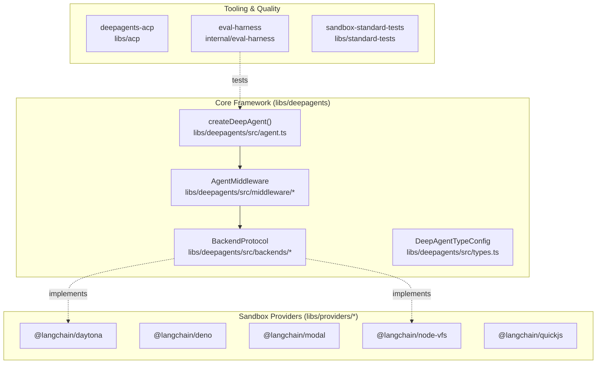
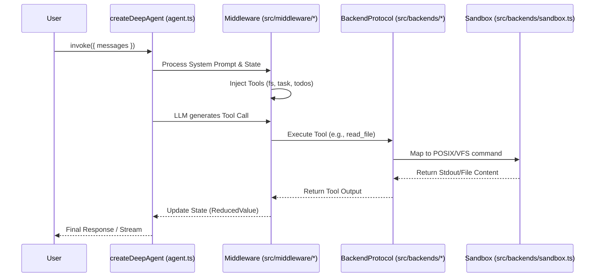

<!-- source: DeepWiki mcp.deepwiki.com · repo langchain-ai/deepagentsjs · page 1 Overview · fetched 2026-10-26 -->

# Overview

Relevant source files

The following files were used as context for generating this wiki page:

- [README.md](README.md)
- [libs/deepagents/README.md](libs/deepagents/README.md)
- [libs/deepagents/package.json](libs/deepagents/package.json)
- [libs/deepagents/src/agent.ts](libs/deepagents/src/agent.ts)
- [libs/deepagents/src/index.ts](libs/deepagents/src/index.ts)
- [libs/deepagents/src/middleware/async_subagents.ts](libs/deepagents/src/middleware/async_subagents.ts)
- [libs/deepagents/src/middleware/index.ts](libs/deepagents/src/middleware/index.ts)
- [libs/deepagents/src/types.ts](libs/deepagents/src/types.ts)
- [package.json](package.json)
- [pnpm-lock.yaml](pnpm-lock.yaml)

## Purpose and Scope

This page introduces the DeepAgentsJS repository, explaining its purpose as a framework for building controllable AI agents with LangGraph. It provides a high-level overview of the architecture, key components, and how they work together to create "batteries-included" agentic workflows. [libs/deepagents/README.md:1-13](), [libs/deepagents/src/index.ts:1-6]()

For detailed information about specific subsystems:
- Getting started instructions and quick-start guide: see **Getting Started**
- Fundamental concepts and architectural patterns: see **Core Concepts**
- Complete API reference for `createDeepAgent`: see **createDeepAgent API**
- Individual middleware components: see **Middleware Reference**

## What is DeepAgentsJS

DeepAgentsJS is an opinionated agent harness built on top of [LangGraph](https://github.com/langchain-ai/langgraphjs). It is designed to move beyond simple tool-calling loops by providing a production-ready runtime that includes planning, filesystem access, and hierarchical delegation out of the box. [libs/deepagents/README.md:24-32](), [libs/deepagents/package.json:4-5]()

The framework is built using `@langchain/langgraph` (v1.2.8+) and `@langchain/core` (v1.1.38+), maintaining 1:1 compatibility with the Python version of Deep Agents. [libs/deepagents/package.json:41-42](), [libs/deepagents/src/index.ts:4-6]()

**Key Capabilities:**
- **Planning**: Built-in `write_todos` tool for task breakdown. [libs/deepagents/README.md:28-28]()
- **Filesystem**: Standardized tools (`read_file`, `write_file`, `edit_file`, `ls`, `glob`, `grep`) for working memory and persistent storage. [libs/deepagents/README.md:29-29]()
- **Sub-agents**: A `task` tool for delegating work to specialized agents with isolated context windows. [libs/deepagents/README.md:30-30]()
- **Context Management**: Middleware for automatic summarization and token management. [libs/deepagents/README.md:32-32]()

**Sources:** [libs/deepagents/package.json:1-49](), [libs/deepagents/README.md:1-35](), [libs/deepagents/src/index.ts:1-76]()

## Repository Organization

DeepAgentsJS is structured as a `pnpm` monorepo containing the core library, various sandbox providers, and internal evaluation tooling. [package.json:1-58](), [pnpm-lock.yaml:1-17]()

### Workspace Architecture

The following diagram associates high-level system components with their corresponding code entities and file paths.

Title: DeepAgentsJS Code Entity Map

**Sources:** [package.json:1-22](), [pnpm-lock.yaml:17-152](), [libs/deepagents/src/index.ts:8-152]()

## Core Architecture

The architecture centers on the `createDeepAgent` factory, which compiles a LangGraph `StateGraph` by weaving together a configurable list of middleware and backends. [libs/deepagents/src/agent.ts:143-179](), [libs/deepagents/README.md:84-87]()

### Data Flow and Component Interaction

This diagram illustrates how a user request flows through the system, from the agent entry point to the underlying execution backends.

Title: Request Flow and Backend Abstraction

**Sources:** [libs/deepagents/src/agent.ts:143-220](), [libs/deepagents/src/middleware/index.ts:1-76](), [libs/deepagents/src/backends/index.ts:96-152]()

## Key Components

### createDeepAgent Factory
The `createDeepAgent` function is the primary entry point. It provides a "strong default runtime" including filesystem and task management. It handles the deterministic ordering of middleware and detects specific model providers (like Anthropic) to apply optimizations like prompt caching. [libs/deepagents/src/agent.ts:114-122](), [libs/deepagents/src/agent.ts:193-202]()

### Middleware System
Middleware in DeepAgentsJS are not just wrappers; they are functional units that define state schemas, tools, and system prompt modifications. [libs/deepagents/src/agent.ts:129-137]()
- **Filesystem**: `createFilesystemMiddleware` adds the `FILESYSTEM_TOOL_NAMES` suite. [libs/deepagents/src/agent.ts:17-23]()
- **Subagents**: `createSubAgentMiddleware` and `createAsyncSubAgentMiddleware` enable hierarchical task delegation. [libs/deepagents/src/agent.ts:18-27]()
- **Summarization**: `createSummarizationMiddleware` manages context window overflow. [libs/deepagents/src/agent.ts:20-20]()

### Backend and Sandbox System
The `BackendProtocol` provides a unified interface for state and file operations. [libs/deepagents/src/backends/index.ts:109-111]()
- **StateBackend**: Ephemeral in-memory storage. [libs/deepagents/src/backends/index.ts:97-97]()
- **StoreBackend**: Persistent storage using LangGraph Store. [libs/deepagents/src/backends/index.ts:98-98]()
- **SandboxBackendProtocol**: Extends the backend to include shell execution (`execute`) and complex file operations (`grep`, `glob`). [libs/deepagents/src/backends/index.ts:130-132](), [libs/deepagents/src/backends/index.ts:125-128]()

**Sources:** [libs/deepagents/src/agent.ts:1-220](), [libs/deepagents/src/index.ts:8-152](), [libs/deepagents/src/middleware/index.ts:1-76]()

## Development and Build System

The monorepo utilizes a modern toolchain for high-performance development:
- **Build**: `tsdown` for fast TypeScript-to-JavaScript bundling (ESM and CJS). [libs/deepagents/package.json:10](), [libs/deepagents/package.json:62-62]()
- **Testing**: `vitest` for unit and integration testing. [libs/deepagents/package.json:15-20]()
- **Linting/Formatting**: `oxlint` and `oxfmt` for extremely fast code quality checks. [package.json:11-14](), [package.json:49-50]()
- **Versioning**: `changesets` for automated versioning and changelog generation. [package.json:20-21](), [pnpm-lock.yaml:24-26]()

**Sources:** [package.json:1-71](), [libs/deepagents/package.json:1-86]()

---

