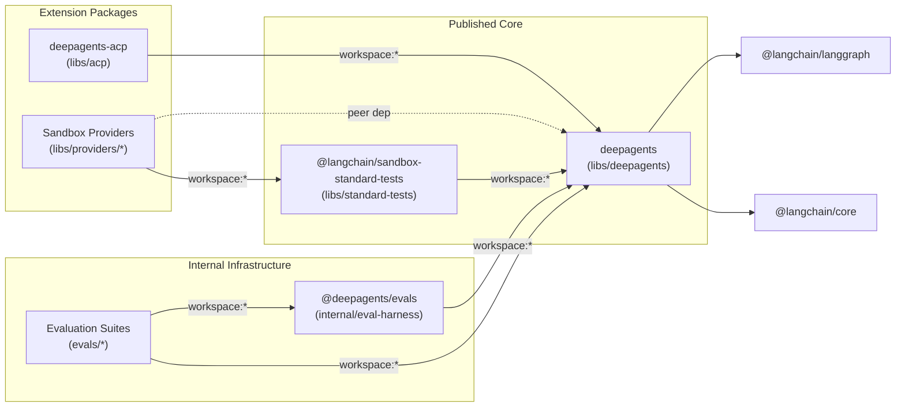

<!-- source: DeepWiki mcp.deepwiki.com · repo langchain-ai/deepagentsjs · page 10.1 Monorepo Structure · fetched 2026-10-26 -->

# Monorepo Structure

<details>
<summary>Relevant source files</summary>

The following files were used as context for generating this wiki page:

- [.changeset/README.md](.changeset/README.md)
- [.changeset/config.json](.changeset/config.json)
- [.github/workflows/ci.yml](.github/workflows/ci.yml)
- [.github/workflows/cli-release.yml](.github/workflows/cli-release.yml)
- [.github/workflows/release.yml](.github/workflows/release.yml)
- [libs/deepagents/package.json](libs/deepagents/package.json)
- [libs/providers/deno/vitest.config.ts](libs/providers/deno/vitest.config.ts)
- [package.json](package.json)
- [pnpm-lock.yaml](pnpm-lock.yaml)
- [pnpm-workspace.yaml](pnpm-workspace.yaml)

</details>


This document describes the physical organization of the DeepAgentsJS repository, including the pnpm workspace configuration, package hierarchy, and inter-package dependencies. For information about the build process and compilation, see [Build System](#10.2). For information about running tests across the monorepo, see [Testing](#10.3).

## Overview

DeepAgentsJS is organized as a monorepo managed by pnpm workspaces. The repository contains multiple independently versioned npm packages that share common tooling, dependencies, and development workflows. The workspace configuration enables efficient dependency management, parallel builds, and centralized quality control.

**Sources:** [pnpm-workspace.yaml:1-7](), [package.json:1-71]()

## Workspace Configuration

The monorepo is configured via `pnpm-workspace.yaml`, which defines five workspace patterns:

```yaml
packages:
  - "libs/*"
  - "libs/providers/*"
  - "internal/*"
  - "evals/*"
  - "examples"
  - "examples/**/*"
```

The workspace uses `pnpm@10.29.2` as the package manager (enforced via the `packageManager` field in the root `package.json`) and enables automatic peer dependency installation with `autoInstallPeers: true` in the lockfile settings.

**Sources:** [pnpm-workspace.yaml:1-8](), [package.json:58-58](), [pnpm-lock.yaml:1-6]()

## Directory Structure

The following diagram maps the high-level organizational structure to the specific package names found in the monorepo.

```mermaid
graph TB
    Root["Root<br/>(deepagentsjs-monorepo)"]
    
    subgraph "Core Libraries (libs/*)"
        DeepAgents["libs/deepagents<br/>deepagents"]
        ACP["libs/acp<br/>deepagents-acp"]
        CLI["libs/cli<br/>deepagents-cli"]
        StandardTests["libs/standard-tests<br/>@langchain/sandbox-standard-tests"]
    end
    
    subgraph "Sandbox Providers (libs/providers/*)"
        Daytona["libs/providers/daytona<br/>@langchain/daytona"]
        Deno["libs/providers/deno<br/>@langchain/deno"]
        Modal["libs/providers/modal<br/>@langchain/modal"]
        NodeVFS["libs/providers/node-vfs<br/>@langchain/node-vfs"]
        QuickJS["libs/providers/quickjs<br/>@langchain/quickjs"]
    end
    
    subgraph "Evaluation & Development"
        Evals["evals/*<br/>(Internal Eval Suites)"]
        Examples["examples<br/>(Private/Docs)"]
        Internal["internal/eval-harness<br/>@deepagents/evals"]
    end
    
    Root --> DeepAgents
    Root --> ACP
    Root --> CLI
    Root --> StandardTests
    Root --> Daytona
    Root --> Deno
    Root --> Modal
    Root --> NodeVFS
    Root --> QuickJS
    Root --> Examples
    Root --> Internal
    Root --> Evals
```



**Sources:** [pnpm-workspace.yaml:1-8](), [pnpm-lock.yaml:17-152]()

## Package Inventory

### Core Libraries (`libs/*`)

| Package | NPM Name | Purpose | Published |
|---------|----------|---------|-----------|
| `libs/deepagents` | `deepagents` | Core framework, middleware, backends | ✓ |
| `libs/acp` | `deepagents-acp` | Agent Client Protocol server | ✓ |
| `libs/cli` | `deepagents-cli` | Command-line tooling (wraps Python CLI) | ✓ |
| `libs/standard-tests` | `@langchain/sandbox-standard-tests` | Shared test suite for providers | ✓ |

**Sources:** [libs/deepagents/package.json:1-86](), [pnpm-lock.yaml:55-152]()

### Sandbox Providers (`libs/providers/*`)

| Package | NPM Name | Primary Technology | Published |
|---------|----------|--------------------|-----------|
| `libs/providers/daytona` | `@langchain/daytona` | Daytona.io SDK | ✓ |
| `libs/providers/deno` | `@langchain/deno` | Deno Sandbox | ✓ |
| `libs/providers/modal` | `@langchain/modal` | Modal.com Containers | ✓ |
| `libs/providers/node-vfs` | `@langchain/node-vfs` | Node Virtual Filesystem | ✓ |
| `libs/providers/quickjs` | `@langchain/quickjs` | WASM-based QuickJS | ✓ |

**Sources:** [pnpm-lock.yaml:160-250]() (Note: specific lines depend on lockfile state, but these packages are defined as workspace members).

### Evaluation and Internal Packages

| Package | Type | Purpose |
|---------|------|---------|
| `evals/*` | Internal | Behavioral evaluation suites (basic, files, hitl, etc.) |
| `internal/eval-harness` | `@deepagents/evals` | Shared infrastructure for running evals |
| `examples` | Private | Usage examples and demonstrations |

**Sources:** [pnpm-lock.yaml:55-152](), [pnpm-workspace.yaml:4-8]()

## Inter-Package Dependencies

The following diagram illustrates the relationship between code entities and how they depend on one another across the workspace.



**Workspace Dependencies (`workspace:*`)**

Internal package references use the `workspace:*` protocol. This ensures that during local development, pnpm links to the source code within the monorepo rather than fetching from the npm registry.

**Sources:** [pnpm-lock.yaml:57-65](), [pnpm-lock.yaml:83-89](), [libs/deepagents/package.json:41-43]()

## Package Dependency Patterns

### Core Package (`deepagents`)

The `deepagents` package maintains production dependencies on the LangChain ecosystem and core utility libraries:

```json
{
  "dependencies": {
    "@langchain/core": "^1.1.38",
    "@langchain/langgraph": "^1.2.8",
    "@langchain/langgraph-sdk": "^1.8.0",
    "fast-glob": "^3.3.3",
    "langchain": "^1.3.1",
    "micromatch": "^4.0.8",
    "yaml": "^2.8.2",
    "zod": "^4.3.6"
  }
}
```

**Sources:** [libs/deepagents/package.json:40-49]()

### Provider Packages

Sandbox providers utilize the `@langchain/sandbox-standard-tests` to ensure compliance with the `SandboxBackendProtocol`. This dependency is declared as a workspace reference:

```json
{
  "devDependencies": {
    "@langchain/sandbox-standard-tests": "workspace:*"
  }
}
```

**Sources:** [libs/deepagents/package.json:54]()

### Evaluation System Dependencies

The evaluation suites (e.g., `evals/basic`, `evals/files`) depend on the internal evaluation harness (`@deepagents/evals`) and the core `deepagents` library:

```json
{
  "dependencies": {
    "@deepagents/evals": "workspace:*",
    "deepagents": "workspace:*"
  }
}
```

**Sources:** [pnpm-lock.yaml:83-89](), [pnpm-lock.yaml:113-119]()

## Root Package Scripts

The root `package.json` defines coordinated scripts that operate across workspace packages using pnpm filters:

| Script | Filter | Purpose |
|--------|--------|---------|
| `build` | `./libs/*`, `./libs/providers/*` | Build all publishable packages using `tsdown` |
| `clean` | `./libs/*` | Remove build artifacts and `.tsdown/` directories |
| `typecheck` | `./libs/*` | Run TypeScript type checking (`tsc --noEmit`) |
| `lint` | N/A | Run `oxlint` on the entire codebase |
| `format` | N/A | Run `oxfmt` on the entire codebase |
| `test` | `./libs/*` | Run unit tests after quality checks |
| `test:int` | `./libs/*`, `./libs/providers/*` | Run integration tests across framework and providers |
| `release` | N/A | Build all packages and publish via Changesets |

**Sources:** [package.json:7-22](), [libs/deepagents/package.json:9-20]()

## Release and Versioning

The monorepo uses **Changesets** for version management and automated releases.

- **Configuration**: Located in `.changeset/config.json`.
- **Changelog**: Uses `@changesets/changelog-github` to link PRs and contributors [package.json:42]().
- **Workflow**: 
    1. Developers run `pnpm changeset` to create a new fragment.
    2. CI runs `pnpm changeset:version` to update versions and create a release PR [.github/workflows/release.yml:44]().
    3. Merging to `main` triggers `pnpm release`, which builds and publishes to npm [.github/workflows/release.yml:45]().

**Sources:** [.changeset/config.json:1-19](), [.github/workflows/release.yml:1-51](), [package.json:20-21]()

### CLI Special Release Workflow

The `deepagents-cli` package has a dedicated release workflow (`.github/workflows/cli-release.yml`) that builds platform-specific binaries (Linux, Darwin, Win32) by wrapping the Python-based CLI from PyPI for npm distribution.

**Sources:** [.github/workflows/cli-release.yml:107-123](), [.github/workflows/cli-release.yml:148-154]()

## Security and Overrides

The monorepo enforces specific versions of transitive dependencies to resolve known vulnerabilities or ensure compatibility:

```json
{
  "pnpm": {
    "overrides": {
      "minimatch@<3.1.4": "3.1.4",
      "minimatch@>=9 <10.2.1": "10.2.4",
      "fast-xml-parser@>=4.0.0-beta.3 <=5.5.6": "5.5.10",
      "rollup@>=4.0.0 <4.59.0": "4.59.0",
      "lodash@<=4.17.23": "4.18.1"
    }
  }
}
```

**Sources:** [package.json:59-70](), [pnpm-lock.yaml:7-16]()

## Package-Specific Configurations

### Vitest Environment

Packages include a `vitest.config.ts` that defines `test` (unit) and `test:int` (integration) modes. Integration tests are distinguished by the `.int.test.ts` suffix and typically use extended timeouts (e.g., 100,000ms) to accommodate network-bound sandbox operations.

**Sources:** [libs/providers/deno/vitest.config.ts:9-41]()

### Development Tooling

Tooling like `oxlint`, `oxfmt`, and `typescript` are declared as root `devDependencies` to ensure version consistency across all workspace packages.

**Sources:** [package.json:41-53]()

---

