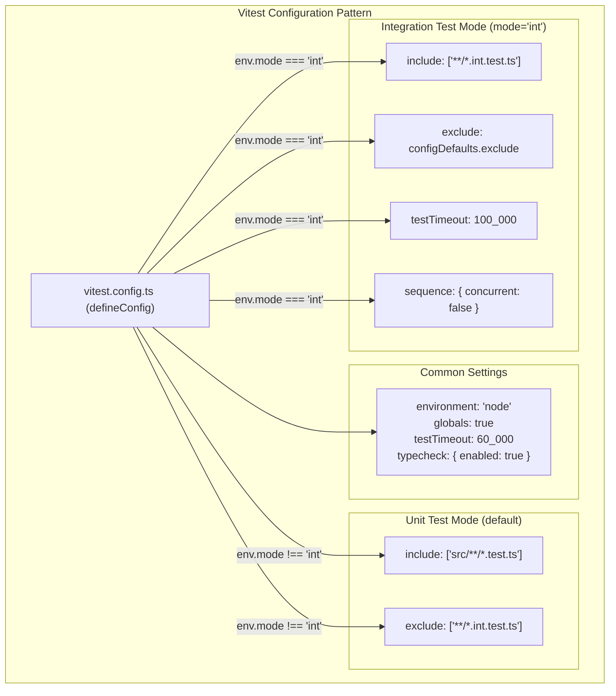
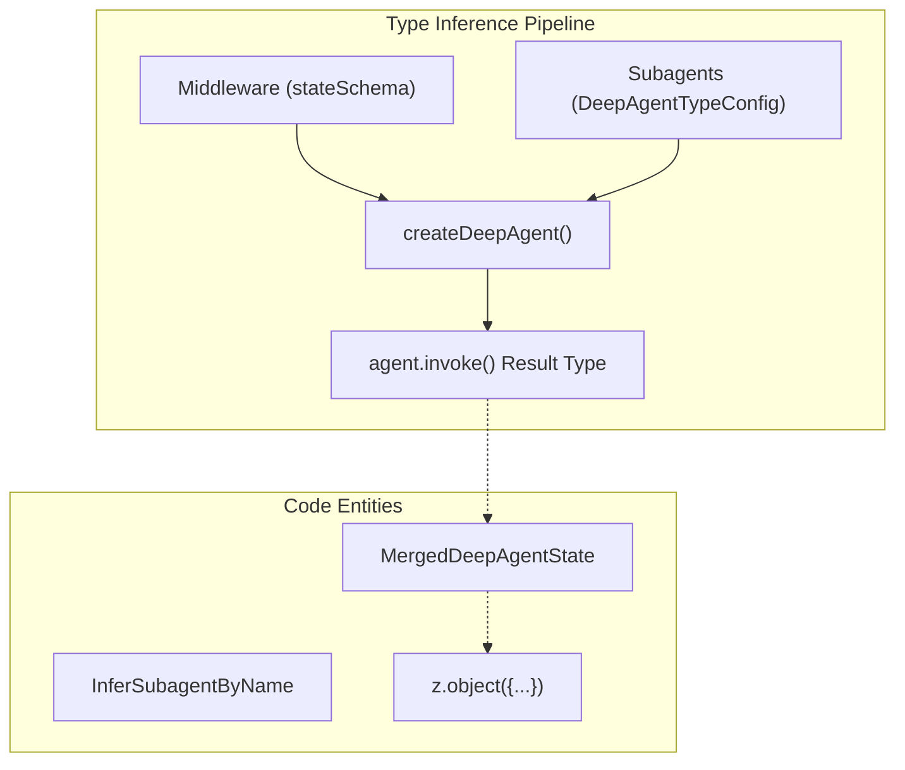

<!-- source: DeepWiki mcp.deepwiki.com · repo langchain-ai/deepagentsjs · page 10.3 Testing · fetched 2026-10-26 -->

# Testing

Relevant source files

The following files were used as context for generating this wiki page:

- [.changeset/README.md](.changeset/README.md)
- [.changeset/config.json](.changeset/config.json)
- [.github/workflows/ci.yml](.github/workflows/ci.yml)
- [.github/workflows/cli-release.yml](.github/workflows/cli-release.yml)
- [.github/workflows/release.yml](.github/workflows/release.yml)
- [libs/deepagents/src/agent.int.test.ts](libs/deepagents/src/agent.int.test.ts)
- [libs/deepagents/src/agent.test-d.ts](libs/deepagents/src/agent.test-d.ts)
- [libs/deepagents/src/testing/utils.ts](libs/deepagents/src/testing/utils.ts)
- [libs/deepagents/vitest.config.ts](libs/deepagents/vitest.config.ts)
- [libs/providers/deno/vitest.config.ts](libs/providers/deno/vitest.config.ts)
- [pnpm-workspace.yaml](pnpm-workspace.yaml)

This document describes the testing infrastructure in the DeepAgentsJS repository, including the test framework, configuration, unit vs. integration tests, and the behavioral evaluation (evals) system.

---

## Test Framework and Organization

DeepAgentsJS uses **Vitest** as its primary test framework across all packages in the monorepo. The testing infrastructure is designed to support fast unit tests, type-level tests, and slower integration tests requiring external API access.

### Test File Conventions

The repository follows a strict naming convention to differentiate between test types:

| Test Type | File Pattern | Description |
|-----------|-------------|-------------|
| **Unit Tests** | `*.test.ts` | Fast, isolated tests without external dependencies. |
| **Integration Tests** | `*.int.test.ts` | Tests requiring external LLM providers (OpenAI, Anthropic) or sandbox services. |
| **Type Tests** | `*.test-d.ts` | Tests that verify TypeScript inference for complex middleware and subagent state. |
| **Evals** | `evals/**/*.test.ts` | Behavioral evaluations using the `eval-harness`. |

Unit tests are typically co-located with source files in `src/` directories, while integration tests are explicitly excluded from default test runs to prevent accidental API consumption.

**Sources:** [libs/deepagents/vitest.config.ts:21-46](), [libs/providers/deno/vitest.config.ts:16-40](), [libs/deepagents/src/agent.test-d.ts:1-10]()

---

## Vitest Configuration

Each package in the monorepo has its own `vitest.config.ts` that extends a common configuration pattern. The configuration uses Vitest's `mode` parameter to switch between unit and integration test configurations.

### Configuration Structure

**Key Configuration Parameters:**

| Parameter | Unit Tests | Integration Tests |
|-----------|-----------|-------------------|
| `testTimeout` | 60,000ms | 100,000ms |
| `globals` | `true` | `false` (in `deepagents` int mode) |
| `sequence.concurrent` | `true` (default) | `false` (to prevent rate limits) |
| `typecheck.enabled` | `true` | N/A |

**Sources:** [libs/deepagents/vitest.config.ts:12-47](), [libs/providers/deno/vitest.config.ts:7-41]()

---

## Testing Utilities and Assertions

The `libs/deepagents/src/testing/utils.ts` file provides shared utilities for verifying agent behavior and mocking complex interactions.

### DeepAgent Quality Assertions

The function `assertAllDeepAgentQualities(agent)` is used across integration tests to ensure that a generated `DeepAgent` satisfies the framework's requirements.

| Check | Logic | Source |
|-------|-------|--------|
| **State Channels** | Verifies existence of `todos` and `files` channels in `agent.graph.channels`. | [libs/deepagents/src/testing/utils.ts:36-47]() |
| **Core Tools** | Ensures `write_todos`, `ls`, `read_file`, `write_file`, `edit_file`, and `task` are bound. | [libs/deepagents/src/testing/utils.ts:49-58]() |

### Mocking Infrastructure

The testing suite includes mock tools and middleware to simulate LLM interactions without network calls:
*   **Mock Tools**: `getWeather`, `getSoccerScores`, `sampleTool`, and `researchBasketball`. [libs/deepagents/src/testing/utils.ts:154-208]()
*   **Test Middleware**: `ResearchMiddleware`, `SampleMiddlewareWithTools`, and `WeatherToolMiddleware`. [libs/deepagents/src/testing/utils.ts:227-265]()

**Sources:** [libs/deepagents/src/testing/utils.ts:1-270]()

---

## Type-Level Testing

DeepAgentsJS uses Vitest's `typecheck` feature to ensure that the complex type inference for `createDeepAgent` remains sound. These tests reside in `*.test-d.ts` files.

These tests verify that:
1.  **State Merging**: `MergedDeepAgentState` correctly combines properties from multiple middleware (e.g., `research` from `ResearchMiddleware` and `counter` from `CounterMiddleware`). [libs/deepagents/src/agent.test-d.ts:95-113]()
2.  **Runtime Consistency**: Using `expectTypeOf(result).toHaveProperty("research")` on the return value of `agent.invoke()` to confirm that the inferred type matches the runtime schema. [libs/deepagents/src/agent.test-d.ts:116-150]()
3.  **Subagent Inference**: `InferSubagentByName` correctly retrieves subagent definitions from the parent agent's configuration. [libs/deepagents/src/agent.test-d.ts:199-220]()

**Sources:** [libs/deepagents/src/agent.test-d.ts:1-220]()

---

## Integration Tests

Integration tests in `agent.int.test.ts` verify the end-to-end flow of the agent, including LLM-driven tool calling and hierarchical subagent execution.

### Key Integration Scenarios
*   **Tool Binding**: Verifying that tools passed to `createDeepAgent` or provided via middleware are correctly registered. [libs/deepagents/src/agent.int.test.ts:30-44]()
*   **Subagent Tasking**: Testing that the main agent can correctly use the `task` tool to delegate work to subagents like `weather_agent`. [libs/deepagents/src/agent.int.test.ts:58-88]()
*   **Multi-Agent Coordination**: Ensuring the agent can coordinate multiple subagents (e.g., a `weather_agent` and a `soccer_agent`) within a single conversation. [libs/deepagents/src/agent.int.test.ts:159-208]()

**Sources:** [libs/deepagents/src/agent.int.test.ts:24-210]()

---

## CI/CD and Local Execution

### Local Execution Commands

| Scope | Command |
|-------|---------|
| **All Unit Tests** | `pnpm test` |
| **Integration Tests** | `pnpm test:int` |
| **Specific Package** | `pnpm --filter <package-name> test` |
| **Linting** | `pnpm run lint` |

### CI Workflow
The `.github/workflows/ci.yml` workflow manages the automated testing lifecycle:
1.  **Build**: Compiles all packages and uploads build artifacts. [/.github/workflows/ci.yml:80-109]()
2.  **Unit Tests**: Runs the test suite across `ubuntu-latest` and `windows-latest` for Node.js 22.x and 24.x. [/.github/workflows/ci.yml:110-137]()
3.  **Integration Tests**: Executes `pnpm test:int` on Ubuntu, providing secrets for `ANTHROPIC_API_KEY`, `OPENAI_API_KEY`, and sandbox providers. [/.github/workflows/ci.yml:138-169]()

**Sources:** [.github/workflows/ci.yml:1-169]()

---

