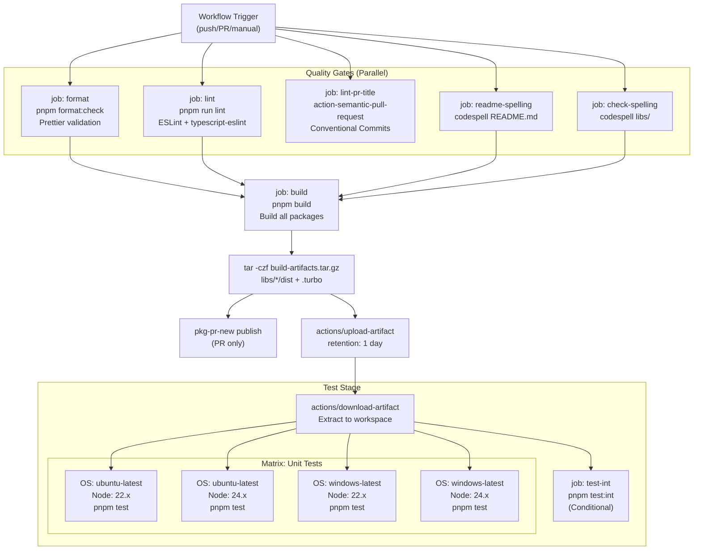
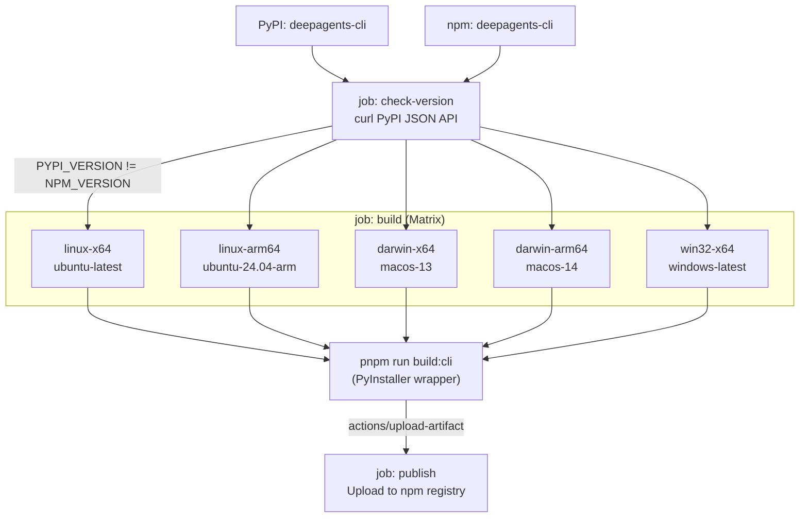

<!-- source: DeepWiki mcp.deepwiki.com · repo langchain-ai/deepagentsjs · page 10.4 CI/CD Pipeline · fetched 2026-10-26 -->

# CI/CD Pipeline

<details>
<summary>Relevant source files</summary>

The following files were used as context for generating this wiki page:

- [.changeset/README.md](.changeset/README.md)
- [.changeset/config.json](.changeset/config.json)
- [.codespellignore](.codespellignore)
- [.gitattributes](.gitattributes)
- [.github/dependabot.yml](.github/dependabot.yml)
- [.github/workflows/ci.yml](.github/workflows/ci.yml)
- [.github/workflows/cli-release.yml](.github/workflows/cli-release.yml)
- [.github/workflows/pr_lint.yml](.github/workflows/pr_lint.yml)
- [.github/workflows/release.yml](.github/workflows/release.yml)
- [LICENSE](LICENSE)
- [examples/skills/skill-creator/scripts/init_skill.ts](examples/skills/skill-creator/scripts/init_skill.ts)
- [examples/skills/skill-creator/scripts/quick_validate.ts](examples/skills/skill-creator/scripts/quick_validate.ts)
- [libs/providers/deno/vitest.config.ts](libs/providers/deno/vitest.config.ts)
- [pnpm-workspace.yaml](pnpm-workspace.yaml)

</details>


## Purpose and Scope

This document describes the continuous integration and continuous deployment (CI/CD) pipeline implemented in the DeepAgentsJS repository. It covers the GitHub Actions workflows that enforce code quality, run tests across multiple platforms, manage build artifacts, and handle automated releases for both the core framework and the CLI. For details on the testing infrastructure itself, see [Testing]() (10.3). For the release process details, see [Release Process]() (10.5).

## Overview

The CI/CD pipeline is implemented through GitHub Actions workflows that automatically validate code changes on every push and pull request. The pipeline enforces strict quality gates before allowing code to be merged, ensuring consistent code quality and preventing regressions.

**Sources:** [.github/workflows/ci.yml:1-169](), [.github/workflows/release.yml:1-51](), [.github/workflows/cli-release.yml:1-221]()

## Workflow Triggers

The CI pipeline consists of several specialized workflows triggered by different events:

| Workflow | Trigger | Branches | Purpose |
|----------|---------|----------|---------|
| `CI` | `push`, `pull_request`, `workflow_dispatch` | `main`, all PRs | Core validation (lint, build, test) |
| `Release` | `push` | `main`, `alpha` | Automated npm publishing via Changesets |
| `CLI Release` | `schedule`, `workflow_dispatch` | N/A | Cross-platform binary builds for the CLI |
| `PR Title Lint` | `pull_request` | All PRs | Enforce semantic commit messages |

**Sources:** [.github/workflows/ci.yml:9-13](), [.github/workflows/release.yml:3-8](), [.github/workflows/cli-release.yml:17-31](), [.github/workflows/pr_lint.yml:9-12]()

## Concurrency Control

The pipeline implements automatic concurrency control to optimize CI resource usage. When a new push occurs to the same PR or branch, any in-progress workflow run is automatically cancelled:

```yaml
concurrency:
  group: ${{ github.workflow }}-${{ github.ref }}
  cancel-in-progress: true
```

The `CLI Release` workflow uses a static group `cli-release` with `cancel-in-progress: false` to ensure that release processes do not overlap or corrupt each other.

**Sources:** [.github/workflows/ci.yml:21-23](), [.github/workflows/cli-release.yml:37-39](), [.github/workflows/release.yml:9]()

## Pipeline Architecture

### Core CI Flow
The following diagram maps the high-level CI stages to the specific GitHub Actions jobs and pnpm scripts defined in the codebase.



**Sources:** [.github/workflows/ci.yml:25-169](), [.github/workflows/pr_lint.yml:13-69]()

## Quality Gate Jobs

All quality gate jobs must pass before the `build` job can execute [[.github/workflows/ci.yml:82]](). These jobs run in parallel to provide fast feedback.

### Format and Linting
- **Format:** Validates code formatting using Prettier via `pnpm format:check` [[.github/workflows/ci.yml:26-41]]().
- **Lint:** Validates code quality using ESLint via `pnpm run lint` [[.github/workflows/ci.yml:43-58]]().
- **PR Title:** Uses `amannn/action-semantic-pull-request` to ensure PR titles follow Conventional Commits (feat, fix, docs, etc.) [[.github/workflows/pr_lint.yml:28-69]](). It specifically rejects empty scope parentheses like `fix(): ...` [[.github/workflows/pr_lint.yml:18-26]]().

### Spelling Checks
Two separate spelling validation jobs using `codespell` target different scopes:
- `readme-spelling`: Targets only the root `README.md` [[.github/workflows/ci.yml:60-69]]().
- `check-spelling`: Targets the `libs/` directory [[.github/workflows/ci.yml:70-79]]().
- Both jobs utilize `.codespellignore` to handle project-specific terminology like `afterAll` or `Nd` [[.codespellignore:1-4]]().

**Sources:** [.github/workflows/ci.yml:26-79](), [.github/workflows/pr_lint.yml:1-69](), [.codespellignore:1-4]()

## Build and Artifact Management

The `build` job compiles all packages in the monorepo using `pnpm build` [[.github/workflows/ci.yml:96]]().

### Preview Packages
For pull requests, the pipeline publishes preview versions of packages to `pkg.pr.new` [[.github/workflows/ci.yml:99-102]](). This allows developers to install and test the specific changes from a PR before they are merged.

### Artifact Storage
The build output (`libs/*/dist`) and `.turbo` cache are archived into `build-artifacts.tar.gz` and uploaded as a GitHub Action artifact with a 1-day retention period [[.github/workflows/ci.yml:97-108]](). This artifact is then consumed by downstream test jobs to ensure they test exactly what was built [[.github/workflows/ci.yml:129-134]]().

**Sources:** [.github/workflows/ci.yml:80-109]()

## Test Jobs

### Unit Test Matrix
Unit tests are executed across a matrix of Operating Systems (`ubuntu-latest`, `windows-latest`) and Node.js versions (`22.x`, `24.x`) [[.github/workflows/ci.yml:113-116]](). This ensures broad compatibility for the framework.

### Integration Tests
Integration tests run on `ubuntu-latest` with Node.js `24.x` [[.github/workflows/ci.yml:142-150]](). They are skipped for PRs from forks or Dependabot to protect secrets [[.github/workflows/ci.yml:141]]().

Integration tests require several environment variables for external providers:
- `OPENAI_API_KEY` and `ANTHROPIC_API_KEY` for LLM testing [[.github/workflows/ci.yml:163-164]]().
- `DENO_DEPLOY_TOKEN`, `DAYTONA_API_KEY`, `MODAL_TOKEN_ID`, and `MODAL_TOKEN_SECRET` for sandbox provider validation [[.github/workflows/ci.yml:165-168]]().

**Sources:** [.github/workflows/ci.yml:110-169]()

## CLI Release Pipeline

The CLI release process is decoupled from the main framework release because it involves building platform-specific binaries that wrap the Python-based `deepagents-cli` from PyPI.

### CLI Release Data Flow
The diagram below shows how the `CLI Release` workflow manages the transition from PyPI source to npm platform-specific binaries.



**Key Features:**
- **Version Detection:** Automatically checks PyPI for new versions and compares against npm [[.github/workflows/cli-release.yml:56-85]]().
- **Cross-Compilation:** Uses a matrix of GitHub runners to generate native binaries [[.github/workflows/cli-release.yml:104-124]]().
- **Binary Wrapping:** The `libs/cli` package uses `pnpm run build:cli` to invoke PyInstaller and package the binaries for distribution via npm [[.github/workflows/cli-release.yml:150-155]]().

**Sources:** [.github/workflows/cli-release.yml:1-221]()

## Release and Publishing

The main framework release is handled by the `Release` workflow using Changesets [[.github/workflows/release.yml:1-51]]().

- **Changesets:** Uses `changesets/action` to manage versioning and changelogs [[.github/workflows/release.yml:41-46]]().
- **Provenance:** Enables `NPM_CONFIG_PROVENANCE: true` for secure, verifiable publishing from GitHub Actions [[.github/workflows/release.yml:50]]().
- **Configuration:** The release behavior is defined in `.changeset/config.json`, which ignores the `examples` directory and updates internal dependencies as patches [[.changeset/config.json:1-19]]().

**Sources:** [.github/workflows/release.yml:1-51](), [.changeset/config.json:1-19]()

---

