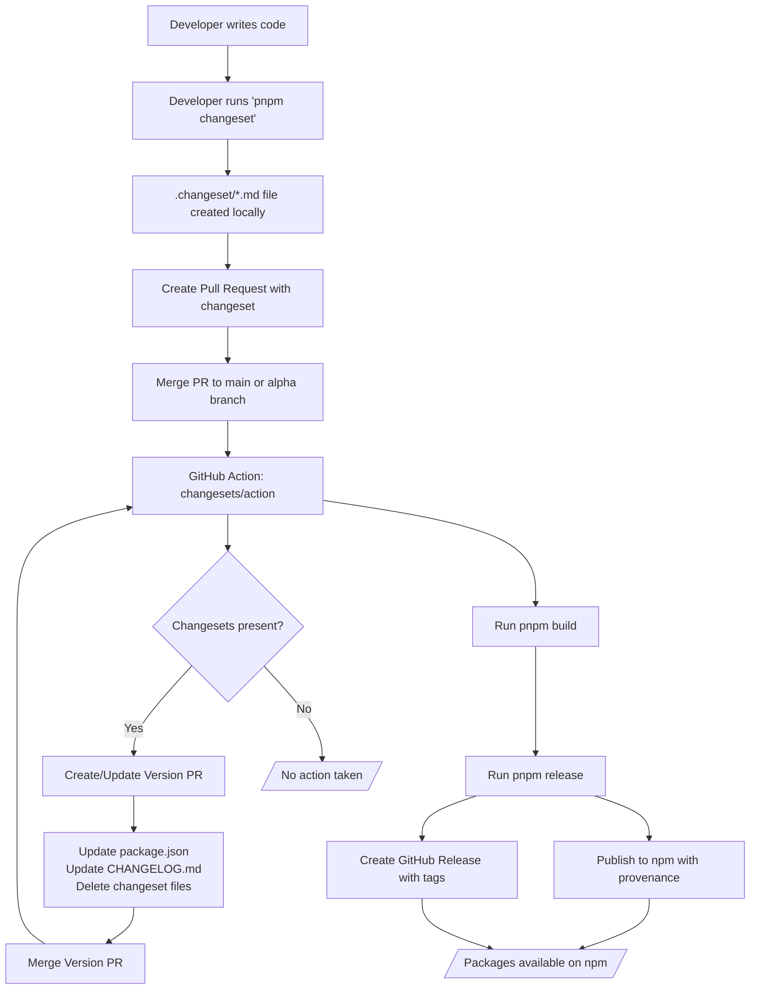
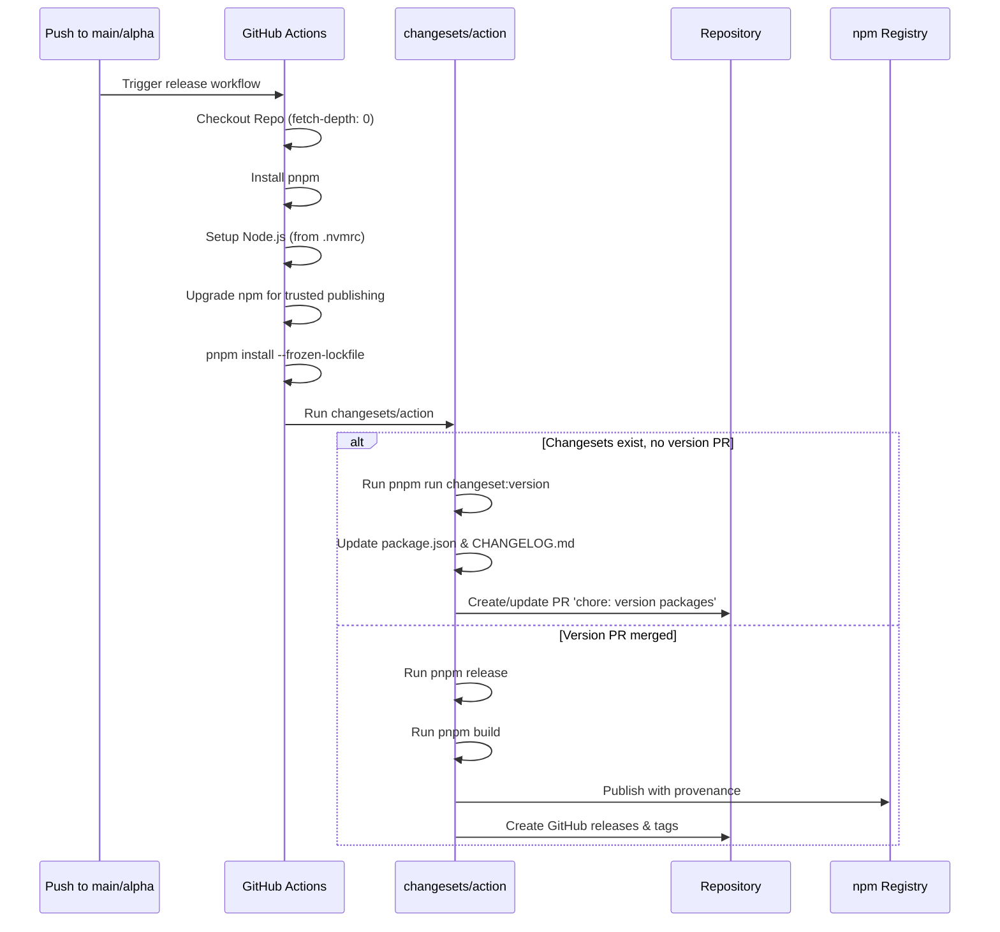
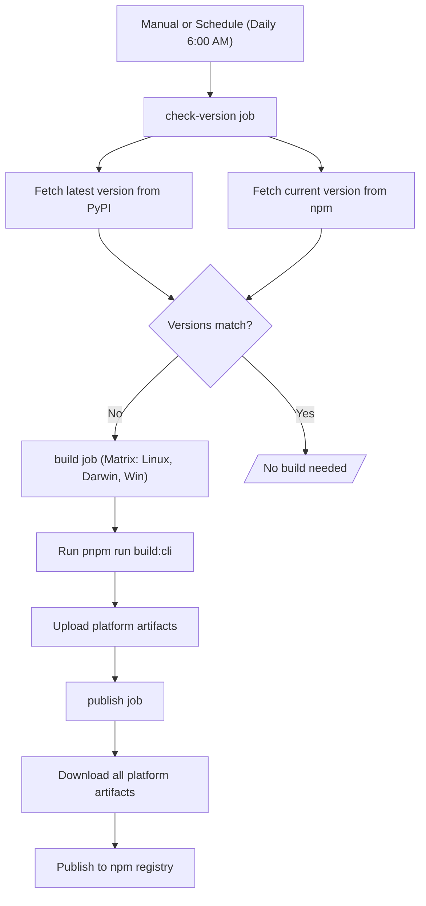

<!-- source: DeepWiki mcp.deepwiki.com · repo langchain-ai/deepagentsjs · page 10.5 Release Process · fetched 2026-10-26 -->

# Release Process

<details>
<summary>Relevant source files</summary>

The following files were used as context for generating this wiki page:

- [.changeset/README.md](.changeset/README.md)
- [.changeset/config.json](.changeset/config.json)
- [.changeset/hot-berries-arrive.md](.changeset/hot-berries-arrive.md)
- [.github/workflows/ci.yml](.github/workflows/ci.yml)
- [.github/workflows/cli-release.yml](.github/workflows/cli-release.yml)
- [.github/workflows/release.yml](.github/workflows/release.yml)
- [internal/eval-harness/CHANGELOG.md](internal/eval-harness/CHANGELOG.md)
- [libs/acp/CHANGELOG.md](libs/acp/CHANGELOG.md)
- [libs/deepagents/CHANGELOG.md](libs/deepagents/CHANGELOG.md)
- [libs/providers/deno/vitest.config.ts](libs/providers/deno/vitest.config.ts)
- [libs/providers/quickjs/CHANGELOG.md](libs/providers/quickjs/CHANGELOG.md)
- [pnpm-workspace.yaml](pnpm-workspace.yaml)

</details>


This document describes the versioning and release process for the DeepAgentsJS monorepo. The project uses [Changesets](https://github.com/changesets/changesets) for managing versioning, changelog generation, and npm publishing. For information about the CI pipeline that runs on every push/PR, see [CI/CD Pipeline](10.4). For information about the overall monorepo structure, see [Monorepo Structure](10.1).

## Overview

The DeepAgentsJS release process is automated through GitHub Actions and uses a pull request-based workflow. Developers add changesets to describe changes, the automation creates version bump PRs, and merging those PRs triggers automated npm publishing with provenance tracking.

**Key Components:**
- **Changesets CLI**: Tool for version management in monorepos.
- **GitHub Actions**: Automated release workflow defined in `release.yml` [[.github/workflows/release.yml:1-50]]().
- **npm with Provenance**: Package publishing with supply chain attestation [[.github/workflows/release.yml:50]]().
- **CLI Release Pipeline**: Specialized workflow for building platform-specific binaries for the `deepagents-cli` [[.github/workflows/cli-release.yml:1-15]]().

---

## Release Workflow

The following diagram illustrates the complete release process from code change to npm publication:

### Complete Release Flow



**Sources:** [[.github/workflows/release.yml:3-50]](), [[.github/workflows/release.yml:44-45]]()

---

## Creating a Changeset

Developers add changesets to describe their changes before creating a pull request. A changeset describes what changed and how it should affect versioning.

### Changeset Creation Process

```mermaid
graph LR
    Start["Developer completes feature/fix"]
    RunCmd["Run: 'pnpm changeset'"]
    SelectPkg["Select packages to version"]
    SelectType["Select bump type: patch/minor/major"]
    WriteSummary["Write change summary"]
    FileCreated[".changeset/random-id.md created"]
    CommitFile["Commit changeset with code changes"]
    
    Start --> RunCmd
    RunCmd --> SelectPkg
    SelectPkg --> SelectType
    SelectType --> WriteSummary
    WriteSummary --> FileCreated
    FileCreated --> CommitFile
```



### Changeset File Format

A changeset file contains a frontmatter section with package names and version bump types, followed by a human-readable summary.

Example changeset file (e.g., `.changeset/hot-berries-arrive.md`):
```markdown
---
"deepagents": patch
---

remove unconditional @langchain/anthropic import
```
[[.changeset/hot-berries-arrive.md:1-6]]()

**Version Bump Types:**
- **patch** (0.0.x): Bug fixes and minor changes.
- **minor** (0.x.0): New features, backward compatible.
- **major** (x.0.0): Breaking changes.

**Sources:** [[.changeset/README.md:1-9]](), [[libs/deepagents/CHANGELOG.md:5-13]]()

---

## GitHub Actions Automation

The release process is fully automated through the `release.yml` workflow, which runs on every push to the `main` or `alpha` branches [[.github/workflows/release.yml:3-7]]().

### Release Workflow Steps



**Sources:** [[.github/workflows/release.yml:19-50]]()

### Workflow Configuration Details

| Configuration | Value | Purpose |
|---------------|-------|---------|
| Trigger | `push` to `main`, `alpha` | Runs on stable and pre-release branch updates [[.github/workflows/release.yml:4-7]]() |
| Concurrency | `${{ github.workflow }}-${{ github.ref }}` | Prevents overlapping release runs [[.github/workflows/release.yml:9]]() |
| Permissions | `contents: write`, `pull-requests: write`, `id-token: write` | Allows PR creation and npm provenance [[.github/workflows/release.yml:15-18]]() |
| Node version | From `.nvmrc` | Ensures consistent Node.js version [[.github/workflows/release.yml:31]]() |
| npm Upgrade | `npm install -g npm@latest` | Required for OIDC trusted publishing [[.github/workflows/release.yml:35]]() |

---

## CLI Specialized Release Process

The `deepagents-cli` package follows a unique release process because it wraps Python binaries from PyPI as platform-specific npm packages [[.github/workflows/cli-release.yml:1-5]]().

### CLI Release Logic



**Key CLI Platforms:**
- `linux-x64` / `linux-arm64` (Ubuntu) [[.github/workflows/cli-release.yml:108-113]]()
- `darwin-x64` / `darwin-arm64` (macOS) [[.github/workflows/cli-release.yml:114-119]]()
- `win32-x64` (Windows) [[.github/workflows/cli-release.yml:120-122]]()

**Sources:** [[.github/workflows/cli-release.yml:41-206]]()

---

## Changesets Configuration

The `.changeset/config.json` file controls the behavior of the Changesets tool:

| Option | Value | Description |
|--------|-------|-------------|
| `changelog` | `@changesets/changelog-github` | Uses GitHub API for changelogs [[.changeset/config.json:3-4]]() |
| `access` | `public` | All packages published as public to npm [[.changeset/config.json:12]]() |
| `baseBranch` | `main` | Base branch for version PRs [[.changeset/config.json:13]]() |
| `updateInternalDependencies` | `patch` | Bumps workspace dependencies with patch version [[.changeset/config.json:14]]() |
| `ignore` | `["examples"]` | Excludes examples from versioning [[.changeset/config.json:15]]() |

**Sources:** [[.changeset/config.json:1-19]]()

---

## npm Publishing and Provenance

When a version PR is merged, the workflow automatically publishes updated packages to npm with provenance enabled. This provides a verifiable link between the npm package and the source code/build process.

**Requirements:**
- `id-token: write` permission in GitHub Actions [[.github/workflows/release.yml:18]]().
- `NPM_CONFIG_PROVENANCE: true` environment variable [[.github/workflows/release.yml:50]]().
- Public repository visibility as defined in config [[.changeset/config.json:12]]().

**Sources:** [[.github/workflows/release.yml:14-50]]()

---

## Monorepo Package Management

The release process handles the monorepo's package interdependencies automatically across the workspace defined in `pnpm-workspace.yaml` [[pnpm-workspace.yaml:1-7]]().

### Internal Dependency Updates

- **Automatic Bumping**: `updateInternalDependencies: "patch"` ensures that if package A depends on package B, and B is updated, A's dependency range is updated [[.changeset/config.json:14]]().
- **Peer Dependents**: `onlyUpdatePeerDependentsWhenOutOfRange: true` prevents unnecessary updates to peer dependents unless the new version breaks the specified range [[.changeset/config.json:17]]().

**Sources:** [[.changeset/config.json:1-19]](), [[pnpm-workspace.yaml:1-8]]()

---

