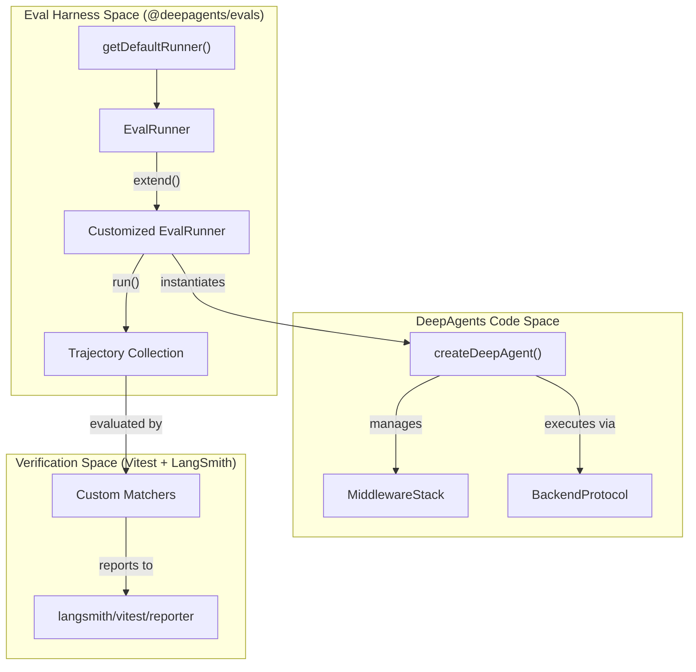
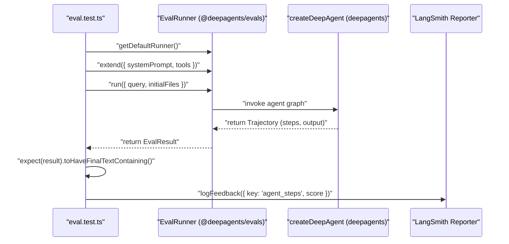

<!-- source: DeepWiki mcp.deepwiki.com · repo langchain-ai/deepagentsjs · page 10.6 Evaluation Suites · fetched 2026-10-26 -->

# Evaluation Suites

Relevant source files

The following files were used as context for generating this wiki page:

- [evals/README.md](evals/README.md)
- [evals/all/README.md](evals/all/README.md)
- [evals/all/eval.test.ts](evals/all/eval.test.ts)
- [evals/all/package.json](evals/all/package.json)
- [evals/all/vitest.config.ts](evals/all/vitest.config.ts)
- [evals/basic/eval.test.ts](evals/basic/eval.test.ts)
- [evals/basic/index.ts](evals/basic/index.ts)
- [evals/external-benchmarks/eval.test.ts](evals/external-benchmarks/eval.test.ts)
- [evals/external-benchmarks/index.ts](evals/external-benchmarks/index.ts)
- [evals/hitl/eval.test.ts](evals/hitl/eval.test.ts)
- [evals/oolong/.gitignore](evals/oolong/.gitignore)
- [evals/oolong/README.md](evals/oolong/README.md)
- [evals/skills/eval.test.ts](evals/skills/eval.test.ts)
- [evals/subagents/eval.test.ts](evals/subagents/eval.test.ts)
- [internal/eval-harness/package.json](internal/eval-harness/package.json)
- [libs/acp/package.json](libs/acp/package.json)

The DeepAgentsJS behavioral evaluation system is a specialized testing framework designed to validate agentic behavior across various domains such as tool usage, memory retention, and hierarchical task delegation. It leverages a custom internal harness (`eval-harness`) and integrates with **LangSmith** for tracing, experiment tracking, and dataset management.

## Overview and Purpose

The evaluation system, located in the `evals/` directory, serves as the primary mechanism for regression testing and behavioral benchmarking [evals/README.md:1-5](). Unlike standard unit tests, these evaluations (evals) run real agents against LLM APIs and assert on the resulting execution trajectory [evals/README.md:3-5]().

### Key Components
- **`eval-harness`**: An internal package (`@deepagents/evals`) that provides the runner interface, profile registry, and trajectory matchers [internal/eval-harness/package.json:2-5]().
- **Eval Suites**: Independent workspace packages (e.g., `evals/files/`, `evals/skills/`) containing specific test logic [evals/README.md:3-5]().
- **LangSmith Integration**: Results are streamed to LangSmith as experiments to track regressions and compare model performance [evals/README.md:7-9]().

Sources: [evals/README.md:1-9](), [internal/eval-harness/package.json:1-5]()

---

## Eval-Harness Internals

The `eval-harness` is the engine that executes evaluations. It abstracts the complexity of setting up agent instances and providing mock environments.

### Execution Flow
The harness follows a structured pipeline to execute a test case:
1.  **Runner Initialization**: A runner is obtained via `getDefaultRunner()`, which selects a model based on the `EVAL_RUNNER` environment variable [evals/README.md:33-35, 103]().
2.  **Configuration**: The runner can be customized using `.extend()` to inject specific system prompts, tools, or subagents [evals/README.md:126-149]().
3.  **Agent Invocation**: The `runner.run()` method executes the agent with the provided query and optional `initialFiles` [evals/README.md:113, 151-154]().
4.  **Verification**: Vitest matchers (e.g., `toHaveAgentSteps`) are used to assert on the trajectory [evals/README.md:114, 159-165]().

### Agent-to-Eval Mapping
The following diagram illustrates how code entities within the `eval-harness` interact with the DeepAgents core to perform an evaluation.

**Eval Harness Data Flow**

Sources: [evals/README.md:103-165](), [internal/eval-harness/package.json:1-9]()

---

## Available Evaluation Suites

The repository contains several specialized suites targeting specific capabilities.

| Suite | Purpose |
| :--- | :--- |
| `basic` | System prompt adherence and avoiding unnecessary tool calls [evals/README.md:14](). |
| `files` | File operations: read, write, edit, ls, grep, glob, and parallel I/O [evals/README.md:16](). |
| `hitl` | Human-in-the-loop interrupts, review configs, and resumption [evals/README.md:18](). |
| `memory` | `AGENTS.md` memory injection and recall [evals/README.md:20](). |
| `skills` | Skill file discovery, selection, and combination via `SKILL.md` [evals/README.md:23](). |
| `subagents` | Delegation via the `task` tool to named subagents [evals/README.md:24](). |
| `tool-usage-relational` | Multi-step tool chaining with relational data lookups [evals/README.md:29](). |
| `external-benchmarks` | Samples from FRAMES, Nexus, and BFCL v3 benchmarks [evals/README.md:19](). |

### Aggregated Runs
The `evals/all/` suite serves as a single entry point that imports and executes all other suites (e.g., `basicSuite`, `filesSuite`, `memorySuite`) within a single LangSmith experiment target [evals/all/README.md:1-9](), [evals/all/eval.test.ts:3-58]().

Sources: [evals/README.md:12-30](), [evals/all/README.md:1-9](), [evals/all/eval.test.ts:1-62]()

---

## Writing New Evaluations

New evaluations are implemented as Vitest tests using the `langsmith/vitest` wrapper.

### Implementation Pattern
1.  **Define the Suite**: Create a function that accepts an `EvalRunner` and defines `ls.test` cases [evals/basic/index.ts:5-6]().
2.  **Run the Agent**: Call `runner.run()` with the test input [evals/basic/index.ts:13-15]().
3.  **Assert and Log**: Use matchers for validation and `ls.logFeedback` to send scores (like step counts) to LangSmith [evals/basic/index.ts:17-21]().

**Entity Association: Eval Definition to Code**

### Custom Matchers
The harness provides specialized Vitest matchers that automatically log feedback to LangSmith [evals/README.md:159]:
- `toHaveAgentSteps(n)`: Asserts the exact number of steps taken [evals/README.md:161]().
- `toHaveToolCallRequests(n)`: Asserts total tool-call count [evals/README.md:162]().
- `toHaveToolCallInStep(step, { name, ... })`: Asserts a specific tool was called in a specific step [evals/README.md:163]().
- `toHaveFinalTextContaining(text)`: Asserts the final response contains a substring [evals/README.md:164]().

Sources: [evals/README.md:96-165](), [evals/basic/index.ts:5-40](), [evals/external-benchmarks/index.ts:30-64]()

---

