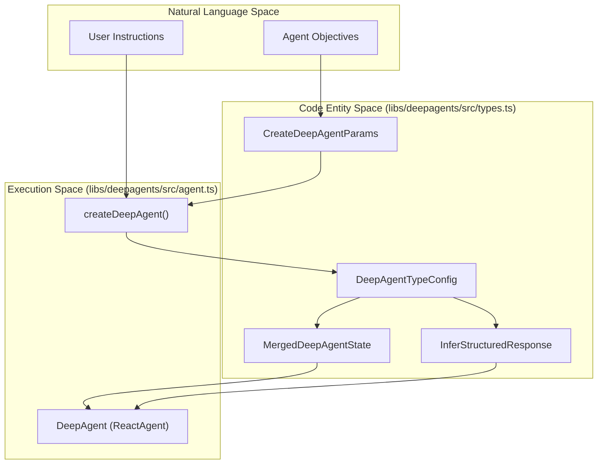

<!-- source: DeepWiki mcp.deepwiki.com · repo langchain-ai/deepagentsjs · page 11 API Reference · fetched 2026-10-26 -->

# API Reference

<details>
<summary>Relevant source files</summary>

The following files were used as context for generating this wiki page:

- [.gitignore](.gitignore)
- [libs/deepagents/src/agent.ts](libs/deepagents/src/agent.ts)
- [libs/deepagents/src/backends/protocol.ts](libs/deepagents/src/backends/protocol.ts)
- [libs/deepagents/src/backends/state.test.ts](libs/deepagents/src/backends/state.test.ts)
- [libs/deepagents/src/backends/state.ts](libs/deepagents/src/backends/state.ts)
- [libs/deepagents/src/index.ts](libs/deepagents/src/index.ts)
- [libs/deepagents/src/middleware/agent-memory.test.ts](libs/deepagents/src/middleware/agent-memory.test.ts)
- [libs/deepagents/src/middleware/async_subagents.ts](libs/deepagents/src/middleware/async_subagents.ts)
- [libs/deepagents/src/middleware/index.ts](libs/deepagents/src/middleware/index.ts)
- [libs/deepagents/src/middleware/patch_tool_calls.test.ts](libs/deepagents/src/middleware/patch_tool_calls.test.ts)
- [libs/deepagents/src/middleware/patch_tool_calls.ts](libs/deepagents/src/middleware/patch_tool_calls.ts)
- [libs/deepagents/src/middleware/types.ts](libs/deepagents/src/middleware/types.ts)
- [libs/deepagents/src/types.ts](libs/deepagents/src/types.ts)
- [tsconfig.json](tsconfig.json)

</details>


This page provides a complete reference for all public APIs exported by the `deepagents` package. For conceptual explanations of these APIs, see **Core Concepts**. For detailed usage patterns, see the respective middleware and backend documentation pages.

The API is organized into five categories:
- **Core API**: Primary factory function and type system.
- **Middleware API**: All middleware constructors and configuration types.
- **Backend API**: Storage and execution backend implementations.
- **Skills API**: Skill loading and metadata utilities.
- **Utility Types**: Type helpers for inference and configuration.

---

## Core API

### `createDeepAgent`

Primary factory function that creates a Deep Agent with LangGraph-based middleware architecture. It maintains 1:1 compatibility with the Python implementation.

**Signature:**
```typescript
export function createDeepAgent<
  TResponse extends SupportedResponseFormat = SupportedResponseFormat,
  ContextSchema extends InteropZodObject = InteropZodObject,
  const TMiddleware extends readonly AgentMiddleware[] = readonly [],
  const TSubagents extends readonly AnySubAgent[] = readonly [],
  const TTools extends readonly (ClientTool | ServerTool)[] = readonly [],
>(
  params: CreateDeepAgentParams<TResponse, ContextSchema, TMiddleware, TSubagents, TTools>
): DeepAgent<DeepAgentTypeConfig<...>>
```
[libs/deepagents/src/agent.ts:143-163]()

**Parameters:**

| Parameter | Type | Description |
|-----------|------|-------------|
| `model` | `BaseLanguageModel \| string` | Language model instance or model name string. Defaults to `anthropic:claude-sonnet-4-6`. [libs/deepagents/src/agent.ts:165]() |
| `tools` | `readonly (ClientTool \| ServerTool)[]` | Array of tools available to the agent. [libs/deepagents/src/agent.ts:166]() |
| `systemPrompt` | `string \| SystemMessage` | Custom system prompt. Combined with `BASE_AGENT_PROMPT`. [libs/deepagents/src/agent.ts:167]() |
| `middleware` | `readonly AgentMiddleware[]` | Custom middleware applied to the agent. [libs/deepagents/src/agent.ts:168]() |
| `subagents` | `readonly AnySubAgent[]` | Subagent specifications (sync, compiled, or async). [libs/deepagents/src/agent.ts:169]() |
| `responseFormat` | `SupportedResponseFormat` | Structured output format (Zod schema wrapped in strategy). [libs/deepagents/src/agent.ts:170]() |
| `contextSchema` | `InteropZodObject` | Schema for ephemeral context (not persisted). [libs/deepagents/src/agent.ts:171]() |
| `checkpointer` | `BaseCheckpointSaver` | State persistence checkpointer. [libs/deepagents/src/agent.ts:172]() |
| `store` | `BaseStore` | LangGraph store for long-term memory. [libs/deepagents/src/agent.ts:173]() |
| `backend` | `BackendFactory` | Storage/execution backend factory. Defaults to `StateBackend`. [libs/deepagents/src/agent.ts:174]() |
| `interruptOn` | `InterruptOnConfig` | Human-in-the-loop interrupt configuration. [libs/deepagents/src/agent.ts:175]() |
| `name` | `string` | Agent name for identification. [libs/deepagents/src/agent.ts:176]() |
| `memory` | `string[]` | Paths to `AGENTS.md` files for memory loading. [libs/deepagents/src/agent.ts:177]() |
| `skills` | `string[]` | Paths to skill directories (`SKILL.md` files). [libs/deepagents/src/agent.ts:178]() |

**Built-in Middleware Pipeline:**

The function automatically applies middleware in a deterministic order. Key components include:
1. `todoListMiddleware` [libs/deepagents/src/agent.ts:5]()
2. `createFilesystemMiddleware` [libs/deepagents/src/agent.ts:17]()
3. `createSubAgentMiddleware` [libs/deepagents/src/agent.ts:18]()
4. `createAsyncSubAgentMiddleware` [libs/deepagents/src/agent.ts:26]()
5. `createSummarizationMiddleware` [libs/deepagents/src/agent.ts:20]()
6. `createPatchToolCallsMiddleware` [libs/deepagents/src/agent.ts:19]()

**Sources:** [libs/deepagents/src/agent.ts:143-179](), [libs/deepagents/src/types.ts:35-46]()

---

### Core Types

#### `DeepAgent<TTypes>`

Type alias for a `ReactAgent` with DeepAgent-specific type configuration.

```typescript
export type DeepAgent<
  TTypes extends DeepAgentTypeConfig = DeepAgentTypeConfig,
> = ReactAgent<TTypes> & {
  readonly "~deepAgentTypes": TTypes;
};
```
[libs/deepagents/src/types.ts:189-194]()

#### `DeepAgentTypeConfig`

Type bag extending `AgentTypeConfig` with subagent type information for type-safe streaming and delegation.

```typescript
export interface DeepAgentTypeConfig<...> extends AgentTypeConfig<...> {
  Subagents: TSubagents;
}
```
[libs/deepagents/src/types.ts:153-173]()

**Sources:** [libs/deepagents/src/types.ts:153-194](), [libs/deepagents/src/index.ts:10-30]()

---

### Type Inference Utilities

| Type | Purpose |
|------|---------|
| `SupportedResponseFormat` | Union of all accepted response format types (Tool/Provider strategies). [libs/deepagents/src/types.ts:95]() |
| `InferStructuredResponse<T>` | Extracts the parsed response type from a strategy wrapper. [libs/deepagents/src/types.ts:116-125]() |
| `MergedDeepAgentState<M, S>` | Combines custom middleware and subagent middleware states. [libs/deepagents/src/types.ts:80-84]() |
| `FlattenSubAgentMiddleware<T>` | Merges middleware arrays from all subagents into one list. [libs/deepagents/src/types.ts:59-70]() |

**Sources:** [libs/deepagents/src/types.ts:59-125](), [libs/deepagents/src/index.ts:10-30]()

---

## Core API Type Flow Diagram

This diagram associates high-level concepts with specific code entities and types used in the `createDeepAgent` factory.


**Sources:** [libs/deepagents/src/agent.ts:143-163](), [libs/deepagents/src/types.ts:153-173]()

---

## Middleware API

### `createFilesystemMiddleware`

Provides filesystem tools and manages tool result eviction for large outputs.

**Tool Names:** Exported as `FILESYSTEM_TOOL_NAMES` (includes `ls`, `read_file`, `write_file`, `edit_file`, `glob`, `grep`, `execute`). [libs/deepagents/src/middleware/index.ts:4]()

**Sources:** [libs/deepagents/src/middleware/fs.ts:1-10](), [libs/deepagents/src/index.ts:42]()

### `createSubAgentMiddleware`

Enables hierarchical task delegation via the `task` tool for synchronous subagents.

**Sources:** [libs/deepagents/src/middleware/subagents.ts:11-20](), [libs/deepagents/src/index.ts:43]()

### `createAsyncSubAgentMiddleware`

Enables delegation to remote agents running on Agent Protocol-compliant servers. Provides `start_async_task`, `check_async_task`, `update_async_task`, `cancel_async_task`, and `list_async_tasks`. [libs/deepagents/src/middleware/async_subagents.ts:190-200]()

**Sources:** [libs/deepagents/src/middleware/async_subagents.ts:65-92](), [libs/deepagents/src/index.ts:48]()

### `createSkillsMiddleware`

Loads and injects skills from `SKILL.md` files into the system prompt.

**Sources:** [libs/deepagents/src/middleware/skills.ts:31-39](), [libs/deepagents/src/index.ts:51]()

---

## Backend API

### `BackendProtocolV2`

The current core interface for all storage backends.

| Method | Description |
|--------|-------------|
| `ls(path)` | List files and directories. [libs/deepagents/src/backends/protocol.ts:149]() |
| `read(path, offset, limit)` | Read file content with pagination for text. [libs/deepagents/src/backends/protocol.ts:129]() |
| `write(path, content)` | Create or overwrite a file. [libs/deepagents/src/backends/protocol.ts:174]() |
| `edit(path, old, new)` | Perform string replacement in a file. [libs/deepagents/src/backends/protocol.ts:198]() |
| `grep(pattern, path)` | Search file contents. [libs/deepagents/src/backends/protocol.ts:71]() |

**Sources:** [libs/deepagents/src/backends/protocol.ts:27-29](), [libs/deepagents/src/index.ts:109]()

### Implementation Classes

| Class | Storage | Execution |
|-------|---------|-----------|
| `StateBackend` | Ephemeral LangGraph state. [libs/deepagents/src/backends/state.ts:39]() | No |
| `StoreBackend` | Persistent LangGraph `BaseStore`. | No |
| `FilesystemBackend` | Local disk. | No |
| `LocalShellBackend` | Local disk. | Yes (Local shell) |
| `CompositeBackend` | Combines multiple backends. [libs/deepagents/src/index.ts:103]() | Varies |

**Sources:** [libs/deepagents/src/backends/state.ts:49](), [libs/deepagents/src/index.ts:96-103]()

---

## Backend System Architecture

This diagram maps the `BackendProtocol` to concrete implementations and shows how `CompositeBackend` bridges multiple storage types.

```mermaid
graph TD
    subgraph "Interface Space (libs/deepagents/src/backends/protocol.ts)"
        BP["BackendProtocolV2"]
        SBP["SandboxBackendProtocolV2"]
    end

    subgraph "Implementation Space"
        StateB["StateBackend (libs/deepagents/src/backends/state.ts)"]
        StoreB["StoreBackend (libs/deepagents/src/backends/store.ts)"]
        FSB["FilesystemBackend (libs/deepagents/src/backends/filesystem.ts)"]
        ShellB["LocalShellBackend (libs/deepagents/src/backends/local-shell.ts)"]
        CompB["CompositeBackend (libs/deepagents/src/backends/composite.ts)"]
    end

    BP --- StateB
    BP --- StoreB
    BP --- FSB
    BP --- CompB
    SBP --- ShellB
    BP <|-- SBP

    CompB -- "delegates based on path" --> StateB
```
**Sources:** [libs/deepagents/src/backends/protocol.ts:27-35](), [libs/deepagents/src/backends/state.ts:49]()

---

## Utility Exports

- `filesValue`: Reducer for the `files` state channel that merges updates. [libs/deepagents/src/index.ts:79]()
- `patchDanglingToolCalls`: Core logic for ensuring tool call/response parity. [libs/deepagents/src/middleware/patch_tool_calls.ts:32]()
- `asyncTasksReducer`: Reducer for merging `AsyncTask` updates in state. [libs/deepagents/src/middleware/async_subagents.ts:177]()
- `isAnthropicModel`: Helper to detect Anthropic models for prompt caching. [libs/deepagents/src/agent.ts:102]()

**Sources:** [libs/deepagents/src/index.ts:1-153](), [libs/deepagents/src/middleware/patch_tool_calls.ts:32-99]()

---

