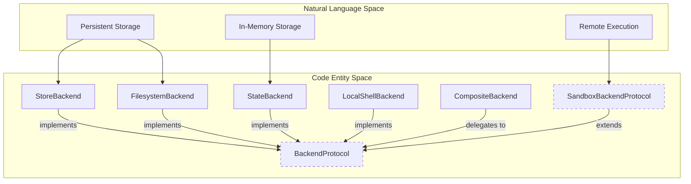
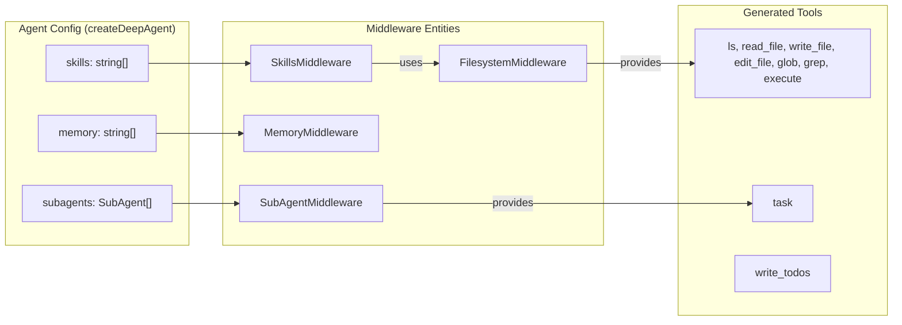

<!-- source: DeepWiki mcp.deepwiki.com · repo langchain-ai/deepagentsjs · page 12 Glossary · fetched 2026-10-26 -->

# Glossary

Relevant source files

The following files were used as context for generating this wiki page:

- [.changeset/skill-loading-limit.md](.changeset/skill-loading-limit.md)
- [internal/eval-harness/CHANGELOG.md](internal/eval-harness/CHANGELOG.md)
- [internal/eval-harness/package.json](internal/eval-harness/package.json)
- [libs/acp/CHANGELOG.md](libs/acp/CHANGELOG.md)
- [libs/acp/package.json](libs/acp/package.json)
- [libs/deepagents/CHANGELOG.md](libs/deepagents/CHANGELOG.md)
- [libs/deepagents/package.json](libs/deepagents/package.json)
- [libs/deepagents/src/agent.ts](libs/deepagents/src/agent.ts)
- [libs/deepagents/src/index.ts](libs/deepagents/src/index.ts)
- [libs/deepagents/src/middleware/agent-memory.ts](libs/deepagents/src/middleware/agent-memory.ts)
- [libs/deepagents/src/middleware/async_subagents.ts](libs/deepagents/src/middleware/async_subagents.ts)
- [libs/deepagents/src/middleware/fs.eviction.test.ts](libs/deepagents/src/middleware/fs.eviction.test.ts)
- [libs/deepagents/src/middleware/fs.test.ts](libs/deepagents/src/middleware/fs.test.ts)
- [libs/deepagents/src/middleware/fs.ts](libs/deepagents/src/middleware/fs.ts)
- [libs/deepagents/src/middleware/index.ts](libs/deepagents/src/middleware/index.ts)
- [libs/deepagents/src/middleware/skills.test.ts](libs/deepagents/src/middleware/skills.test.ts)
- [libs/deepagents/src/middleware/skills.ts](libs/deepagents/src/middleware/skills.ts)
- [libs/deepagents/src/skills/index.int.test.ts](libs/deepagents/src/skills/index.int.test.ts)
- [libs/deepagents/src/types.ts](libs/deepagents/src/types.ts)
- [libs/providers/quickjs/CHANGELOG.md](libs/providers/quickjs/CHANGELOG.md)
- [libs/providers/quickjs/package.json](libs/providers/quickjs/package.json)
- [package.json](package.json)
- [pnpm-lock.yaml](pnpm-lock.yaml)

This page provides definitions for codebase-specific terms, jargon, and domain concepts used in DeepAgentsJS. It serves as a technical reference for onboarding engineers to understand the underlying architecture and the relationships between various code entities.

## Core Concepts

### DeepAgent
A **DeepAgent** is a specialized LangGraph `ReactAgent` instance created via the `createDeepAgent` factory. It is designed for complex, long-running tasks by incorporating a "batteries-included" harness that includes planning, filesystem access, and subagent delegation.
*   **Implementation:** Defined in [libs/deepagents/src/agent.ts:143-163]() as the primary entry point for building production-style agents.
*   **Type Configuration:** Uses `DeepAgentTypeConfig` [libs/deepagents/src/types.ts:15-30]() to manage complex TypeScript inference for state, context, and subagents.

### Middleware
The architecture relies on **Agent Middleware** to inject functionality. Unlike standard LangChain middleware, DeepAgents middleware often manages its own state (e.g., `FilesRecord`) and interacts with backends.
*   **Execution Order:** Middleware is executed in a specific pipeline. Recent updates ensure that `anthropicPromptCachingMiddleware` and `createCacheBreakpointMiddleware` are used for models that support prompt caching [libs/deepagents/src/agent.ts:194-202]().
*   **Key Function:** `createMiddleware` from `langchain` is used to wrap logic that can modify the system prompt or intercept tool calls [libs/deepagents/src/middleware/fs.ts:11-17]().

### Backend
A **Backend** is an abstraction layer for storage and execution. It decouples the agent's tools (like `read_file`) from the actual storage medium (In-memory, LangGraph Store, or a real Filesystem).
*   **Protocol:** All backends must implement `BackendProtocol` [libs/deepagents/src/backends/index.ts:109]().
*   **Factory:** `BackendFactory` [libs/deepagents/src/backends/index.ts:112]() allows the agent to instantiate backends dynamically based on the current execution context.

---

## Technical Terms & Jargon

| Term | Definition | Code Pointer |
| :--- | :--- | :--- |
| **ACP** | Agent Client Protocol. Enables IDE integration (e.g., Zed, JetBrains) with DeepAgents. | [libs/acp/package.json:2-4]() |
| **VFS** | Virtual Filesystem. Often refers to the `StateBackend` representation of files or provider-specific virtual layers. | [libs/deepagents/src/backends/index.ts:97-102]() |
| **PTC** | Programmatic Tool Calling. Invoking tools directly within a REPL (like QuickJS) without a standard LLM tool-call ID. | [libs/providers/quickjs/package.json:4-6]() |
| **HITL** | Human-In-The-Loop. Workflows that require manual approval or intervention via `humanInTheLoopMiddleware`. | [libs/deepagents/src/agent.ts:3-5]() |
| **ReducedValue** | A LangGraph concept used for state keys that merge updates rather than overwriting them. | [libs/deepagents/src/middleware/fs.ts:22-23]() |
| **Changeset** | The tool used for managing monorepo versions and changelogs. | [package.json:20-21]() |
| **tsdown** | The build tool used across the monorepo for bundling and transpilation. | [libs/deepagents/package.json:10]() |

---

## Code Entity Mapping

### Backend Hierarchy
The following diagram bridges the natural language concept of "Storage" to the specific classes and interfaces in the codebase.

**Storage Abstraction Mapping**

*   **Sources:** [libs/deepagents/src/backends/index.ts:96-152](), [libs/deepagents/src/middleware/fs.ts:25-32]()

### Middleware Pipeline
The relationship between the agent configuration and the middleware that populates its tools.

**Middleware-to-Tool Mapping**

*   **Sources:** [libs/deepagents/src/agent.ts:164-215](), [libs/deepagents/src/middleware/fs.ts:77-85]()

---

## Detailed Definitions

### Summarization & Context
*   **SummarizationEvent:** A structure tracking when and how a conversation was compressed. [libs/deepagents/src/middleware/index.ts:45-46]()
*   **ContextSize:** Defines thresholds for summarization based on message counts or token limits. [libs/deepagents/src/middleware/index.ts:45-46]()
*   **Offloading:** The process of moving evicted messages to the filesystem via `createSummarizationMiddleware` to manage context window limits. [libs/deepagents/src/middleware/index.ts:45-46]()

### Subagents & Tasks
*   **SubAgent:** A definition object containing a name, description, and optional middleware. [libs/deepagents/src/middleware/index.ts:70-71]()
*   **CompiledSubAgent:** A `SubAgent` that has been transformed into a runnable LangGraph instance. [libs/deepagents/src/middleware/index.ts:71]()
*   **task tool:** The primary mechanism for the main agent to delegate work. It triggers the `SubAgentMiddleware`. [libs/deepagents/src/agent.ts:94]()
*   **AsyncSubAgent:** A subagent that runs on a remote LangGraph server, managed via `createAsyncSubAgentMiddleware`. [libs/deepagents/src/middleware/index.ts:48-49]()

### Filesystem Operations
*   **ReducedValue (filesValue):** The state key for files uses a reducer `fileDataReducer` [libs/deepagents/src/middleware/fs.test.ts:27-40]() that allows parallel subagents to merge file updates.
*   **Large Output Eviction:** Logic within `FilesystemMiddleware` that automatically saves tool results to the filesystem if they exceed token limits, replacing the message content with a preview and a path. [libs/deepagents/src/middleware/fs.ts:127-138]()
*   **FILESYSTEM_TOOL_NAMES:** The definitive list of tools provided by the filesystem middleware: `ls`, `read_file`, `write_file`, `edit_file`, `glob`, `grep`, and `execute`. [libs/deepagents/src/middleware/fs.ts:77-85]()

### Development & Testing
*   **eval-harness:** The internal package `@deepagents/evals` used to run behavioral evaluation suites (e.g., `files`, `hitl`, `skills`). [internal/eval-harness/package.json:2-5]()
*   **AGENTS.md / SKILL.md:** Conventional filenames used for loading long-term memory and specialized agent skills via the `SkillsMiddleware`. [libs/deepagents/src/middleware/skills.ts:88-101]()

---
**Sources:**
*   [libs/deepagents/src/agent.ts:1-215]()
*   [libs/deepagents/src/types.ts:1-30]()
*   [libs/deepagents/src/middleware/fs.ts:1-138]()
*   [libs/deepagents/src/middleware/skills.ts:1-140]()
*   [libs/deepagents/src/backends/index.ts:86-152]()
*   [libs/deepagents/CHANGELOG.md:1-40]()
*   [internal/eval-harness/package.json:1-10]()