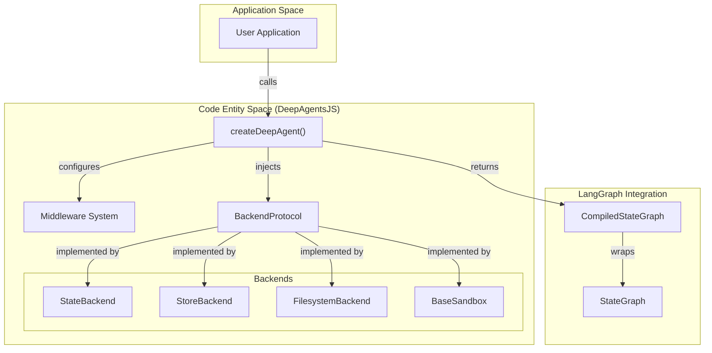
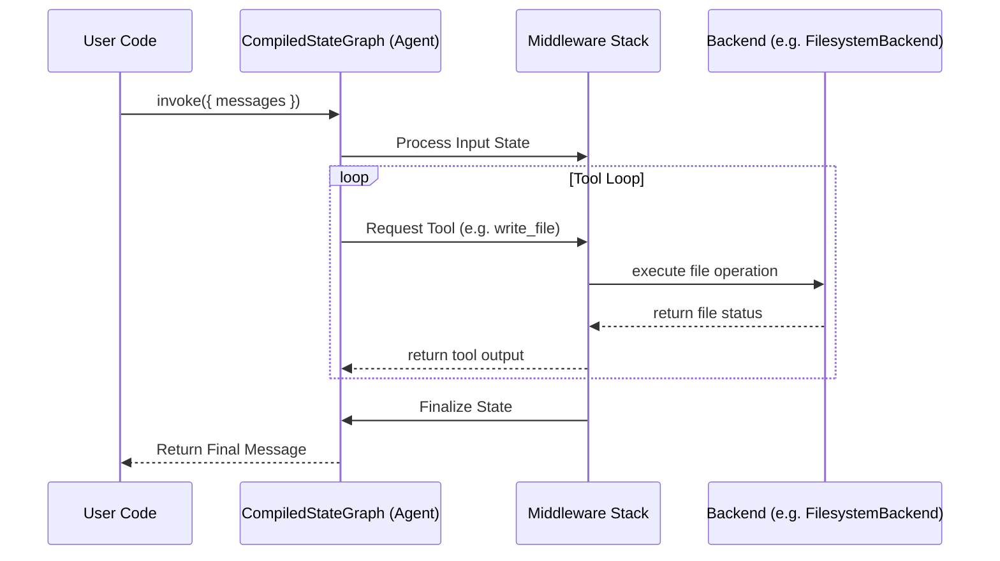

<!-- source: DeepWiki mcp.deepwiki.com · repo langchain-ai/deepagentsjs · page 2 Getting Started · fetched 2026-10-26 -->

# Getting Started

<details>
<summary>Relevant source files</summary>

The following files were used as context for generating this wiki page:

- [README.md](README.md)
- [evals/hitl/package.json](evals/hitl/package.json)
- [evals/subagents/package.json](evals/subagents/package.json)
- [evals/tool-usage-relational/package.json](evals/tool-usage-relational/package.json)
- [examples/async-subagents/parallel-research/package.json](examples/async-subagents/parallel-research/package.json)
- [examples/package.json](examples/package.json)
- [libs/deepagents/README.md](libs/deepagents/README.md)
- [libs/deepagents/package.json](libs/deepagents/package.json)
- [package.json](package.json)
- [pnpm-lock.yaml](pnpm-lock.yaml)

</details>


This document provides installation instructions and a quick-start guide for creating your first Deep Agent. It covers package installation, basic configuration, and a minimal working example.

For detailed information about the framework's architecture and concepts, see **Core Concepts**. For comprehensive API documentation, see **createDeepAgent API**. For sandbox execution environments, see **Backend Implementations**.

## Prerequisites

DeepAgentsJS requires:
- **Node.js**: v24.x is recommended (implied by latest environment support)
- **Package Manager**: pnpm is the primary manager for this monorepo [[package.json:58-58]()].
- **API Keys**: API keys for language model providers (e.g., Anthropic, OpenAI) [[libs/deepagents/package.json:51-53]()].

## Installation

Install the core `deepagents` package using your preferred package manager:

```bash
# npm
npm install deepagents

# yarn
yarn add deepagents

# pnpm
pnpm add deepagents
```

**Sources:** [libs/deepagents/README.md:39-45](), [README.md:39-45]()

### Installing Language Model Providers

Deep Agents are designed to work with LangChain-compatible models. You should install the provider for the LLM you intend to use:

```bash
# For Anthropic (Claude models)
npm install @langchain/anthropic

# For OpenAI (GPT models)
npm install @langchain/openai
```

**Sources:** [libs/deepagents/package.json:51-53](), [examples/package.json:13-19]()

### Installing Optional Dependencies

For specific features or sandbox environments, you may need additional packages:

```bash
# For web search capabilities
npm install @langchain/tavily

# For persistent storage checkpointers
npm install @langchain/langgraph-checkpoint

# For specific sandbox environments
npm install @langchain/node-vfs
npm install @langchain/quickjs
```

**Sources:** [libs/deepagents/package.json:52-55](), [examples/package.json:9-20]()

## Package Architecture

The following diagram bridges the high-level concepts to the specific code entities used in the system.

### System Entity Map



**Sources:** [libs/deepagents/README.md:84-86](), [libs/deepagents/package.json:42-43]()

## Creating Your First Agent

The `createDeepAgent` function is the primary entry point. It returns a compiled LangGraph graph that supports standard methods like `invoke` and `stream`.

### Basic Example

This minimal example creates an agent with default capabilities (planning and filesystem).

```typescript
import { createDeepAgent } from "deepagents";
import { ChatOpenAI } from "@langchain/openai";

// 1. Create the agent
const agent = createDeepAgent({
  model: new ChatOpenAI({ model: "gpt-4o", temperature: 0 }),
});

// 2. Invoke the agent
const result = await agent.invoke({
  messages: [
    {
      role: "user",
      content: "Create a file named hello.md and write 'Hello from DeepAgents' in it.",
    },
  ],
});
```

**Sources:** [libs/deepagents/README.md:47-60](), [libs/deepagents/README.md:71-80]()

## Backend Selection

Deep Agents require a backend for file operations and state persistence. While the default configuration is suitable for many tasks, you can customize the backend based on your requirements:

| Backend Category | Persistence | Environment | Typical Use Case |
|------------------|-------------|-------------|------------------|
| `StateBackend` | Ephemeral | In-memory | Simple sessions, testing |
| `StoreBackend` | Persistent | LangGraph Store | Cross-conversation memory |
| `FilesystemBackend` | Persistent | Local Disk | CLI tools, local automation |
| `SandboxBackend` | Isolated | Virtual/Remote | Safe code execution (Modal, Daytona, Node-VFS) |

**Sources:** [libs/deepagents/README.md:28-32](), [examples/package.json:9-17]()

### Agent Execution Data Flow

The following diagram illustrates how the `CompiledStateGraph` interacts with the middleware and backend during a tool call.



**Sources:** [libs/deepagents/README.md:24-32](), [libs/deepagents/README.md:84-86]()

## Built-in Capabilities

Every agent created via `createDeepAgent` comes with "batteries included" features out of the box:

1.  **Planning**: Includes `write_todos` for task breakdown and progress tracking [[libs/deepagents/README.md:28-28]()].
2.  **Filesystem**: Provides `read_file`, `write_file`, `edit_file`, `ls`, `glob`, and `grep` for managing working memory [[libs/deepagents/README.md:29-29]()].
3.  **Sub-agents**: Includes the `task` tool for delegating work with isolated context windows [[libs/deepagents/README.md:30-30]()].
4.  **Context Management**: Uses file-based workflows to keep long tasks manageable and avoid context overflow [[libs/deepagents/README.md:32-32]()].

## Next Steps

- **Core Concepts**: Learn about the middleware pipeline and the `BackendProtocol`.
- **Middleware Reference**: Explore specialized middleware like `SummarizationMiddleware` or `SkillsMiddleware`.
- **Backend Implementations**: Configure secure execution environments using providers like `Modal`, `Deno`, or `QuickJS`.

**Sources:** [libs/deepagents/README.md:88-96](), [README.md:88-96]()

---

