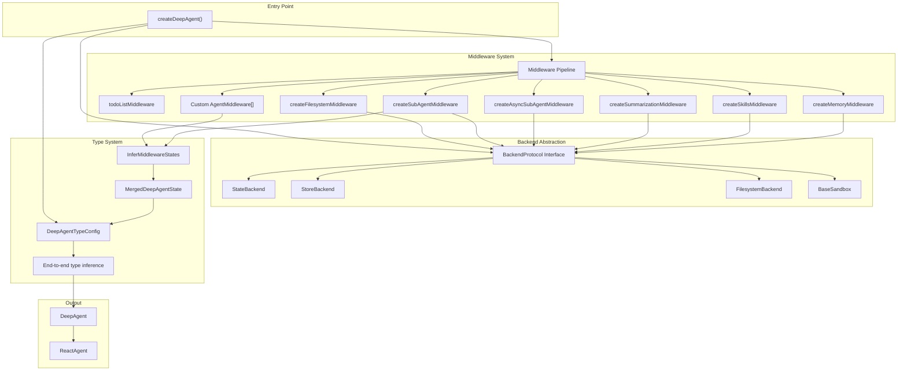
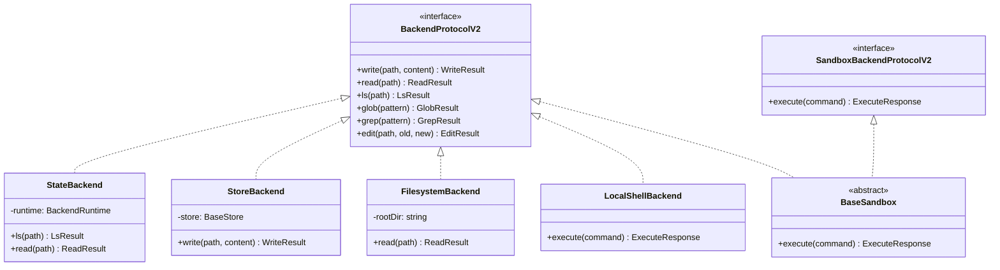
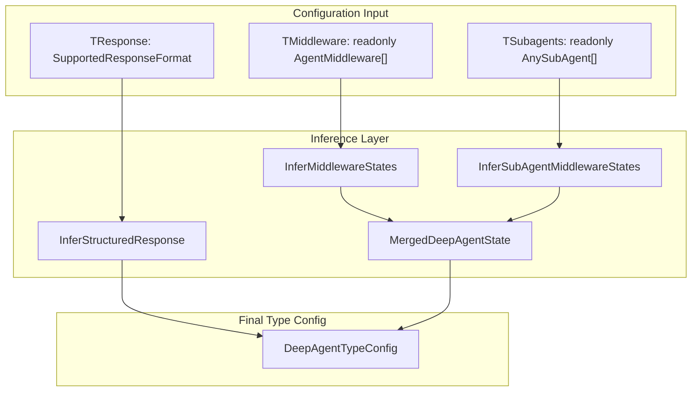

<!-- source: DeepWiki mcp.deepwiki.com · repo langchain-ai/deepagentsjs · page 3 Core Concepts · fetched 2026-10-26 -->

# Core Concepts

<details>
<summary>Relevant source files</summary>

The following files were used as context for generating this wiki page:

- [internal/eval-harness/CHANGELOG.md](internal/eval-harness/CHANGELOG.md)
- [libs/acp/CHANGELOG.md](libs/acp/CHANGELOG.md)
- [libs/deepagents/CHANGELOG.md](libs/deepagents/CHANGELOG.md)
- [libs/deepagents/src/agent.ts](libs/deepagents/src/agent.ts)
- [libs/deepagents/src/backends/protocol.ts](libs/deepagents/src/backends/protocol.ts)
- [libs/deepagents/src/backends/state.test.ts](libs/deepagents/src/backends/state.test.ts)
- [libs/deepagents/src/backends/state.ts](libs/deepagents/src/backends/state.ts)
- [libs/deepagents/src/index.ts](libs/deepagents/src/index.ts)
- [libs/deepagents/src/middleware/async_subagents.ts](libs/deepagents/src/middleware/async_subagents.ts)
- [libs/deepagents/src/middleware/index.ts](libs/deepagents/src/middleware/index.ts)
- [libs/deepagents/src/types.ts](libs/deepagents/src/types.ts)
- [libs/providers/quickjs/CHANGELOG.md](libs/providers/quickjs/CHANGELOG.md)

</details>


This page explains the three fundamental architectural patterns that underpin the DeepAgentsJS framework: the **middleware system**, the **backend abstraction layer**, and the **TypeScript type system**. Understanding these concepts is essential for effectively using and extending DeepAgents.

These concepts enable DeepAgents to be modular, extensible, and type-safe. Each concept is covered in detail in dedicated child pages ([Middleware Architecture](#3.1), [Backend System](#3.2), [Type System](#3.3)). This overview explains how they relate to each other and to the overall architecture.

---

## Architecture Overview

DeepAgents builds on LangChain's `createAgent` by adding a composable middleware architecture, a pluggable backend system, and comprehensive TypeScript type inference. The core factory function is `createDeepAgent`, which orchestrates these three systems.



**Diagram: Core Architecture of DeepAgents**

The `createDeepAgent` function [libs/deepagents/src/agent.ts:143-345]() combines these three systems:

1. **Middleware Pipeline**: Composed through factory methods that wire up tools and state [libs/deepagents/src/agent.ts:241-302]().
2. **Backend Abstraction**: Provides pluggable storage and execution via `BackendProtocol` [libs/deepagents/src/backends/protocol.ts:109]().
3. **Type System**: Ensures end-to-end type safety using `DeepAgentTypeConfig` [libs/deepagents/src/types.ts:153-173]().

**Sources:** [libs/deepagents/src/agent.ts:143-345](), [libs/deepagents/src/index.ts:8-152](), [libs/deepagents/src/types.ts:153-173]()

---

## The Middleware System

DeepAgents uses LangChain's `AgentMiddleware` interface to implement composable functionality. Each middleware can provide tools, modify the system prompt, and maintain its own state schema.

### Built-in Middleware

The framework includes several built-in middleware components that are automatically attached or conditionally added by `createDeepAgent`:

| Middleware | Purpose | Tools Provided |
|------------|---------|----------------|
| `todoListMiddleware` | Task planning and tracking | `write_todos` |
| `createFilesystemMiddleware` | File operations | `ls, read_file, write_file, edit_file, glob, grep` |
| `createSubAgentMiddleware` | Sync subagent delegation | `task` |
| `createAsyncSubAgentMiddleware` | Remote subagent delegation | `start_async_task, check_async_task, update_async_task, cancel_async_task, list_async_tasks` |
| `createSummarizationMiddleware` | Automatic context management | None (intercepts messages) |
| `createSkillsMiddleware` | Progressive disclosure of skills | `list_skills, read_skill` |
| `createMemoryMiddleware` | Long-term memory loading | None (modifies system prompt) |

Each middleware is created with factory functions exported from the main entry point [libs/deepagents/src/index.ts:41-76]().

### Middleware Pipeline Execution

Middleware executes in a deterministic order to ensure that prompt optimizations (like caching) and human-in-the-loop interrupts occur at the correct stage [libs/deepagents/src/agent.ts:241-302]().


**Diagram: Middleware Execution Order**

**For detailed information on the middleware architecture, see [Middleware Architecture](#3.1).**

**Sources:** [libs/deepagents/src/agent.ts:241-302](), [libs/deepagents/src/middleware/index.ts:1-73](), [libs/deepagents/src/middleware/async_subagents.ts:203-240]()

---

## The Backend Abstraction

The backend system abstracts storage and execution, allowing DeepAgents to work with different persistence mechanisms. All backends implement the `BackendProtocolV2` interface [libs/deepagents/src/backends/protocol.ts:27-29]().

### Backend Class Hierarchy



**Diagram: Backend Class Hierarchy**

### Backend Implementations

The framework provides several concrete backend implementations [libs/deepagents/src/index.ts:96-152]():

| Backend | Storage | Execution | Use Case |
|---------|---------|-----------|----------|
| `StateBackend` | In-memory LangGraph state | No | Ephemeral, single-session agents [libs/deepagents/src/backends/state.ts:39-48]() |
| `StoreBackend` | LangGraph Store | No | Multi-session persistent agents |
| `FilesystemBackend` | Local Disk | No | Local file manipulation |
| `LocalShellBackend` | Local Disk | Local Shell | Local dev/testing |
| `BaseSandbox` | Remote/Virtual | Sandboxed Shell | Production agents with isolation |

### Middleware-Backend Integration

Middleware components depend on the backend for persistence. For example, `StateBackend` uses LangGraph's `__pregel_send` to update state [libs/deepagents/src/backends/state.ts:115-126]().

**For detailed information on backends and their implementations, see [Backend System](#3.2).**

**Sources:** [libs/deepagents/src/backends/protocol.ts:1-222](), [libs/deepagents/src/backends/state.ts:49-223](), [libs/deepagents/src/index.ts:96-152]()

---

## The Type System

DeepAgents provides comprehensive TypeScript type inference that flows from configuration through to invocation results.

### DeepAgentTypeConfig

The type system centers on `DeepAgentTypeConfig`, which extends LangChain's `AgentTypeConfig` with subagent information [libs/deepagents/src/types.ts:153-173]():

```typescript
export interface DeepAgentTypeConfig<
  TResponse extends Record<string, any> | ResponseFormatUndefined,
  TState extends AnyAnnotationRoot | InteropZodObject | undefined,
  TContext extends AnyAnnotationRoot | InteropZodObject,
  TMiddleware extends readonly AgentMiddleware[],
  TTools extends readonly (ClientTool | ServerTool)[],
  TSubagents extends readonly AnySubAgent[],
> extends AgentTypeConfig<TResponse, TState, TContext, TMiddleware, TTools> {
  Subagents: TSubagents;
}
```

### Type Inference Flow



**Diagram: Type Inference Flow**

**Key Type Helpers:**
* `MergedDeepAgentState`: Merges states from custom and subagent middleware [libs/deepagents/src/types.ts:80-84]().
* `InferStructuredResponse`: Extracts the parsed type from response strategies [libs/deepagents/src/types.ts:116-125]().

**For detailed information on the type system, see [Type System](#3.3).**

**Sources:** [libs/deepagents/src/types.ts:1-173](), [libs/deepagents/src/index.ts:10-30]()

---

## Summary

The three core concepts work together to provide DeepAgents' capabilities:

| Concept | Provides | Configured Via |
|---------|----------|----------------|
| **Middleware System** | Tools, state, prompt logic | `middleware` parameter |
| **Backend Abstraction** | Storage and execution portability | `backend` parameter |
| **Type System** | End-to-end type safety | TypeScript generics |

**Sources:** [libs/deepagents/src/agent.ts:143-345](), [libs/deepagents/src/types.ts:1-173](), [libs/deepagents/src/index.ts:1-152]()

---

