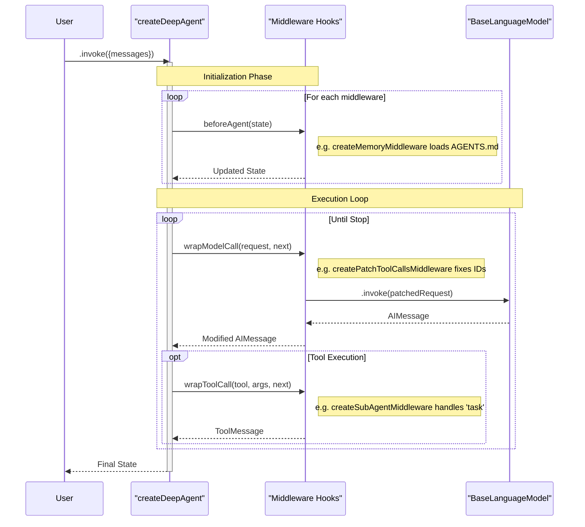

<!-- source: DeepWiki mcp.deepwiki.com · repo langchain-ai/deepagentsjs · page 3.1 Middleware Architecture · fetched 2026-10-26 -->

# Middleware Architecture

<details>
<summary>Relevant source files</summary>

The following files were used as context for generating this wiki page:

- [.gitignore](.gitignore)
- [libs/deepagents/src/agent.ts](libs/deepagents/src/agent.ts)
- [libs/deepagents/src/backends/protocol.test.ts](libs/deepagents/src/backends/protocol.test.ts)
- [libs/deepagents/src/index.ts](libs/deepagents/src/index.ts)
- [libs/deepagents/src/middleware/agent-memory.test.ts](libs/deepagents/src/middleware/agent-memory.test.ts)
- [libs/deepagents/src/middleware/async_subagents.test.ts](libs/deepagents/src/middleware/async_subagents.test.ts)
- [libs/deepagents/src/middleware/async_subagents.ts](libs/deepagents/src/middleware/async_subagents.ts)
- [libs/deepagents/src/middleware/index.test.ts](libs/deepagents/src/middleware/index.test.ts)
- [libs/deepagents/src/middleware/index.ts](libs/deepagents/src/middleware/index.ts)
- [libs/deepagents/src/middleware/patch_tool_calls.test.ts](libs/deepagents/src/middleware/patch_tool_calls.test.ts)
- [libs/deepagents/src/middleware/patch_tool_calls.ts](libs/deepagents/src/middleware/patch_tool_calls.ts)
- [libs/deepagents/src/middleware/types.ts](libs/deepagents/src/middleware/types.ts)
- [libs/deepagents/src/types.ts](libs/deepagents/src/types.ts)
- [tsconfig.json](tsconfig.json)

</details>


## Purpose and Scope

This page explains the middleware architecture used throughout DeepAgentsJS to extend agent capabilities in a modular, composable way. It covers the middleware pipeline execution order, available hooks, state management, and how to create custom middleware.

The middleware system is built on top of LangChain's `createMiddleware` utility, providing a structured way to inject logic into the agent's lifecycle.

---

## Architecture Overview

The DeepAgents framework uses a middleware-based architecture where functionality is added through a strictly ordered pipeline. Each middleware component can:

- **Add state channels**: Define new keys in the agent's state schema using Zod or `AnnotationRoot` [libs/deepagents/src/agent.ts:130-133]().
- **Inject System Messages**: Prepend or append content to the system prompt [libs/deepagents/src/middleware/utils.ts:42-42]().
- **Intercept Model Calls**: Modify messages or parameters before they reach the LLM [libs/deepagents/src/middleware/patch_tool_calls.ts:169-187]().
- **Provide Tools**: Inject structured tools (like `ls`, `read_file`, or `task`) into the agent's available toolset [libs/deepagents/src/middleware/fs.ts:120-140]().
- **Manage Lifecycle**: Execute logic before or after agent invocation [libs/deepagents/src/middleware/patch_tool_calls.ts:137-160]().

### Core Middleware Pipeline

```mermaid
graph TB
    ["createDeepAgent()"] -- "Constructs" --> [Pipeline]
    
    subgraph Pipeline["Middleware Pipeline (Execution Order)"]
        direction TB
        [todoListMiddleware] -- "Task Management" --> [createFilesystemMiddleware]
        [createFilesystemMiddleware] -- "Files & Sandbox" --> [createSubAgentMiddleware]
        [createSubAgentMiddleware] -- "Delegation" --> [createSummarizationMiddleware]
        [createSummarizationMiddleware] -- "Context Mgmt" --> [anthropicPromptCachingMiddleware]
        [anthropicPromptCachingMiddleware] -- "Caching" --> [createPatchToolCallsMiddleware]
        [createPatchToolCallsMiddleware] -- "Parity Fixes" --> [createSkillsMiddleware]
        [createSkillsMiddleware] -- "On-demand Skills" --> [createMemoryMiddleware]
        [createMemoryMiddleware] -- "Persistent Context" --> [humanInTheLoopMiddleware]
        [humanInTheLoopMiddleware] -- "Oversight" --> [CustomMiddleware]
    end
    
    [Pipeline] -- "Compiled into" --> [ReactAgent]
    
    subgraph CodeEntities["Code Entity Space"]
        [todoListMiddleware]
        [createFilesystemMiddleware]
        [createSubAgentMiddleware]
        [createSummarizationMiddleware]
        [createPatchToolCallsMiddleware]
        [createSkillsMiddleware]
        [createMemoryMiddleware]
        [anthropicPromptCachingMiddleware]
    end
```

**Sources:** [libs/deepagents/src/agent.ts:241-302](), [libs/deepagents/src/middleware/index.ts:1-76]()

The execution order is deterministic to ensure dependencies are met (e.g., Filesystem tools must exist before Subagents that might use them).

---

## Middleware Hooks

Middleware components implement hooks defined by the `AgentMiddleware` interface to integrate with the agent execution flow.

### Hook Execution Flow



**Sources:** [libs/deepagents/src/agent.ts:143-163](), [libs/deepagents/src/middleware/patch_tool_calls.ts:134-189](), [libs/deepagents/src/middleware/async_subagents.ts:4-9]()

### Key Hooks

| Hook | Purpose | Implementation Example |
|------|---------|------------------------|
| `beforeAgent` | Initialize resources or load data into state before the graph starts. | `createMemoryMiddleware` loads file contents into `memoryContents` [libs/deepagents/src/middleware/memory.ts:137-176](). |
| `wrapModelCall` | Modify the prompt or parameters right before model invocation. | `createPatchToolCallsMiddleware` ensures tool call parity for Gemini/Anthropic [libs/deepagents/src/middleware/patch_tool_calls.ts:169-187](). |
| `wrapToolCall` | Intercept and handle tool execution logic. | `createSubAgentMiddleware` intercepts the `task` tool to run sub-graphs [libs/deepagents/src/middleware/subagents.ts:1-20](). |

---

## State Management

Middleware components contribute state channels to the agent's overall state schema. DeepAgentsJS uses a merging strategy where middleware states are flattened into the final agent state.

### Built-in State Channels

| Middleware | State Channel | Reducer | Description |
|------------|---------------|---------|-------------|
| `createFilesystemMiddleware` | `files` | `filesValue` | Merges file updates into the state record [libs/deepagents/src/middleware/fs.ts:1-9](). |
| `createSummarizationMiddleware` | `__summaryEvents` | `(a, b) => [...a, ...b]` | Private tracking of summarization triggers [libs/deepagents/src/middleware/summarization.ts:51-61](). |
| `createAsyncSubAgentMiddleware` | `asyncTasks` | `asyncTasksReducer` | Merges task updates into the tasks dictionary [libs/deepagents/src/middleware/async_subagents.ts:156-164](). |
| `createMemoryMiddleware` | `memoryContents` | Replace | Mapping of source paths to file content [libs/deepagents/src/middleware/memory.ts:26-28](). |

### The `asyncTasksReducer`

The `asyncTasksReducer` handles concurrent updates to remote tasks, ensuring that individual tool updates (launch, check, cancel) merge into the existing tasks dictionary rather than replacing it [libs/deepagents/src/middleware/async_subagents.ts:177-182]().

**Sources:** [libs/deepagents/src/middleware/async_subagents.ts:156-182](), [libs/deepagents/src/values.ts:79-79]()

---

## Specialized Middleware

### Tool Call Patching
The `createPatchToolCallsMiddleware` is critical for providers like Google Gemini that enforce strict parity between `AIMessage.tool_calls` and `ToolMessage` responses.

- **Dangling Calls**: Inserts synthetic "cancelled" `ToolMessage`s if an AI message has a tool call without a corresponding response [libs/deepagents/src/middleware/patch_tool_calls.ts:82-93]().
- **Orphaned Messages**: Removes `ToolMessage`s that do not match any preceding `AIMessage` tool call [libs/deepagents/src/middleware/patch_tool_calls.ts:63-68]().

### Async Subagents
The `createAsyncSubAgentMiddleware` provides tools (`start_async_task`, `check_async_task`, etc.) to interact with remote LangGraph servers. It uses a `ReducedValue` state channel to track background tasks [libs/deepagents/src/middleware/async_subagents.ts:190-200]().

---

## Creating Custom Middleware

Custom middleware is created using the `createMiddleware` factory from `langchain`.

### Implementation Example

```typescript
import { createMiddleware } from "langchain";
import { z } from "zod/v4";

export const MyCustomMiddleware = createMiddleware({
  name: "MyCustomMiddleware",
  // 1. Define custom state
  stateSchema: z.object({
    customCounter: z.number().default(0),
  }),
  
  // 2. Implement hooks
  beforeAgent: async (state) => {
    return { customCounter: state.customCounter + 1 };
  },
  
  wrapModelCall: async (request, handler) => {
    // Modify request or inspect result
    return handler(request);
  }
});
```

**Sources:** [libs/deepagents/src/agent.ts:130-137](), [libs/deepagents/src/middleware/patch_tool_calls.ts:134-189]()

### Type Inference
DeepAgentsJS uses TypeScript's conditional types to infer the merged state of all middleware. When `MyCustomMiddleware` is passed to `createDeepAgent`, the `customCounter` property becomes available on the agent's state [libs/deepagents/src/types.ts:79-84]().

**Sources:** [libs/deepagents/src/types.ts:71-84](), [libs/deepagents/src/agent.ts:143-163]()

---

