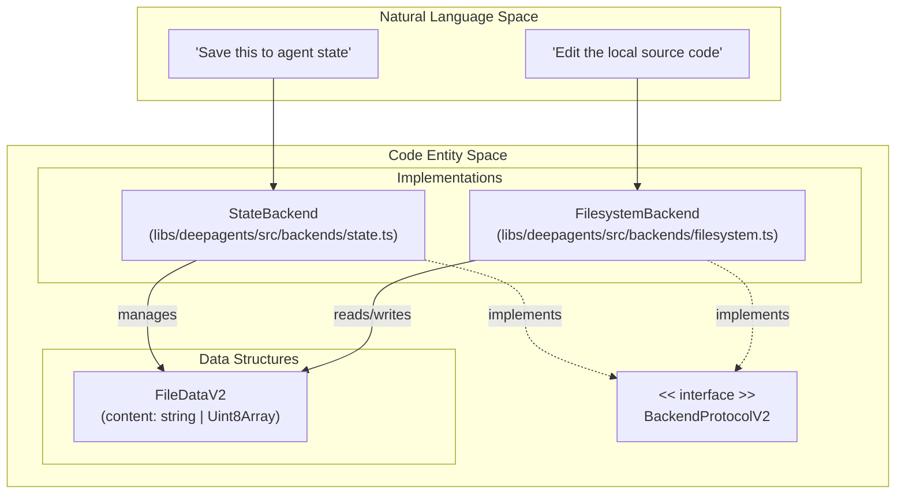
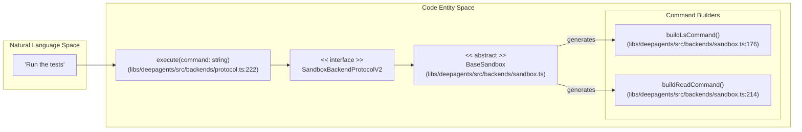

<!-- source: DeepWiki mcp.deepwiki.com · repo langchain-ai/deepagentsjs · page 3.2 Backend System · fetched 2026-10-26 -->

# Backend System

Relevant source files

The following files were used as context for generating this wiki page:

- [.changeset/fix-follow-symlinks.md](.changeset/fix-follow-symlinks.md)
- [libs/deepagents/src/backends/filesystem.test.ts](libs/deepagents/src/backends/filesystem.test.ts)
- [libs/deepagents/src/backends/filesystem.ts](libs/deepagents/src/backends/filesystem.ts)
- [libs/deepagents/src/backends/protocol.ts](libs/deepagents/src/backends/protocol.ts)
- [libs/deepagents/src/backends/sandbox.test.ts](libs/deepagents/src/backends/sandbox.test.ts)
- [libs/deepagents/src/backends/sandbox.ts](libs/deepagents/src/backends/sandbox.ts)
- [libs/deepagents/src/backends/state.test.ts](libs/deepagents/src/backends/state.test.ts)
- [libs/deepagents/src/backends/state.ts](libs/deepagents/src/backends/state.ts)
- [libs/deepagents/src/backends/utils.test.ts](libs/deepagents/src/backends/utils.test.ts)
- [libs/deepagents/src/backends/utils.ts](libs/deepagents/src/backends/utils.ts)

## Purpose and Scope

The backend system provides a pluggable abstraction layer for storage and execution operations in DeepAgentsJS. It decouples agent logic and middleware tools from the underlying storage mechanism (e.g., LangGraph state, persistent stores, or real filesystems). This layer ensures that agents can operate consistently across different environments, from ephemeral in-memory state to persistent sandboxed containers.

## Backend Abstraction Layer

The system is built around a unified interface that allows agents to interact with "files" and "commands" regardless of the physical implementation.

### BackendProtocol

The core interface is defined in `libs/deepagents/src/backends/protocol.ts`. It provides a uniform API for file-like operations. The current standard is `BackendProtocolV2`, which supports both text and binary data via `Uint8Array` [libs/deepagents/src/backends/protocol.ts:17-19]().

**Key Interface Methods:**
- `ls(path)`: Returns structured file listing metadata (`LsResult`) [libs/deepagents/src/backends/protocol.ts:149-156]().
- `read(filePath, offset, limit)`: Returns content (string or `Uint8Array`) with optional pagination for text [libs/deepagents/src/backends/protocol.ts:129-137]().
- `readRaw(filePath)`: Returns the underlying `FileData` object containing metadata like `mimeType` and timestamps [libs/deepagents/src/backends/protocol.ts:141-146]().
- `write(filePath, content)`: Creates or overwrites a file and returns a `WriteResult` [libs/deepagents/src/backends/protocol.ts:174-190]().
- `edit(filePath, oldString, newString, replaceAll)`: Performs targeted string replacement within a file [libs/deepagents/src/backends/protocol.ts:198-216]().
- `grep(pattern, path, glob)`: Performs text searching, returning `GrepMatch` objects with line numbers [libs/deepagents/src/backends/protocol.ts:59-76]().

Sources: [libs/deepagents/src/backends/protocol.ts:1-216](), [libs/deepagents/src/backends/utils.ts:187-235]()

### SandboxBackendProtocol

An extension of the backend layer (`SandboxBackendProtocolV2`) that adds capabilities for remote or isolated execution environments [libs/deepagents/src/backends/protocol.ts:28-29]().

**Additional capabilities:**
- `execute(command)`: Runs a POSIX shell command and returns `ExecuteResponse` (stdout/stderr, exitCode, and a `truncated` flag) [libs/deepagents/src/backends/protocol.ts:222-230]().
- `uploadFiles(files)`: Bulk transfer of `Uint8Array` data to the sandbox [libs/deepagents/src/backends/protocol.ts:252-254]().
- `downloadFiles(paths)`: Bulk retrieval of binary data from the sandbox [libs/deepagents/src/backends/protocol.ts:245-247]().

Sources: [libs/deepagents/src/backends/protocol.ts:222-265](), [libs/deepagents/src/backends/sandbox.ts:1-14]()

## Backend Implementations

DeepAgentsJS includes several built-in backends to handle different persistence and execution requirements.

| Backend | Class Name | Storage/Execution Mechanism | Use Case |
| :--- | :--- | :--- | :--- |
| **State** | `StateBackend` | LangGraph `files` state channel | Ephemeral, per-thread storage. |
| **Filesystem** | `FilesystemBackend` | Local Node.js `fs` | Real disk access (local development/CLI). |
| **Sandbox** | `BaseSandbox` | Remote/Isolated Shell | Secure execution (Daytona, Deno, Modal). |
| **Composite** | `CompositeBackend` | Multi-backend router | Routing paths to different storage types. |

### StateBackend
The `StateBackend` stores files directly within the LangGraph agent state. In modern usage, it uses `__pregel_send` to dispatch state updates to the "files" channel [libs/deepagents/src/backends/state.ts:115-126](). It supports both legacy `v1` (line arrays) and `v2` (raw strings/binary) formats [libs/deepagents/src/backends/state.ts:51-75]().

### FilesystemBackend
The `FilesystemBackend` provides direct access to the host filesystem. It features a `virtualMode` which, when enabled, sandboxes all operations to a `rootDir`, preventing path traversal (`..`) [libs/deepagents/src/backends/filesystem.ts:79-96](). It uses `O_NOFOLLOW` where available to prevent symlink attacks [libs/deepagents/src/backends/filesystem.ts:39-39]().

### BaseSandbox
`BaseSandbox` is an abstract class that implements high-level `BackendProtocol` methods (like `read`, `ls`, `grep`) by translating them into low-level shell commands (e.g., `awk`, `find`, `grep`) executed via the `execute()` method [libs/deepagents/src/backends/sandbox.ts:2-14](). This allows any provider that can run a shell command to immediately support the full filesystem toolset.

Sources: [libs/deepagents/src/backends/state.ts:49-103](), [libs/deepagents/src/backends/filesystem.ts:48-64](), [libs/deepagents/src/backends/sandbox.ts:158-208]()

## System Architecture Diagrams

### Storage Mapping: Natural Language to Code Entities
This diagram shows how high-level storage concepts map to specific classes and interfaces in the codebase.

Sources: [libs/deepagents/src/backends/protocol.ts:103-112](), [libs/deepagents/src/backends/state.ts:49](), [libs/deepagents/src/backends/filesystem.ts:48]()

### Execution Mapping: Natural Language to Code Entities
This diagram shows how command execution requests flow through the sandbox abstraction.

Sources: [libs/deepagents/src/backends/protocol.ts:222](), [libs/deepagents/src/backends/sandbox.ts:176-214]()

## Data Flow: File Operations

When an agent interacts with a file, the following flow occurs:

1.  **Backend Method Call**: A middleware (like `FilesystemMiddleware`) calls a method on the `BackendProtocol` implementation, such as `backend.write(path, content)`.
2.  **Path Resolution**: 
    *   In `FilesystemBackend`, `resolvePath(key)` ensures the path is absolute or contained within the `rootDir` [libs/deepagents/src/backends/filesystem.ts:78-96]().
    *   In `StateBackend`, the path is used as a key in the state's `files` record [libs/deepagents/src/backends/state.ts:95-103]().
3.  **Content Transformation**:
    *   `createFileData` is used to wrap the raw content into a `FileDataV2` structure with a `mimeType` and timestamps [libs/deepagents/src/backends/utils.ts:194-227]().
4.  **Persistence**:
    *   `StateBackend` calls `sendFilesUpdate()` to notify LangGraph of the change [libs/deepagents/src/backends/state.ts:115-126]().
    *   `FilesystemBackend` uses `node:fs/promises` to write to disk [libs/deepagents/src/backends/filesystem.ts:264-284]().

## Sandbox Command Logic

The `BaseSandbox` uses sophisticated shell scripting to provide a consistent environment across different Linux distributions (GNU, BusyBox/Alpine, BSD/macOS).

*   **Runtime Detection**: `buildLsCommand` and `buildFindCommand` probe the environment for `find -printf` (GNU) and fall back to `stat -c` (BusyBox) or `stat -f` (BSD) [libs/deepagents/src/backends/sandbox.ts:176-188]().
*   **Pagination**: `buildReadCommand` uses `awk` to provide efficient line-based reading with `offset` and `limit` directly in the shell [libs/deepagents/src/backends/sandbox.ts:214-230]().
*   **Safety**: All paths and patterns are escaped using `shellQuote` to prevent command injection [libs/deepagents/src/backends/sandbox.ts:38-40]().

Sources: [libs/deepagents/src/backends/sandbox.ts:38-230](), [libs/deepagents/src/backends/utils.ts:79-81]()

---

