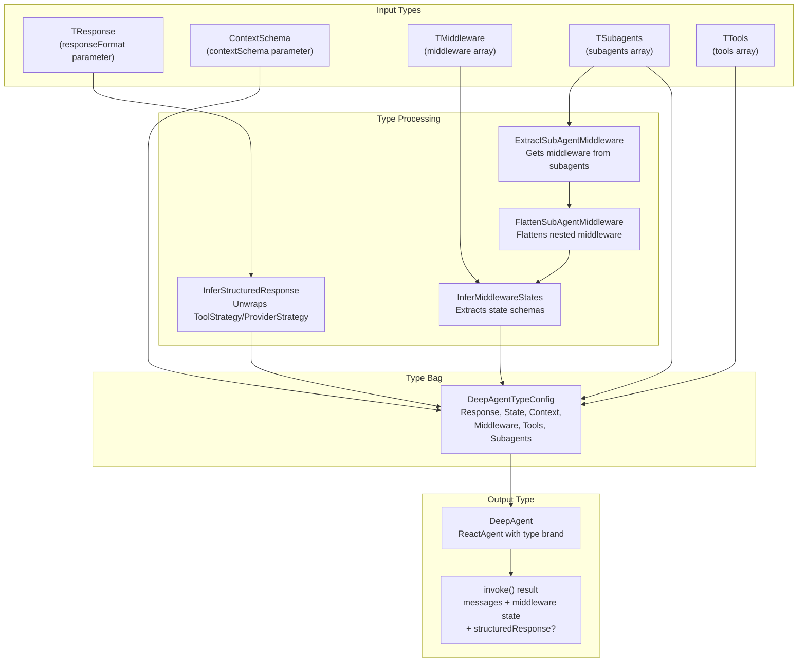
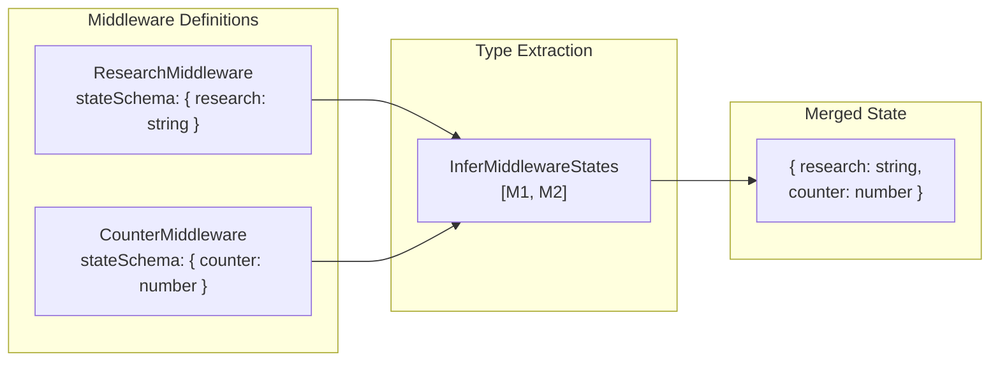
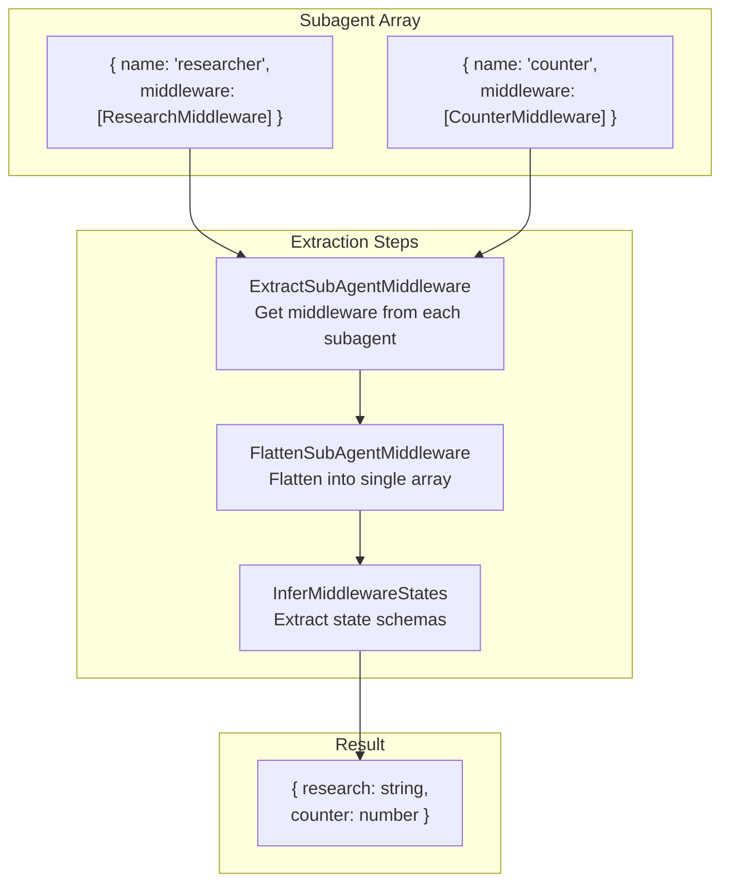
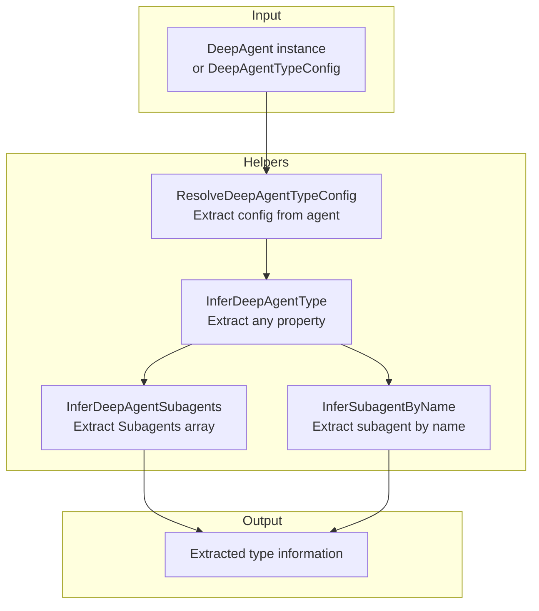
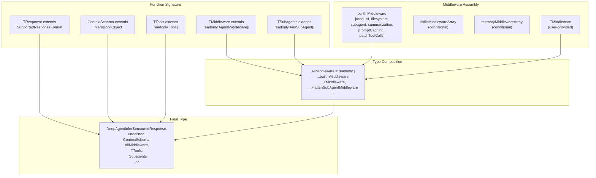

<!-- source: DeepWiki mcp.deepwiki.com · repo langchain-ai/deepagentsjs · page 3.3 Type System · fetched 2026-10-26 -->

# Type System

<details>
<summary>Relevant source files</summary>

The following files were used as context for generating this wiki page:

- [.gitignore](.gitignore)
- [libs/deepagents/src/agent.int.test.ts](libs/deepagents/src/agent.int.test.ts)
- [libs/deepagents/src/agent.test-d.ts](libs/deepagents/src/agent.test-d.ts)
- [libs/deepagents/src/agent.ts](libs/deepagents/src/agent.ts)
- [libs/deepagents/src/index.ts](libs/deepagents/src/index.ts)
- [libs/deepagents/src/middleware/agent-memory.test.ts](libs/deepagents/src/middleware/agent-memory.test.ts)
- [libs/deepagents/src/middleware/async_subagents.ts](libs/deepagents/src/middleware/async_subagents.ts)
- [libs/deepagents/src/middleware/index.ts](libs/deepagents/src/middleware/index.ts)
- [libs/deepagents/src/middleware/patch_tool_calls.test.ts](libs/deepagents/src/middleware/patch_tool_calls.test.ts)
- [libs/deepagents/src/middleware/patch_tool_calls.ts](libs/deepagents/src/middleware/patch_tool_calls.ts)
- [libs/deepagents/src/middleware/types.ts](libs/deepagents/src/middleware/types.ts)
- [libs/deepagents/src/testing/utils.ts](libs/deepagents/src/testing/utils.ts)
- [libs/deepagents/src/types.ts](libs/deepagents/src/types.ts)
- [tsconfig.json](tsconfig.json)

</details>


**Purpose and Scope**: This document explains the TypeScript type system used throughout DeepAgentsJS, including the `DeepAgentTypeConfig` type bag, type inference from middleware and subagents, response format typing, and helper utilities for extracting types from agent configurations. It covers the flow of types through the `createDeepAgent` factory and how the system ensures end-to-end type safety for state and structured responses.

---

## Overview

The DeepAgents type system provides end-to-end type safety by inferring state schemas from middleware, tracking subagent types for type-safe delegation, and ensuring structured responses match their declared formats. All type information flows through the `createDeepAgent` factory function and is bundled into a `DeepAgentTypeConfig` type bag.

**Type System Architecture**



Sources: [libs/deepagents/src/types.ts:153-173](), [libs/deepagents/src/agent.ts:143-163]()

---

## Core Type Constructs

### DeepAgentTypeConfig

The `DeepAgentTypeConfig` interface is a type bag that extends LangChain's `AgentTypeConfig` with subagent type information. It bundles all generic type parameters used throughout the deep agent system, including support for `AnySubAgent` (Sync, Compiled, or Async).

**Type Parameters**:

| Parameter | Default | Description |
|-----------|---------|-------------|
| `TResponse` | `Record<string, any> \| ResponseFormatUndefined` | Structured response type from `responseFormat` |
| `TState` | `AnyAnnotationRoot \| InteropZodObject \| undefined` | Custom state schema (unused in DeepAgents, state comes from middleware) |
| `TContext` | `AnyAnnotationRoot \| InteropZodObject` | Context schema type |
| `TMiddleware` | `readonly AgentMiddleware[]` | Middleware array type |
| `TTools` | `readonly (ClientTool \| ServerTool)[]` | Tools array type |
| `TSubagents` | `readonly AnySubAgent[]` | Subagents array type (Sync, Compiled, or Async) |

**Interface Definition**:

```typescript
export interface DeepAgentTypeConfig<
  TResponse extends Record<string, any> | ResponseFormatUndefined = ...,
  TState extends AnyAnnotationRoot | InteropZodObject | undefined = ...,
  TContext extends AnyAnnotationRoot | InteropZodObject = ...,
  TMiddleware extends readonly AgentMiddleware[] = readonly AgentMiddleware[],
  TTools extends readonly (ClientTool | ServerTool)[] = ...,
  TSubagents extends readonly AnySubAgent[] = readonly AnySubAgent[],
> extends AgentTypeConfig<TResponse, TState, TContext, TMiddleware, TTools> {
  Subagents: TSubagents;
}
```

Sources: [libs/deepagents/src/types.ts:153-173]()

### DeepAgent Type

The `DeepAgent` type wraps LangChain's `ReactAgent` with a type brand (`~deepAgentTypes`) that carries the full `DeepAgentTypeConfig`. This allows helper types to extract type information from an agent instance.

```typescript
export type DeepAgent<TTypes extends DeepAgentTypeConfig> = ReactAgent<TTypes> & {
  readonly "~deepAgentTypes": TTypes;
};
```

The type brand is accessible at compile time but does not exist at runtime. It serves purely for type inference.

Sources: [libs/deepagents/src/types.ts:189-194]()

### AnySubAgent Union

DeepAgents supports three types of subagents, all unified under the `AnySubAgent` type:
1. **SubAgent**: A configuration object for a new subagent.
2. **CompiledSubAgent**: A previously created `DeepAgent` or `ReactAgent` instance.
3. **AsyncSubAgent**: A remote agent running on an Agent Protocol server.

```typescript
export type AnySubAgent = SubAgent | CompiledSubAgent | AsyncSubAgent;
```

Sources: [libs/deepagents/src/types.ts:36-36]()

---

## Type Inference from Middleware

DeepAgents infers state types from middleware by extracting their `stateSchema` properties. The LangChain `InferMiddlewareStates` utility merges all middleware state schemas into a single type.

**Middleware State Inference Flow**



### Example: Custom Middleware State

```typescript
// Define middleware with state schema
const ResearchMiddleware = createMiddleware({
  name: "ResearchMiddleware",
  stateSchema: z.object({
    research: z.string().default("")
  }),
});

const agent = createDeepAgent({
  middleware: [ResearchMiddleware],
});

// invoke() result includes research property typed as string
const result = await agent.invoke({ messages: [] });
// result.research is string
```

Sources: [libs/deepagents/src/agent.test-d.ts:33-48](), [libs/deepagents/src/agent.test-d.ts:116-134]()

### MergedDeepAgentState

The `MergedDeepAgentState` type combines state from both custom middleware and subagent middleware:

```typescript
export type MergedDeepAgentState<
  TMiddleware extends readonly AgentMiddleware[],
  TSubagents extends readonly AnySubAgent[],
> = InferMiddlewareStates<TMiddleware> &
  InferSubAgentMiddlewareStates<TSubagents>;
```

Sources: [libs/deepagents/src/types.ts:80-84]()

---

## Type Inference from Subagents

Subagents can define their own middleware, and the type system extracts and flattens this middleware to infer state contributions.

**Subagent Middleware Extraction**



### ExtractSubAgentMiddleware

Extracts the middleware array from a `SubAgent` definition, handling both mutable and readonly arrays:

```typescript
export type ExtractSubAgentMiddleware<T> = T extends { middleware?: infer M }
  ? M extends readonly AgentMiddleware[]
    ? M
    : M extends AgentMiddleware[]
      ? M
      : readonly []
  : readonly [];
```

Sources: [libs/deepagents/src/types.ts:48-54]()

### FlattenSubAgentMiddleware

Recursively flattens middleware from all subagents into a single array:

```typescript
export type FlattenSubAgentMiddleware<T extends readonly AnySubAgent[]> =
  T extends readonly []
    ? readonly []
    : T extends readonly [infer First, ...infer Rest]
      ? Rest extends readonly AnySubAgent[]
        ? readonly [
            ...ExtractSubAgentMiddleware<First>,
            ...FlattenSubAgentMiddleware<Rest>,
          ]
        : ExtractSubAgentMiddleware<First>
      : readonly [];
```

Sources: [libs/deepagents/src/types.ts:59-69]()

### InferSubAgentMiddlewareStates

Combines extraction and flattening to infer state from subagent middleware:

```typescript
export type InferSubAgentMiddlewareStates<T extends readonly AnySubAgent[]> =
  InferMiddlewareStates<FlattenSubAgentMiddleware<T>>;
```

Sources: [libs/deepagents/src/types.ts:74-75]()

---

## Response Format Typing

The type system unwraps response format strategies (`ToolStrategy<T>`, `ProviderStrategy<T>`, `TypedToolStrategy<T>`) to extract the parsed output type.

### SupportedResponseFormat

Union of all response format types accepted by `createDeepAgent`:

```typescript
export type SupportedResponseFormat = ResponseFormat | TypedToolStrategy<any>;
```

Sources: [libs/deepagents/src/types.ts:95-95]()

### InferStructuredResponse

Extracts the parsed type from a response format strategy:

```typescript
export type InferStructuredResponse<T extends SupportedResponseFormat> =
  SupportedResponseFormat extends T
    ? ResponseFormatUndefined
    : T extends TypedToolStrategy<infer U>
      ? U
      : T extends ToolStrategy<infer U>
        ? U
        : T extends ProviderStrategy<infer U>
          ? U
          : ResponseFormatUndefined;
```

**Type Unwrapping**:

| Input Type | Output Type |
|------------|-------------|
| `ToolStrategy<{ city: string }>` | `{ city: string }` |
| `ProviderStrategy<{ answer: string }>` | `{ answer: string }` |
| `TypedToolStrategy<{ name: string }>` | `{ name: string }` |
| `SupportedResponseFormat` (default) | `ResponseFormatUndefined` |

Sources: [libs/deepagents/src/types.ts:116-125]()

---

## Type Extraction Helpers

DeepAgents provides helper types for extracting specific information from a `DeepAgent` instance or `DeepAgentTypeConfig`.

**Type Extraction Helper Utilities**



### ResolveDeepAgentTypeConfig

Extracts `DeepAgentTypeConfig` from either a config object or an agent instance:

```typescript
export type ResolveDeepAgentTypeConfig<T> = T extends {
  "~deepAgentTypes": infer Types;
}
  ? Types extends DeepAgentTypeConfig
    ? Types
    : never
  : T extends DeepAgentTypeConfig
    ? T
    : never;
```

Sources: [libs/deepagents/src/types.ts:241-249]()

### InferDeepAgentType

Generic helper to extract any property from a `DeepAgentTypeConfig`:

```typescript
export type InferDeepAgentType<
  T,
  K extends keyof DeepAgentTypeConfig,
> = ResolveDeepAgentTypeConfig<T>[K];
```

Sources: [libs/deepagents/src/types.ts:263-266]()

### InferSubagentByName

Extracts a specific subagent by its name literal:

```typescript
export type InferSubagentByName<T, TName extends string> =
  InferDeepAgentSubagents<T> extends readonly (infer SA)[]
    ? SA extends { name: TName }
      ? SA
      : never
    : never;
```

Sources: [libs/deepagents/src/types.ts:328-333]()

---

## Type Flow Through createDeepAgent

The `createDeepAgent` function threads generic type parameters through the entire agent creation process, assembling them into a final `DeepAgent` type.

**Type Parameter Flow**



Sources: [libs/deepagents/src/agent.ts:143-345]()

### Generic Type Parameters

The function signature captures five generic type parameters with `const` assertions to preserve literal types:

```typescript
export function createDeepAgent<
  TResponse extends SupportedResponseFormat = SupportedResponseFormat,
  ContextSchema extends InteropZodObject = InteropZodObject,
  const TMiddleware extends readonly AgentMiddleware[] = readonly [],
  const TSubagents extends readonly AnySubAgent[] = readonly [],
  const TTools extends readonly (ClientTool | ServerTool)[] = readonly [],
>(params: CreateDeepAgentParams<...>) { ... }
```

Sources: [libs/deepagents/src/agent.ts:143-163]()

### Final Type Construction

The agent is cast to `DeepAgent` with the complete type configuration, ensuring that `invoke()` results are correctly typed based on the provided middleware and subagents.

```typescript
  return agent as unknown as DeepAgent<
    DeepAgentTypeConfig<
      InferStructuredResponse<TResponse>,
      undefined,
      ContextSchema,
      AllMiddleware,
      TTools,
      TSubagents
    >
  >;
```

Sources: [libs/deepagents/src/agent.ts:335-344]()

---

