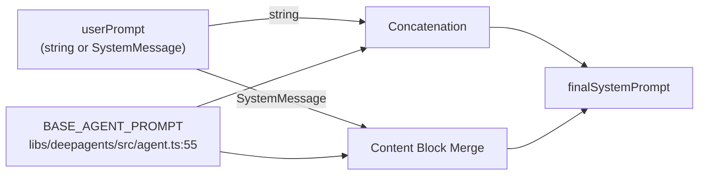
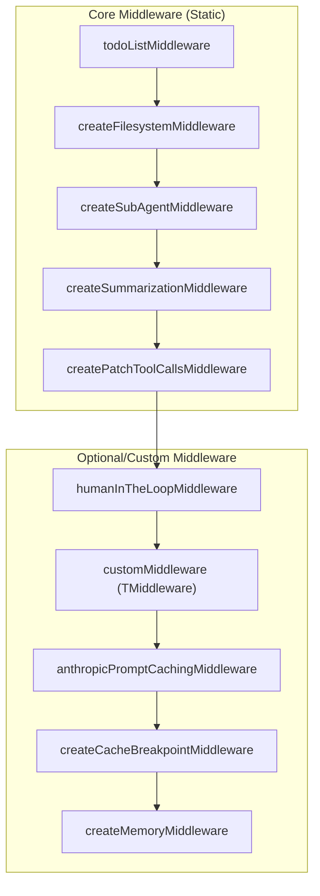
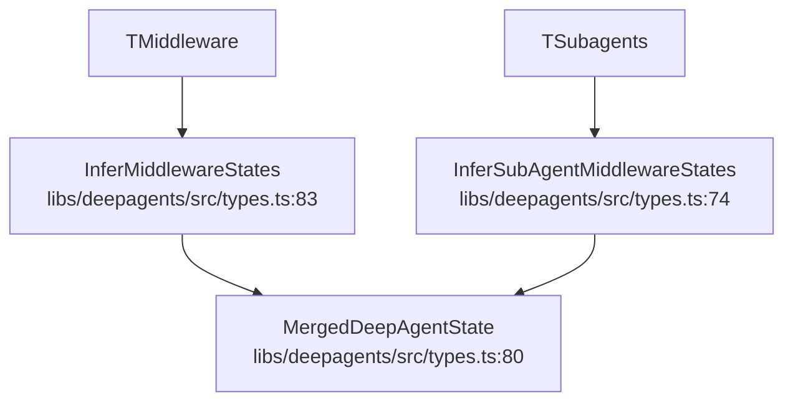

<!-- source: DeepWiki mcp.deepwiki.com · repo langchain-ai/deepagentsjs · page 4 createDeepAgent API · fetched 2026-10-26 -->

# createDeepAgent API

<details>
<summary>Relevant source files</summary>

The following files were used as context for generating this wiki page:

- [libs/deepagents/src/agent.int.test.ts](libs/deepagents/src/agent.int.test.ts)
- [libs/deepagents/src/agent.test-d.ts](libs/deepagents/src/agent.test-d.ts)
- [libs/deepagents/src/agent.test.ts](libs/deepagents/src/agent.test.ts)
- [libs/deepagents/src/agent.ts](libs/deepagents/src/agent.ts)
- [libs/deepagents/src/errors.ts](libs/deepagents/src/errors.ts)
- [libs/deepagents/src/index.ts](libs/deepagents/src/index.ts)
- [libs/deepagents/src/middleware/async_subagents.ts](libs/deepagents/src/middleware/async_subagents.ts)
- [libs/deepagents/src/middleware/cache.test.ts](libs/deepagents/src/middleware/cache.test.ts)
- [libs/deepagents/src/middleware/index.ts](libs/deepagents/src/middleware/index.ts)
- [libs/deepagents/src/testing/utils.ts](libs/deepagents/src/testing/utils.ts)
- [libs/deepagents/src/types.ts](libs/deepagents/src/types.ts)

</details>


This page provides a comprehensive reference for the `createDeepAgent` function, the primary factory function for creating Deep Agents. It documents all configuration parameters, return value types, middleware assembly logic, and type inference behavior.

For information about individual middleware components, see [Middleware Reference](#5). For backend configuration options, see [Backend Implementations](#6). For the conceptual overview of Deep Agents architecture, see [Core Concepts](#3).

## Overview

`createDeepAgent` is a factory function that creates a LangGraph-based agent with built-in support for task planning, filesystem operations, subagent delegation, conversation summarization, and extensible middleware. It wraps LangChain's `createAgent` function with an opinionated middleware stack that implements the Deep Agent architecture pattern. [libs/deepagents/src/agent.ts:114-125]()

The function returns a `DeepAgent` instance (which extends `ReactAgent` from LangGraph) configured with:
- A default or custom language model (defaults to `anthropic:claude-sonnet-4-6`). [libs/deepagents/src/agent.ts:165-165]()
- Automatic middleware for todos, filesystem, subagents, summarization, prompt caching, and tool call patching. [libs/deepagents/src/agent.ts:251-305]()
- Optional middleware for skills, memory, and human-in-the-loop workflows. [libs/deepagents/src/agent.ts:221-250]()
- Type-safe state inference from custom middleware and subagents. [libs/deepagents/src/types.ts:79-84]()
- Configurable backend for filesystem and memory storage. [libs/deepagents/src/agent.ts:174-174]()

**Sources:** [libs/deepagents/src/agent.ts:114-179](), [libs/deepagents/src/types.ts:189-197]()

## Function Signature

```typescript
export function createDeepAgent<
  TResponse extends SupportedResponseFormat = SupportedResponseFormat,
  ContextSchema extends InteropZodObject = InteropZodObject,
  const TMiddleware extends readonly AgentMiddleware[] = readonly [],
  const TSubagents extends readonly AnySubAgent[] = readonly [],
  const TTools extends readonly (ClientTool | ServerTool)[] = readonly [],
>(
  params: CreateDeepAgentParams<
    TResponse,
    ContextSchema,
    TMiddleware,
    TSubagents,
    TTools
  > = {} as CreateDeepAgentParams<...>
)
```

### Type Parameters

| Parameter | Description | Default |
|-----------|-------------|---------|
| `TResponse` | Response format type (from `responseFormat` parameter). [libs/deepagents/src/types.ts:95-95]() | `SupportedResponseFormat` |
| `ContextSchema` | Context schema type (from `contextSchema` parameter). [libs/deepagents/src/agent.ts:145-145]() | `InteropZodObject` |
| `TMiddleware` | Custom middleware tuple type for state inference. [libs/deepagents/src/agent.ts:146-146]() | `readonly []` |
| `TSubagents` | Subagents tuple type for state inference and streaming. [libs/deepagents/src/types.ts:36-36]() | `readonly []` |
| `TTools` | Tools tuple type. [libs/deepagents/src/agent.ts:148-148]() | `readonly []` |

The type parameters are inferred from the configuration object and used to compute the agent's state type by merging states from all middleware sources. [libs/deepagents/src/types.ts:153-173]()

**Sources:** [libs/deepagents/src/agent.ts:143-163](), [libs/deepagents/src/types.ts:153-173]()

## Configuration Parameters

The `CreateDeepAgentParams` interface defines all configuration options:

### Core Parameters

| Parameter | Type | Default | Description |
|-----------|------|---------|-------------|
| `model` | `BaseLanguageModel \| string` | `"anthropic:claude-sonnet-4-6"` | Language model to use. [libs/deepagents/src/agent.ts:165-165]() |
| `tools` | `TTools` | `[]` | Tools the agent should have access to. [libs/deepagents/src/agent.ts:166-166]() |
| `systemPrompt` | `string \| SystemMessage` | `undefined` | Custom system prompt. Combined with `BASE_AGENT_PROMPT`. [libs/deepagents/src/agent.ts:167-167]() |
| `middleware` | `TMiddleware` | `[]` | Custom middleware array. [libs/deepagents/src/agent.ts:168-168]() |

### Agent Composition Parameters

| Parameter | Type | Default | Description |
|-----------|------|---------|-------------|
| `subagents` | `TSubagents` | `[]` | Subagent specifications (sync, async, or compiled). [libs/deepagents/src/agent.ts:169-169]() |
| `skills` | `string[]` | `undefined` | Skill source paths for `SkillsMiddleware`. [libs/deepagents/src/agent.ts:178-178]() |
| `memory` | `string[]` | `undefined` | Memory file paths for `MemoryMiddleware`. [libs/deepagents/src/agent.ts:177-177]() |

### Backend & Storage Parameters

| Parameter | Type | Default | Description |
|-----------|------|---------|-------------|
| `backend` | `BackendProtocol \| ((config) => BackendProtocol)` | `StateBackend` | Backend for filesystem operations. [libs/deepagents/src/agent.ts:174-174]() |
| `store` | `BaseStore` | `undefined` | LangGraph Store for persistent memory. [libs/deepagents/src/agent.ts:173-173]() |
| `checkpointer` | `BaseCheckpointSaver` | `undefined` | Checkpointer for state persistence. [libs/deepagents/src/agent.ts:172-172]() |

**Sources:** [libs/deepagents/src/agent.ts:164-179](), [libs/deepagents/src/types.ts:35-36]()

## Built-in Tool Collision

`createDeepAgent` performs a validation check at construction time to ensure user-supplied tools do not collide with built-in Deep Agent tools. [libs/deepagents/src/agent.ts:181-191]()

```typescript
const BUILTIN_TOOL_NAMES: ReadonlySet<string> = new Set([
  ...FILESYSTEM_TOOL_NAMES, // ls, read_file, write_file, edit_file, glob, grep, execute
  ...ASYNC_TASK_TOOL_NAMES, // start_async_task, check_async_task, update_async_task, etc.
  "task",
  "write_todos",
]);
```

If a collision is detected, it throws a `ConfigurationError` with code `TOOL_NAME_COLLISION`. [libs/deepagents/src/agent.ts:186-190]()

**Sources:** [libs/deepagents/src/agent.ts:91-96](), [libs/deepagents/src/agent.ts:181-191](), [libs/deepagents/src/errors.ts:7-7]()

## System Prompt Construction

The system prompt is constructed by combining the user-provided `systemPrompt` with the `BASE_AGENT_PROMPT` constant. [libs/deepagents/src/agent.ts:55-89]()



**Sources:** [libs/deepagents/src/agent.ts:55-89](), [libs/deepagents/src/agent.ts:308-313]()

## Middleware Assembly

DeepAgents uses an opinionated middleware pipeline. The order is deterministic to ensure correct data flow (e.g., filesystem tools must exist before memory loads from them). [libs/deepagents/src/agent.ts:251-305]()



### Cache Optimization
If an Anthropic model is detected via `isAnthropicModel`, the agent automatically injects `anthropicPromptCachingMiddleware` and `createCacheBreakpointMiddleware`. [libs/deepagents/src/agent.ts:194-202]()

**Sources:** [libs/deepagents/src/agent.ts:193-202](), [libs/deepagents/src/agent.ts:251-305]()

## Return Value

`createDeepAgent` returns a `DeepAgent` instance, which is a `ReactAgent` extended with a type bag `~deepAgentTypes` for enhanced type inference. [libs/deepagents/src/types.ts:189-197]()

### State Type Inference

The agent's output state is computed by merging states from all middleware using the `MergedDeepAgentState` helper. [libs/deepagents/src/types.ts:80-84]()



**Sources:** [libs/deepagents/src/types.ts:74-84](), [libs/deepagents/src/agent.ts:316-344]()

## Type Inference Helpers

The following helpers extract type information from a `DeepAgent` instance:

| Helper | Description |
|--------|-------------|
| `InferDeepAgentType<T, K>` | Extracts a specific key from the `DeepAgentTypeConfig`. [libs/deepagents/src/types.ts:153-173]() |
| `InferDeepAgentSubagents<T>` | Extracts the subagents array for type-safe delegation. [libs/deepagents/src/index.ts:20-20]() |
| `InferSubagentByName<T, N>` | Resolves a specific subagent's type by its name. [libs/deepagents/src/index.ts:21-21]() |
| `InferStructuredResponse<T>` | Unwraps `ToolStrategy` or `ProviderStrategy` to the raw Zod type. [libs/deepagents/src/types.ts:116-125]() |

**Sources:** [libs/deepagents/src/types.ts:98-125](), [libs/deepagents/src/index.ts:10-30]()

## Integration with LangGraph

The returned agent is a standard LangGraph graph. It is initialized with a default `recursionLimit` of 10,000 to support long-running autonomous tasks. [libs/deepagents/src/agent.ts:333-335]()

**Sources:** [libs/deepagents/src/agent.ts:333-344]()

---

