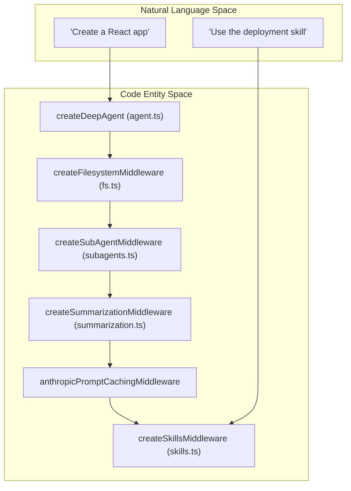
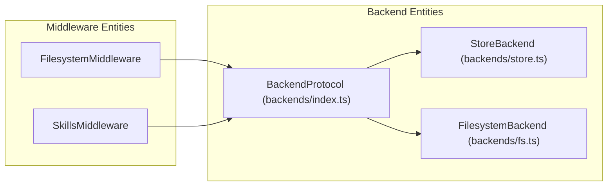

<!-- source: DeepWiki mcp.deepwiki.com · repo langchain-ai/deepagentsjs · page 5 Middleware Reference · fetched 2026-10-26 -->

# Middleware Reference

Relevant source files

The following files were used as context for generating this wiki page:

- [internal/eval-harness/CHANGELOG.md](internal/eval-harness/CHANGELOG.md)
- [libs/acp/CHANGELOG.md](libs/acp/CHANGELOG.md)
- [libs/deepagents/CHANGELOG.md](libs/deepagents/CHANGELOG.md)
- [libs/deepagents/src/agent.ts](libs/deepagents/src/agent.ts)
- [libs/deepagents/src/index.ts](libs/deepagents/src/index.ts)
- [libs/deepagents/src/middleware/async_subagents.ts](libs/deepagents/src/middleware/async_subagents.ts)
- [libs/deepagents/src/middleware/index.ts](libs/deepagents/src/middleware/index.ts)
- [libs/deepagents/src/types.ts](libs/deepagents/src/types.ts)
- [libs/providers/quickjs/CHANGELOG.md](libs/providers/quickjs/CHANGELOG.md)

This page provides an overview of all middleware components available in DeepAgents and guidance on when to use each one. Middleware extends the capabilities of agents by intercepting and modifying state, model calls, and tool executions.

For detailed documentation of individual middleware components, see:
- [Filesystem Middleware](#5.1) — Detailed documentation of `FilesystemMiddleware`, including all tools (`ls`, `read_file`, `write_file`, `edit_file`, `glob`, `grep`, `execute`), configuration options, state management, and large output eviction.
- [Skills Middleware](#5.2) — Documentation of `SkillsMiddleware`, the `SKILL.md` format, progressive disclosure pattern, multi-source skill loading, and validation rules.
- [Subagent Middleware](#5.3) — Documentation of `SubAgentMiddleware`, the `task` tool, subagent lifecycle, state isolation, and hierarchical architectures.
- [Summarization Middleware](#5.4) — Documentation of `SummarizationMiddleware`, conversation history offloading, context window management, and automatic triggers.
- [Memory Middleware](#5.5) — Documentation of `MemoryMiddleware`, `AGENTS.md` format, memory loading, and how it differs from skills.
- [Other Middleware](#5.6) — Documentation of `TodoListMiddleware`, `PatchToolCallsMiddleware`, `anthropicPromptCachingMiddleware`, and `humanInTheLoopMiddleware`.

---

## Middleware System Overview

Middleware in DeepAgents follows the pattern of LangChain's `createAgent`, using the `AgentMiddleware` interface to hook into agent execution [libs/deepagents/src/agent.ts:7-9](). Each middleware can modify state before execution (`beforeAgent`), wrap model calls (`wrapModelCall`), and transform tool calls.

The `createDeepAgent` function orchestrates a specific execution order to ensure that state updates (like memory or prompt caching) do not conflict with tool execution or summarization logic [libs/deepagents/src/agent.ts:120-123]().

**Sources:** [libs/deepagents/src/agent.ts:1-15](), [libs/deepagents/src/agent.ts:114-142]()

---

## Built-in Middleware Components

The following table lists the primary middleware components available:

| Middleware | Factory Function | Purpose | Default Enabled |
|------------|-----------------|---------|-----------------|
| **Todo List** | `todoListMiddleware()` | Task planning and tracking via `write_todos` | Yes [libs/deepagents/src/agent.ts:91-96]() |
| **Filesystem** | `createFilesystemMiddleware()` | File operations (`ls`, `read_file`, `write_file`, etc.) | Yes [libs/deepagents/src/agent.ts:17-23]() |
| **Subagent** | `createSubAgentMiddleware()` | Delegate tasks via the `task` tool | Yes [libs/deepagents/src/agent.ts:18-25]() |
| **Async Subagent** | `createAsyncSubAgentMiddleware()` | Remote task delegation via Agent Protocol | Yes [libs/deepagents/src/agent.ts:26-28]() |
| **Summarization** | `createSummarizationMiddleware()` | Automatic history offloading and context management | Yes [libs/deepagents/src/agent.ts:20-21]() |
| **Prompt Caching** | `anthropicPromptCachingMiddleware()` | Anthropic-specific cost optimization | Yes (for Claude) [libs/deepagents/src/agent.ts:193-202]() |
| **Patch Tool Calls** | `createPatchToolCallsMiddleware()` | Fixes dangling tool calls across providers | Yes [libs/deepagents/src/agent.ts:19-20]() |
| **Skills** | `createSkillsMiddleware()` | Loads reusable capabilities from `SKILL.md` | Conditional* [libs/deepagents/src/agent.ts:178-179]() |
| **Memory** | `createMemoryMiddleware()` | Loads project context from `AGENTS.md` | Conditional* [libs/deepagents/src/agent.ts:177-178]() |

\* Enabled when `skills` or `memory` parameters are provided to `createDeepAgent`.

**Sources:** [libs/deepagents/src/agent.ts:16-46](), [libs/deepagents/src/index.ts:41-76]()

---

## Middleware Execution Order

The order of middleware is critical. For example, `anthropicPromptCachingMiddleware` is gated by model type to insert `cache_control` breakpoints before the model call [libs/deepagents/src/agent.ts:193-202]().

### Pipeline Flow: Natural Language to Code Entities

**Sources:** [libs/deepagents/src/agent.ts:164-210](), [libs/deepagents/src/middleware/index.ts:1-76]()

---

## Middleware by Category

### State & File Management
These components manage the `files` channel and persistent storage.
- **Filesystem Middleware**: Provides the core tools for file manipulation and shell execution. It uses `filesValue` for state reduction [libs/deepagents/src/index.ts:79]().
- **Skills Middleware**: Implements "Progressive Disclosure." It injects `SKILL.md` metadata into the system prompt but requires the agent to use `read_file` to see implementation details [libs/deepagents/src/middleware/skills.ts]().
- **Memory Middleware**: Loads `AGENTS.md` files. Unlike skills, the full content is typically injected into the system prompt [libs/deepagents/src/middleware/memory.ts]().

### Task & Orchestration
- **Subagent Middleware**: Enables hierarchical architectures via the `task` tool [libs/deepagents/src/middleware/subagents.ts]().
- **Async Subagent Middleware**: Connects to remote [Agent Protocol](https://github.com/langchain-ai/agent-protocol) servers for background tasks [libs/deepagents/src/middleware/async_subagents.ts:14-25]().
- **Patch Tool Calls Middleware**: A utility that fixes "dangling" tool calls (calls without content blocks) which often cause validation errors [libs/deepagents/src/middleware/patch_tool_calls.ts:22-24]().

### Context Optimization
- **Summarization Middleware**: Monitors the `messages` channel and triggers a summary when tokens exceed a threshold, offloading history to the backend [libs/deepagents/src/middleware/summarization.ts:51-61]().
- **Prompt Caching**: Specifically targets Anthropic models to insert `cache_control` breakpoints [libs/deepagents/src/agent.ts:193-202]().

---

## Configuration Patterns

### Shared Backend Architecture
Middleware components like Filesystem, Skills, and Memory share a `BackendProtocol` implementation (e.g., `StoreBackend` or `FilesystemBackend`).

**Sources:** [libs/deepagents/src/agent.ts:174-180](), [libs/deepagents/src/backends/index.ts:108-114]()

### Skills Inheritance
Custom subagents do **not** inherit skills from the parent agent by default. If a subagent needs skills, they must be explicitly defined. The only exception is the `GENERAL_PURPOSE_SUBAGENT`, which inherits the parent's skills [libs/deepagents/src/agent.ts:205-210]().

**Sources:** [libs/deepagents/src/agent.ts:211-235]()

---

## Next Steps

- For detailed tool schemas and output eviction, see [Filesystem Middleware](#5.1).
- To learn about the `SKILL.md` format, see [Skills Middleware](#5.2).
- For hierarchical agent patterns, see [Subagent Middleware](#5.3).
- To configure automatic history offloading, see [Summarization Middleware](#5.4).
- For project-level context loading via `AGENTS.md`, see [Memory Middleware](#5.5).
- For specialized utilities like HITL or Prompt Caching, see [Other Middleware](#5.6).

---

