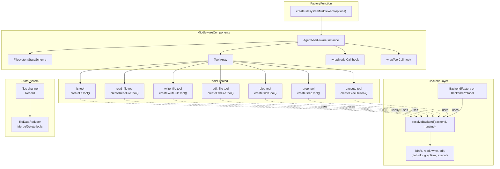
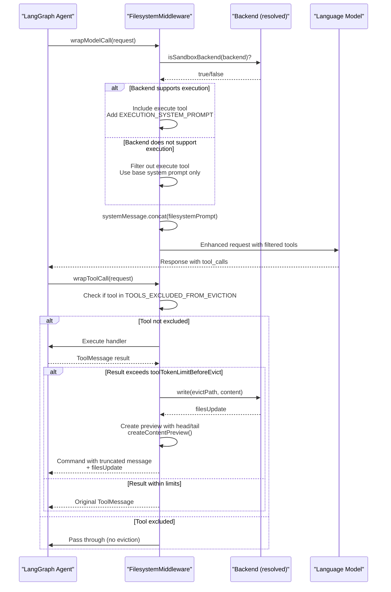
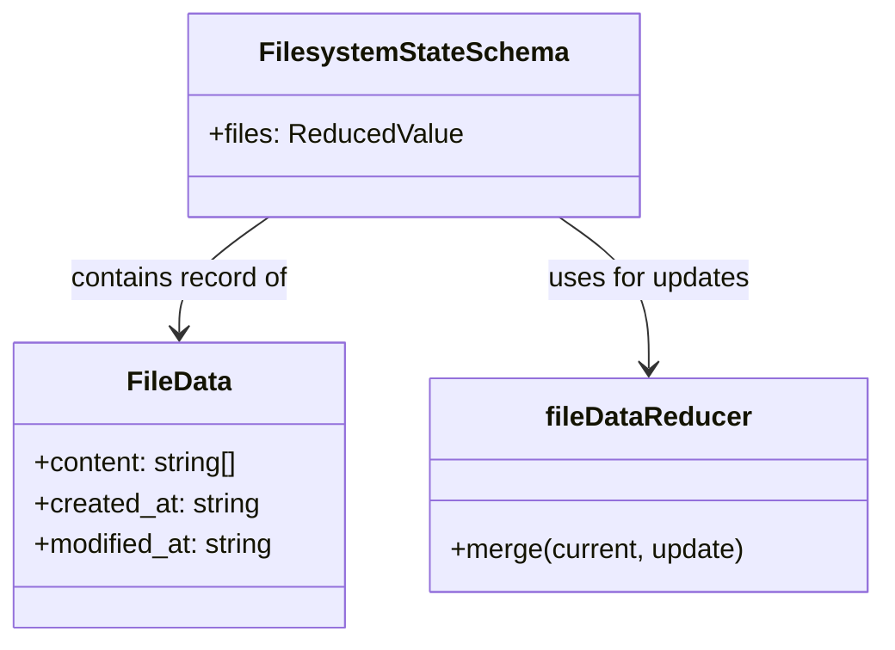

<!-- source: DeepWiki mcp.deepwiki.com · repo langchain-ai/deepagentsjs · page 5.1 Filesystem Middleware · fetched 2026-10-26 -->

# Filesystem Middleware

Relevant source files

The following files were used as context for generating this wiki page:

- [libs/deepagents/src/middleware/fs.eviction.test.ts](libs/deepagents/src/middleware/fs.eviction.test.ts)
- [libs/deepagents/src/middleware/fs.int.test.ts](libs/deepagents/src/middleware/fs.int.test.ts)
- [libs/deepagents/src/middleware/fs.test.ts](libs/deepagents/src/middleware/fs.test.ts)
- [libs/deepagents/src/middleware/fs.ts](libs/deepagents/src/middleware/fs.ts)
- [libs/deepagents/src/middleware/hitl.int.test.ts](libs/deepagents/src/middleware/hitl.int.test.ts)
- [libs/deepagents/src/middleware/subagents-hitl.int.test.ts](libs/deepagents/src/middleware/subagents-hitl.int.test.ts)

The Filesystem Middleware provides a comprehensive suite of file manipulation and search tools to agents, enabling them to interact with files through a pluggable backend abstraction layer. This middleware handles file reading, writing, editing, listing, pattern matching, searching, and optional shell command execution.

For information about backend implementations that this middleware uses, see [Backend Implementations](). For creating custom backends, see [Custom Backend Implementation]().

**Sources:** [libs/deepagents/src/middleware/fs.ts:1-8]()

## Overview

The Filesystem Middleware is created via the `createFilesystemMiddleware` factory function, which returns an `AgentMiddleware` instance with the following capabilities:

| Capability | Description |
|------------|-------------|
| **Tools** | `ls`, `read_file`, `write_file`, `edit_file`, `glob`, `grep`, `execute` |
| **State Management** | `FilesystemStateSchema` with `files` channel using `ReducedValue` for concurrent updates |
| **Backend Support** | Works with `StateBackend`, `StoreBackend`, `FilesystemBackend`, `LocalShellBackend`, `SandboxBackend` |
| **Eviction System** | Automatically saves large tool results to filesystem to prevent context overflow |
| **Dynamic Tools** | `execute` tool only available if backend implements `SandboxBackendProtocol` |

**Sources:** [libs/deepagents/src/middleware/fs.ts:77-85](), [libs/deepagents/src/middleware/fs.ts:749-803]()

## Architecture

### Component Structure

The middleware coordinates between the LangGraph agent, the tool definitions, and the pluggable backends.

Title: Filesystem Middleware Architecture

**Sources:** [libs/deepagents/src/middleware/fs.ts:764-803](), [libs/deepagents/src/middleware/fs.ts:232-240](), [libs/deepagents/src/backends/protocol.ts:31]()

### Middleware Hooks Flow

The middleware uses `wrapModelCall` to inject prompts and `wrapToolCall` to handle large output eviction.

Title: Filesystem Middleware Execution Flow

**Sources:** [libs/deepagents/src/middleware/fs.ts:806-832](), [libs/deepagents/src/middleware/fs.ts:833-969](), [libs/deepagents/src/middleware/fs.ts:87-94]()

## Tools

### ls
Lists all files in a directory with their metadata.

| Property | Value |
|----------|-------|
| **Name** | `ls` |
| **Schema** | `{ path?: string }` - defaults to `"/"` |
| **Backend Method** | `lsInfo(path)` |

**Implementation:** [libs/deepagents/src/middleware/fs.ts:368-411]()
**Sources:** [libs/deepagents/src/middleware/fs.ts:256-260]()

### read_file
Reads file content with pagination support.

| Property | Value |
|----------|-------|
| **Name** | `read_file` |
| **Schema** | `{ file_path: string, offset?: number, limit?: number }` |
| **Defaults** | `offset=0`, `limit=100` lines |
| **Eviction** | Excluded from automatic eviction |

**Implementation:** [libs/deepagents/src/middleware/fs.ts:416-480]()
**Sources:** [libs/deepagents/src/middleware/fs.ts:77-85](), [libs/deepagents/src/middleware/fs.ts:261-277]()

### write_file
Creates a new file with specified content.

| Property | Value |
|----------|-------|
| **Name** | `write_file` |
| **Schema** | `{ file_path: string, content?: string }` |
| **Backend Method** | `write(file_path, content)` |

**Implementation:** [libs/deepagents/src/middleware/fs.ts:485-532]()
**Sources:** [libs/deepagents/src/middleware/fs.ts:278-283]()

### edit_file
Performs exact string replacements in existing files.

| Property | Value |
|----------|-------|
| **Name** | `edit_file` |
| **Schema** | `{ file_path: string, old_string: string, new_string: string, replace_all?: boolean }` |
| **Backend Method** | `edit(file_path, old_string, new_string, replace_all)` |

**Implementation:** [libs/deepagents/src/middleware/fs.ts:537-595]()
**Sources:** [libs/deepagents/src/middleware/fs.ts:284-291]()

### glob
Finds files matching a glob pattern.

| Property | Value |
|----------|-------|
| **Name** | **glob** |
| **Schema** | `{ pattern: string, path?: string }` |
| **Backend Method** | `globInfo(pattern, path)` |

**Implementation:** [libs/deepagents/src/middleware/fs.ts:600-634]()
**Sources:** [libs/deepagents/src/middleware/fs.ts:292-301]()

### grep
Searches for literal text patterns across files.

| Property | Value |
|----------|-------|
| **Name** | `grep` |
| **Schema** | `{ pattern: string, path?: string, glob?: string \| null }` |
| **Backend Method** | `grepRaw(pattern, path, glob)` |

**Implementation:** [libs/deepagents/src/middleware/fs.ts:639-694]()
**Sources:** [libs/deepagents/src/middleware/fs.ts:302-312]()

### execute
Executes shell commands in the sandbox environment. Only available if the backend implements `SandboxBackendProtocol`.

**Implementation:** [libs/deepagents/src/middleware/fs.ts:699-745]()
**Sources:** [libs/deepagents/src/middleware/fs.ts:312-356](), [libs/deepagents/src/backends/protocol.ts:29]()

## State Management

### FilesystemStateSchema
The middleware defines a shared state schema with a `files` channel that uses `ReducedValue` to support concurrent updates.

Title: Filesystem State Management

**Sources:** [libs/deepagents/src/middleware/fs.ts:208-224](), [libs/deepagents/src/middleware/fs.ts:225-230]()

### fileDataReducer
The `fileDataReducer` enables concurrent file updates from parallel subagents by merging changes instead of using last-value semantics. It handles additions, updates, and deletions (when a file value is `null`).

**Implementation:** [libs/deepagents/src/middleware/fs.ts:176-206]()
**Sources:** [libs/deepagents/src/middleware/fs.test.ts:27-188]()

## Large Output Eviction

The middleware automatically detects when tool results exceed a token threshold and saves them to the filesystem to prevent context overflow.

### Eviction Logic
1. **Threshold Check**: If content length exceeds `toolTokenLimitBeforeEvict * NUM_CHARS_PER_TOKEN`. [libs/deepagents/src/middleware/fs.ts:881-883]()
2. **Exclusion**: Tools like `ls`, `read_file`, and `grep` are excluded from eviction because they have built-in truncation or specific failure modes. [libs/deepagents/src/middleware/fs.ts:87-94]()
3. **Storage**: The full result is written to `/large_tool_results/{tool_call_id}`. [libs/deepagents/src/middleware/fs.ts:896-900]()
4. **Preview**: A preview showing the head and tail of the result is provided to the LLM. [libs/deepagents/src/middleware/fs.ts:127-138]()

**Sources:** [libs/deepagents/src/middleware/fs.ts:50-71](), [libs/deepagents/src/middleware/fs.ts:101]()

## Configuration Options

| Option | Type | Description |
|--------|------|-------------|
| `backend` | `BackendProtocol \| BackendFactory` | Storage and execution layer. [libs/deepagents/src/middleware/fs.ts:751]() |
| `systemPrompt` | `string \| null` | Custom system prompt instructions. [libs/deepagents/src/middleware/fs.ts:753]() |
| `customToolDescriptions` | `Record<string, string> \| null` | Overrides for tool descriptions. [libs/deepagents/src/middleware/fs.ts:755]() |
| `toolTokenLimitBeforeEvict` | `number \| null` | Token threshold for eviction (default: 20000). [libs/deepagents/src/middleware/fs.ts:757]() |

**Sources:** [libs/deepagents/src/middleware/fs.ts:750-759](), [libs/deepagents/src/middleware/fs.ts:768-771]()

---

