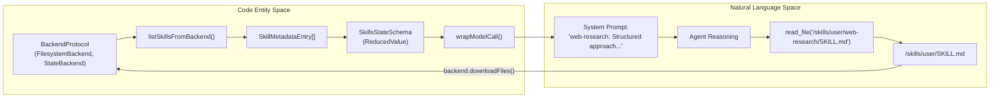
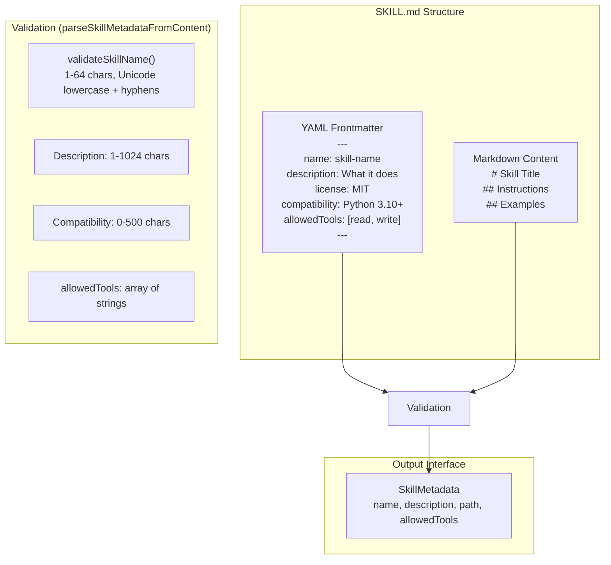
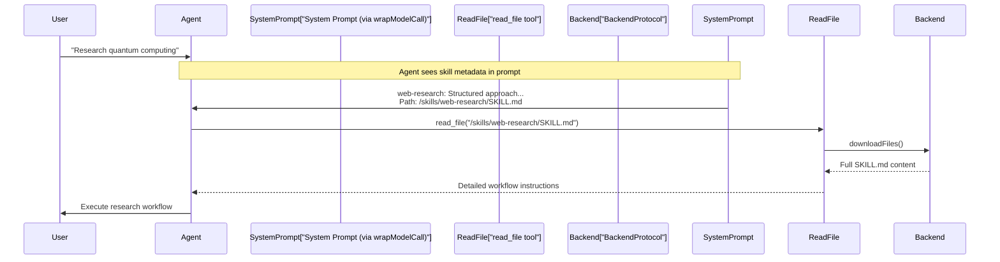
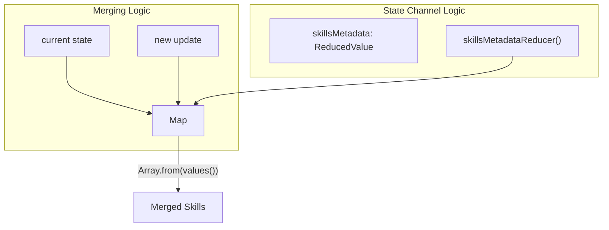

<!-- source: DeepWiki mcp.deepwiki.com · repo langchain-ai/deepagentsjs · page 5.2 Skills Middleware · fetched 2026-10-26 -->

# Skills Middleware

<details>
<summary>Relevant source files</summary>

The following files were used as context for generating this wiki page:

- [.changeset/skill-loading-limit.md](.changeset/skill-loading-limit.md)
- [examples/skills-memory/skills-memory-agent.ts](examples/skills-memory/skills-memory-agent.ts)
- [examples/skills/file-organizer/SKILL.md](examples/skills/file-organizer/SKILL.md)
- [examples/skills/skill-creator/SKILL.md](examples/skills/skill-creator/SKILL.md)
- [libs/deepagents/src/middleware/agent-memory.ts](libs/deepagents/src/middleware/agent-memory.ts)
- [libs/deepagents/src/middleware/skills.test.ts](libs/deepagents/src/middleware/skills.test.ts)
- [libs/deepagents/src/middleware/skills.ts](libs/deepagents/src/middleware/skills.ts)
- [libs/deepagents/src/skills/index.int.test.ts](libs/deepagents/src/skills/index.int.test.ts)

</details>


This page documents the Skills Middleware (`SkillsMiddleware`), which loads agent skills from backend storage and injects them into the system prompt using a progressive disclosure pattern. Skills provide agents with specialized capabilities and domain knowledge organized in a standardized format.

For information about other middleware components, see [Middleware Reference](). For the overall middleware architecture and execution order, see [Middleware Architecture]().

## Purpose and Scope

The Skills Middleware implements Anthropic's agent skills pattern, enabling agents to access reusable capabilities stored as `SKILL.md` files. This middleware:

- Loads skills from one or more **sources** (paths in a backend) [libs/deepagents/src/middleware/skills.ts:9-13]()
- Validates skills against the Agent Skills specification [libs/deepagents/src/middleware/skills.ts:70-74]()
- Implements **progressive disclosure** (showing only metadata in prompts, full content on demand) [libs/deepagents/src/middleware/skills.ts:4-6]()
- Supports **multi-source layering** (user → project → team skills with override semantics) [libs/deepagents/src/middleware/skills.ts:9-13]()
- Works with any backend via `BackendProtocol` [libs/deepagents/src/middleware/skills.ts:14-16]()

**Sources:** [libs/deepagents/src/middleware/skills.ts:1-40]()

## Overview

Skills are self-documenting capabilities stored in `SKILL.md` files with YAML frontmatter. The middleware loads these files from configured sources during agent initialization and injects skill metadata into the system prompt. Agents can then read full skill instructions when needed using the `read_file` tool.

### From Code to Prompt Space

The following diagram bridges the code entities (functions and interfaces) with the conceptual flow of skill injection.



**Sources:** [libs/deepagents/src/middleware/skills.ts:486-567](), [libs/deepagents/src/middleware/skills.ts:645-733]()

## The Agent Skills Specification

Skills follow the [Agent Skills specification](https://agentskills.io/specification), a standardized format for documenting agent capabilities. Each skill is a directory containing a `SKILL.md` file with YAML frontmatter.

### SKILL.md Structure



**Sources:** [libs/deepagents/src/middleware/skills.ts:75-139](), [libs/deepagents/src/middleware/skills.ts:368-484]()

### Frontmatter Fields

| Field | Type | Required | Constraints | Description |
|-------|------|----------|-------------|-------------|
| `name` | string | Yes | 1-64 chars, lowercase alphanumeric + hyphens [libs/deepagents/src/middleware/skills.ts:80-89]() | Skill identifier (must match parent directory) |
| `description` | string | Yes | 1-1024 chars [libs/deepagents/src/middleware/skills.ts:93-101]() | What the skill does and when to use it |
| `license` | string | No | Any [libs/deepagents/src/middleware/skills.ts:107-107]() | License name or reference |
| `compatibility` | string | No | 1-500 chars [libs/deepagents/src/middleware/skills.ts:111-119]() | Environment requirements |
| `allowedTools` | array | No | Array of strings [libs/deepagents/src/middleware/skills.ts:130-138]() | Tool names the skill recommends using |

**Sources:** [libs/deepagents/src/middleware/skills.ts:75-139]()

## Progressive Disclosure Pattern

Progressive disclosure minimizes token usage by showing only skill **metadata** (name, description, path) in the system prompt. The agent reads the full `SKILL.md` content only when needed using the `read_file` tool.



**Sources:** [libs/deepagents/src/middleware/skills.ts:229-263](), [libs/deepagents/src/middleware/skills.ts:596-624]()

## Multi-Source Skill Loading

Skills can be loaded from multiple **sources** (directory paths), with later sources overriding earlier ones. This enables skill hierarchies (e.g., base -> user -> project). [libs/deepagents/src/middleware/skills.ts:9-13]()

### Override Semantics

When multiple sources contain skills with the same name, the **last source wins** (highest index in the `sources` array). This is handled by the `skillsMetadataReducer`. [libs/deepagents/src/middleware/skills.ts:188-209]()

```typescript
// Configuration example
const middleware = createSkillsMiddleware({
  backend: new FilesystemBackend({ rootDir: "/" }),
  sources: [
    "/skills/user/",      // Loaded first
    "/skills/project/",   // Loaded last (higher priority)
  ],
});
```

**Sources:** [libs/deepagents/src/middleware/skills.ts:144-160](), [libs/deepagents/src/middleware/skills.test.ts:109-146]()

## Middleware Architecture

The `SkillsMiddleware` consists of `beforeAgent` for loading and `wrapModelCall` for injection.

### State Management and Reducers

Skills use `ReducedValue` in the `SkillsStateSchema` to handle concurrent updates from parallel subagents. The `skillsMetadataReducer` merges arrays by skill name, ensuring that later updates override earlier ones. [libs/deepagents/src/middleware/skills.ts:188-225]()



**Sources:** [libs/deepagents/src/middleware/skills.ts:188-225](), [libs/deepagents/src/middleware/skills.test.ts:189-211]()

### Backend Abstraction

The middleware uses `BackendProtocol` for storage operations, making it portable across different backends. It can resolve the backend using a static instance or a `BackendFactory` function that has access to runtime state. [libs/deepagents/src/middleware/skills.ts:144-153]()

| Backend Type | Skill Source Implementation |
|-------------|----------------------------|
| `FilesystemBackend` | Reads from real disk paths [libs/deepagents/src/backends/filesystem.ts:10]() |
| `StateBackend` | Reads from `state.files` channel [libs/deepagents/src/middleware/skills.ts:152]() |
| `StoreBackend` | Reads from LangGraph Store [libs/deepagents/src/middleware/skills.ts:60]() |

**Sources:** [libs/deepagents/src/middleware/skills.ts:144-160](), [libs/deepagents/src/middleware/skills.ts:653-660]()

## Validation Rules

The middleware enforces strict validation rules based on the Agent Skills specification.

- **File Size**: Maximum 10MB per `SKILL.md` to prevent DoS. [libs/deepagents/src/middleware/skills.ts:66]()
- **Read Limit**: Default limit of 1000 lines for skill file reading. [libs/deepagents/src/middleware/skills.ts:68]()
- **Name**: 1-64 characters, Unicode lowercase alphanumeric and hyphens. No leading/trailing/consecutive hyphens. [libs/deepagents/src/middleware/skills.ts:71](), [libs/deepagents/src/middleware/skills.ts:266-315]()
- **Description**: 1-1024 characters. [libs/deepagents/src/middleware/skills.ts:72]()
- **Compatibility**: Maximum 500 characters. [libs/deepagents/src/middleware/skills.ts:73]()

**Sources:** [libs/deepagents/src/middleware/skills.ts:65-74](), [libs/deepagents/src/middleware/skills.ts:368-484]()

## Usage Examples

### Integration with createDeepAgent

The `createDeepAgent` function provides a shorthand `skills` parameter which internally configures the `SkillsMiddleware`.

```typescript
import { createDeepAgent, FilesystemBackend } from "deepagents";

const agent = await createDeepAgent({
  model: chatModel,
  backend: new FilesystemBackend({ rootDir: "/" }),
  skills: ["/skills/user/", "/skills/project/"], // Shorthand
});
```

**Sources:** [libs/deepagents/src/middleware/skills.ts:33-40](), [examples/skills-memory/skills-memory-agent.ts:159-164]()

### Integration with Memory Middleware

Skills (procedural knowledge) and Memory (personal/project context) can be used together. While Memory focuses on `agent.md` files (deprecated) or `AGENTS.md` files, Skills focus on modular `SKILL.md` directories. [libs/deepagents/src/middleware/agent-memory.ts:1-12]()

**Sources:** [libs/deepagents/src/skills/index.int.test.ts:150-277](), [examples/skills-memory/skills-memory-agent.ts:149-164]()

---

