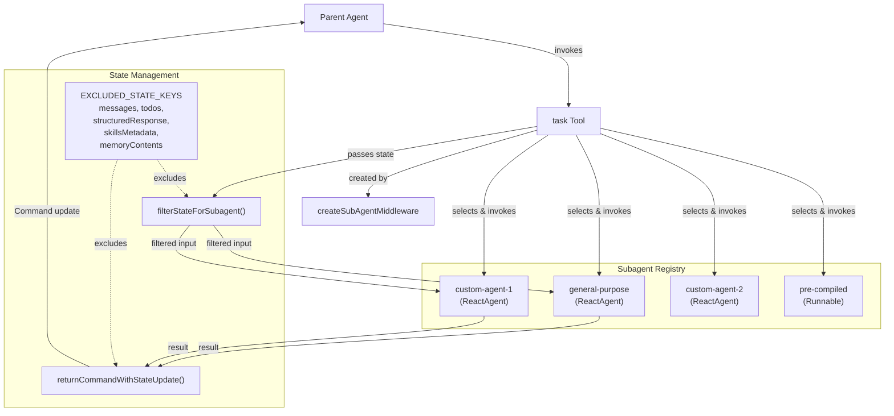
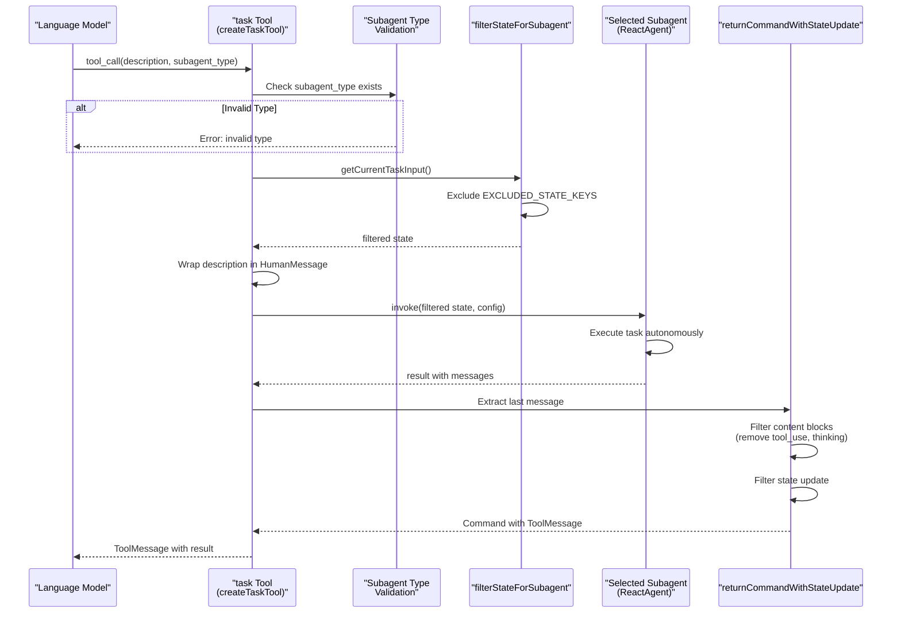
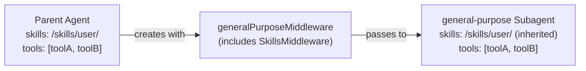
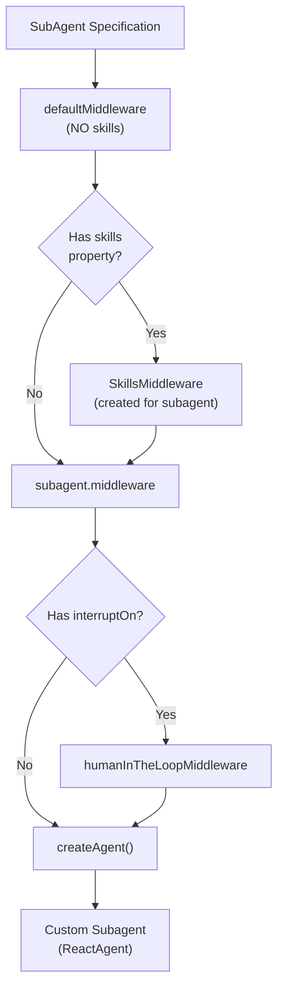
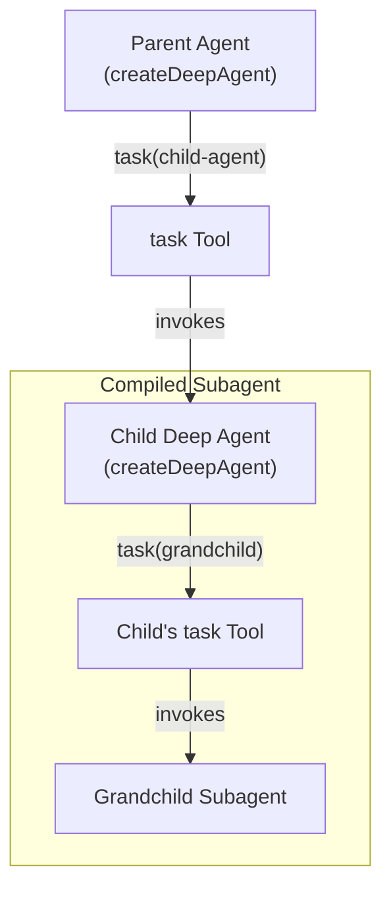
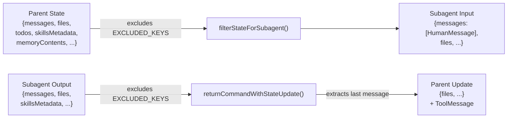
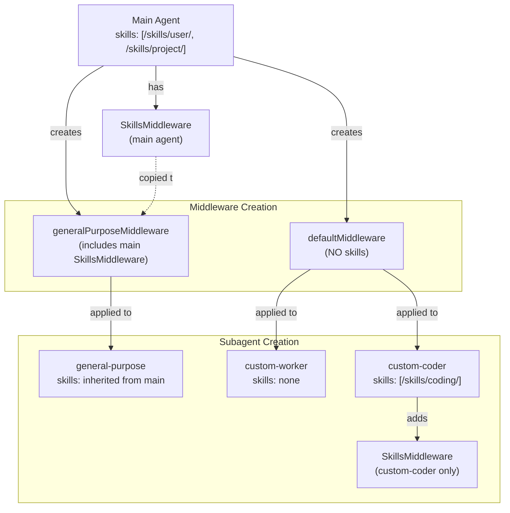
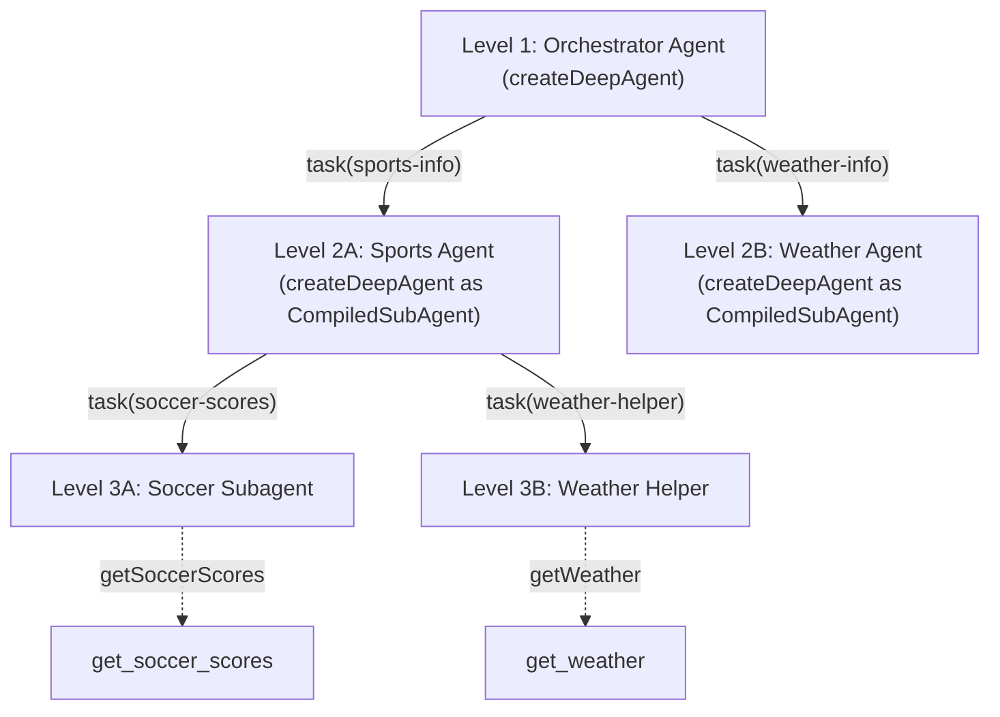
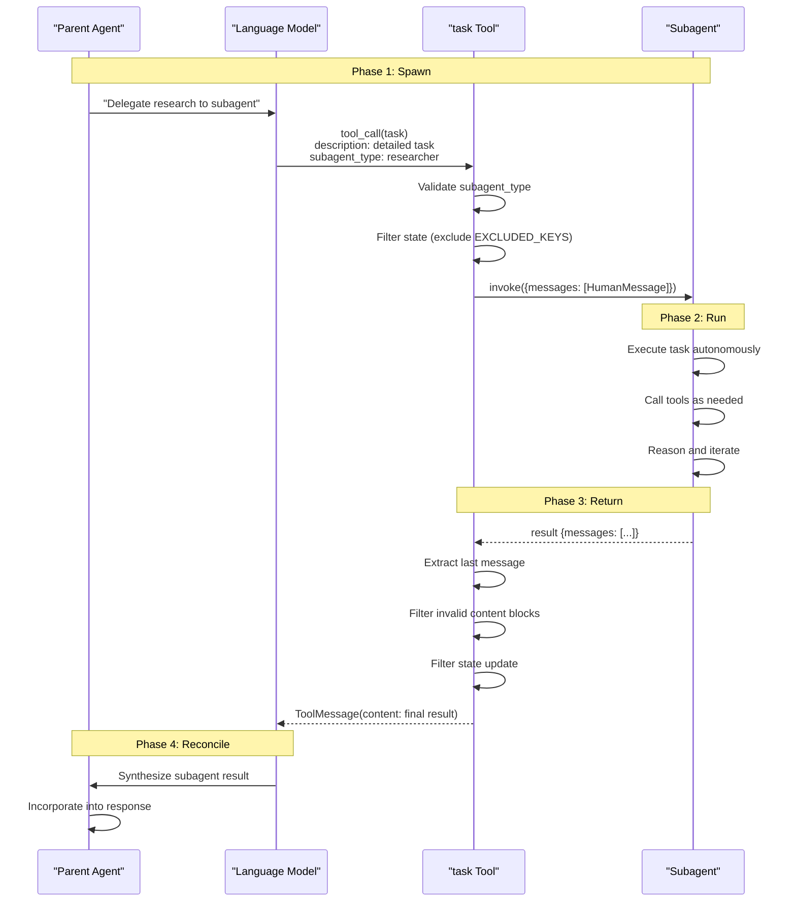

<!-- source: DeepWiki mcp.deepwiki.com · repo langchain-ai/deepagentsjs · page 5.3 Subagent Middleware · fetched 2026-10-26 -->

# Subagent Middleware

<details>
<summary>Relevant source files</summary>

The following files were used as context for generating this wiki page:

- [libs/deepagents/src/agent.ts](libs/deepagents/src/agent.ts)
- [libs/deepagents/src/index.ts](libs/deepagents/src/index.ts)
- [libs/deepagents/src/middleware/async_subagents.ts](libs/deepagents/src/middleware/async_subagents.ts)
- [libs/deepagents/src/middleware/index.ts](libs/deepagents/src/middleware/index.ts)
- [libs/deepagents/src/middleware/subagent.test.ts](libs/deepagents/src/middleware/subagent.test.ts)
- [libs/deepagents/src/middleware/subagents.int.test.ts](libs/deepagents/src/middleware/subagents.int.test.ts)
- [libs/deepagents/src/middleware/subagents.ts](libs/deepagents/src/middleware/subagents.ts)
- [libs/deepagents/src/types.ts](libs/deepagents/src/types.ts)

</details>


The Subagent Middleware enables hierarchical agent architectures by providing a `task` tool that spawns ephemeral subagents to handle complex, multi-step tasks in isolation. Subagents execute autonomously with their own context window, then return a single result to the parent agent. This pattern is essential for managing token usage, parallelizing independent work, and isolating complex reasoning tasks.

For information about other middleware components, see [Middleware Reference](). For the `createDeepAgent` API that automatically configures subagent middleware, see [createDeepAgent API]().

## Overview

The Subagent Middleware is created using the `createSubAgentMiddleware` function, which adds a `task` tool to the agent and manages the lifecycle of spawned subagents. The middleware handles:

1.  **Task delegation**: Routes tasks to appropriate subagent types based on specifications.
2.  **State isolation**: Filters state when passing to/from subagents to prevent leakage.
3.  **Skills inheritance**: Manages skill distribution (general-purpose inherits, custom does not).
4.  **Parallel execution**: Supports concurrent subagent invocations.
5.  **Result synthesis**: Returns only the final message from subagent execution.

**Architecture Overview**



**Sources**: [libs/deepagents/src/middleware/subagents.ts:1-663](), [libs/deepagents/src/middleware/subagents.ts:45-51]()

## The task Tool

The `task` tool is the primary interface for spawning subagents. It accepts two parameters: `description` (the task to execute) and `subagent_type` (which agent to use). The tool validates the subagent type, filters the current state, invokes the selected subagent, and returns a `Command` with the filtered state update.

**Tool Schema**

| Parameter | Type | Description |
| :--- | :--- | :--- |
| `description` | `string` | The task to execute with the selected agent. Should contain detailed, autonomous instructions. |
| `subagent_type` | `string` | Name of the agent to use. Must match a registered subagent name. |

**Tool Flow**



**Sources**: [libs/deepagents/src/middleware/subagents.ts:499-591](), [libs/deepagents/src/middleware/subagents.ts:539-590](), [libs/deepagents/src/middleware/subagents.ts:45-51]()

## Subagent Types

The middleware supports three categories of subagents, each with different configuration and inheritance patterns.

### General-Purpose Subagent

The general-purpose subagent is automatically created when `generalPurposeAgent: true` (the default). It inherits:

*   All tools from the parent agent's `defaultTools`.
*   All skills from the parent agent's skills middleware (via `generalPurposeMiddleware`).
*   The same model as the parent (unless overridden).

This agent is ideal for delegating complex tasks that require the full capability set of the main agent but benefit from isolated context.



**Sources**: [libs/deepagents/src/middleware/subagents.ts:343-351](), [libs/deepagents/src/middleware/subagents.ts:446-467](), [libs/deepagents/src/middleware/subagents.ts:57-59]()

### Custom Subagents (SubAgent Interface)

Custom subagents are defined using the `SubAgent` interface and do NOT inherit skills from the main agent by default. Each custom subagent must explicitly specify its own `skills` property to have skills.

**SubAgent Interface**

```typescript
interface SubAgent {
  name: string;                  // Identifier for subagent_type
  description: string;           // Shown to model for selection
  systemPrompt: string;          // System prompt for this subagent
  tools?: StructuredTool[];      // Override defaultTools
  model?: LanguageModelLike;     // Override defaultModel
  middleware?: readonly AgentMiddleware[];  // Additional middleware
  interruptOn?: Record<string, boolean | InterruptOnConfig>;
  skills?: string[];             // Skill source paths (NOT inherited)
}
```

**Custom Subagent Creation Flow**



**Sources**: [libs/deepagents/src/middleware/subagents.ts:262-305](), [libs/deepagents/src/middleware/subagents.ts:470-494]()

### Pre-Compiled Subagents (CompiledSubAgent Interface)

Pre-compiled subagents are existing `ReactAgent` or `Runnable` instances that can be used directly without recreation. This enables hierarchical agent architectures where a `createDeepAgent` instance is used as a subagent.

**CompiledSubAgent Interface**

```typescript
interface CompiledSubAgent<TRunnable extends ReactAgent<any> | Runnable> {
  name: string;        // Identifier for subagent_type
  description: string; // Shown to model for selection
  runnable: TRunnable; // Pre-compiled agent or runnable
}
```

**Hierarchical Architecture Example**



**Sources**: [libs/deepagents/src/middleware/subagents.ts:221-230](), [libs/deepagents/src/middleware/subagents.ts:475-477]()

## Async Subagents

Async subagents connect to remote [Agent Protocol](https://github.com/langchain-ai/agent-protocol) servers via the LangGraph SDK. They run as background tasks that the main agent can monitor and update using a specific set of tools: `start_async_task`, `check_async_task`, `update_async_task`, `cancel_async_task`, and `list_async_tasks`.

**Async Task State**

Async tasks are persisted in the agent state within the `asyncTasks` channel, which uses a reducer to merge updates.

```typescript
export interface AsyncTask {
  taskId: string;      // Unique identifier (thread id)
  agentName: string;   // Async subagent type
  threadId: string;    // Remote thread ID
  runId: string;       // Current execution ID
  status: AsyncTaskStatus; // running, success, error, etc.
  createdAt: string;
}
```

**Sources**: [libs/deepagents/src/middleware/async_subagents.ts:26-92](), [libs/deepagents/src/middleware/async_subagents.ts:156-182]()

## State Isolation and Filtering

State filtering is critical for subagent isolation. The middleware excludes specific state keys when passing state to subagents and when returning updates from subagents.

**EXCLUDED\_STATE\_KEYS**

The following keys are excluded from state propagation:

| Key | Reason for Exclusion |
| :--- | :--- |
| `messages` | Handled explicitly; only final message returned. |
| `todos` | No defined reducer; unclear semantics for subagents. |
| `structuredResponse` | No defined reducer; parent-specific output. |
| `skillsMetadata` | Prevents parent skills leaking to child agents. |
| `memoryContents` | Prevents parent memory leaking to child agents. |

**State Filtering Flow**



**Sources**: [libs/deepagents/src/middleware/subagents.ts:45-51](), [libs/deepagents/src/middleware/subagents.ts:356-366](), [libs/deepagents/src/middleware/subagents.ts:379-411]()

### Content Block Filtering

When constructing the `ToolMessage` from the subagent's response, invalid content blocks are filtered out. This prevents errors when using Anthropic models that return `tool_use`, `thinking`, or `redacted_thinking` blocks in `AIMessage.content`.

**Invalid Content Block Types**:

*   `tool_use`: Tool invocation blocks.
*   `thinking`: Extended thinking blocks.
*   `redacted_thinking`: Redacted thinking blocks.

If all blocks are invalid, the content defaults to `"Task completed"`.

**Sources**: [libs/deepagents/src/middleware/subagents.ts:370-398]()

## Skills Inheritance

Skills inheritance follows a clear pattern that distinguishes between general-purpose and custom subagents:

**Inheritance Rules**

| Subagent Type | Inherits Parent Skills | Can Define Own Skills |
| :--- | :--- | :--- |
| general-purpose | ✅ Yes (via `generalPurposeMiddleware`) | ❌ No (uses parent's) |
| Custom (no `skills` property) | ❌ No | ❌ No |
| Custom (with `skills` property) | ❌ No | ✅ Yes (loads from specified paths) |

**Skills Middleware Distribution**



**Sources**: [libs/deepagents/src/middleware/subagents.ts:419-443](), [libs/deepagents/src/middleware/subagent.test.ts:54-135]()

## Hierarchical Agent Architectures

The `CompiledSubAgent` pattern enables multi-level agent hierarchies where agents delegate to agents that can themselves delegate to further subagents.

**Three-Level Hierarchy Example**



**Agent-as-Subagent Usage**

```typescript
// Level 2: Create deep agent with its own subagents
const sportsDeepAgent = createDeepAgent({
  model: "claude-3-5-sonnet",
  systemPrompt: "You are a sports information agent.",
  tools: [getSoccerScores],
  subagents: [{
    name: "weather-helper",
    description: "Gets weather info for match conditions.",
    systemPrompt: "Use get_weather for weather.",
    tools: [getWeather]
  }]
});

// Level 1: Use deep agent as CompiledSubAgent
const orchestrator = createDeepAgent({
  model: "claude-3-5-sonnet",
  subagents: [{
    name: "sports-info",
    description: "Sports scores and match conditions.",
    runnable: sportsDeepAgent  // CompiledSubAgent
  } satisfies CompiledSubAgent]
});
```

**Sources**: [libs/deepagents/src/middleware/subagents.int.test.ts:546-713]()

## Subagent Lifecycle

The subagent lifecycle consists of four phases: spawn, run, return, and reconcile.

**Lifecycle Diagram**



**Key Lifecycle Points**:

1.  **Spawn**: Parent provides detailed, autonomous instructions via `description` parameter. The subagent type is selected via `subagent_type`.
2.  **Run**: Subagent executes completely independently with its own context window. Intermediate steps are not visible to parent.
3.  **Return**: Only the last message from the subagent is returned. Invalid content blocks are filtered out.
4.  **Reconcile**: Parent receives a `ToolMessage` containing the subagent's result and incorporates it into the main reasoning thread.

**Sources**: [libs/deepagents/src/middleware/subagents.ts:196-201](), [libs/deepagents/src/middleware/subagents.ts:539-575]()

## System Prompt Injection

The middleware automatically appends guidance to the parent agent's system prompt via `wrapModelCall`. The injected prompt explains when and how to use the `task` tool.

**Default System Prompt Section** (`TASK_SYSTEM_PROMPT`):

The default prompt provides:

*   When to use the task tool (complex, multi-step, isolated tasks).
*   Subagent lifecycle explanation.
*   When NOT to use the task tool (trivial tasks, sequential dependencies).
*   Best practices (parallelize work, provide detailed instructions).
*   Example usage patterns.

**Customization**:

```typescript
// Override system prompt
const middleware = createSubAgentMiddleware({
  defaultModel: model,
  defaultTools: tools,
  systemPrompt: "Custom task tool instructions...",
  // or set systemPrompt: null to disable injection entirely
});
```

**Sources**: [libs/deepagents/src/middleware/subagents.ts:185-211](), [libs/deepagents/src/middleware/subagents.ts:650-660]()

## Configuration Reference

### createSubAgentMiddleware Options

```typescript
interface SubAgentMiddlewareOptions {
  defaultModel: LanguageModelLike | string;
  defaultTools?: StructuredTool[];
  defaultMiddleware?: AgentMiddleware[] | null;
  generalPurposeMiddleware?: AgentMiddleware[] | null;
  defaultInterruptOn?: Record<string, boolean | InterruptOnConfig> | null;
  subagents?: (SubAgent | CompiledSubAgent)[];
  systemPrompt?: string | null;
  generalPurposeAgent?: boolean;
  taskDescription?: string | null;
}
```

**Configuration Options Table**

| Option | Type | Default | Description |
| :--- | :--- | :--- | :--- |
| `defaultModel` | `LanguageModelLike \| string` | **Required** | Model for subagents. |
| `defaultTools` | `StructuredTool[]` | `[]` | Tools for general-purpose subagent. |
| `defaultMiddleware` | `AgentMiddleware[]` | `null` | Middleware for custom subagents (NO skills). |
| `generalPurposeMiddleware` | `AgentMiddleware[]` | `null` | Middleware for general-purpose (includes skills). |
| `defaultInterruptOn` | `Record<string, InterruptOnConfig>` | `null` | HITL configuration. |
| `subagents` | `(SubAgent \| CompiledSubAgent)[]` | `[]` | Custom subagent definitions. |
| `systemPrompt` | `string \| null` | `TASK_SYSTEM_PROMPT` | Task tool guidance (null disables). |
| `generalPurposeAgent` | `boolean` | `true` | Include general-purpose subagent. |
| `taskDescription` | `string \| null` | `null` | Custom task tool description. |

**Sources**: [libs/deepagents/src/middleware/subagents.ts:595-618](), [libs/deepagents/src/middleware/subagents.ts:623-646]()

## Usage Patterns

### Pattern 1: General-Purpose Delegation

Use the default general-purpose subagent for complex tasks that benefit from isolated context.

```typescript
const agent = createDeepAgent({
  model: "claude-3-5-sonnet",
  systemPrompt: "Use the general-purpose subagent for research tasks.",
  tools: [webSearchTool, readFileTool],
});
```

**Sources**: [libs/deepagents/src/middleware/subagents.int.test.ts:87-117]()

### Pattern 2: Specialized Subagents

Define custom subagents with specific tools and capabilities.

```typescript
const agent = createDeepAgent({
  model: "claude-3-5-sonnet",
  subagents: [
    {
      name: "researcher",
      description: "Conducts thorough research on complex topics",
      systemPrompt: "You are a research specialist.",
      tools: [webSearchTool, documentAnalysisTool],
      skills: ["/skills/research/"]
    }
  ]
});
```

**Sources**: [libs/deepagents/src/middleware/subagents.int.test.ts:119-157]()

### Pattern 3: Parallel Execution

Spawn multiple subagents in parallel by issuing multiple `task` tool calls in a single model response.

**Benefits**:

*   Reduces total execution time.
*   Isolates context per task.
*   Prevents `LastValue` channel errors with proper reducers.

**Sources**: [libs/deepagents/src/middleware/subagents.int.test.ts:450-537]()

### Pattern 4: Hierarchical Agents

Use a `createDeepAgent` instance as a `CompiledSubAgent` in another agent.

```typescript
const childAgent = createDeepAgent({
  model: "claude-3-5-sonnet",
  systemPrompt: "Sports information agent",
  tools: [getSoccerScores]
});

const parentAgent = createDeepAgent({
  model: "claude-3-5-sonnet",
  subagents: [{
    name: "sports-info",
    description: "Sports scores and conditions",
    runnable: childAgent
  } satisfies CompiledSubAgent]
});
```

**Sources**: [libs/deepagents/src/middleware/subagents.int.test.ts:596-656]()

### Pattern 5: Pre-Compiled Agents

Use any `ReactAgent` or `Runnable` as a subagent without modification.

```typescript
const parentAgent = createDeepAgent({
  model: "claude-3-5-sonnet",
  subagents: [{
    name: "specialist",
    description: "Handles specialized tasks",
    runnable: customAgent // Any Runnable
  }]
});
```

**Sources**: [libs/deepagents/src/middleware/subagents.int.test.ts:267-304]()

## Integration with createDeepAgent

When using `createDeepAgent`, the subagent middleware is automatically configured if the `subagents` parameter is provided or if skills are configured.

**Automatic Configuration**:

```typescript
const agent = createDeepAgent({
  model: "claude-3-5-sonnet",
  tools: [tool1, tool2],
  skills: ["/skills/user/"],
  subagents: [customSubagent]
});
```

**Sources**: [libs/deepagents/src/middleware/subagents.ts:232-261]()

---

