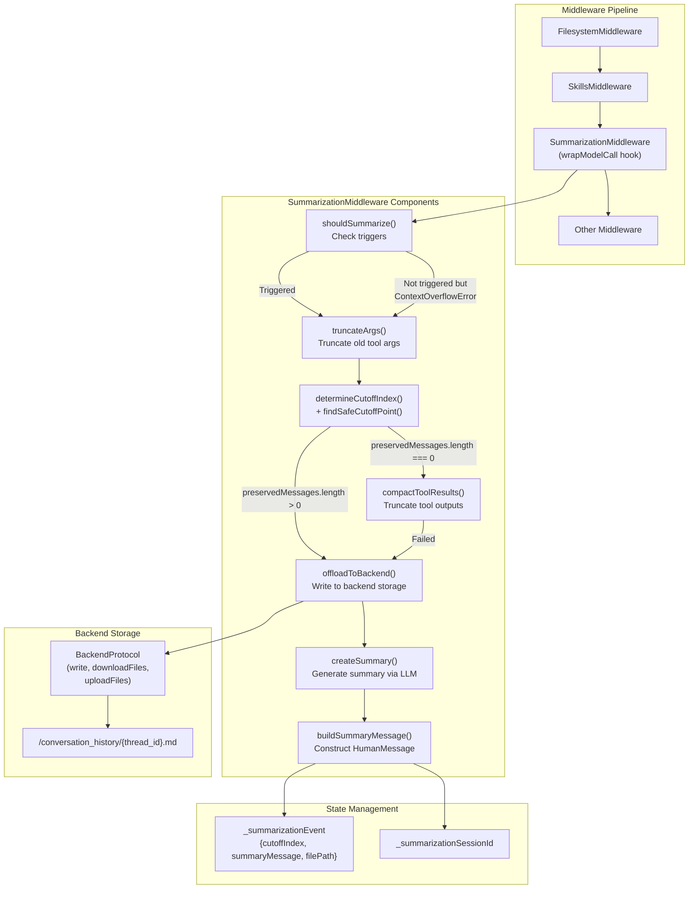
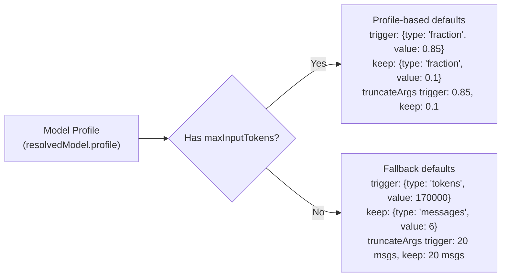
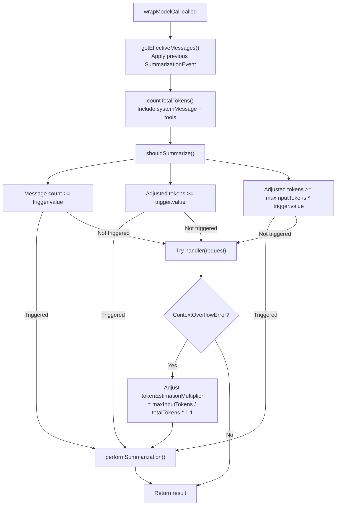
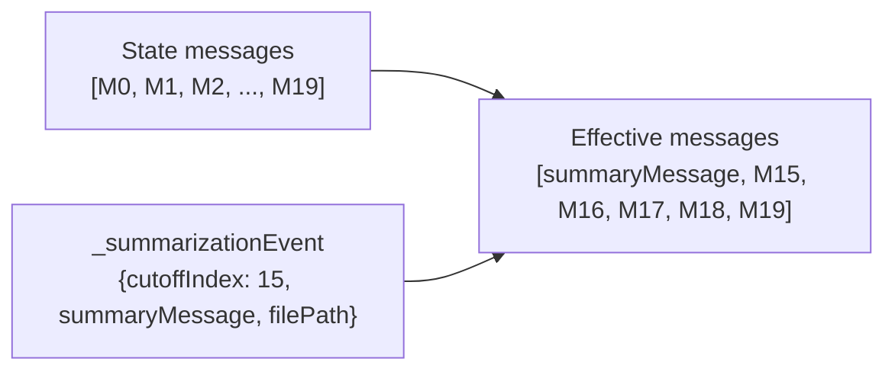
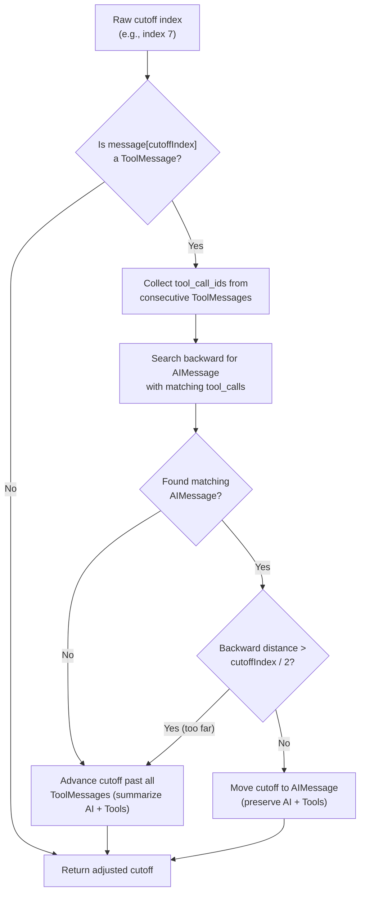
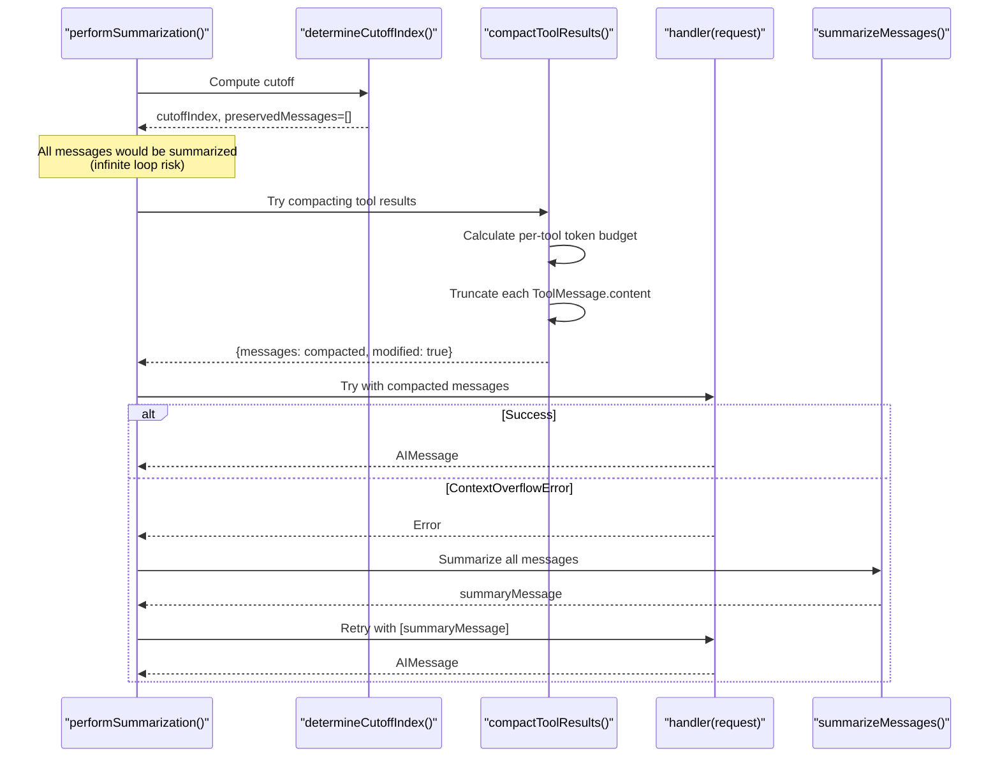
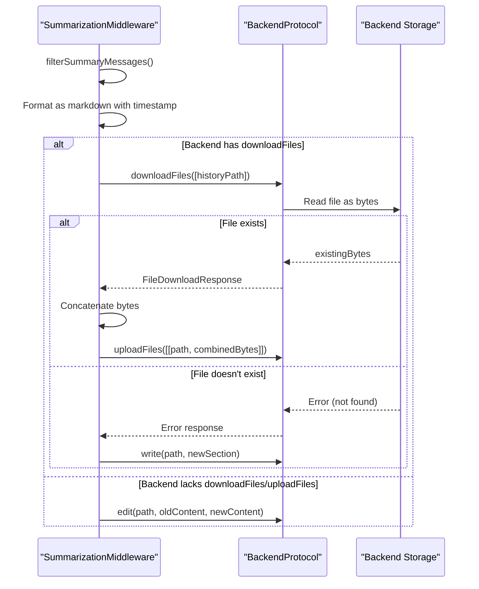

<!-- source: DeepWiki mcp.deepwiki.com · repo langchain-ai/deepagentsjs · page 5.4 Summarization Middleware · fetched 2026-10-26 -->

# Summarization Middleware

<details>
<summary>Relevant source files</summary>

The following files were used as context for generating this wiki page:

- [.changeset/mean-rats-shake.md](.changeset/mean-rats-shake.md)
- [libs/deepagents/src/middleware/summarization.test.ts](libs/deepagents/src/middleware/summarization.test.ts)
- [libs/deepagents/src/middleware/summarization.ts](libs/deepagents/src/middleware/summarization.ts)

</details>


The Summarization Middleware automatically manages conversation history by monitoring context window usage and offloading old messages to backend storage when thresholds are exceeded. It generates summaries of offloaded messages, replaces them with a condensed summary message, and preserves recent context to keep the agent's memory within model limits.

This middleware addresses the context overflow problem that occurs when long-running conversations exceed the model's maximum input token limit. For information about other middleware components, see [Middleware Reference](). For backend storage configuration, see [Backend Implementations]().

## Core Architecture

The `createSummarizationMiddleware` function [[libs/deepagents/src/middleware/summarization.ts:286-1262]]() returns an `AgentMiddleware` that hooks into the `wrapModelCall` lifecycle to intercept model requests and apply summarization when needed.



**Sources**: [[libs/deepagents/src/middleware/summarization.ts:286-1262]](), [[libs/deepagents/src/middleware/summarization.ts:43-63]]()

## Configuration Options

The `SummarizationMiddlewareOptions` interface [[libs/deepagents/src/middleware/summarization.ts:122-172]]() defines the configuration:

| Option | Type | Description | Default |
|--------|------|-------------|---------|
| `model` | `string \| BaseChatModel \| BaseLanguageModel` | Model for generating summaries | Required |
| `backend` | `AnyBackendProtocol \| BackendFactory \| Function` | Backend for storing conversation history | Required |
| `trigger` | `ContextSize \| ContextSize[]` | Threshold(s) for triggering summarization | Auto-computed from model profile |
| `keep` | `ContextSize` | Context retention policy after summarization | Auto-computed from model profile |
| `summaryPrompt` | `string` | Template for generating summaries | `DEFAULT_SUMMARY_PROMPT` |
| `trimTokensToSummarize` | `number` | Max tokens when generating summary | `4000` |
| `historyPathPrefix` | `string` | Path prefix for history files | `"/conversation_history"` |
| `truncateArgsSettings` | `TruncateArgsSettings` | Settings for argument truncation | Auto-computed from model profile |

The `ContextSize` type [[libs/deepagents/src/middleware/summarization.ts:83-88]]() specifies thresholds:

```typescript
export interface ContextSize {
  /** Type of context measurement */
  type: "messages" | "tokens" | "fraction";
  /** Threshold value */
  value: number;
}
```

- `messages`: Count of messages (e.g., `{type: "messages", value: 20}`)
- `tokens`: Token count (e.g., `{type: "tokens", value: 170000}`)
- `fraction`: Fraction of `maxInputTokens` from model profile (e.g., `{type: "fraction", value: 0.85}`)

**Sources**: [[libs/deepagents/src/middleware/summarization.ts:83-172]]()

## Default Computation from Model Profile

When `trigger`, `keep`, or `truncateArgsSettings` are not provided, the middleware computes defaults based on the model's profile using `computeSummarizationDefaults` [[libs/deepagents/src/middleware/summarization.ts:203-227]]():



This ensures consistent defaults across language implementations by checking for `maxInputTokens` in the model profile [[libs/deepagents/src/middleware/summarization.ts:208-212]]().

**Sources**: [[libs/deepagents/src/middleware/summarization.ts:178-227]]()

## Trigger Mechanisms

The middleware checks multiple trigger conditions to determine when summarization should occur:



The `shouldSummarize` function [[libs/deepagents/src/middleware/summarization.ts:437-465]]() applies a `tokenEstimationMultiplier` to the estimated token count. This multiplier starts at `1.0` and is calibrated upward when a `ContextOverflowError` is caught [[libs/deepagents/src/middleware/summarization.ts:1240-1245]](), learning the gap between estimated and actual tokens to fire proactive summarization before hitting hard limits.

**Sources**: [[libs/deepagents/src/middleware/summarization.ts:437-465]](), [[libs/deepagents/src/middleware/summarization.ts:1179-1261]](), [[libs/deepagents/src/middleware/summarization.test.ts:944-1005]]()

## Summarization Event Tracking

Instead of rewriting the entire LangGraph state with `RemoveMessage`, the middleware tracks a `SummarizationEvent` [[libs/deepagents/src/middleware/summarization.ts:236-251]]() in private state:

```typescript
export interface SummarizationEvent {
  /** Index in original messages list to summarize before (exclusive) */
  cutoffIndex: number;
  /** Summary of messages before cutoffIndex */
  summaryMessage: HumanMessage;
  /** Path to full conversation history on backend */
  filePath: string | null;
}
```

The `getEffectiveMessages` function [[libs/deepagents/src/middleware/summarization.ts:978-994]]() reconstructs the effective message list on each call:



This approach avoids full state rewrites and supports chained summarizations. On subsequent summarizations, the `stateCutoffIndex` is computed relative to the previous event [[libs/deepagents/src/middleware/summarization.ts:1029-1033]]().

**Sources**: [[libs/deepagents/src/middleware/summarization.ts:236-251]](), [[libs/deepagents/src/middleware/summarization.ts:978-994]](), [[libs/deepagents/src/middleware/summarization.ts:1029-1033]](), [[libs/deepagents/src/middleware/summarization.test.ts:648-722]]()

## Context Retention Policy

The `keep` policy determines how many messages to preserve after summarization. The `determineCutoffIndex` function [[libs/deepagents/src/middleware/summarization.ts:554-586]]() computes the cutoff based on the policy type:

| Policy Type | Behavior | Example |
|-------------|----------|---------|
| `messages` | Keep last N messages | `{type: "messages", value: 6}` keeps 6 most recent |
| `tokens` | Keep messages totaling N tokens | `{type: "tokens", value: 4000}` keeps ~4000 tokens |
| `fraction` | Keep fraction of maxInputTokens | `{type: "fraction", value: 0.1}` keeps 10% of context |

For token-based policies, the function walks backward from the most recent message, accumulating token counts until the target is exceeded [[libs/deepagents/src/middleware/summarization.ts:572-579]]().

**Sources**: [[libs/deepagents/src/middleware/summarization.ts:554-586]]()

## Safe Cutoff for Tool Call/Result Pairs

The `findSafeCutoffPoint` function [[libs/deepagents/src/middleware/summarization.ts:481-545]]() ensures that `AIMessage` tool calls and their corresponding `ToolMessage` results are not split across the summarization boundary:



This prevents orphaned `ToolMessages` or orphaned AI `tool_calls`, ensuring the model always sees paired requests and responses [[libs/deepagents/src/middleware/summarization.ts:467-545]]().

**Sources**: [[libs/deepagents/src/middleware/summarization.ts:467-545]](), [[libs/deepagents/src/middleware/summarization.test.ts:724-849]]()

## Tool Result Compaction

When `determineCutoffIndex` would summarize all messages, the middleware attempts `compactToolResults` [[libs/deepagents/src/middleware/summarization.ts:690-744]]() instead of full summarization:



Compaction allocates each `ToolMessage` an equal share of the remaining token budget [[libs/deepagents/src/middleware/summarization.ts:717-720]](), truncating content to fit within the context window while preserving the AI/Tool message structure.

**Sources**: [[libs/deepagents/src/middleware/summarization.ts:690-744]](), [[libs/deepagents/src/middleware/summarization.ts:1076-1103]](), [[libs/deepagents/src/middleware/summarization.test.ts:1007-1173]]()

## Argument Truncation

The `truncateArgs` function [[libs/deepagents/src/middleware/summarization.ts:749-813]]() truncates large tool call arguments in old messages to reduce context usage without full summarization:

```typescript
export interface TruncateArgsSettings {
  trigger?: ContextSize;
  keep?: ContextSize;
  maxLength?: number;
  truncationText?: string;
}
```

Only arguments to `write_file` and `edit_file` tools are truncated [[libs/deepagents/src/middleware/summarization.ts:791-792]](), as these commonly contain large content payloads. The function replaces long string arguments with a truncated version followed by `truncationText` [[libs/deepagents/src/middleware/summarization.ts:803-806]]().

**Sources**: [[libs/deepagents/src/middleware/summarization.ts:93-118]](), [[libs/deepagents/src/middleware/summarization.ts:590-653]](), [[libs/deepagents/src/middleware/summarization.ts:749-813]]()

## Backend Integration and History Offloading

Before generating a summary, the middleware offloads the conversation history to backend storage using `offloadToBackend` [[libs/deepagents/src/middleware/summarization.ts:831-905]]():



The offloading uses raw byte concatenation via `uploadFiles` when available [[libs/deepagents/src/middleware/summarization.ts:868-877]](). Each summarization appends a new section to the history file at `/conversation_history/{thread_id}.md` [[libs/deepagents/src/middleware/summarization.ts:27]]().

**Sources**: [[libs/deepagents/src/middleware/summarization.ts:831-905]](), [[libs/deepagents/src/middleware/summarization.ts:25-31]]()

---

