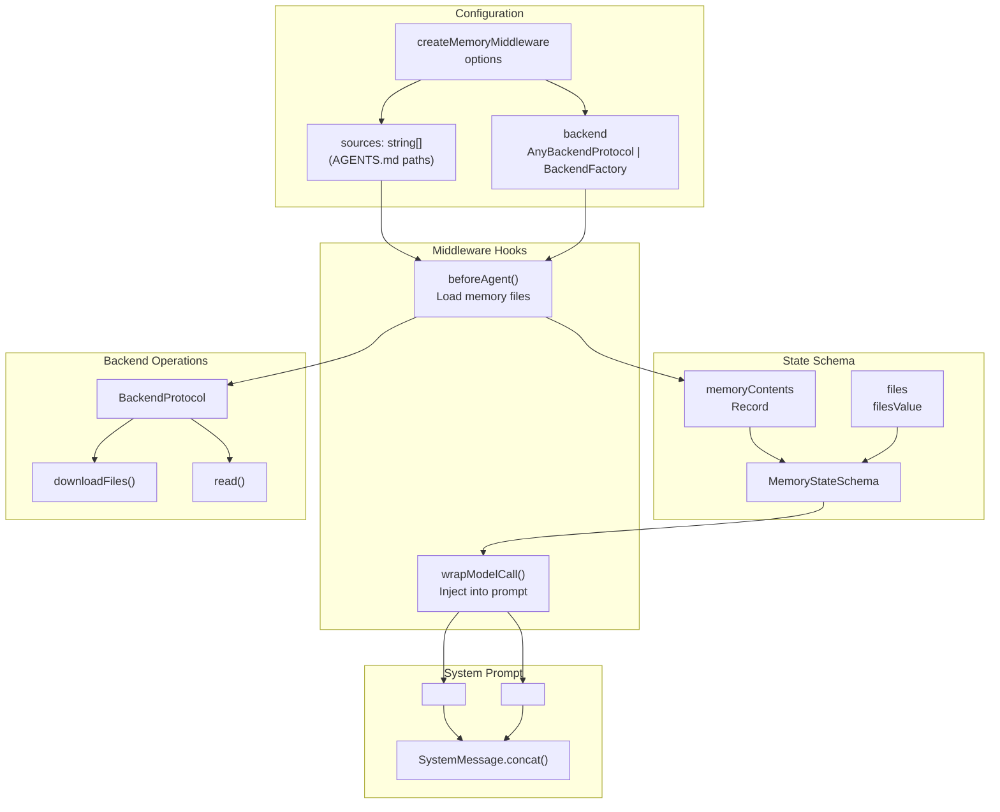
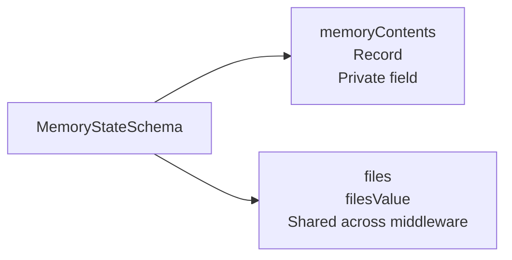
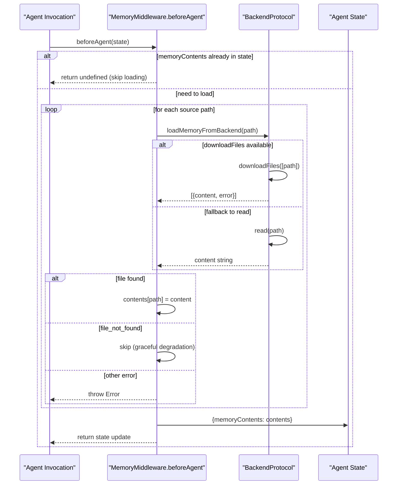
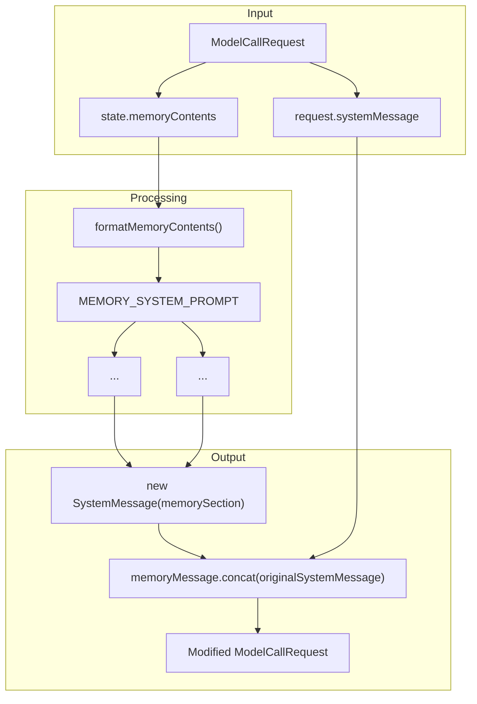

<!-- source: DeepWiki mcp.deepwiki.com · repo langchain-ai/deepagentsjs · page 5.5 Memory Middleware · fetched 2026-10-26 -->

# Memory Middleware

<details>
<summary>Relevant source files</summary>

The following files were used as context for generating this wiki page:

- [examples/memory/AGENTS.md](examples/memory/AGENTS.md)
- [examples/memory/memory-agent.ts](examples/memory/memory-agent.ts)
- [libs/deepagents/src/middleware/cache.ts](libs/deepagents/src/middleware/cache.ts)
- [libs/deepagents/src/middleware/memory.test.ts](libs/deepagents/src/middleware/memory.test.ts)
- [libs/deepagents/src/middleware/memory.ts](libs/deepagents/src/middleware/memory.ts)

</details>


## Purpose and Scope

The Memory Middleware loads persistent context from `AGENTS.md` files and injects it into every model call. Memory provides project-specific context, instructions, and learned information that helps agents work effectively within a codebase or domain.

For on-demand capabilities and workflows, see [Skills Middleware (5.2)](). For managing conversation history, see [Summarization Middleware (5.4)]().

**Sources**: [libs/deepagents/src/middleware/memory.ts:1-49]()

---

## Overview

Memory Middleware implements support for the [AGENTS.md specification](https://agents.md/), which defines a standard format for providing context to AI agents. Unlike skills (which use progressive disclosure and are loaded on-demand), memory is:

- **Always loaded**: Memory content is included in every model call. [libs/deepagents/src/middleware/memory.ts:10-11]()
- **Fully visible**: The entire content is injected into the system prompt. [libs/deepagents/src/middleware/memory.ts:37-39]()
- **Persistent context**: Provides long-term information across conversations. [libs/deepagents/src/middleware/memory.ts:11-12]()
- **Self-modifying**: Agents are instructed to update memory files using the `edit_file` tool as they learn. [libs/deepagents/src/middleware/memory.ts:129-130]()

Memory files typically contain:
- Project overview and architecture.
- Build/test commands. [examples/memory/AGENTS.md:5-9]()
- Code style guidelines. [examples/memory/AGENTS.md:11-16]()
- User preferences.
- Previously learned information.

**Sources**: [libs/deepagents/src/middleware/memory.ts:1-49](), [libs/deepagents/src/middleware/memory.ts:124-162](), [examples/memory/AGENTS.md:1-31]()

---

## Architecture

### Memory Middleware Data Flow

The middleware operates in two phases:
1. **Loading Phase** (`beforeAgent`): Reads `AGENTS.md` files from configured sources using the backend. [libs/deepagents/src/middleware/memory.ts:258-274]()
2. **Injection Phase** (`wrapModelCall`): Formats loaded content and prepends it to the system prompt. [libs/deepagents/src/middleware/memory.ts:301-323]()

Title: Memory Middleware Component Interaction


**Sources**: [libs/deepagents/src/middleware/memory.ts:81-118](), [libs/deepagents/src/middleware/memory.ts:190-236](), [libs/deepagents/src/middleware/memory.ts:258-324]()

---

## Configuration

### Basic Usage

```typescript
import { createMemoryMiddleware, FilesystemBackend } from "deepagents";

const middleware = createMemoryMiddleware({
  backend: new FilesystemBackend({ rootDir: "/" }),
  sources: [
    "~/.deepagents/AGENTS.md",      // User-level memory
    "./.deepagents/AGENTS.md",       // Project-level memory
  ],
});

const agent = createDeepAgent({
  middleware: [middleware],
});
```
[libs/deepagents/src/middleware/memory.ts:16-33]()

### Configuration Options

| Option | Type | Description |
|--------|------|-------------|
| `backend` | `AnyBackendProtocol \| BackendFactory` | Backend for file operations (see [Backend System (3.2)]()). [libs/deepagents/src/middleware/memory.ts:86-89]() |
| `sources` | `string[]` | Ordered list of `AGENTS.md` file paths to load. [libs/deepagents/src/middleware/memory.ts:96]() |
| `addCacheControl` | `boolean` | (Optional) Adds `cache_control: { type: "ephemeral" }` to the memory block for Anthropic prompt caching. [libs/deepagents/src/middleware/memory.ts:98-104]() |

**Sources**: [libs/deepagents/src/middleware/memory.ts:81-105]()

---

## State Schema

Memory Middleware defines its state using `MemoryStateSchema`. [libs/deepagents/src/middleware/memory.ts:110-117]()

Title: Memory State Mapping


### State Fields

| Field | Type | Visibility | Purpose |
|-------|------|-----------|---------|
| `memoryContents` | `Record<string, string>` | Private (optional) | Maps source paths to loaded content. [libs/deepagents/src/middleware/memory.ts:115]() |
| `files` | `filesValue` | Shared | File state managed by [Filesystem Middleware (5.1)](). [libs/deepagents/src/middleware/memory.ts:116]() |

The `memoryContents` field is marked as optional and treated as private state. It stores the loaded memory content but is not included in the final agent state returned to users. [libs/deepagents/src/middleware/memory.ts:112-115]()

**Sources**: [libs/deepagents/src/middleware/memory.ts:110-117](), [libs/deepagents/src/values.ts:6-14]()

---

## Memory Loading (beforeAgent)

The `beforeAgent` hook loads memory content from configured sources. [libs/deepagents/src/middleware/memory.ts:258-274]()

Title: beforeAgent Sequence


### Loading Logic

1. **Check Cache**: If `memoryContents` already exists in state, skip loading. [libs/deepagents/src/middleware/memory.test.ts:85-108]()
2. **Resolve Backend**: Call factory function if backend is a factory. [libs/deepagents/src/middleware/memory.test.ts:110-134]()
3. **Load Sources**: Iterate through sources in order. [libs/deepagents/src/middleware/memory.ts:264-270]()
4. **Graceful Degradation**: Missing files are skipped silently. [libs/deepagents/src/middleware/memory.test.ts:45-68]()

**Sources**: [libs/deepagents/src/middleware/memory.ts:190-236](), [libs/deepagents/src/middleware/memory.ts:276-299]()

---

## System Prompt Injection (wrapModelCall)

The `wrapModelCall` hook injects loaded memory into the system prompt. [libs/deepagents/src/middleware/memory.ts:301-323]()

Title: wrapModelCall Flow


### Prompt Structure

The injected memory section has two parts:

1. **`<agent_memory>` Block**: Contains the actual loaded content. [libs/deepagents/src/middleware/memory.ts:124-126]()
2. **`<memory_guidelines>` Block**: Instructions on how to use and update memory. [libs/deepagents/src/middleware/memory.ts:128-162]()

### Content Formatting

Memory content is formatted to show source paths. If no memory is loaded, it displays: `(No memory loaded)`. [libs/deepagents/src/middleware/memory.ts:184-186]()

**Sources**: [libs/deepagents/src/middleware/memory.ts:301-323](), [libs/deepagents/src/middleware/memory.ts:164-188]()

---

## Memory Guidelines

The middleware injects comprehensive guidelines instructing the agent how to manage memory. [libs/deepagents/src/middleware/memory.ts:123-162]()

### Core Principles

| Principle | Description |
|-----------|-------------|
| **Learn from feedback** | Update memory immediately when user provides corrections or preferences. [libs/deepagents/src/middleware/memory.ts:131-138]() |
| **Capture patterns** | Encode WHY something is better/worse, not just the specific fix. [libs/deepagents/src/middleware/memory.ts:134-137]() |
| **Ask for information** | Don't assume; ask users for missing context. [libs/deepagents/src/middleware/memory.ts:140-143]() |
| **Update before responding** | Memory updates should be the FIRST action when learning occurs. [libs/deepagents/src/middleware/memory.ts:133]() |

### Security Warning

The guidelines explicitly warn against storing sensitive information:

```
Never store API keys, access tokens, passwords, or any other credentials 
in any file, memory, or system prompt. If the user asks where to put API 
keys or provides an API key, do NOT echo or save it.
```
[libs/deepagents/src/middleware/memory.ts:159-161]()

**Sources**: [libs/deepagents/src/middleware/memory.ts:128-162]()

---

## Comparison with Skills

Memory and Skills serve different purposes:

| Aspect | Memory Middleware | Skills Middleware |
|--------|------------------|-------------------|
| **Loading** | Always loaded at start | On-demand via `read_file` |
| **Visibility** | Full content in prompt | Only name/description |
| **Purpose** | Persistent context & learned info | Reusable workflows & capabilities |
| **Format** | `AGENTS.md` (plain Markdown) | `SKILL.md` (YAML frontmatter + Markdown) |
| **Updates** | Frequent (learns from user) | Rare (curated workflows) |

**Sources**: [libs/deepagents/src/middleware/memory.ts:1-49]()

---

## Usage Examples

### Example: Basic Project Memory

```typescript
import { createDeepAgent, FilesystemBackend } from "deepagents";
import * as path from "node:path";

const agent = createDeepAgent({
  model: "claude-haiku-4-5-20251001",
  backend: new FilesystemBackend({ rootDir: "./" }),
  memory: [path.join("./", "AGENTS.md")],
});
```
[examples/memory/memory-agent.ts:40-52]()

### Prompt Caching Integration

When `addCacheControl` is enabled, the memory block is tagged for prompt caching. Alternatively, the `createCacheBreakpointMiddleware` can be used to place a breakpoint at the boundary between static content and dynamic memory. [libs/deepagents/src/middleware/cache.ts:9-25]()

**Sources**: [examples/memory/memory-agent.ts:1-92](), [libs/deepagents/src/middleware/cache.ts:1-54]()

---

