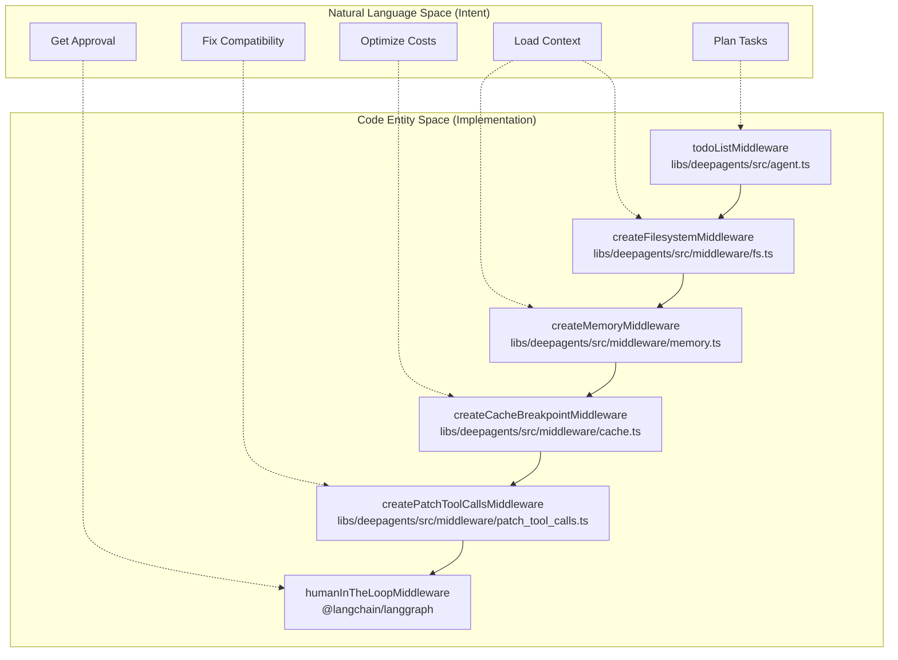
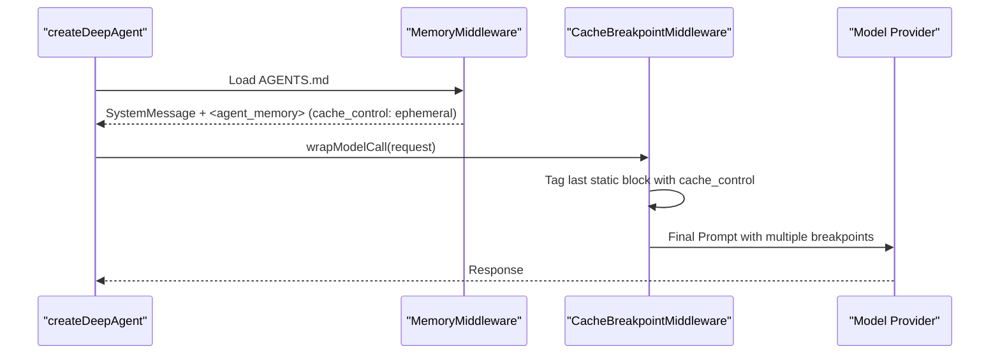

<!-- source: DeepWiki mcp.deepwiki.com · repo langchain-ai/deepagentsjs · page 5.6 Other Middleware · fetched 2026-10-26 -->

# Other Middleware

Relevant source files

The following files were used as context for generating this wiki page:

- [.gitignore](.gitignore)
- [libs/deepagents/src/middleware/agent-memory.test.ts](libs/deepagents/src/middleware/agent-memory.test.ts)
- [libs/deepagents/src/middleware/cache.ts](libs/deepagents/src/middleware/cache.ts)
- [libs/deepagents/src/middleware/fs.int.test.ts](libs/deepagents/src/middleware/fs.int.test.ts)
- [libs/deepagents/src/middleware/hitl.int.test.ts](libs/deepagents/src/middleware/hitl.int.test.ts)
- [libs/deepagents/src/middleware/memory.test.ts](libs/deepagents/src/middleware/memory.test.ts)
- [libs/deepagents/src/middleware/memory.ts](libs/deepagents/src/middleware/memory.ts)
- [libs/deepagents/src/middleware/patch_tool_calls.test.ts](libs/deepagents/src/middleware/patch_tool_calls.test.ts)
- [libs/deepagents/src/middleware/patch_tool_calls.ts](libs/deepagents/src/middleware/patch_tool_calls.ts)
- [libs/deepagents/src/middleware/subagents-hitl.int.test.ts](libs/deepagents/src/middleware/subagents-hitl.int.test.ts)
- [libs/deepagents/src/middleware/types.ts](libs/deepagents/src/middleware/types.ts)
- [tsconfig.json](tsconfig.json)

This page documents middleware components that provide supporting capabilities for Deep Agents. These components handle task tracking, model compatibility, performance optimization, and human-in-the-loop (HITL) workflows.

The middleware covered here include:
- **TodoListMiddleware**: Task planning and tracking.
- **PatchToolCallsMiddleware**: Tool call/response parity patching.
- **anthropicPromptCachingMiddleware**: Automated prompt caching for Anthropic models.
- **humanInTheLoopMiddleware**: Human approval interrupts.

These middleware are orchestrated within the `createDeepAgent` factory [libs/deepagents/src/agent.ts:241-302]().

---

## Middleware Pipeline Architecture

The middleware documented on this page are integrated into a strictly ordered pipeline. This ensures that state modifications (like memory updates) occur before performance optimizations (like prompt caching) to prevent cache invalidation.

### Pipeline Execution Flow

The following diagram maps the high-level system logic to the specific code entities that implement the pipeline in `createDeepAgent`.

**Sources:** [libs/deepagents/src/agent.ts:241-302](), [libs/deepagents/src/middleware/cache.ts:28-54](), [libs/deepagents/src/middleware/patch_tool_calls.ts:134-189]()

---

## TodoListMiddleware

`todoListMiddleware` enables the agent to maintain a persistent checklist of tasks. It is typically the first middleware in the pipeline [libs/deepagents/src/agent.ts:241-245]().

### State and Tools
The middleware manages a `todos` state channel. It injects the following tools into the agent:
- `add_todo`: Create new tasks.
- `update_todo`: Change status (e.g., to `completed`).
- `list_todos`: Retrieve the current list.
- `remove_todo`: Delete entries.

`createDeepAgent` performs collision detection at construction time to ensure user-supplied tools do not shadow the built-in todo tools [libs/deepagents/src/agent.ts:156-163]().

**Sources:** [libs/deepagents/src/agent.ts:156-163](), [libs/deepagents/src/agent.ts:241-245]()

---

## PatchToolCallsMiddleware

`createPatchToolCallsMiddleware` ensures strict 1:1 parity between `AIMessage` tool calls and `ToolMessage` responses. This is critical for providers like Google Gemini that return `400 INVALID_ARGUMENT` if counts mismatch [libs/deepagents/src/middleware/patch_tool_calls.ts:26-28]().

### Core Logic: `patchDanglingToolCalls`
The core logic resides in `patchDanglingToolCalls` [libs/deepagents/src/middleware/patch_tool_calls.ts:32-99](). It performs two passes:
1. **Dangling tool_calls**: If an `AIMessage` has a `tool_call` without a subsequent `ToolMessage`, a synthetic "cancelled" `ToolMessage` is injected [libs/deepagents/src/middleware/patch_tool_calls.ts:82-93]().
2. **Orphaned ToolMessages**: If a `ToolMessage` exists with a `tool_call_id` that was never requested by a preceding `AIMessage`, it is dropped [libs/deepagents/src/middleware/patch_tool_calls.ts:63-68]().

### Middleware Integration
The middleware patches in two locations for maximum safety:
- `beforeAgent`: Cleans up state at the start of the loop by returning a `RemoveMessage` followed by the patched history [libs/deepagents/src/middleware/patch_tool_calls.ts:137-160]().
- `wrapModelCall`: Acts as a safety net for edge cases like HITL rejections where state updates might not have propagated to the model request yet [libs/deepagents/src/middleware/patch_tool_calls.ts:169-187]().

**Sources:** [libs/deepagents/src/middleware/patch_tool_calls.ts:1-189]()

---

## Cache Breakpoint Middleware

The `createCacheBreakpointMiddleware` enables ephemeral prompt caching (supported by providers like Anthropic). It is positioned after static content-generating middleware to capture the boundary between stable and changing content [libs/deepagents/src/middleware/cache.ts:9-19]().

### Cache Control Implementation
The middleware adds `cache_control: { type: "ephemeral" }` markers to the system message blocks [libs/deepagents/src/middleware/cache.ts:43-46]().

- **Static Blocks**: It tags the last block of the system message during `wrapModelCall`, capturing static content from preceding middleware like the todo list or filesystem tools [libs/deepagents/src/middleware/cache.ts:12-15]().
- **Dynamic Memory**: When used with `createMemoryMiddleware`, the memory block can also be tagged with its own breakpoint if `addCacheControl` is enabled [libs/deepagents/src/middleware/memory.ts:99-104]().

**Sources:** [libs/deepagents/src/middleware/cache.ts:28-54](), [libs/deepagents/src/middleware/memory.ts:99-104]()

---

## Human-in-the-Loop Middleware

The `humanInTheLoopMiddleware` allows for manual intervention by interrupting the agent graph before or after specific tool executions.

### Configuration via `interruptOn`
The middleware is added to the pipeline if the `interruptOn` configuration is provided to `createDeepAgent` [libs/deepagents/src/agent.ts:296-302](). It uses an `InterruptOnConfig` record to determine which tools require approval [libs/deepagents/src/middleware/hitl.int.test.ts:20-24]().

### Subagent Propagation
In hierarchical architectures, the `interruptOn` settings are automatically passed down to subagents via the `SubAgentMiddleware`, ensuring consistent safety constraints across the entire tree [libs/deepagents/src/agent.ts:267]().

### Integration with `interrupt()` Primitive
Subagents can also use the LangGraph `interrupt()` primitive directly within tools to pause execution and wait for specific user input or structured data [libs/deepagents/src/middleware/subagents-hitl.int.test.ts:38-52](). Execution is resumed using a `Command({ resume: ... })` [libs/deepagents/src/middleware/subagents-hitl.int.test.ts:194-199]().

**Sources:** [libs/deepagents/src/agent.ts:267](), [libs/deepagents/src/agent.ts:296-302](), [libs/deepagents/src/middleware/hitl.int.test.ts:20-24](), [libs/deepagents/src/middleware/subagents-hitl.int.test.ts:15-16](), [libs/deepagents/src/middleware/subagents-hitl.int.test.ts:194-199]()

---

## Summary of Other Middleware Characteristics

| Middleware | Implementation File | Key Role | State Impact |
|:---|:---|:---|:---|
| **TodoList** | External (`langchain`) | Planning | Updates `todos` channel |
| **PatchToolCalls** | `middleware/patch_tool_calls.ts` | Provider Parity | Uses `RemoveMessage` to reset history if mismatch found |
| **CacheBreakpoint**| `middleware/cache.ts` | Cost/Latency | Injects `cache_control` metadata |
| **HITL** | External (`@langchain/langgraph`) | Safety | Triggers `NodeInterrupt` based on tool name |

**Sources:** [libs/deepagents/src/agent.ts:241-302](), [libs/deepagents/src/middleware/patch_tool_calls.ts:134-189](), [libs/deepagents/src/middleware/cache.ts:28-30]()

---

