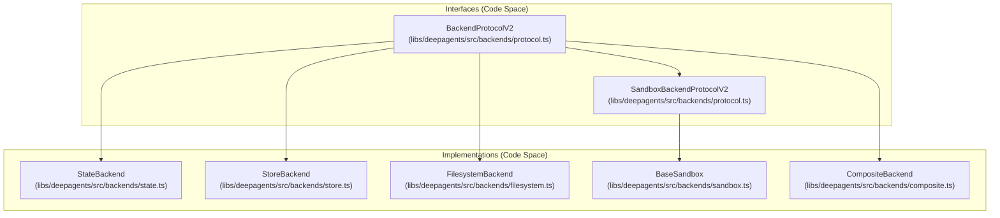
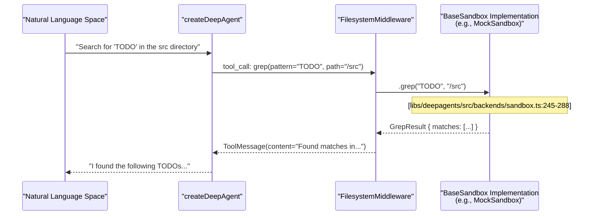

<!-- source: DeepWiki mcp.deepwiki.com · repo langchain-ai/deepagentsjs · page 6 Backend Implementations · fetched 2026-10-26 -->

# Backend Implementations

<details>
<summary>Relevant source files</summary>

The following files were used as context for generating this wiki page:

- [.changeset/fix-follow-symlinks.md](.changeset/fix-follow-symlinks.md)
- [libs/deepagents/src/backends/composite.test.ts](libs/deepagents/src/backends/composite.test.ts)
- [libs/deepagents/src/backends/composite.ts](libs/deepagents/src/backends/composite.ts)
- [libs/deepagents/src/backends/filesystem.ts](libs/deepagents/src/backends/filesystem.ts)
- [libs/deepagents/src/backends/protocol.ts](libs/deepagents/src/backends/protocol.ts)
- [libs/deepagents/src/backends/sandbox.test.ts](libs/deepagents/src/backends/sandbox.test.ts)
- [libs/deepagents/src/backends/sandbox.ts](libs/deepagents/src/backends/sandbox.ts)
- [libs/deepagents/src/backends/state.test.ts](libs/deepagents/src/backends/state.test.ts)
- [libs/deepagents/src/backends/state.ts](libs/deepagents/src/backends/state.ts)

</details>


This page provides an overview of the backend abstraction layer in DeepAgentsJS, which decouples storage and execution from the core agent logic. Backends implement the `BackendProtocolV2` interface and provide file operations, state persistence, and optionally shell command execution. This design enables agents to run in diverse environments—from in-memory testing to production sandboxes—without code changes.

For specific backend implementations, see:
- [StateBackend](#6.1) — Documentation of StateBackend, in-memory ephemeral storage, and when to use it. [libs/deepagents/src/backends/state.ts:39-48]()
- [StoreBackend](#6.2) — Documentation of StoreBackend, persistent storage with LangGraph Store, checkpointer integration, and namespace isolation.
- [FilesystemBackend](#6.3) — Documentation of FilesystemBackend, real filesystem operations, and rootDir configuration. [libs/deepagents/src/backends/filesystem.ts:42-47]()
- [LocalShellBackend](#6.4) — Documentation of LocalShellBackend, shell command execution, environment variable inheritance, and security considerations.
- [SandboxBackend and BaseSandbox](#6.5) — Documentation of the SandboxBackendProtocol, BaseSandbox abstract class, cross-platform POSIX shell commands, and how to implement custom sandbox backends. [libs/deepagents/src/backends/sandbox.ts:2-14]()
- [CompositeBackend](#6.6) — Documentation of CompositeBackend and how to combine multiple backends. [libs/deepagents/src/backends/composite.ts:25-32]()

## Purpose of Backends

Backends serve two primary purposes in DeepAgentsJS:

1.  **Storage Abstraction**: Provide a unified interface for file operations (`read`, `write`, `ls`, `glob`, `grep`) regardless of whether files are stored in memory, on disk, or in a remote sandbox [libs/deepagents/src/backends/protocol.ts:129-216]().
2.  **Execution Abstraction**: Optionally provide shell command execution via the `SandboxBackendProtocolV2`, enabling the `execute` tool for running arbitrary commands in isolated environments [libs/deepagents/src/backends/protocol.ts:246-252]().

This abstraction allows the same agent code to work across development (in-memory), testing (virtual filesystem), and production (remote sandbox) without modification.

**Sources**: [libs/deepagents/src/backends/protocol.ts:1-8](), [libs/deepagents/src/backends/sandbox.ts:2-14]()

## Backend Type Hierarchy

The following diagram maps the high-level backend types to their corresponding code entities and interfaces.

**Diagram: Backend Entity Mapping**

**Sources**: [libs/deepagents/src/backends/protocol.ts:17-19](), [libs/deepagents/src/backends/state.ts:49](), [libs/deepagents/src/backends/sandbox.ts:34]()

## The BackendProtocolV2 Interface

The `BackendProtocolV2` interface defines the core file operations that all backends must implement. All file data is represented using the `FileData` structure, which supports both text (string) and binary (Uint8Array) content [libs/deepagents/src/backends/protocol.ts:103-112]().

Key methods include:
- `read(filePath, offset, limit)`: Read formatted file content with line numbers [libs/deepagents/src/backends/protocol.ts:159-166]().
- `write(filePath, content)`: Create or overwrite a file, returning a `WriteResult` [libs/deepagents/src/backends/protocol.ts:174-190]().
- `ls(path)`: List files and directories in a non-recursive manner [libs/deepagents/src/backends/protocol.ts:149-156]().
- `grep(pattern, path, glob)`: Search file contents using literal or regex patterns [libs/deepagents/src/backends/protocol.ts:182-186]().

**Sources**: [libs/deepagents/src/backends/protocol.ts:129-216]()

## SandboxBackendProtocolV2

The `SandboxBackendProtocolV2` extends `BackendProtocolV2` to add shell command execution and bulk file transfer capabilities [libs/deepagents/src/backends/protocol.ts:237-265]().

```typescript
export interface SandboxBackendProtocolV2 extends BackendProtocolV2 {
  readonly id: string;
  execute(command: string, options?: { timeout?: number }): MaybePromise<ExecuteResponse>;
  uploadFiles(files: Array<[string, Uint8Array]>): MaybePromise<FileUploadResponse[]>;
  downloadFiles(paths: string[]): MaybePromise<FileDownloadResponse[]>;
}
```

The `BaseSandbox` abstract class provides a robust implementation of these methods using POSIX shell commands (awk, find, stat, grep) to ensure compatibility across different Linux distributions [libs/deepagents/src/backends/sandbox.ts:2-14]().

**Sources**: [libs/deepagents/src/backends/protocol.ts:237-265](), [libs/deepagents/src/backends/sandbox.ts:34-149]()

## Backend Lifecycle and Integration

The following diagram illustrates how backends bridge the gap between Natural Language tool calls and the underlying code execution/storage.

**Diagram: Tool to Backend Execution Flow**

**Sources**: [libs/deepagents/src/backends/sandbox.ts:245-288](), [libs/deepagents/src/backends/protocol.ts:59-76](), [libs/deepagents/src/backends/sandbox.test.ts:75-94]()

## Available Backend Implementations

| Backend | Code Entity | Persistence | Execution | Use Case |
| :--- | :--- | :--- | :--- | :--- |
| **State** | `StateBackend` | Ephemeral (Agent State) | ❌ | Default, per-thread testing [libs/deepagents/src/backends/state.ts:39-48]() |
| **Store** | `StoreBackend` | Persistent (LangGraph Store) | ❌ | Cross-thread shared memory [libs/deepagents/src/backends/composite.ts:28]() |
| **Filesystem** | `FilesystemBackend` | Persistent (Local Disk) | ❌ | Local file management [libs/deepagents/src/backends/filesystem.ts:48]() |
| **Composite** | `CompositeBackend` | Mixed (Routed by path) | Conditional | Hybrid storage (e.g., `/memories/` in Store) [libs/deepagents/src/backends/composite.ts:25-32]() |
| **Sandbox** | `BaseSandbox` | Remote/Isolated | ✅ | Secure code execution [libs/deepagents/src/backends/sandbox.ts:2-14]() |

**Sources**: [libs/deepagents/src/backends/state.ts:49](), [libs/deepagents/src/backends/filesystem.ts:48](), [libs/deepagents/src/backends/composite.ts:33](), [libs/deepagents/src/backends/sandbox.ts:34]()

## Next Steps

- For ephemeral in-memory storage, see [StateBackend](#6.1).
- For persistent storage with LangGraph Store, see [StoreBackend](#6.2).
- For real filesystem operations, see [FilesystemBackend](#6.3).
- For local shell command execution, see [LocalShellBackend](#6.4).
- For implementing custom sandbox backends, see [SandboxBackend and BaseSandbox](#6.5).
- For combining multiple backends based on path prefixes, see [CompositeBackend](#6.6).

---

