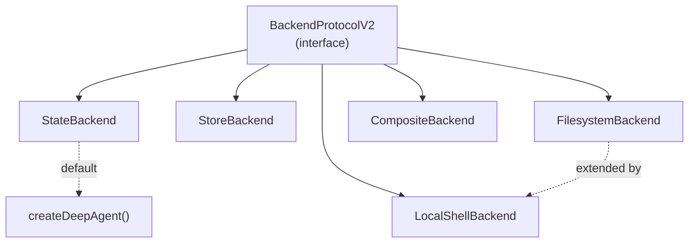
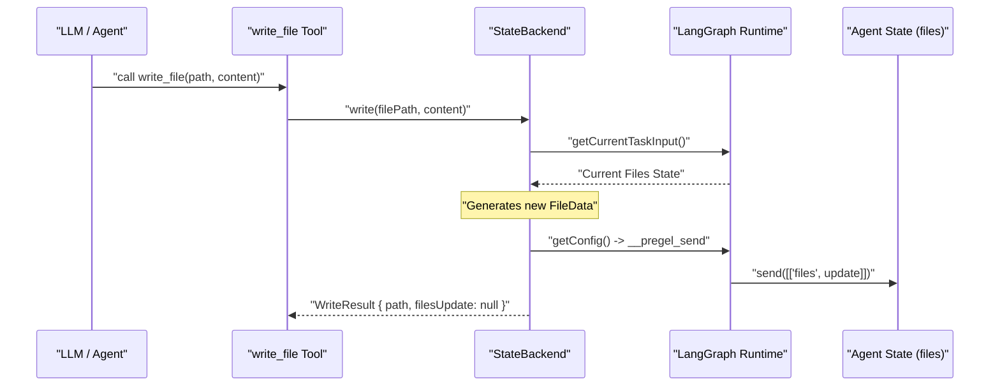

<!-- source: DeepWiki mcp.deepwiki.com · repo langchain-ai/deepagentsjs · page 6.1 StateBackend · fetched 2026-10-26 -->

# StateBackend

<details>
<summary>Relevant source files</summary>

The following files were used as context for generating this wiki page:

- [examples/backends/composite-backend.ts](examples/backends/composite-backend.ts)
- [examples/backends/state-backend.ts](examples/backends/state-backend.ts)
- [examples/backends/store-backend.ts](examples/backends/store-backend.ts)
- [libs/deepagents/src/backends/protocol.ts](libs/deepagents/src/backends/protocol.ts)
- [libs/deepagents/src/backends/state.test.ts](libs/deepagents/src/backends/state.test.ts)
- [libs/deepagents/src/backends/state.ts](libs/deepagents/src/backends/state.ts)

</details>


This page documents the `StateBackend` class, which provides in-memory, ephemeral file storage for Deep Agents. For persistent storage, see [StoreBackend](6.2). For real filesystem operations, see [FilesystemBackend](6.3). For information on the general backend abstraction, see [Backend System](3.2).

## Purpose and Scope

`StateBackend` is the default backend implementation used by `createDeepAgent` when no backend is explicitly configured. It stores files in the agent's state (the `files` channel) for the duration of a single agent invocation. Files exist in memory and are checkpointed along with the agent's conversation state.

This backend is suitable for:
- Development and testing.
- Short-lived agent tasks where persistence across different threads is not required.
- Scenarios where files serve as temporary working context during execution.

**Sources:** [libs/deepagents/src/backends/state.ts:1-3](), [libs/deepagents/src/backends/state.ts:39-43](), [examples/backends/state-backend.ts:35-54]()

## Architecture

### Backend Hierarchy

The `StateBackend` implements the `BackendProtocolV2` interface. Unlike `SandboxBackend` implementations, it does not support arbitrary code execution (the `execute` method), focusing purely on file-like CRUD operations within the LangGraph state.

"Natural Language Space to Code Entity Space: Backend Hierarchy"


**Sources:** [libs/deepagents/src/backends/protocol.ts:27-29](), [libs/deepagents/src/backends/state.ts:49-49](), [examples/backends/composite-backend.ts:79-82]()

### Data Flow and State Management

`StateBackend` supports two modes of operation:
1.  **Zero-arg Mode (Current):** Reads state from the LangGraph execution context via `getCurrentTaskInput` and sends updates via the `__pregel_send` function found in the LangGraph config.
2.  **Legacy Mode:** Reads from an injected `BackendRuntime` and returns `filesUpdate` in the result for the caller (usually middleware) to handle.

"Natural Language Space to Code Entity Space: State Update Flow (Zero-arg)"


**Sources:** [libs/deepagents/src/backends/state.ts:88-126](), [libs/deepagents/src/backends/state.ts:335-350](), [libs/deepagents/src/backends/state.test.ts:19-37]()

## Implementation Details

### File Storage Format
Files in the `StateBackend` can be stored in two formats, though `v2` is the current standard.

| Property | Type | Description |
| :--- | :--- | :--- |
| `content` | `string \| Uint8Array` | File content (string for text, Uint8Array for binary). |
| `mimeType` | `string` | MIME type (e.g., "text/plain", "image/png"). |
| `created_at` | `string` | ISO 8601 timestamp of file creation. |
| `modified_at` | `string` | ISO 8601 timestamp of the last modification. |

**Sources:** [libs/deepagents/src/backends/protocol.ts:103-112](), [libs/deepagents/src/backends/state.ts:207-212]()

### Key Functions

#### `ls(path: string)`
Lists files and directories. It simulates a directory structure by analyzing the keys (paths) in the `files` record. It identifies subdirectories by checking if a path starts with the requested prefix and contains further `/` delimiters.
**Sources:** [libs/deepagents/src/backends/state.ts:135-186]()

#### `read(filePath, offset, limit)`
Retrieves file content. Text files support pagination via `offset` (starting line) and `limit` (number of lines). Binary files return the full `Uint8Array` content, ignoring pagination.
**Sources:** [libs/deepagents/src/backends/state.ts:199-223]()

#### `write(filePath, content)`
Creates a new file. It returns an error if the file already exists, forcing the agent to use `edit` for modifications. It triggers `sendFilesUpdate` to persist changes to the LangGraph state channel.
**Sources:** [libs/deepagents/src/backends/state.ts:331-360]()

#### `grep(pattern, path)`
Performs a text search across files in the specified directory. It uses a literal string match (not regex) and returns structured `GrepMatch` entries including line numbers and matching text.
**Sources:** [libs/deepagents/src/backends/state.ts:261-274](), [libs/deepagents/src/backends/protocol.ts:59-66]()

## Comparison with Other Backends

| Feature | StateBackend | StoreBackend | FilesystemBackend |
| :--- | :--- | :--- | :--- |
| **Storage** | LangGraph State (`files`) | LangGraph `BaseStore` | Local Disk |
| **Persistence** | Ephemeral (Thread-bound) | Persistent (Cross-thread) | Persistent (Local) |
| **Isolation** | Isolated per thread | Shared via namespace | System-wide |
| **Updates** | Via `__pregel_send` / `Command` | Direct `store.put` | Direct `fs` calls |

**Sources:** [libs/deepagents/src/backends/state.ts:39-48](), [examples/backends/composite-backend.ts:42-52](), [libs/deepagents/src/backends/protocol.ts:172-174]()

## Usage and Configuration

### Implicit Usage
If no backend is provided to `createDeepAgent`, it defaults to `StateBackend`.

```typescript
// Implicit default
const agent = createDeepAgent({
  model: myModel,
  // ... other config
});
```

### Explicit Initialization
You can explicitly initialize it to configure the file format or for use in composite scenarios.

```typescript
import { StateBackend } from "deepagents";

const backend = new StateBackend({ fileFormat: "v2" });
```

**Sources:** [libs/deepagents/src/backends/state.ts:58-75](), [examples/backends/state-backend.ts:53-54]()

## Integration with CompositeBackend
`StateBackend` is frequently used as the "root" or "default" route in a `CompositeBackend`, handling all files that don't match specific persistent prefixes (like `/memories/`).

```typescript
import { CompositeBackend, StateBackend, StoreBackend } from "deepagents";

const backend = new CompositeBackend(
  new StateBackend(), // Default: Ephemeral root
  {
    "/memories/": new StoreBackend(), // Persistent sub-directory
  }
);
```

**Sources:** [examples/backends/composite-backend.ts:79-82](), [libs/deepagents/src/backends/state.test.ts:105-150]()

---

