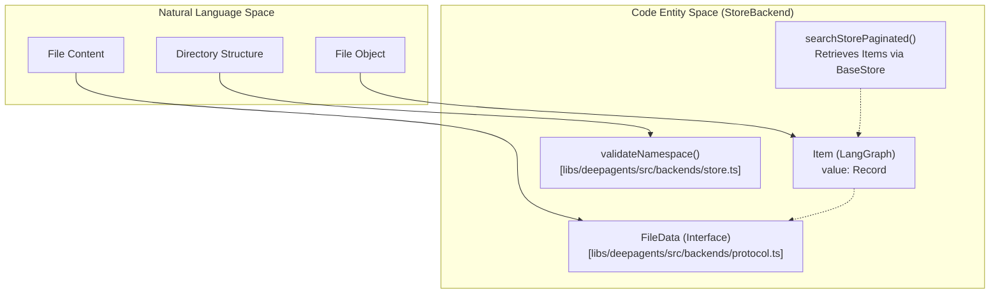
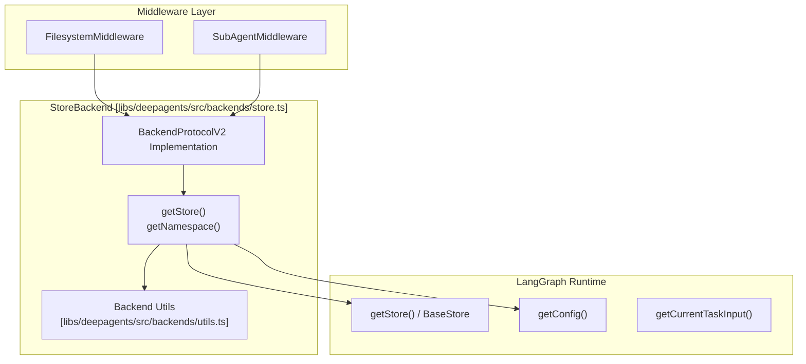

<!-- source: DeepWiki mcp.deepwiki.com · repo langchain-ai/deepagentsjs · page 6.2 StoreBackend · fetched 2026-10-26 -->

# StoreBackend

<details>
<summary>Relevant source files</summary>

The following files were used as context for generating this wiki page:

- [.changeset/chilled-beers-lay.md](.changeset/chilled-beers-lay.md)
- [examples/backends/composite-backend.ts](examples/backends/composite-backend.ts)
- [examples/backends/state-backend.ts](examples/backends/state-backend.ts)
- [examples/backends/store-backend.ts](examples/backends/store-backend.ts)
- [libs/deepagents/src/backends/index.ts](libs/deepagents/src/backends/index.ts)
- [libs/deepagents/src/backends/store.test.ts](libs/deepagents/src/backends/store.test.ts)
- [libs/deepagents/src/backends/store.ts](libs/deepagents/src/backends/store.ts)

</details>


## Purpose and Scope

`StoreBackend` provides persistent storage for Deep Agents using LangGraph's `BaseStore` interface. It enables files, skills, memory, and conversation history to be stored across multiple agent invocations and threads. Unlike `StateBackend`, which keeps data only in ephemeral state channels, `StoreBackend` persists data to a store that survives beyond individual conversation lifetimes, making it ideal for cross-thread memory and long-term knowledge retention.

For in-memory ephemeral storage, see [StateBackend](6.1). For real filesystem operations, see [FilesystemBackend](6.3). For combining multiple backends, see [CompositeBackend](6.6).

Sources: [libs/deepagents/src/backends/store.ts:1-10](), [libs/deepagents/src/backends/store.ts:170-178]()

## Overview

`StoreBackend` implements the `BackendProtocolV2` interface and serves as an adapter between Deep Agents middleware and LangGraph's persistent storage system. It translates file-like operations (read, write, ls, grep) into hierarchical store operations using namespaces for isolation.

**Key characteristics:**

| Feature | Description |
|---------|-------------|
| **Persistence** | Data survives across agent invocations and threads via `BaseStore`. |
| **Dynamic Namespaces** | Supports custom namespaces via static arrays or factory functions for user/org-scoped isolation. |
| **Validation** | Enforces safe character sets for namespace components to prevent injection or wildcard collisions. |
| **Execution Context** | Automatically retrieves the store from the LangGraph execution context if not explicitly provided. |
| **Migration Support** | Handles both `v1` (legacy) and `v2` file data formats. |

Sources: [libs/deepagents/src/backends/store.ts:59-91](), [libs/deepagents/src/backends/store.ts:128-167](), [libs/deepagents/src/backends/store.ts:179-184]()

## Architecture

### Data Flow and Entity Mapping

The following diagram maps Natural Language concepts (Files, Directories) to the Code Entities used within the `StoreBackend` implementation.



**Diagram: Mapping Files to Store Entities**

Sources: [libs/deepagents/src/backends/store.ts:69-91](), [libs/deepagents/src/backends/store.ts:245-260](), [libs/deepagents/src/backends/store.ts:282-310]()

### Component Interaction

`StoreBackend` interacts with the LangGraph runtime to resolve its dependencies (Store and Config) and uses utility functions for complex file operations like globbing and regex matching.



**Diagram: StoreBackend Integration Architecture**

Sources: [libs/deepagents/src/backends/store.ts:227-243](), [libs/deepagents/src/backends/store.ts:245-280](), [libs/deepagents/src/backends/store.ts:5-10]()

## Configuration and Usage

### Initialization

`StoreBackend` can be initialized with an explicit store or configured to resolve the store and namespace dynamically from the agent's execution context.

```typescript
import { StoreBackend } from "deepagents";
import { InMemoryStore } from "@langchain/langgraph-checkpoint";

// Example 1: Explicit store and static namespace
const backend = new StoreBackend({
  store: new InMemoryStore(),
  namespace: ["memories", "user_123"]
});

// Example 2: Dynamic namespace factory
const dynamicBackend = new StoreBackend({
  namespace: ({ state }) => ["users", (state as any).userId, "files"]
});
```

Sources: [libs/deepagents/src/backends/store.ts:149-167](), [examples/backends/store-backend.ts:61-62]()

### StoreBackendOptions

The constructor accepts `StoreBackendOptions` to control persistence and isolation behavior.

| Property | Type | Description |
|----------|------|-------------|
| `store` | `BaseStore` | Explicit store instance. If omitted, uses `getLangGraphStore()`. |
| `namespace` | `string[] \| Factory` | Custom hierarchical path. Defaults to `assistant_id` detection or `["filesystem"]`. |
| `fileFormat` | `"v1" \| "v2"` | The internal storage schema for file metadata. Defaults to `"v2"`. |

Sources: [libs/deepagents/src/backends/store.ts:128-167](), [libs/deepagents/src/backends/store.ts:214-215]()

## Namespace Isolation

### Validation Rules

To prevent wildcard or glob injection in store lookups, `StoreBackend` validates namespace components using the `NAMESPACE_COMPONENT_RE` regex: `/^[A-Za-z0-9\-_.@+:~]+$/`.

- **Allowed**: Alphanumeric, `-`, `_`, `.`, `@`, `+`, `:`, `~`.
- **Rejected**: Wildcards (`*`, `?`), brackets (`[`, `]`, `{`, `}`), and empty strings.

Sources: [libs/deepagents/src/backends/store.ts:42-42](), [libs/deepagents/src/backends/store.ts:69-91]()

### Resolution Logic

The `getNamespace()` method resolves the final namespace array in the following priority order:
1. Validates the provided static `namespace` array or calls the `namespace` factory.
2. If no namespace is provided, it attempts to extract an `assistant_id` from the LangGraph config metadata.
3. Falls back to `["filesystem"]`.

Sources: [libs/deepagents/src/backends/store.ts:245-280]()

## Key Implementation Details

### Store Access Patterns

The backend provides two primary ways to access the underlying `BaseStore`:
- **Legacy Mode**: Reads from an injected `StateAndStore` object provided during construction. [libs/deepagents/src/backends/store.ts:228-234]()
- **Zero-Arg Mode**: Retrieves the store from the current LangGraph execution context via `getLangGraphStore()`. [libs/deepagents/src/backends/store.ts:235-239]()

### Pagination Logic

The internal `searchStorePaginated` helper ensures that operations like `ls` or `grep` (which may span many files) do not miss data due to store limits. It uses a recursive-style loop to fetch items with an increasing `offset` until no more items are returned.

Sources: [libs/deepagents/src/backends/store.ts:282-310]()

### File Operations Summary

| Method | Implementation Detail |
|--------|-----------------------|
| `ls(path)` | Fetches all items in the namespace via `searchStorePaginated`, then uses `lsInfo` logic to filter by directory structure. |
| `read(path)` | Retrieves a specific item by key, migrates it to `v2` if necessary, and handles line-based slicing (offset/limit). |
| `write(path, content)` | Checks for existing files to prevent overwrites, then performs `store.put()` with serialized `FileData`. |
| `edit(path, ...)` | Atomic read-modify-write: retrieves the file, applies string replacements via `performStringReplacement`, and saves back to the store. |

Sources: [libs/deepagents/src/backends/store.ts:322-330](), [libs/deepagents/src/backends/store.ts:423-440](), [libs/deepagents/src/backends/store.ts:468-475](), [libs/deepagents/src/backends/store.ts:512-525]()

## Integration with CompositeBackend

`StoreBackend` is frequently used within a `CompositeBackend` to provide a "persistent" partition of a larger virtual filesystem. For example, an agent might use `StateBackend` for the root directory (ephemeral) and `StoreBackend` for a `/memories/` directory (persistent).

```typescript
const backend = new CompositeBackend(new StateBackend(), {
  "/memories/": new StoreBackend(),
});
```

Sources: [examples/backends/composite-backend.ts:79-81](), [libs/deepagents/src/backends/store.test.ts:45-87]()

---

