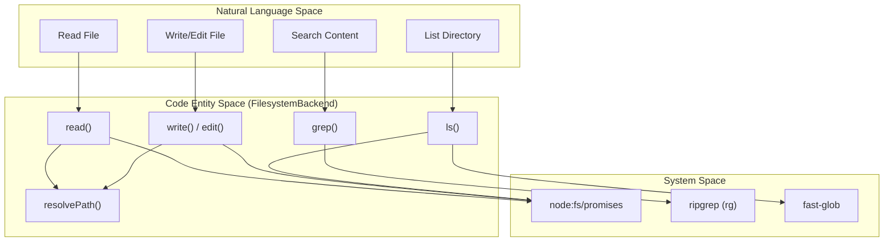
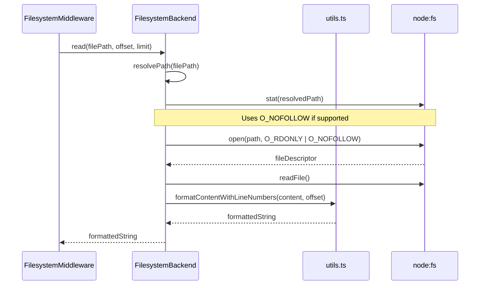

<!-- source: DeepWiki mcp.deepwiki.com · repo langchain-ai/deepagentsjs · page 6.3 FilesystemBackend · fetched 2026-10-26 -->

# FilesystemBackend

Relevant source files

The following files were used as context for generating this wiki page:

- [.changeset/fix-follow-symlinks.md](.changeset/fix-follow-symlinks.md)
- [examples/backends/composite-backend.ts](examples/backends/composite-backend.ts)
- [examples/backends/state-backend.ts](examples/backends/state-backend.ts)
- [examples/backends/store-backend.ts](examples/backends/store-backend.ts)
- [libs/deepagents/src/backends/filesystem.test.ts](libs/deepagents/src/backends/filesystem.test.ts)
- [libs/deepagents/src/backends/filesystem.ts](libs/deepagents/src/backends/filesystem.ts)
- [libs/deepagents/src/backends/sandbox.test.ts](libs/deepagents/src/backends/sandbox.test.ts)
- [libs/deepagents/src/backends/sandbox.ts](libs/deepagents/src/backends/sandbox.ts)
- [libs/deepagents/src/backends/utils.test.ts](libs/deepagents/src/backends/utils.test.ts)
- [libs/deepagents/src/backends/utils.ts](libs/deepagents/src/backends/utils.ts)

## Purpose and Scope

`FilesystemBackend` is a backend implementation that performs real filesystem operations using Node.js `node:fs/promises` and `node:child_process` APIs. It provides persistent storage for agents, allowing tools to interact with actual directories on disk. This backend supports a `virtualMode` for path sandboxed access and leverages high-performance tools like `ripgrep` for search operations when available.

For other backend implementations, see:
- [StateBackend](6.1) for in-memory ephemeral storage
- [StoreBackend](6.2) for LangGraph Store-based persistence
- [LocalShellBackend](6.4) for filesystem access with shell command execution
- [SandboxBackend](6.5) for remote or containerized execution environments

**Sources:** [libs/deepagents/src/backends/filesystem.ts:1-9](), [libs/deepagents/src/backends/filesystem.ts:41-47]()

## Architecture Overview

`FilesystemBackend` implements the `BackendProtocolV2` interface. It translates high-level file requests from `FilesystemMiddleware` into low-level Node.js system calls. It handles path resolution, security checks, and result formatting using shared utilities.

### Code Entity Relationship

The following diagram maps Natural Language concepts to specific code entities and system dependencies within the `FilesystemBackend` implementation.

**Sources:** [libs/deepagents/src/backends/filesystem.ts:48-64](), [libs/deepagents/src/backends/filesystem.ts:105-188](), [libs/deepagents/src/backends/filesystem.ts:198-244](), [libs/deepagents/src/backends/filesystem.ts:326-400]()

## Configuration

### Constructor Options

The `FilesystemBackend` constructor accepts an options object:

| Parameter | Type | Default | Description |
|-----------|------|---------|-------------|
| `rootDir` | `string` | `process.cwd()` | The base directory for all operations. |
| `virtualMode` | `boolean` | `false` | If true, paths are treated as virtual absolute paths (e.g., `/src`) relative to `rootDir`. |
| `maxFileSizeMb` | `number` | `10` | Maximum file size allowed for read operations. |

**Sources:** [libs/deepagents/src/backends/filesystem.ts:53-64]()

### Path Resolution and Security

The `resolvePath` method is the central security gate for all operations:

1.  **Normal Mode (`virtualMode: false`)**: Absolute paths are used as-is. Relative paths are resolved against `rootDir`.
2.  **Virtual Mode (`virtualMode: true`)**: All paths are treated as absolute starting from `/` (which maps to `rootDir`). It explicitly blocks traversal patterns (`..` or `~`) and ensures the final path remains inside the `rootDir` using `path.relative`.

**Sources:** [libs/deepagents/src/backends/filesystem.ts:78-96]()

## Implementation Details

### File Operations Flow

When a tool call is made (e.g., `read_file`), the data flows through the backend as follows:

**Sources:** [libs/deepagents/src/backends/filesystem.ts:198-244](), [libs/deepagents/src/backends/utils.ts:92-139]()

### Search and Grep

The `grep` method attempts to use `ripgrep` (`rg`) for high-performance searching if available in the system path. It defaults to literal (fixed-string) searches for safety. If `ripgrep` is not found, it falls back to a manual substring search across files discovered via `fast-glob`.

**Sources:** [libs/deepagents/src/backends/filesystem.ts:326-400]()

### Symbolic Link Safety

To prevent symlink-following attacks, the backend uses `fsSync.constants.O_NOFOLLOW` when opening files if the platform supports it. This ensures that the agent cannot read sensitive system files by interacting with a malicious symlink inside the workspace.

**Sources:** [libs/deepagents/src/backends/filesystem.ts:39](), [libs/deepagents/src/backends/filesystem.ts:210-220]()

## Key Functions

### `ls(dirPath: string)`
Lists directory contents. In `virtualMode`, it transforms absolute system paths back into virtual paths (e.g., `/home/user/app/src` becomes `/src`) before returning them to the agent. It sorts results alphabetically.
**Sources:** [libs/deepagents/src/backends/filesystem.ts:105-188]()

### `edit(filePath, oldString, newString, replaceAll)`
Performs precise string replacement. It leverages `performStringReplacement` from `utils.ts` to validate that the `oldString` exists and handles the `replaceAll` logic.
**Sources:** [libs/deepagents/src/backends/filesystem.ts:285-324](), [libs/deepagents/src/backends/utils.ts:340-379]()

### `write(filePath, content)`
Writes content to disk. It automatically creates parent directories if they do not exist using `fs.mkdir(..., { recursive: true })`.
**Sources:** [libs/deepagents/src/backends/filesystem.ts:246-283]()

## Comparison of Operation Modes

| Feature | Virtual Mode (`true`) | Normal Mode (`false`) |
| :--- | :--- | :--- |
| **Path Style** | `/app/main.ts` | `/Users/me/project/main.ts` |
| **Traversal** | Throws error on `..` | Allowed via OS resolution |
| **Root Escaping** | Blocked via `path.relative` check | Possible if process has permissions |
| **Agent View** | Sees `rootDir` as `/` | Sees the real host path |

**Sources:** [libs/deepagents/src/backends/filesystem.ts:79-96](), [libs/deepagents/src/backends/filesystem.test.ts:89-136]()

## Testing

The implementation is verified via `libs/deepagents/src/backends/filesystem.test.ts`, which uses temporary directories to test:
- Absolute vs. Virtual path resolution.
- Multi-level directory listing (`ls`).
- Grep performance and glob pattern matching.
- Path traversal rejection in virtual mode.

**Sources:** [libs/deepagents/src/backends/filesystem.test.ts:45-87](), [libs/deepagents/src/backends/filesystem.test.ts:138-185]()

---

