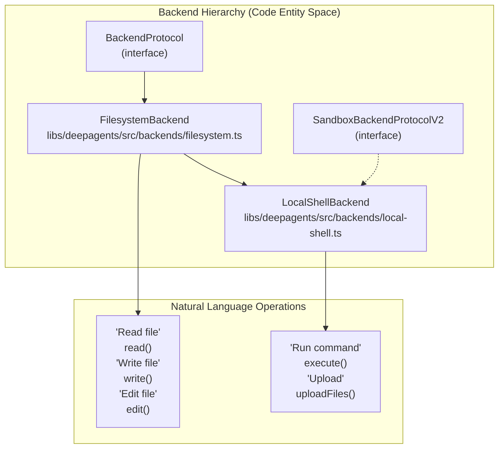
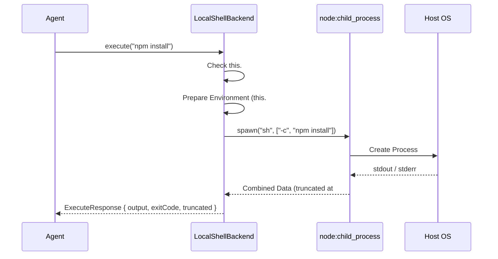

<!-- source: DeepWiki mcp.deepwiki.com · repo langchain-ai/deepagentsjs · page 6.4 LocalShellBackend · fetched 2026-10-26 -->

# LocalShellBackend

<details>
<summary>Relevant source files</summary>

The following files were used as context for generating this wiki page:

- [libs/acp/src/acp-filesystem-backend.test.ts](libs/acp/src/acp-filesystem-backend.test.ts)
- [libs/deepagents/src/backends/local-shell.int.test.ts](libs/deepagents/src/backends/local-shell.int.test.ts)
- [libs/deepagents/src/backends/local-shell.test.ts](libs/deepagents/src/backends/local-shell.test.ts)
- [libs/deepagents/src/backends/local-shell.ts](libs/deepagents/src/backends/local-shell.ts)
- [libs/standard-tests/src/index.ts](libs/standard-tests/src/index.ts)
- [libs/standard-tests/src/tests/command-execution.ts](libs/standard-tests/src/tests/command-execution.ts)
- [libs/standard-tests/src/tests/edit.ts](libs/standard-tests/src/tests/edit.ts)
- [libs/standard-tests/src/tests/file-operations.ts](libs/standard-tests/src/tests/file-operations.ts)

</details>


`LocalShellBackend` is a backend implementation that combines real filesystem operations with unrestricted local shell command execution capabilities. It extends `FilesystemBackend` to provide agents with the ability to run arbitrary shell commands on the host machine while maintaining file system access.

**Scope:** This page covers the `LocalShellBackend` class, its configuration options, shell command execution behavior, environment variable inheritance, and critical security considerations for local command execution.

## Overview

`LocalShellBackend` provides two primary capabilities:

1.  **Filesystem Operations**: Full read/write access to files on the local filesystem via inherited `FilesystemBackend` methods [libs/deepagents/src/backends/local-shell.ts:123-125]().
2.  **Shell Execution**: Direct execution of shell commands on the host machine via the `execute` method [libs/deepagents/src/backends/local-shell.ts:245-316]().

This backend is designed for development and testing scenarios where agents need both file access and the ability to run local commands. Unlike `SandboxBackend` implementations (like Modal or Daytona), `LocalShellBackend` does **not** provide isolation, containerization, or virtualization [libs/deepagents/src/backends/local-shell.ts:5-6]().

### Architectural Position

The following diagram shows how `LocalShellBackend` fits into the backend hierarchy and how it bridges the Natural Language "Execute" intent to Code Entity Space.

**Code Entity Mapping: LocalShellBackend**


**Sources:** [libs/deepagents/src/backends/local-shell.ts:17-27](), [libs/deepagents/src/backends/local-shell.ts:134-136]()

## Configuration

### LocalShellBackendOptions

`LocalShellBackend` is configured via the `LocalShellBackendOptions` interface [libs/deepagents/src/backends/local-shell.ts:32-83]():

| Option | Type | Default | Description |
| :--- | :--- | :--- | :--- |
| `rootDir` | `string` | `process.cwd()` | Working directory for filesystem and shell operations [libs/deepagents/src/backends/local-shell.ts:37](). |
| `virtualMode` | `boolean` | `false` | If true, treats `rootDir` as a virtual root for FS (but not shell) [libs/deepagents/src/backends/local-shell.ts:45](). |
| `timeout` | `number` | `120` | Maximum execution time in seconds for commands [libs/deepagents/src/backends/local-shell.ts:52](). |
| `maxOutputBytes` | `number` | `100,000` | Maximum bytes to capture from command output [libs/deepagents/src/backends/local-shell.ts:59](). |
| `env` | `Record<string, string>` | `undefined` | Custom environment variables for shell commands [libs/deepagents/src/backends/local-shell.ts:66](). |
| `inheritEnv` | `boolean` | `false` | Whether to inherit `process.env` from the parent [libs/deepagents/src/backends/local-shell.ts:74](). |
| `initialFiles` | `Record<string, string>` | `undefined` | Files to create during initialization [libs/deepagents/src/backends/local-shell.ts:82](). |

**Sources:** [libs/deepagents/src/backends/local-shell.ts:32-83](), [libs/deepagents/src/backends/local-shell.ts:144-170]()

## Implementation Details

### Initialization and Lifecycle

Before executing commands, the backend must be initialized. This ensures the `rootDir` exists on the host system [libs/deepagents/src/backends/local-shell.ts:196-206]().

*   **`initialize()`**: Creates the `rootDir` recursively [libs/deepagents/src/backends/local-shell.ts:203](). Throws `SandboxError` with code `ALREADY_INITIALIZED` if called twice [libs/deepagents/src/backends/local-shell.ts:198-201]().
*   **`LocalShellBackend.create()`**: A static factory that instantiates and initializes the backend in one step [libs/deepagents/src/backends/local-shell.ts:333-345]().
*   **`close()`**: Flips the initialization state to false [libs/deepagents/src/backends/local-shell.ts:213-215]().

### Command Execution (`execute`)

The `execute` method uses `node:child_process` to spawn a shell [libs/deepagents/src/backends/local-shell.ts:245-316]().

**Data Flow: execute() Implementation**


**Key Execution Behaviors:**
*   **Environment Merging**: If `inheritEnv` is true, the backend clones `process.env` and applies overrides from the `env` option [libs/deepagents/src/backends/local-shell.ts:162-169]().
*   **Stderr Handling**: Stderr lines are prefixed with `[stderr]` and combined into the single `output` string [libs/deepagents/src/backends/local-shell.ts:275-277]().
*   **Timeout**: If the command exceeds the configured `#timeout`, it is killed and returns exit code `124` [libs/deepagents/src/backends/local-shell.ts:292-298]().
*   **Truncation**: If output exceeds `#maxOutputBytes`, it is cut off and the `truncated` flag is set to `true` [libs/deepagents/src/backends/local-shell.ts:269-272]().

**Sources:** [libs/deepagents/src/backends/local-shell.ts:162-169](), [libs/deepagents/src/backends/local-shell.ts:245-316](), [libs/deepagents/src/backends/local-shell.test.ts:149-173]()

## Security Warning

`LocalShellBackend` grants agents **unrestricted** access to your host machine [libs/deepagents/src/backends/local-shell.ts:89-95]().

> [!CAUTION]
> This backend provides NO sandboxing, NO process isolation, and NO security restrictions. It is equivalent to giving the agent a terminal logged in as your current user.

### Appropriate Use Cases
*   Local development CLI tools (e.g., coding assistants) [libs/deepagents/src/backends/local-shell.ts:98]().
*   CI/CD pipelines where the runner environment is already ephemeral and controlled [libs/deepagents/src/backends/local-shell.ts:100]().
*   Personal tools where you have full visibility into the agent's logic.

### Inappropriate Use Cases
*   Production web servers or APIs [libs/deepagents/src/backends/local-shell.ts:103]().
*   Multi-tenant systems [libs/deepagents/src/backends/local-shell.ts:103]().
*   Processing untrusted user input or running third-party code [libs/deepagents/src/backends/local-shell.ts:104]().

**Sources:** [libs/deepagents/src/backends/local-shell.ts:89-107]()

## Integration with Standard Tests

`LocalShellBackend` is verified using the `@langchain/sandbox-standard-tests` suite to ensure it adheres to the `SandboxBackendProtocolV2` [libs/deepagents/src/backends/local-shell.int.test.ts:1-15]().

The integration tests cover:
*   **Command Execution**: Echo, exit codes, stderr capture, and environment variables [libs/standard-tests/src/tests/command-execution.ts:1-85]().
*   **File Operations**: Uploading/downloading files and standard read/write/edit behaviors [libs/standard-tests/src/tests/file-operations.ts:1-157]().
*   **Advanced Editing**: Single/multiple occurrences and `replaceAll` logic [libs/standard-tests/src/tests/edit.ts:1-132]().

**Sources:** [libs/deepagents/src/backends/local-shell.int.test.ts:19-44](), [libs/standard-tests/src/index.ts:1-22]()

## Examples

### Creating an Instance with Environment Inheritance

```typescript
import { LocalShellBackend } from "@langchain/deepagents";

const backend = await LocalShellBackend.create({
  rootDir: "./my-project",
  inheritEnv: true, // Inherit PATH and other system variables
  env: {
    API_KEY: "my-secret-key" // Additional custom variables
  },
  timeout: 60 // 1 minute timeout
});

const result = await backend.execute("npm test");
console.log(result.output);
```

**Sources:** [libs/deepagents/src/backends/local-shell.ts:109-132](), [libs/deepagents/src/backends/local-shell.test.ts:190-202]()

---

