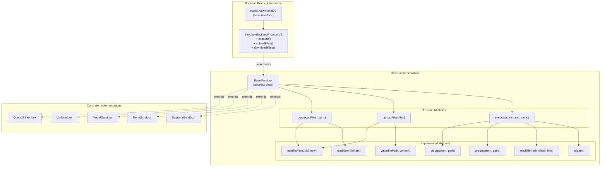
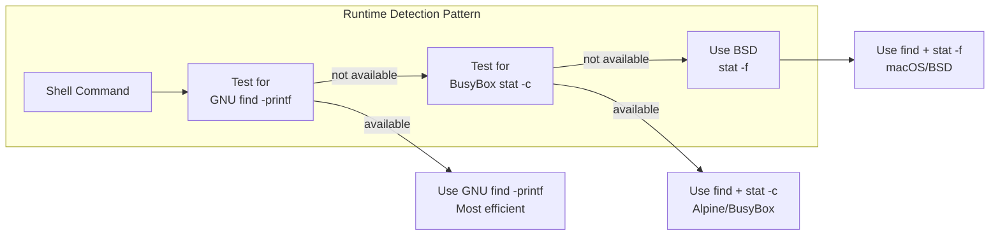

<!-- source: DeepWiki mcp.deepwiki.com · repo langchain-ai/deepagentsjs · page 6.5 SandboxBackend and BaseSandbox · fetched 2026-10-26 -->

# SandboxBackend and BaseSandbox

<details>
<summary>Relevant source files</summary>

The following files were used as context for generating this wiki page:

- [.changeset/fix-follow-symlinks.md](.changeset/fix-follow-symlinks.md)
- [libs/deepagents/src/backends/filesystem.ts](libs/deepagents/src/backends/filesystem.ts)
- [libs/deepagents/src/backends/sandbox.test.ts](libs/deepagents/src/backends/sandbox.test.ts)
- [libs/deepagents/src/backends/sandbox.ts](libs/deepagents/src/backends/sandbox.ts)
- [libs/standard-tests/src/sandbox.ts](libs/standard-tests/src/sandbox.ts)
- [libs/standard-tests/src/tests/glob-info.ts](libs/standard-tests/src/tests/glob-info.ts)
- [libs/standard-tests/src/tests/grep-raw.ts](libs/standard-tests/src/tests/grep-raw.ts)
- [libs/standard-tests/src/tests/initial-files.ts](libs/standard-tests/src/tests/initial-files.ts)
- [libs/standard-tests/src/tests/integration.ts](libs/standard-tests/src/tests/integration.ts)
- [libs/standard-tests/src/tests/ls-info.ts](libs/standard-tests/src/tests/ls-info.ts)

</details>


## Purpose and Scope

This page documents the `SandboxBackendProtocolV2` interface and the `BaseSandbox` abstract class, which provide the foundation for implementing sandbox backends that can execute shell commands in isolated environments. These components enable agents to run arbitrary shell commands via the `execute` tool while maintaining file system access.

For information about other backend types (state-based, store-based, filesystem-based), see [6. Backend Implementations](). For specific sandbox provider implementations (Daytona, Deno, Modal, Node-VFS), see [7. Sandbox Providers]().

## Overview

The sandbox backend system consists of two key components:

- **`SandboxBackendProtocolV2`**: Interface defining the contract for sandbox backends that support command execution, file uploads, and downloads [[libs/deepagents/src/backends/protocol.js:29]]().
- **`BaseSandbox`**: Abstract base class providing default implementations of all file operations using POSIX shell commands [[libs/deepagents/src/backends/sandbox.ts:2-14]]().

The design philosophy is to minimize implementation requirements: concrete sandbox implementations only need to provide three methods (`execute`, `uploadFiles`, and `downloadFiles`), while `BaseSandbox` handles all higher-level file operations (like `ls`, `read`, `grep`, and `glob`) through shell commands executed via the provider's `execute()` implementation [[libs/deepagents/src/backends/sandbox.ts:4-6]]().

**Sources:** [libs/deepagents/src/backends/sandbox.ts:1-14](), [libs/deepagents/src/backends/protocol.js:29-31]()

## Architecture

The following diagram illustrates the relationship between the core protocol, the abstract base class, and the specialized provider implementations.

### Sandbox Backend Class Hierarchy


**Sources:** [libs/deepagents/src/backends/sandbox.ts:16-31](), [libs/deepagents/src/backends/sandbox.ts:272-294]()

## SandboxBackendProtocolV2 Interface

The `SandboxBackendProtocolV2` extends the base `BackendProtocolV2` interface with three additional methods that enable command execution and file transfer:

| Method | Parameters | Return Type | Purpose |
|--------|------------|-------------|---------|
| `execute` | `command: string` | `Promise<ExecuteResponse>` | Execute a shell command in the sandbox [[libs/deepagents/src/backends/sandbox.ts:276]]() |
| `uploadFiles` | `files: Array<[string, Uint8Array]>` | `Promise<FileUploadResponse[]>` | Upload multiple files to the sandbox [[libs/deepagents/src/backends/sandbox.ts:282]]() |
| `downloadFiles` | `paths: string[]` | `Promise<FileDownloadResponse[]>` | Download multiple files from the sandbox [[libs/deepagents/src/backends/sandbox.ts:290]]() |

### ExecuteResponse Structure

```typescript
interface ExecuteResponse {
  output: string;      // Combined stdout and stderr
  exitCode: number;    // Command exit code
  truncated: boolean;  // Whether output was truncated
}
```

### File Transfer Response Structures

Both upload and download operations support **partial success** - if one file fails, others can still succeed. Each response includes per-file success/error information [[libs/deepagents/src/backends/sandbox.test.ts:101-126]]().

**Sources:** [libs/deepagents/src/backends/sandbox.ts:16-31](), [libs/deepagents/src/backends/sandbox.test.ts:101-126]()

## BaseSandbox Abstract Class

`BaseSandbox` is an abstract class that implements `SandboxBackendProtocolV2` with a focus on cross-platform compatibility. It requires only three methods to be implemented (`execute`, `uploadFiles`, `downloadFiles`) and provides default implementations for all other file operations.

### Design Principles

1. **Minimal Implementation Surface**: Concrete classes only implement three methods [[libs/deepagents/src/backends/sandbox.ts:5-6]]().
2. **Cross-Platform Shell Commands**: All shell commands use pure POSIX utilities (awk, grep, find, stat) [[libs/deepagents/src/backends/sandbox.ts:9-11]]().
3. **No Runtime Dependencies**: Works on GNU Linux, BusyBox/Alpine, and BSD/macOS without Python, Node.js, or other runtimes [[libs/deepagents/src/backends/sandbox.ts:13]]().
4. **Efficiency**: Operations like `read()` use shell commands to slice files server-side, avoiding large data transfers [[libs/deepagents/src/backends/sandbox.ts:214-231]]().

**Sources:** [libs/deepagents/src/backends/sandbox.ts:1-14]()

## Cross-Platform Shell Command Strategy

`BaseSandbox` achieves cross-platform compatibility through runtime environment detection. Commands probe for available utilities and adapt accordingly:

### Shell Command Detection Logic


### Command Building Functions

| Function | Purpose | Platforms |
|----------|---------|-----------|
| `buildLsCommand(dirPath)` | List directory contents (non-recursive) [[libs/deepagents/src/backends/sandbox.ts:176]]() | GNU / BusyBox / BSD |
| `buildFindCommand(searchPath)` | List files recursively [[libs/deepagents/src/backends/sandbox.ts:196]]() | GNU / BusyBox / BSD |
| `buildReadCommand(filePath, offset, limit)` | Read file with line numbers [[libs/deepagents/src/backends/sandbox.ts:214]]() | Universal (uses awk) |
| `buildGrepCommand(pattern, path, glob)` | Search for literal text [[libs/deepagents/src/backends/sandbox.ts:233]]() | Universal (uses grep) |

### Example: buildLsCommand Output Format

Each command produces tab-delimited output: `size\tmtime\ttype\tpath` [[libs/deepagents/src/backends/sandbox.ts:109]]().

```bash
# GNU find (most efficient):
find -L '/path' -maxdepth 1 -not -path '/path' -printf '%s\t%T@\t%y\t%p\n'

# BusyBox/Alpine fallback:
find -L '/path' -maxdepth 1 -not -path '/path' -exec sh -c '
  for f; do 
    if [ -d "$f" ]; then t=d; elif [ -L "$f" ]; then t=l; else t=f; fi;
    sz=$(stat -c %s "$f") || continue;
    mt=$(stat -c %Y "$f") || continue;
    printf "%s\t%s\t%s\t%s\n" "$sz" "$mt" "$t" "$f";
  done' _ {} +
```

The `-L` flag is included in `find` invocations to ensure symlinks are followed [[libs/deepagents/src/backends/sandbox.ts:178]]().

**Sources:** [libs/deepagents/src/backends/sandbox.ts:158-208](), [libs/deepagents/src/backends/sandbox.ts:109-149](), [.changeset/fix-follow-symlinks.md:5]()

## Required Abstract Methods

Concrete implementations must provide these three methods:

### 1. execute(command: string)

Execute a shell command in the sandbox environment. Must return the combined stdout/stderr output, exit code, and truncation status [[libs/deepagents/src/backends/sandbox.ts:276-280]]().

```typescript
abstract execute(command: string): MaybePromise<ExecuteResponse>;
```

### 2. uploadFiles(files)

Upload multiple files to the sandbox. Must support **partial success** - each file gets its own error status [[libs/deepagents/src/backends/sandbox.ts:282-288]]().

```typescript
abstract uploadFiles(
  files: Array<[string, Uint8Array]>
): MaybePromise<FileUploadResponse[]>;
```

### 3. downloadFiles(paths)

Download multiple files from the sandbox. Must support **partial success** - each file gets its own error status [[libs/deepagents/src/backends/sandbox.ts:290-294]]().

```typescript
abstract downloadFiles(
  paths: string[]
): MaybePromise<FileDownloadResponse[]>;
```

## Implemented Methods

`BaseSandbox` provides default implementations for all file operations.

### File Listing and Searching

#### ls(path)

Lists files and directories directly in the specified directory (non-recursive). Uses `buildLsCommand()` which executes `find` with `-maxdepth 1` [[libs/deepagents/src/backends/sandbox.ts:305-325]]().

#### glob(pattern, path)

Finds files matching a glob pattern. Lists all files recursively via `buildFindCommand()`, then filters using client-side regex matching [[libs/deepagents/src/backends/sandbox.ts:435-466]]().

**Glob pattern support:**
- `*` matches any characters except `/` [[libs/deepagents/src/backends/sandbox.ts:58]]()
- `**` matches any characters including `/` (recursive) [[libs/deepagents/src/backends/sandbox.ts:59]]()
- `?` matches a single character except `/` [[libs/deepagents/src/backends/sandbox.ts:75]]()
- `[...]` character classes [[libs/deepagents/src/backends/sandbox.ts:78]]()

#### grep(pattern, path, glob)

Searches for literal text pattern in files using `grep -rHnF` (fixed-string, not regex) [[libs/deepagents/src/backends/sandbox.ts:390-420]]().

### File Reading and Writing

#### read(filePath, offset, limit)

Reads file content with line numbers. Uses `buildReadCommand()` which executes `awk` to slice the file server-side [[libs/deepagents/src/backends/sandbox.ts:339-355]]().

#### write(filePath, content)

Creates a new file. Returns error if file already exists [[libs/deepagents/src/backends/sandbox.ts:474-499]]().

#### edit(filePath, oldString, newString, replaceAll)

Edits a file by replacing string occurrences. Supports single replacement or replace-all mode [[libs/deepagents/src/backends/sandbox.ts:510-619]]().

## Method Execution Flow

The following sequence diagram shows how a tool call from the natural language space (the Agent) triggers specific code entities within the `BaseSandbox` implementation.

### Agent Tool to Sandbox Command Flow
```mermaid
sequenceDiagram
    participant Agent
    participant FS["FilesystemMiddleware"]
    participant Sandbox["BaseSandbox<br/>(concrete impl)"]
    participant Shell["Shell Environment"]
    
    Note over Agent,Shell: File Listing (ls)
    
    Agent->>FS: ls tool call
    FS->>Sandbox: ls("/workspace")
    Sandbox->>Sandbox: buildLsCommand("/workspace")
    Note right of Sandbox: Generates cross-platform<br/>find + stat command
    Sandbox->>Shell: execute("find ... | stat ...")
    Shell-->>Sandbox: "100\t1234567890\tf\t/workspace/file.txt\n..."
    Sandbox->>Sandbox: parseStatLine() for each line
    Sandbox-->>FS: LsResult (FileInfo[])
    FS-->>Agent: Formatted listing
    
    Note over Agent,Shell: File Reading (read)
    
    Agent->>FS: read_file tool call
    FS->>Sandbox: read("/file.txt", 0, 100)
    Sandbox->>Sandbox: buildReadCommand("/file.txt", 0, 100)
    Note right of Sandbox: awk 'NR >= 1 && NR <= 100'
    Sandbox->>Shell: execute("awk ...")
    Shell-->>Sandbox: "     1\tline 1\n     2\tline 2\n..."
    Sandbox-->>FS: ReadResult
    FS-->>Agent: File content with line numbers
```

**Sources:** [libs/deepagents/src/backends/sandbox.ts:305-619](), [libs/deepagents/src/backends/sandbox.ts:176-231]()

## Testing Custom Sandboxes

The `@langchain/sandbox-standard-tests` package provides a shared integration test suite that all sandbox providers should pass. It covers:

- **Lifecycle**: `registerLifecycleTests` [[libs/standard-tests/src/sandbox.ts:31]]()
- **Command Execution**: `registerCommandExecutionTests` [[libs/standard-tests/src/sandbox.ts:32]]()
- **File Operations**: `registerFileOperationTests`, `registerWriteTests`, `registerReadTests`, `registerEditTests`, `registerLsInfoTests`, `registerGrepRawTests`, `registerGlobInfoTests` [[libs/standard-tests/src/sandbox.ts:33-39]]()
- **Workflows**: `registerIntegrationTests` (e.g., write-read-edit) [[libs/standard-tests/src/tests/integration.ts:15-39]]()

**Sources:** [libs/standard-tests/src/sandbox.ts:16-29](), [libs/standard-tests/src/tests/integration.ts:1-77]()

---

