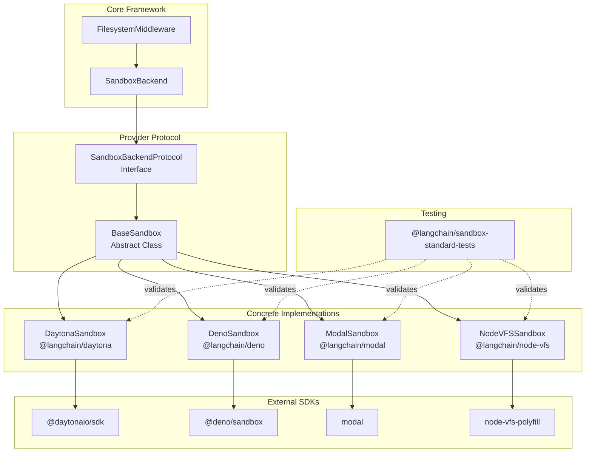
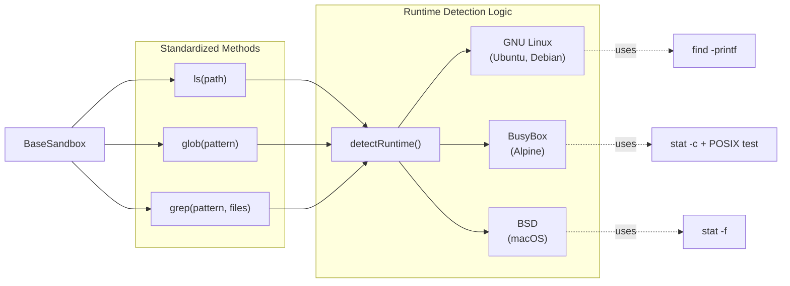
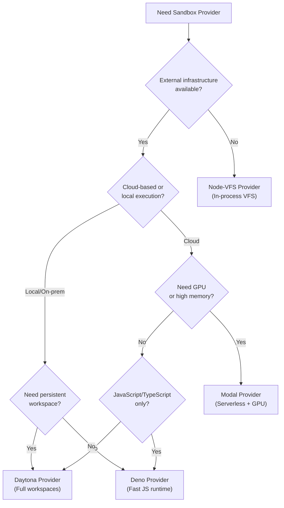

<!-- source: DeepWiki mcp.deepwiki.com · repo langchain-ai/deepagentsjs · page 7 Sandbox Providers · fetched 2026-10-26 -->

# Sandbox Providers

Relevant source files

The following files were used as context for generating this wiki page:

- [examples/async-subagents/parallel-research/ui/package.json](examples/async-subagents/parallel-research/ui/package.json)
- [libs/providers/daytona/CHANGELOG.md](libs/providers/daytona/CHANGELOG.md)
- [libs/providers/daytona/package.json](libs/providers/daytona/package.json)
- [libs/providers/deno/CHANGELOG.md](libs/providers/deno/CHANGELOG.md)
- [libs/providers/deno/package.json](libs/providers/deno/package.json)
- [libs/providers/modal/CHANGELOG.md](libs/providers/modal/CHANGELOG.md)
- [libs/providers/modal/package.json](libs/providers/modal/package.json)
- [libs/providers/node-vfs/CHANGELOG.md](libs/providers/node-vfs/CHANGELOG.md)
- [libs/providers/node-vfs/package.json](libs/providers/node-vfs/package.json)
- [libs/standard-tests/CHANGELOG.md](libs/standard-tests/CHANGELOG.md)
- [libs/standard-tests/package.json](libs/standard-tests/package.json)

This page provides an overview of the sandbox provider ecosystem in DeepAgents, covering the common interfaces, available implementations, and how to choose the appropriate provider for your use case. For details on configuring and using each specific provider, see the child pages listed below. For information about the underlying `SandboxBackend` abstraction used by the framework, see [SandboxBackend and BaseSandbox](#6.5).

## Purpose and Scope

Sandbox providers enable DeepAgents to execute code and file operations in isolated environments. The framework defines a common protocol that all providers implement, allowing agents to be deployed across different execution environments (cloud workspaces, containerized runtimes, serverless functions, virtual filesystems) without code changes.

### Child Pages
- [Daytona Provider](#7.1) — Documentation of `@langchain/daytona` provider and Daytona.io integration.
- [Deno Provider](#7.2) — Documentation of `@langchain/deno` provider and Deno sandbox integration.
- [Modal Provider](#7.3) — Documentation of `@langchain/modal` provider and Modal.com serverless containers.
- [Node-VFS Provider](#7.4) — Documentation of `@langchain/node-vfs` provider and virtual filesystem implementation.
- [QuickJS Provider](#7.5) — Documentation of `@langchain/quickjs` provider and WASM-based REPL.
- [Standard Tests](#7.6) — Documentation of the `@langchain/sandbox-standard-tests` shared test suite.

## Architecture Overview

The following diagram illustrates how the core framework interacts with specific provider implementations and their underlying SDKs.

**Sources:** [libs/providers/daytona/package.json:1-73](), [libs/providers/deno/package.json:1-73](), [libs/providers/modal/package.json:1-73](), [libs/providers/node-vfs/package.json:1-73]()

All sandbox providers are independent npm packages under the `@langchain/*` scope. Each declares `deepagents` as a peer dependency (>=1.9.0-alpha.0) and depends on a specific external SDK for sandbox operations [libs/providers/deno/package.json:39-44](), [libs/providers/daytona/package.json:39-44]().

## BaseSandbox and Cross-Platform Shell Commands

The `BaseSandbox` abstract class provides default implementations of file operations using POSIX-compliant shell commands. Recent refactors have standardized method names across the ecosystem to improve consistency [libs/providers/deno/CHANGELOG.md:3-7](), [libs/providers/node-vfs/CHANGELOG.md:3-9]().

**Sources:** [libs/providers/deno/CHANGELOG.md:31-37](), [libs/providers/node-vfs/CHANGELOG.md:9-9]()

The runtime detection ensures that providers work consistently across different container images (e.g., Ubuntu vs. Alpine) without requiring additional dependencies inside the sandbox environment [libs/providers/deno/CHANGELOG.md:31-37]().

## Available Providers

### Provider Comparison

| Provider | Package | Primary Use Case | Key Features |
|----------|---------|-----------------|--------------|
| **Daytona** | `@langchain/daytona` | Cloud development environments | Persistent storage, auto-archive/delete intervals [libs/providers/daytona/package.json:4-40](), [libs/providers/daytona/CHANGELOG.md:9-9]() |
| **Deno** | `@langchain/deno` | JS/TS execution | Fast startup, volume support [libs/providers/deno/package.json:4-40](), [libs/providers/deno/CHANGELOG.md:25-25]() |
| **Modal** | `@langchain/modal` | Serverless workloads | GPU support, multimodal file support, configurable resources [libs/providers/modal/package.json:4-40](), [libs/providers/modal/CHANGELOG.md:7-9]() |
| **Node-VFS** | `@langchain/node-vfs` | In-process virtual FS | No external dependencies, absolute path rewriting in execute() [libs/providers/node-vfs/package.json:4-41](), [libs/providers/node-vfs/CHANGELOG.md:26-26]() |

### Standard Test Suite

The `@langchain/sandbox-standard-tests` package provides a shared test suite that validates all providers implement the required protocols correctly [libs/standard-tests/package.json:4-7](). This ensures consistent behavior for command execution, file uploads, and path handling across all implementations. It now supports custom test runners and validates multimodal file handling [libs/standard-tests/CHANGELOG.md:7-9](), [libs/standard-tests/CHANGELOG.md:26-27]().

## Choosing a Provider

The choice of provider typically depends on your infrastructure requirements and the specific capabilities needed by the agent (e.g., GPU access vs. local execution).

**Sources:** Based on feature descriptions in [libs/providers/modal/CHANGELOG.md:44-55]() and [libs/providers/deno/CHANGELOG.md:25-25]().

---

