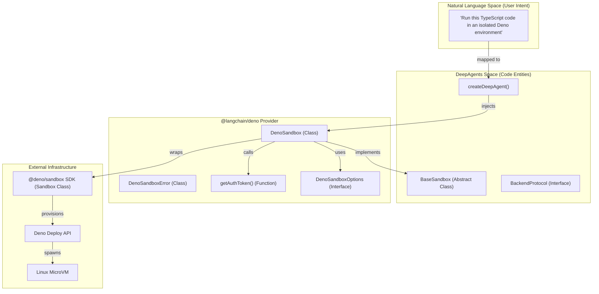
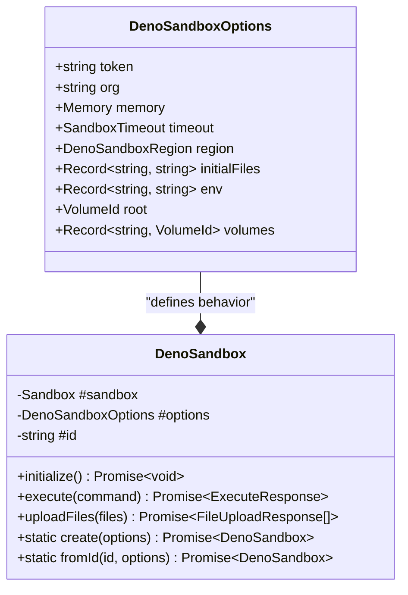

<!-- source: DeepWiki mcp.deepwiki.com · repo langchain-ai/deepagentsjs · page 7.2 Deno Provider · fetched 2026-10-26 -->

# Deno Provider

<details>
<summary>Relevant source files</summary>

The following files were used as context for generating this wiki page:

- [libs/providers/daytona/src/sandbox.int.test.ts](libs/providers/daytona/src/sandbox.int.test.ts)
- [libs/providers/deno/src/auth.test.ts](libs/providers/deno/src/auth.test.ts)
- [libs/providers/deno/src/auth.ts](libs/providers/deno/src/auth.ts)
- [libs/providers/deno/src/index.ts](libs/providers/deno/src/index.ts)
- [libs/providers/deno/src/sandbox.int.test.ts](libs/providers/deno/src/sandbox.int.test.ts)
- [libs/providers/deno/src/sandbox.test.ts](libs/providers/deno/src/sandbox.test.ts)
- [libs/providers/deno/src/sandbox.ts](libs/providers/deno/src/sandbox.ts)
- [libs/providers/deno/src/types.ts](libs/providers/deno/src/types.ts)
- [libs/providers/modal/src/sandbox.int.test.ts](libs/providers/modal/src/sandbox.int.test.ts)

</details>


This document covers the `@langchain/deno` provider, which integrates the Deno sandbox runtime with the DeepAgents framework for isolated code execution. This provider implements the `SandboxBackendProtocol` interface and extends `BaseSandbox` to provide file operations and shell command execution within Deno Deploy's isolated Linux microVM infrastructure.

## Overview

The Deno provider wraps the `@deno/sandbox` SDK to enable DeepAgents to execute code and manipulate files in isolated Deno sandbox instances. It provides:

- **Sandboxed code execution**: Run shell commands and scripts in isolated Linux microVMs [libs/providers/deno/src/sandbox.ts:5-8]().
- **File operations**: Upload and download files to/from sandbox instances [libs/providers/deno/src/sandbox.ts:224-233]().
- **Flexible Resource Allocation**: Configure memory limits (up to 4096MB) and sandbox timeouts [libs/providers/deno/src/types.ts:67-73]().
- **Persistence via Volumes**: Support for mounting Deno Volumes to persist data across sandbox sessions [libs/providers/deno/src/types.ts:234-245]().
- **Cross-platform compatibility**: Inherits POSIX shell command implementations for file listing, globbing, and searching [libs/providers/deno/src/sandbox.ts:67-67]().

The provider is published as `@langchain/deno` on npm and requires `deepagents` as a peer dependency.

**Sources**: [libs/providers/deno/src/sandbox.ts:1-30](), [libs/providers/deno/src/types.ts:1-18]()

## Architecture

The `DenoSandbox` class is the primary entry point, managing the lifecycle of the underlying Deno microVM.



**Diagram: Deno Provider Architecture and Code Entity Mapping**

The `DenoSandbox` class implements the initialization logic in `initialize()` [libs/providers/deno/src/sandbox.ts:160-217](), which authenticates with Deno Deploy and provisions the environment. It maintains a private reference to the underlying SDK instance in `#sandbox` [libs/providers/deno/src/sandbox.ts:69-69]().

**Sources**: [libs/providers/deno/src/sandbox.ts:67-217](), [libs/providers/deno/src/auth.ts:57-79](), [libs/providers/deno/src/types.ts:50-61]()

## Configuration and Initialization

The `DenoSandbox` can be configured via `DenoSandboxOptions`.

### Authentication Flow

Authentication requires a Deno Deploy access token. The `getAuthToken` function resolves credentials in the following priority [libs/providers/deno/src/auth.ts:21-36]():
1. **Explicit token**: Passed via `DenoSandboxOptions.token` [libs/providers/deno/src/types.ts:174-185]().
2. **Deprecated Auth Object**: Passed via `DenoSandboxOptions.auth.token` [libs/providers/deno/src/types.ts:165-172]().
3. **Environment Variable**: `DENO_DEPLOY_TOKEN` [libs/providers/deno/src/auth.ts:64-67]().

### Configuration Mapping



**Diagram: Configuration Entity Mapping**

| Option | Type | Description |
|--------|------|-------------|
| `memory` | `Memory` | Size (e.g., "1GiB", "2048MiB"). Min 768MB, Max 4096MB. Takes precedence over `memoryMb` [libs/providers/deno/src/types.ts:75-87](). |
| `timeout` | `SandboxTimeout` | `"session"` (shuts down on disconnect) or duration (e.g., "5m"). Takes precedence over `lifetime` [libs/providers/deno/src/types.ts:103-118](). |
| `region` | `Region` | Deployment region: `ams` (Amsterdam) or `ord` (Chicago) [libs/providers/deno/src/types.ts:120-127](). |
| `root` | `VolumeId` | A volume or snapshot to use as the root filesystem [libs/providers/deno/src/types.ts:216-231](). |
| `initialFiles`| `Record` | Map of paths to content uploaded during `initialize()` [libs/providers/deno/src/sandbox.ts:207-209](). |
| `volumes` | `Record` | Map of mount paths to Volume IDs for persistent storage [libs/providers/deno/src/types.ts:234-245](). |

**Sources**: [libs/providers/deno/src/types.ts:50-245](), [libs/providers/deno/src/sandbox.ts:170-209]()

## Usage Examples

### Basic Sandbox Setup
The static `create()` method is the recommended way to instantiate and initialize the sandbox in one step [libs/providers/deno/src/sandbox.ts:37-40]().

```typescript
import { DenoSandbox } from "@langchain/deno";

// Initialize with custom resources
const sandbox = await DenoSandbox.create({
  memory: "2GiB",
  timeout: "10m",
});

try {
  const result = await sandbox.execute("deno --version");
  console.log(result.output); 
} finally {
  await sandbox.close(); // Clean up resources
}
```

### Reconnecting to a Sandbox
You can reconnect to a running sandbox using its ID via the `fromId()` static method [libs/providers/deno/src/sandbox.int.test.ts:107-108]().

```typescript
const sandboxId = "your-sandbox-id";
const reconnected = await DenoSandbox.fromId(sandboxId);
```

### Integration with DeepAgent
The sandbox is passed as the `backend` to `createDeepAgent` [libs/providers/deno/src/sandbox.ts:52-65]().

```typescript
import { createDeepAgent } from "deepagents";
import { DenoSandbox } from "@langchain/deno";

const sandbox = await DenoSandbox.create();

const agent = createDeepAgent({
  model: llm,
  systemPrompt: "You have a Deno sandbox.",
  backend: sandbox,
});
```

**Sources**: [libs/providers/deno/src/sandbox.ts:25-66](), [libs/providers/deno/src/index.ts:10-35](), [libs/providers/deno/src/sandbox.int.test.ts:95-119]()

## Implementation Details

### File Operations
`DenoSandbox` implements `uploadFiles` and `downloadFiles` using the underlying SDK's filesystem API. During initialization, `initialFiles` are converted to `Uint8Array` via `TextEncoder` before being uploaded via the internal `#uploadInitialFiles` method [libs/providers/deno/src/sandbox.ts:224-233]().

### Error Handling
The provider uses `DenoSandboxError`, which extends the core `SandboxError` [libs/providers/deno/src/types.ts:17-17](). It includes specific codes:
- `AUTHENTICATION_FAILED`: Missing or invalid token [libs/providers/deno/src/auth.ts:70-78]().
- `NOT_INITIALIZED`: Attempting to use the sandbox before `initialize()` [libs/providers/deno/src/sandbox.ts:99-104]().
- `ALREADY_INITIALIZED`: Attempting to call `initialize()` on an already running instance [libs/providers/deno/src/sandbox.ts:162-167]().
- `SANDBOX_CREATION_FAILED`: Error during the Deno Deploy provisioning process [libs/providers/deno/src/sandbox.ts:210-216]().

### Volume Support
Persistence is achieved by passing a `VolumeId` or `VolumeSlug` to the `root` option or the `volumes` map [libs/providers/deno/src/types.ts:216-245](). Volumes allow data to persist even after the specific microVM instance is destroyed.

**Sources**: [libs/providers/deno/src/sandbox.ts:160-233](), [libs/providers/deno/src/types.ts:1-245](), [libs/providers/deno/src/auth.ts:70-78]()

## Testing

The provider undergoes two levels of testing:
1. **Unit Tests**: Validates authentication logic, option parsing, and mocked SDK interactions in `auth.test.ts` and `sandbox.test.ts` [libs/providers/deno/src/auth.test.ts:9-109](), [libs/providers/deno/src/sandbox.test.ts:1-240]().
2. **Standard Integration Tests**: Uses `@langchain/sandbox-standard-tests` to ensure compliance with the `SandboxBackendProtocol` against real Deno Deploy infrastructure [libs/providers/deno/src/sandbox.int.test.ts:31-44]().

**Sources**: [libs/providers/deno/src/auth.test.ts:9-109](), [libs/providers/deno/src/sandbox.test.ts:7-236](), [libs/providers/deno/src/sandbox.int.test.ts:1-44]()

---

