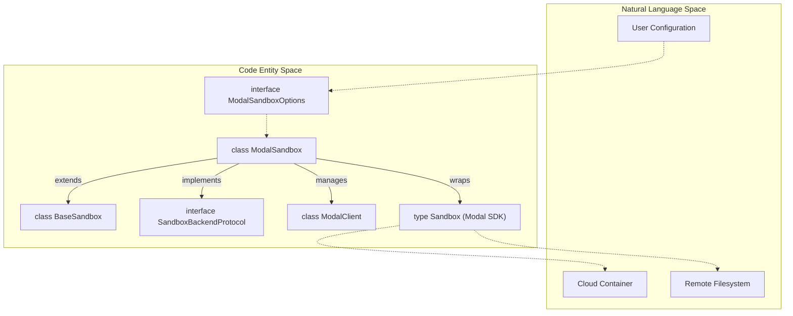
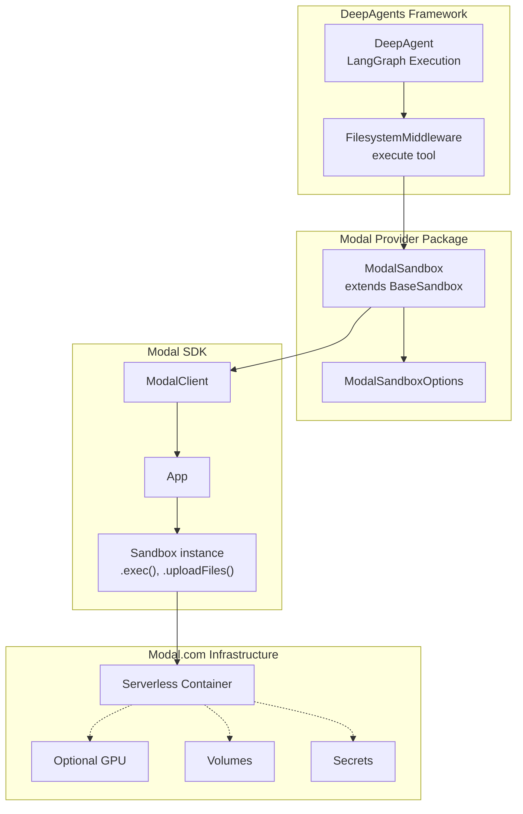
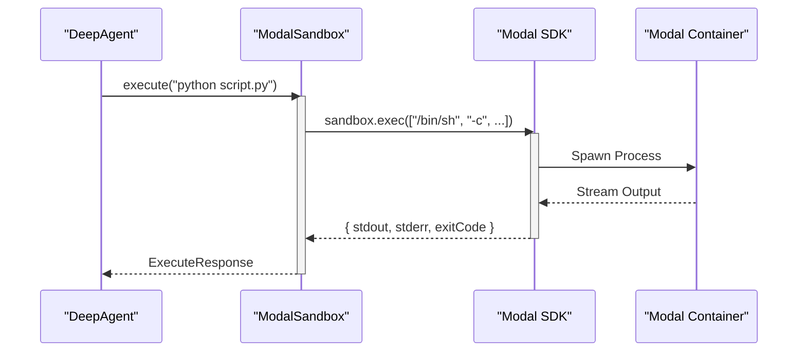

<!-- source: DeepWiki mcp.deepwiki.com · repo langchain-ai/deepagentsjs · page 7.3 Modal Provider · fetched 2026-10-26 -->

# Modal Provider

<details>
<summary>Relevant source files</summary>

The following files were used as context for generating this wiki page:

- [libs/providers/daytona/README.md](libs/providers/daytona/README.md)
- [libs/providers/daytona/src/sandbox.int.test.ts](libs/providers/daytona/src/sandbox.int.test.ts)
- [libs/providers/daytona/src/sandbox.test.ts](libs/providers/daytona/src/sandbox.test.ts)
- [libs/providers/daytona/src/sandbox.ts](libs/providers/daytona/src/sandbox.ts)
- [libs/providers/daytona/src/types.ts](libs/providers/daytona/src/types.ts)
- [libs/providers/daytona/vitest.config.ts](libs/providers/daytona/vitest.config.ts)
- [libs/providers/deno/src/sandbox.int.test.ts](libs/providers/deno/src/sandbox.int.test.ts)
- [libs/providers/modal/src/index.ts](libs/providers/modal/src/index.ts)
- [libs/providers/modal/src/sandbox.int.test.ts](libs/providers/modal/src/sandbox.int.test.ts)
- [libs/providers/modal/src/sandbox.ts](libs/providers/modal/src/sandbox.ts)
- [libs/providers/modal/src/types.ts](libs/providers/modal/src/types.ts)
- [libs/providers/modal/vitest.config.ts](libs/providers/modal/vitest.config.ts)

</details>


The Modal Provider (`@langchain/modal`) is a sandbox backend implementation for DeepAgents that enables agent execution in isolated [Modal.com](https://modal.com) serverless containers. This provider extends the `BaseSandbox` class [libs/providers/modal/src/sandbox.ts:68-68]() and implements the `SandboxBackendProtocol`, allowing agents to execute code in cloud-based containers with configurable compute resources including GPU, memory, volumes, and secrets [libs/providers/modal/src/types.ts:40-158]().

## Overview

Modal is a serverless platform that provides on-demand containerized execution environments. The `@langchain/modal` provider integrates Modal's SDK to enable DeepAgents to:

- Execute shell commands in isolated Modal containers [libs/providers/modal/src/sandbox.ts:329-359]()
- Upload and download files to/from container filesystems [libs/providers/modal/src/sandbox.ts:382-452]()
- Configure container resources (CPU, memory, GPU) [libs/providers/modal/src/types.ts:37-58]()
- Attach persistent volumes and secrets [libs/providers/modal/src/types.ts:86-114]()
- Reconnect to existing sandboxes by ID [libs/providers/modal/src/sandbox.ts:285-313]()

The provider wraps the Modal SDK's `Sandbox` API and provides a standardized interface compatible with the DeepAgents framework.

**Sources:** [libs/providers/modal/src/sandbox.ts:1-30](), [libs/providers/modal/src/types.ts:1-158]()

## Architecture

### System to Code Entity Mapping
The following diagram maps high-level system components to specific classes and interfaces in the codebase.



**Sources:** [libs/providers/modal/src/sandbox.ts:68-82](), [libs/providers/modal/src/types.ts:58-158]()

### Data Flow and Integration



**Diagram:** Modal Provider integration architecture showing the bridge between DeepAgents and Modal.com infrastructure.

**Sources:** [libs/providers/modal/src/sandbox.ts:68-76](), [libs/providers/modal/src/sandbox.ts:215-221]()

## Configuration Options

The `ModalSandboxOptions` interface allows granular control over the container environment. It extends the Modal SDK's `SandboxCreateParams` [libs/providers/modal/src/types.ts:58-58]().

| Option | Type | Description | Default |
|--------|------|-------------|---------|
| `appName` | `string` | Modal App name for grouping sandboxes [libs/providers/modal/src/types.ts:66-66]() | `"deepagents-sandbox"` |
| `imageName` | `string` | Public Docker image or Modal Image [libs/providers/modal/src/types.ts:83-83]() | `"alpine:3.21"` |
| `volumes` | `Record<string, string>` | Map of mount paths to Volume names [libs/providers/modal/src/types.ts:100-100]() | `undefined` |
| `secrets` | `string[]` | List of Modal Secret names to inject [libs/providers/modal/src/types.ts:114-114]() | `undefined` |
| `initialFiles` | `Record<string, string \| Uint8Array>` | Files created on initialization [libs/providers/modal/src/types.ts:130-130]() | `undefined` |
| `timeoutMs` | `number` | Maximum sandbox lifetime in milliseconds | SDK Default |

**Sources:** [libs/providers/modal/src/types.ts:58-158]()

## Implementation Details

### Initialization Lifecycle
The `initialize()` method handles the connection to Modal, app creation, and container provisioning.

1. **Authentication**: Validates credentials via `getAuthCredentials` [libs/providers/modal/src/sandbox.ts:203-211]().
2. **App/Image Setup**: Resolves the Modal App and Image reference [libs/providers/modal/src/sandbox.ts:218-226]().
3. **Resource Resolution**: Converts string names for `volumes` and `secrets` into Modal SDK objects [libs/providers/modal/src/sandbox.ts:241-262]().
4. **Provisioning**: Calls `client.sandboxes.create()` with resolved parameters [libs/providers/modal/src/sandbox.ts:265-271]().
5. **Pre-population**: If `initialFiles` are provided, they are uploaded immediately after creation [libs/providers/modal/src/sandbox.ts:274-278]().

### Command Execution
Commands are executed via the underlying Modal Sandbox instance. The provider captures `stdout`, `stderr`, and `exitCode` [libs/providers/modal/src/sandbox.ts:329-359]().



**Sources:** [libs/providers/modal/src/sandbox.ts:329-359]()

## Usage Examples

### Basic Sandbox Creation
```typescript
import { ModalSandbox } from "@langchain/modal";

const sandbox = await ModalSandbox.create({
  imageName: "python:3.12-slim",
  timeoutMs: 600_000, // 10 minutes
});

try {
  const result = await sandbox.execute("python --version");
  console.log(result.output); // Python 3.12.x
} finally {
  await sandbox.close();
}
```
**Sources:** [libs/providers/modal/src/sandbox.ts:32-51]()

### Using Volumes and Secrets
```typescript
const sandbox = await ModalSandbox.create({
  volumes: {
    "/data": "my-persistent-volume"
  },
  secrets: ["api-keys-secret"]
});
```
**Sources:** [libs/providers/modal/src/types.ts:94-114]()

### Reconnecting to a Sandbox
Sandboxes can be resumed using their unique ID, provided they haven't timed out or been terminated.
```typescript
const sandboxId = "sb-12345";
const sandbox = await ModalSandbox.fromId(sandboxId);
if (sandbox.isRunning) {
  await sandbox.execute("ls /tmp");
}
```
**Sources:** [libs/providers/modal/src/sandbox.ts:285-313](), [libs/providers/modal/src/sandbox.int.test.ts:171-208]()

## Testing
The provider is validated using `sandboxStandardTests` from `@langchain/sandbox-standard-tests`, ensuring parity with other providers like Daytona or Deno [libs/providers/modal/src/sandbox.int.test.ts:33-48]().

Integration tests require `MODAL_TOKEN_ID` and `MODAL_TOKEN_SECRET` environment variables [libs/providers/modal/src/sandbox.int.test.ts:27-29]().

**Sources:** [libs/providers/modal/src/sandbox.int.test.ts:1-48]()

---

