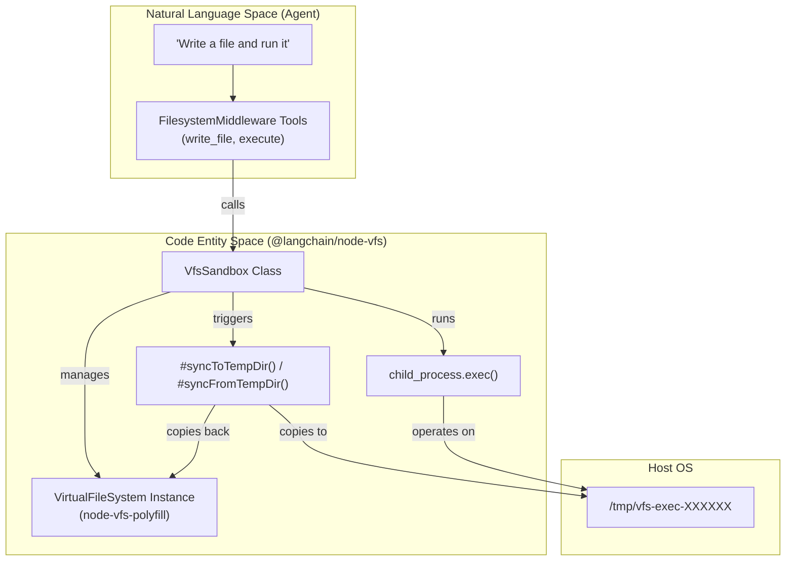
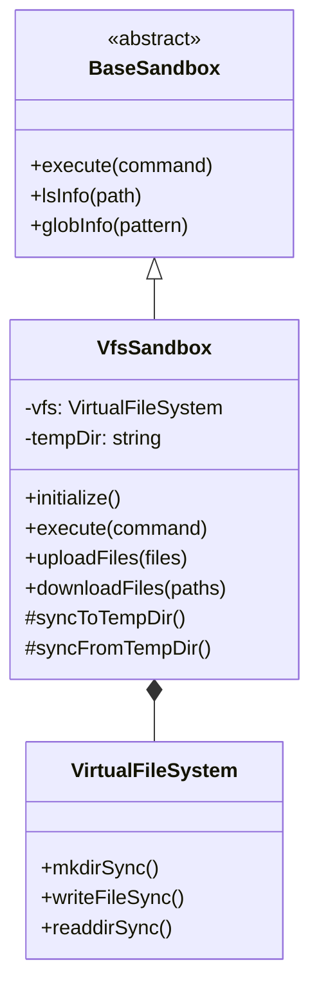

<!-- source: DeepWiki mcp.deepwiki.com · repo langchain-ai/deepagentsjs · page 7.4 Node-VFS Provider · fetched 2026-10-26 -->

# Node-VFS Provider

<details>
<summary>Relevant source files</summary>

The following files were used as context for generating this wiki page:

- [examples/sandbox/vfs-sandbox.ts](examples/sandbox/vfs-sandbox.ts)
- [libs/providers/node-vfs/.npmignore](libs/providers/node-vfs/.npmignore)
- [libs/providers/node-vfs/README.md](libs/providers/node-vfs/README.md)
- [libs/providers/node-vfs/src/index.ts](libs/providers/node-vfs/src/index.ts)
- [libs/providers/node-vfs/src/node-vfs-polyfill.d.ts](libs/providers/node-vfs/src/node-vfs-polyfill.d.ts)
- [libs/providers/node-vfs/src/sandbox.int.test.ts](libs/providers/node-vfs/src/sandbox.int.test.ts)
- [libs/providers/node-vfs/src/sandbox.test.ts](libs/providers/node-vfs/src/sandbox.test.ts)
- [libs/providers/node-vfs/src/sandbox.ts](libs/providers/node-vfs/src/sandbox.ts)
- [libs/providers/node-vfs/src/types.ts](libs/providers/node-vfs/src/types.ts)

</details>


## Purpose and Scope

This document describes the `@langchain/node-vfs` package, which provides a virtual filesystem-based sandbox backend for DeepAgents. The Node-VFS provider implements an in-memory file operations layer without actual filesystem persistence, making it suitable for testing, development, and scenarios where file isolation is needed without external cloud dependencies.

For information about the core sandbox abstraction, see [SandboxBackend and BaseSandbox](6.5). For other sandbox providers with different execution environments, see [Daytona Provider](7.1), [Deno Provider](7.2), and [Modal Provider](7.3).

## Overview

The Node-VFS provider uses the `node-vfs-polyfill` library to create an in-memory virtual filesystem. Unlike other sandbox providers that execute code in remote or isolated containers, Node-VFS runs commands in the local Node.js process but operates on a virtualized filesystem instead of the real disk. To support external command execution (like `node` or `sh`), it dynamically syncs the virtual memory state to a temporary directory on the host machine before execution and syncs results back to memory afterward [libs/providers/node-vfs/src/sandbox.ts:43-46]().

### Key Characteristics

| Characteristic | Description |
|----------------|-------------|
| **Execution Environment** | Local Node.js process via `node:child_process` [libs/providers/node-vfs/src/sandbox.ts:15]() |
| **File Storage** | In-memory `VirtualFileSystem` [libs/providers/node-vfs/src/sandbox.ts:33]() |
| **Persistence** | None (ephemeral; files exist only during runtime) [libs/providers/node-vfs/src/sandbox.ts:5-7]() |
| **Isolation** | Logical filesystem isolation via VFS and temp directories [libs/providers/node-vfs/src/sandbox.ts:211-221]() |
| **Network Access** | Full (inherits host process network) |
| **Setup Complexity** | Zero (no external accounts or API keys required) |

**Sources:** [libs/providers/node-vfs/src/sandbox.ts:1-82](), [libs/providers/node-vfs/src/index.ts:1-13]()

## Architecture

### Component Integration

The following diagram shows how `VfsSandbox` bridges the Natural Language space (Agent tools) to the Code Entity space (VFS implementation).

Title: Node-VFS Execution Data Flow


**Sources:** [libs/providers/node-vfs/src/sandbox.ts:83-100](), [libs/providers/node-vfs/src/sandbox.ts:211-221](), [libs/providers/node-vfs/src/sandbox.ts:249-252]()

### Inheritance and Implementation

Title: VfsSandbox Class Hierarchy


**Sources:** [libs/providers/node-vfs/src/sandbox.ts:83-120](), [libs/providers/node-vfs/src/sandbox.ts:172-205]()

## Installation

Install the package alongside the core library:

```bash
pnpm add @langchain/node-vfs deepagents
```

**Sources:** [libs/providers/node-vfs/src/index.ts:1-13]()

## Configuration and Usage

### Basic Setup

The `VfsSandbox` can be used as a backend for any DeepAgent.

```typescript
import { createDeepAgent } from "deepagents";
import { VfsSandbox } from "@langchain/node-vfs";

// Create and initialize a VFS sandbox
const sandbox = await VfsSandbox.create({
  initialFiles: {
    "/src/index.js": "console.log('Hello from VFS')",
  },
});

const agent = createDeepAgent({
  model: myModel,
  systemPrompt: "You are a coding assistant.",
  backend: sandbox,
});
```

**Sources:** [libs/providers/node-vfs/src/sandbox.ts:50-81]()

### Configuration Options

The `VfsSandboxOptions` interface defines the configuration [libs/providers/node-vfs/src/types.ts:24]():

| Option | Type | Default | Description |
|--------|------|---------|-------------|
| `mountPath` | `string` | `"/vfs"` | The mount path for the virtual file system [libs/providers/node-vfs/src/types.ts:33](). |
| `initialFiles` | `Record<string, string \| Uint8Array>` | `undefined` | Map of file paths to content to pre-populate the VFS [libs/providers/node-vfs/src/types.ts:48](). |
| `timeout` | `number` | `30000` | Command execution timeout in milliseconds [libs/providers/node-vfs/src/types.ts:55](). |

**Sources:** [libs/providers/node-vfs/src/types.ts:10-56]()

## Implementation Details

### Two-Step Initialization
The `VfsSandbox` requires initialization to set up the `VirtualFileSystem` instance and create the default `/workspace` directory [libs/providers/node-vfs/src/sandbox.ts:160-184](). Users should typically use the static `VfsSandbox.create()` method which handles this automatically [libs/providers/node-vfs/src/sandbox.ts:115]().

### Command Execution Flow
Because the host's `node` or `bash` binaries cannot "see" the in-memory VFS, the sandbox performs a synchronization dance:
1.  **Sync To Temp**: All files in the VFS `/workspace` are written to a real temporary directory on the host (using `os.tmpdir()`) [libs/providers/node-vfs/src/sandbox.ts:211-221]().
2.  **Execute**: The command is run using `node:child_process` with the `cwd` set to that temp directory [libs/providers/node-vfs/src/sandbox.ts:15]().
3.  **Sync From Temp**: Any files created or modified by the command are read back from the temp directory into the in-memory VFS [libs/providers/node-vfs/src/sandbox.ts:249-252]().

### Error Handling
The provider uses a specialized `VfsSandboxError` class [libs/providers/node-vfs/src/types.ts:98](). Common error codes include `INITIALIZATION_FAILED`, `NOT_INITIALIZED`, and `ALREADY_INITIALIZED` [libs/providers/node-vfs/src/types.ts:61-66]().

**Sources:** [libs/providers/node-vfs/src/sandbox.ts:172-252](), [libs/providers/node-vfs/src/types.ts:98-134]()

## Use Cases

1.  **Unit Testing Agents**: Fast, side-effect-free testing of agents that use filesystem tools [libs/providers/node-vfs/src/sandbox.int.test.ts:37-48]().
2.  **CI/CD Pipelines**: Running agent evaluations in environments where Docker or external sandbox providers are unavailable.
3.  **Local Prototyping**: Developing agent prompts and logic without incurring costs from cloud sandbox providers like Modal or Daytona.

**Sources:** [libs/providers/node-vfs/src/sandbox.int.test.ts:1-10]()

## Limitations

*   **Host Dependency**: Commands like `node`, `python`, or `gcc` must be installed on the machine running the DeepAgent.
*   **No Resource Limits**: Unlike Docker-based sandboxes, a script running in Node-VFS can consume all host CPU or RAM.
*   **Security**: Since it runs in the local process, it does not provide strong security isolation against malicious code; it is intended for logical isolation and developer convenience [libs/providers/node-vfs/src/sandbox.ts:40-42]().

**Sources:** [libs/providers/node-vfs/src/sandbox.ts:38-46]()

## Testing and Validation

The Node-VFS provider is validated against the `@langchain/sandbox-standard-tests` suite [libs/providers/node-vfs/src/sandbox.int.test.ts:18-25](). This ensures it correctly implements the standard `BaseSandbox` interface, including file operations, directory listing, and command execution across different operating systems (excluding Windows for certain shell-specific features) [libs/providers/node-vfs/src/sandbox.int.test.ts:16-20]().

**Sources:** [libs/providers/node-vfs/src/sandbox.int.test.ts:1-25]()

---

