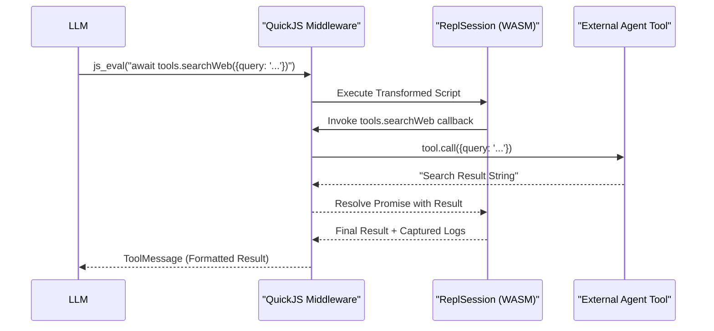

<!-- source: DeepWiki mcp.deepwiki.com · repo langchain-ai/deepagentsjs · page 7.5 QuickJS Provider · fetched 2026-10-26 -->

# QuickJS Provider

<details>
<summary>Relevant source files</summary>

The following files were used as context for generating this wiki page:

- [libs/providers/quickjs/package.json](libs/providers/quickjs/package.json)
- [libs/providers/quickjs/src/middleware.int.test.ts](libs/providers/quickjs/src/middleware.int.test.ts)
- [libs/providers/quickjs/src/middleware.ts](libs/providers/quickjs/src/middleware.ts)
- [libs/providers/quickjs/src/session.test.ts](libs/providers/quickjs/src/session.test.ts)
- [libs/providers/quickjs/src/transform.test.ts](libs/providers/quickjs/src/transform.test.ts)
- [libs/providers/quickjs/src/transform.ts](libs/providers/quickjs/src/transform.ts)

</details>


The QuickJS Provider (`@langchain/quickjs`) provides a high-performance, WASM-sandboxed JavaScript and TypeScript REPL for DeepAgents [libs/providers/quickjs/package.json:2-4](). It allows agents to execute arbitrary code within a secure, isolated environment while maintaining state across multiple tool calls [libs/providers/quickjs/src/middleware.ts:4-9]().

## Overview

The provider implements a `js_eval` tool that executes code in a `ReplSession` [libs/providers/quickjs/src/middleware.ts:211-212](). Key features include:
*   **WASM Isolation**: Code runs in a QuickJS instance compiled to WebAssembly (using `quickjs-emscripten`), providing strong security boundaries [libs/providers/quickjs/src/middleware.ts:4-5](), [libs/providers/quickjs/package.json:48-49]().
*   **State Persistence**: Variables, functions, and classes defined in one `js_eval` call persist for subsequent calls within the same thread by hoisting declarations to `globalThis` [libs/providers/quickjs/src/session.test.ts:91-98](), [libs/providers/quickjs/src/transform.ts:88-106]().
*   **TypeScript Support**: Automatic stripping of type annotations, interfaces, and generics at runtime using an AST-based transformation pipeline [libs/providers/quickjs/src/transform.ts:7-12]().
*   **Programmatic Tool Calling (PTC)**: The ability for the agent to call its own tools as standard async functions from within the JavaScript environment [libs/providers/quickjs/src/middleware.ts:133-156]().
*   **VFS Integration**: Built-in `readFile` and `writeFile` globals that bridge the REPL to the agent's `BackendProtocol` [libs/providers/quickjs/src/middleware.ts:91-103]().

## Architecture and Data Flow

The QuickJS provider operates through a transformation pipeline that prepares raw LLM-generated code for execution in the WASM environment.

### Code Transformation Pipeline
The `transformForEval` function processes input code through several stages:
1.  **Parsing**: Uses `acorn` with the `@sveltejs/acorn-typescript` plugin to generate an AST [libs/providers/quickjs/src/transform.ts:55-59]().
2.  **TS Stripping**: Removes nodes like `TSTypeAliasDeclaration`, `TSInterfaceDeclaration`, and other TypeScript-specific syntax [libs/providers/quickjs/src/transform.ts:145-155]().
3.  **Hoisting**: Rewrites `VariableDeclaration` (const, let, var) to `globalThis` assignments to ensure they persist across evaluation cells [libs/providers/quickjs/src/transform.ts:163-188]().
4.  **Auto-Return**: Identifies the last non-empty node; if it is an expression, it wraps it in `return (...)` [libs/providers/quickjs/src/transform.ts:131-136]().
5.  **Async Wrapping**: Wraps the entire block in an `async IIFE` to support top-level `await` [libs/providers/quickjs/src/transform.ts:139-140]().

### REPL Execution Flow

The following diagram illustrates how a natural language request from an LLM is converted into a sandboxed execution inside the `ReplSession`.

**Diagram: NL Space to Code Entity Space Mapping**
```mermaid
graph TD
    subgraph "Natural Language Space (LLM)"
        A["LLM generates 'js_eval' tool call"]
        B["Code: 'const x: number = 10; await writeFile(\"f.txt\", x)'"]
    end

    subgraph "Code Entity Space (QuickJS Provider)"
        C["jsEvalTool (middleware.ts)"]
        D["transformForEval (transform.ts)"]
        E["ReplSession (session.ts)"]
        F["QuickJS WASM Runtime (quickjs-emscripten)"]
        G["BackendProtocol (deepagents)"]
    end

    A --> C
    B --> D
    D -- "Transformed Code" --> E
    E -- "session.eval()" --> F
    F -- "readFile/writeFile calls" --> G
    G -- "VFS State" --> F
    F -- "Result/Logs" --> C
```
Sources: [libs/providers/quickjs/src/middleware.ts:211-231](), [libs/providers/quickjs/src/transform.ts:52-63](), [libs/providers/quickjs/src/session.test.ts:61-66]()

## Programmatic Tool Calling (PTC)

PTC allows an agent to use the REPL as an orchestrator. Instead of the LLM calling tools sequentially via individual `ToolCall` messages, it can write a script that calls multiple tools, processes their data, and performs complex logic in a single step [libs/providers/quickjs/src/middleware.ts:133-156]().

### Implementation
*   **Namespace**: Tools are exposed under the `tools` global object [libs/providers/quickjs/src/middleware.ts:133-135]().
*   **Signatures**: `generatePtcPrompt` generates TypeScript type signatures for available tools by converting their Zod schemas to JSON Schema and then to TS types [libs/providers/quickjs/src/middleware.ts:115-129]().
*   **Exclusion**: By default, standard filesystem tools (`ls`, `read_file`, `write_file`, etc.) are excluded from the `tools` namespace because the REPL provides direct `readFile`/`writeFile` globals which are more ergonomic within the JS context [libs/providers/quickjs/src/middleware.ts:55-63]().

**Diagram: PTC Interaction Model**

Sources: [libs/providers/quickjs/src/middleware.ts:133-156](), [libs/providers/quickjs/src/middleware.ts:211-240]()

## Configuration

The `createQuickJSMiddleware` function accepts `QuickJSMiddlewareOptions` to control the sandbox limits and behavior [libs/providers/quickjs/src/middleware.ts:162-164]().

| Option | Type | Default | Description |
| :--- | :--- | :--- | :--- |
| `ptc` | `boolean \| PTCConfig` | `false` | Enables PTC. Can be boolean or an object with `include`/`exclude` lists [libs/providers/quickjs/src/middleware.ts:181-209](). |
| `memoryLimitBytes` | `number` | `64MB` | Maximum heap size for the QuickJS instance [libs/providers/quickjs/src/middleware.ts:168](). |
| `maxStackSizeBytes` | `number` | `512KB` | Maximum stack size for the interpreter [libs/providers/quickjs/src/middleware.ts:169](). |
| `executionTimeoutMs` | `number` | `30000` | Timeout for a single code evaluation (30s) [libs/providers/quickjs/src/middleware.ts:170](). |
| `backend` | `BackendProtocol` | `StateBackend` | The backend used for VFS operations (`readFile`/`writeFile`) [libs/providers/quickjs/src/middleware.ts:166](). |

Sources: [libs/providers/quickjs/src/middleware.ts:165-172](), [libs/providers/quickjs/src/session.test.ts:7-8]()

## VFS Integration

The REPL is tightly integrated with the DeepAgents backend system via the `BackendProtocol`. This allows code running inside the sandbox to interact with the same virtual filesystem used by the agent's other tools.

*   **`readFile(path: string): Promise<string>`**: Asynchronous global that calls `backend.read()` [libs/providers/quickjs/src/middleware.ts:94-97]().
*   **`writeFile(path: string, content: string): Promise<void>`**: Asynchronous global that calls `backend.write()` [libs/providers/quickjs/src/middleware.ts:99-102]().

This integration ensures that if an agent uses `js_eval` to process a file, the results are persisted in the shared backend, making them accessible to subsequent tools like `edit_file` or `grep` [libs/providers/quickjs/src/middleware.ts:72-89]().

## Key Functions and Classes

### `ReplSession`
Manages the lifecycle of a QuickJS runtime. It handles the creation of the WASM context, setting up `console.log/warn/error` capturing, and binding the VFS and PTC functions to the environment [libs/providers/quickjs/src/session.test.ts:49-58](). It maintains a static cache to persist sessions by `thread_id` [libs/providers/quickjs/src/middleware.ts:213-221]().

### `transformForEval`
The core AST transformation engine. It ensures that code written by the LLM (which often assumes a script-like global scope) behaves correctly in a persistent REPL environment by converting top-level declarations into `globalThis` assignments and stripping TypeScript types [libs/providers/quickjs/src/transform.ts:52-53](), [libs/providers/quickjs/src/transform.test.ts:24-38]().

### `generatePtcPrompt`
Dynamically constructs the documentation for the `tools` namespace based on the actual tools provided to the agent. It uses `toolToTypeSignature` to generate TypeScript interfaces from Zod schemas, which helps the LLM understand how to call tools programmatically [libs/providers/quickjs/src/middleware.ts:115-129]().

Sources: [libs/providers/quickjs/src/middleware.ts](), [libs/providers/quickjs/src/transform.ts](), [libs/providers/quickjs/src/session.test.ts]()

---

