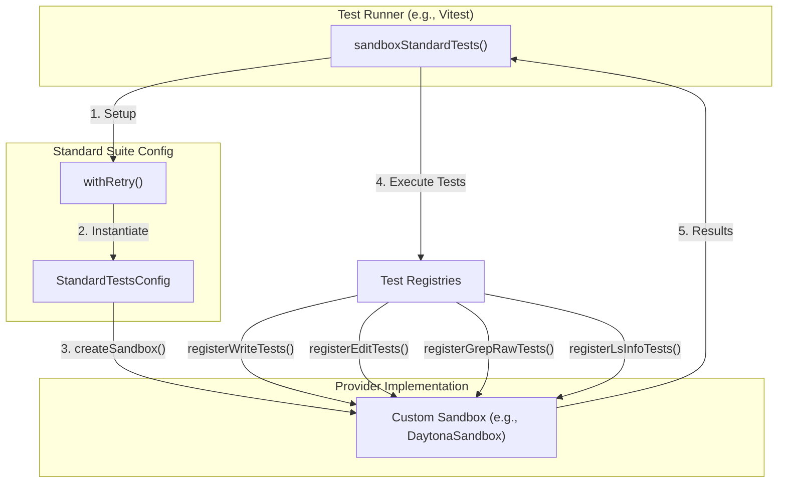
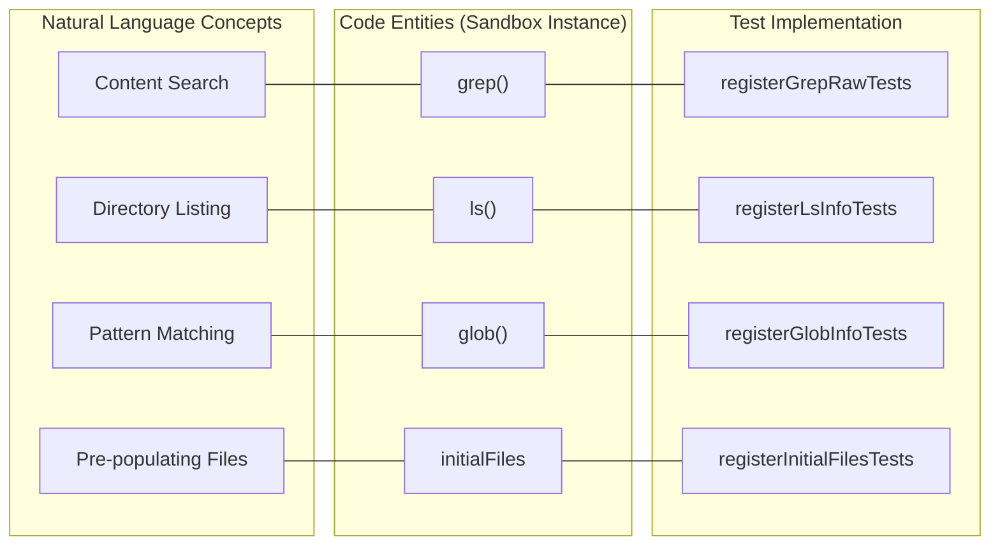

<!-- source: DeepWiki mcp.deepwiki.com · repo langchain-ai/deepagentsjs · page 7.6 Standard Tests · fetched 2026-10-26 -->

# Standard Tests

<details>
<summary>Relevant source files</summary>

The following files were used as context for generating this wiki page:

- [examples/async-subagents/parallel-research/ui/package.json](examples/async-subagents/parallel-research/ui/package.json)
- [libs/deepagents/src/backends/local-shell.int.test.ts](libs/deepagents/src/backends/local-shell.int.test.ts)
- [libs/providers/daytona/package.json](libs/providers/daytona/package.json)
- [libs/providers/deno/package.json](libs/providers/deno/package.json)
- [libs/providers/modal/package.json](libs/providers/modal/package.json)
- [libs/providers/node-vfs/package.json](libs/providers/node-vfs/package.json)
- [libs/standard-tests/package.json](libs/standard-tests/package.json)
- [libs/standard-tests/src/index.ts](libs/standard-tests/src/index.ts)
- [libs/standard-tests/src/sandbox.ts](libs/standard-tests/src/sandbox.ts)
- [libs/standard-tests/src/tests/command-execution.ts](libs/standard-tests/src/tests/command-execution.ts)
- [libs/standard-tests/src/tests/edit.ts](libs/standard-tests/src/tests/edit.ts)
- [libs/standard-tests/src/tests/file-operations.ts](libs/standard-tests/src/tests/file-operations.ts)
- [libs/standard-tests/src/tests/glob-info.ts](libs/standard-tests/src/tests/glob-info.ts)
- [libs/standard-tests/src/tests/grep-raw.ts](libs/standard-tests/src/tests/grep-raw.ts)
- [libs/standard-tests/src/tests/initial-files.ts](libs/standard-tests/src/tests/initial-files.ts)
- [libs/standard-tests/src/tests/integration.ts](libs/standard-tests/src/tests/integration.ts)
- [libs/standard-tests/src/tests/ls-info.ts](libs/standard-tests/src/tests/ls-info.ts)

</details>


The `@langchain/sandbox-standard-tests` package provides a framework-agnostic, shared integration test suite that defines the behavioral contract for all sandbox providers in the DeepAgentsJS ecosystem. By requiring all providers to pass these tests, the framework ensures that agent logic and middleware (like `FilesystemMiddleware`) function identically regardless of whether the backend is a local shell, a Deno container, or a serverless environment.

## Overview

The standard test suite validates that a provider correctly implements the `SandboxBackendProtocol` and handles cross-platform POSIX-style commands [libs/standard-tests/src/sandbox.ts:16-29](). It is designed to be efficient by reusing a single "shared" sandbox instance for most operations while spinning up ephemeral instances only for lifecycle and initialization tests [libs/standard-tests/src/sandbox.ts:9-15]().

### Test Categories

| Category | Description |
| :--- | :--- |
| **Lifecycle** | Validates `create`, `initialize`, `isRunning`, and `close` behavior [libs/standard-tests/src/sandbox.ts:17-17](). |
| **Command Execution** | Verifies shell command handling, exit codes, multiline output, and environment variables [libs/standard-tests/src/sandbox.ts:18-18](). |
| **File Operations** | Tests `uploadFiles`, `downloadFiles`, and high-level `read`, `write`, and `edit` methods [libs/standard-tests/src/sandbox.ts:19-22](). |
| **Filesystem Metadata** | Validates `ls` (directory listing), `glob` (pattern matching), and `grep` (content searching) [libs/standard-tests/src/sandbox.ts:23-25](). |
| **Initial Files** | Ensures the `initialFiles` configuration correctly populates the sandbox upon startup [libs/standard-tests/src/sandbox.ts:26-26](). |
| **Integration Workflows** | Tests complex sequences like write-read-edit-read to ensure state consistency [libs/standard-tests/src/sandbox.ts:27-27](). |

**Sources:** [libs/standard-tests/src/sandbox.ts:1-29](), [libs/standard-tests/src/tests/integration.ts:14-15]()

## Data Flow: Test Execution

The following diagram illustrates how the `sandboxStandardTests` runner orchestrates the testing of a provider.

**Standard Test Orchestration**

**Sources:** [libs/standard-tests/src/sandbox.ts:124-170](), [libs/standard-tests/src/sandbox.ts:75-95]()

## Implementation Detail: Test Registries

The suite is modularized into "registries" that inject tests into the provided test runner. Each registry takes a `getShared` function to access the active sandbox and a `config` object to resolve paths correctly [libs/standard-tests/src/sandbox.ts:31-41]().

### Key Registries and Functions

*   **`registerLsInfoTests`**: Verifies that directory listings return absolute paths [libs/standard-tests/src/tests/ls-info.ts:18-32](), correctly identify directories vs. files via the `is_dir` flag [libs/standard-tests/src/tests/ls-info.ts:53-61](), and handle special characters or unicode filenames [libs/standard-tests/src/tests/ls-info.ts:133-153]().
*   **`registerGlobInfoTests`**: Ensures the provider supports basic wildcards [libs/standard-tests/src/tests/glob-info.ts:17-37](), recursive `**` matching [libs/standard-tests/src/tests/glob-info.ts:39-58](), and character class patterns like `[1-2]` [libs/standard-tests/src/tests/glob-info.ts:140-161]().
*   **`registerGrepRawTests`**: Validates content searching with literal strings [libs/standard-tests/src/tests/grep-raw.ts:106-123](), glob filters [libs/standard-tests/src/tests/grep-raw.ts:49-66](), and line number reporting [libs/standard-tests/src/tests/grep-raw.ts:84-102]().
*   **`registerInitialFilesTests`**: Confirms that files provided during sandbox creation are accessible via shell commands like `cat` [libs/standard-tests/src/tests/initial-files.ts:35-42]() or the `read()` API [libs/standard-tests/src/tests/initial-files.ts:106-126]().

**Entity Mapping: Natural Language to Code**

**Sources:** [libs/standard-tests/src/tests/grep-raw.ts:31-45](), [libs/standard-tests/src/tests/ls-info.ts:24-30](), [libs/standard-tests/src/tests/glob-info.ts:26-35](), [libs/standard-tests/src/tests/initial-files.ts:23-30]()

## Using Standard Tests for Custom Providers

When implementing a new sandbox provider (e.g., `Daytona`, `Deno`, `Modal`), you must include `@langchain/sandbox-standard-tests` as a devDependency [libs/providers/daytona/package.json:47-47]().

### Configuration Parameters

The `StandardTestsConfig` object requires several factory functions:
*   **`createSandbox`**: Returns a fully initialized sandbox [libs/standard-tests/src/sandbox.ts:147-147]().
*   **`closeSandbox`**: Handles cleanup of the sandbox instance [libs/standard-tests/src/sandbox.ts:152-152]().
*   **`resolvePath`**: Maps a test filename to the provider's specific path format (e.g., prefixing with `/tmp/`) [libs/standard-tests/src/tests/ls-info.ts:21-21]().
*   **`runner`**: The test runner instance (e.g., `vitest`) providing `describe`, `it`, `expect`, `beforeAll`, and `afterAll` [libs/standard-tests/src/sandbox.ts:127-127]().

### Example Integration
Providers typically run these tests in an integration mode (`test:int`) [libs/providers/deno/package.json:17-17]().

```typescript
import { sandboxStandardTests } from "@langchain/sandbox-standard-tests/vitest";
import { MyCustomSandbox } from "./sandbox.js";

sandboxStandardTests({
  name: "MyCustomSandbox",
  timeout: 180_000,
  createSandbox: (opts) => MyCustomSandbox.create({ ...opts }),
  closeSandbox: (sb) => sb.close(),
  resolvePath: (name) => `/home/sandbox/${name}`,
});
```
**Sources:** [libs/standard-tests/src/sandbox.ts:108-123]()

## Resiliency and Retries

Because remote sandbox providers (like Modal or Daytona) may have transient concurrency limits or slow cold starts, the suite includes a `withRetry` utility [libs/standard-tests/src/sandbox.ts:75-95](). This function wraps sandbox creation and attempts the operation multiple times (default 5) with a delay (default 15 seconds) before failing [libs/standard-tests/src/sandbox.ts:48-55]().

**Sources:** [libs/standard-tests/src/sandbox.ts:48-95]()

---

