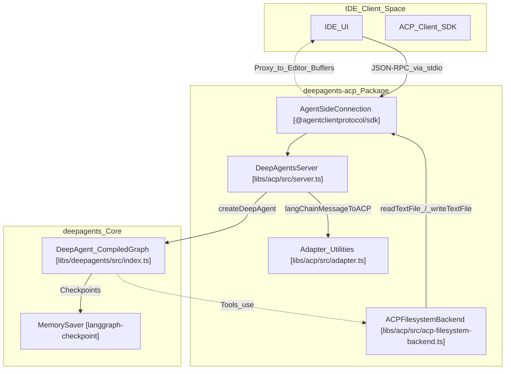
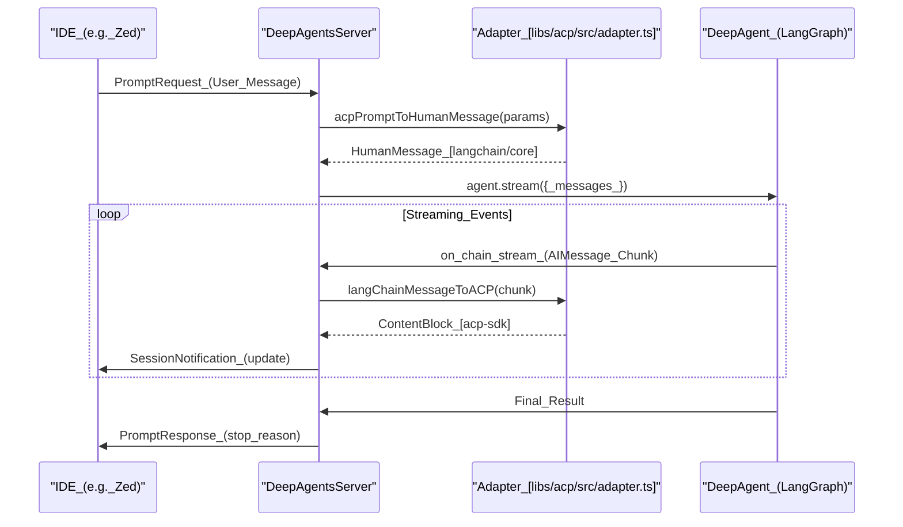

<!-- source: DeepWiki mcp.deepwiki.com · repo langchain-ai/deepagentsjs · page 8 Agent Client Protocol (ACP) · fetched 2026-10-26 -->

# Agent Client Protocol (ACP)

<details>
<summary>Relevant source files</summary>

The following files were used as context for generating this wiki page:

- [internal/eval-harness/package.json](internal/eval-harness/package.json)
- [libs/acp/package.json](libs/acp/package.json)
- [libs/acp/src/acp-filesystem-backend.test.ts](libs/acp/src/acp-filesystem-backend.test.ts)
- [libs/acp/src/index.ts](libs/acp/src/index.ts)
- [libs/acp/src/server.test.ts](libs/acp/src/server.test.ts)
- [libs/acp/src/server.ts](libs/acp/src/server.ts)
- [libs/acp/src/types.ts](libs/acp/src/types.ts)
- [libs/deepagents/src/backends/local-shell.test.ts](libs/deepagents/src/backends/local-shell.test.ts)
- [libs/deepagents/src/backends/local-shell.ts](libs/deepagents/src/backends/local-shell.ts)

</details>


## Purpose and Scope

This page documents the `deepagents-acp` package, which provides Agent Client Protocol (ACP) server integration for Deep Agents. ACP is a standardized protocol that enables Deep Agents to be used directly within IDEs like Zed and JetBrains through a consistent JSON-RPC interface.

The `deepagents-acp` package acts as a bridge, wrapping the core `createDeepAgent` logic and exposing it over a standardized transport (typically stdio) for IDE consumption.

**Sources:** [libs/acp/package.json:2-4](), [libs/acp/src/server.ts:4-9]()

## Overview

The Agent Client Protocol (ACP) enables bidirectional communication between an AI agent and a client (like an IDE). Key features of the DeepAgents implementation include:

*   **Standardized Communication**: Implements JSON-RPC 2.0 over `ndjson` streams [libs/acp/src/server.ts:12-16]().
*   **IDE Context Awareness**: The `ACPFilesystemBackend` allows agents to read unsaved editor buffers directly from the IDE [libs/acp/src/acp-filesystem-backend.ts:39-51]().
*   **Session Persistence**: Uses LangGraph `MemorySaver` to maintain thread state across IDE restarts [libs/acp/src/server.ts:34-34](), [libs/acp/src/server.ts:168-168]().
*   **Auth Negotiation**: Advertises required environment variables (e.g., `ANTHROPIC_API_KEY`) to the client for UI-driven configuration [libs/acp/src/server.ts:75-95]().

**Sources:** [libs/acp/src/server.ts:11-57](), [libs/acp/src/types.ts:118-121]()

## Architecture

The following diagram illustrates how the `DeepAgentsServer` bridges the IDE's JSON-RPC requests to the LangGraph-based agent execution.

### ACP System Architecture



**Sources:** [libs/acp/src/server.ts:135-184](), [libs/acp/src/acp-filesystem-backend.ts:9-45](), [libs/acp/src/adapter.ts:48-57]()

## Implementation Details

### DeepAgentsServer

The `DeepAgentsServer` class is the primary entry point. It manages the lifecycle of the `AgentSideConnection` and routes incoming ACP requests to specific `DeepAgent` instances.

*   **Initialization**: When the server starts, it sets up process signal handlers (`SIGINT`, `SIGTERM`) for graceful shutdown [libs/acp/src/server.ts:197-205]().
*   **Multi-Agent Support**: The server can host multiple agent configurations, mapped by name [libs/acp/src/server.ts:171-177]().
*   **Session Management**: Maps ACP `sessionId` to LangGraph `threadId`, allowing the agent to maintain conversation context through the `SessionState` interface [libs/acp/src/types.ts:172-212]().

**Sources:** [libs/acp/src/server.ts:135-184](), [libs/acp/src/types.ts:126-167]()

### ACP Filesystem Backend

A specialized backend, `ACPFilesystemBackend`, extends the standard `FilesystemBackend`. It prioritizes the IDE's internal state (buffers) over the physical disk:

1.  **Reads**: Attempts to use `conn.readTextFile` to fetch the content of the file currently open in the editor (including unsaved changes) [libs/acp/src/acp-filesystem-backend.ts:40-51]().
2.  **Writes**: Uses `conn.writeTextFile` so the IDE can track modifications, provide undo history, and show diffs to the user [libs/acp/src/acp-filesystem-backend.ts:122-136]().
3.  **Fallback**: If the ACP call fails or no session is active, it falls back to standard disk I/O via `super.read()` or `super.write()` [libs/acp/src/acp-filesystem-backend.ts:67-77](), [libs/acp/src/acp-filesystem-backend.ts:153-164]().

**Sources:** [libs/acp/src/acp-filesystem-backend.ts:9-181]()

### Message Flow and Data Transformation

The server uses an adapter layer to translate between LangChain `BaseMessage` objects and ACP `ContentBlock` structures.



**Sources:** [libs/acp/src/server.ts:48-57](), [libs/acp/src/adapter.ts:48-57](), [libs/acp/src/server.test.ts:33-39]()

## Configuration

### Server Options

The `DeepAgentsServerOptions` interface defines how the server is instantiated:

| Option | Type | Description |
| :--- | :--- | :--- |
| `agents` | `DeepAgentConfig \| DeepAgentConfig[]` | One or more agent configurations [libs/acp/src/types.ts:130-130](). |
| `workspaceRoot` | `string` | The root directory for file operations (defaults to `cwd`) [libs/acp/src/types.ts:154-157](). |
| `authMethods` | `ACPAuthMethod[]` | Custom authentication methods to advertise to the client [libs/acp/src/types.ts:166-166](). |
| `logFile` | `string` | Path to a file for persistent logging [libs/acp/src/types.ts:148-151](). |
| `debug` | `boolean` | Enable debug logging to stderr [libs/acp/src/types.ts:145-145](). |

**Sources:** [libs/acp/src/types.ts:126-167]()

### Default Authentication Methods

By default, the server advertises authentication methods to help users set up their environment via the IDE UI:
1.  **Anthropic**: Requests `ANTHROPIC_API_KEY` [libs/acp/src/server.ts:76-82]().
2.  **OpenAI**: Requests `OPENAI_API_KEY` [libs/acp/src/server.ts:83-89]().
3.  **DeepAgents Setup**: A generic fallback for manual environment configuration [libs/acp/src/server.ts:90-94]().

**Sources:** [libs/acp/src/server.ts:75-95]()

## IDE Integration Setup

### Zed Configuration

To use DeepAgents in Zed, update your `settings.json`. The `deepagents-acp` binary is exposed via the package's `bin` configuration [libs/acp/package.json:9-11]().

```json
{
  "context_predictive_edits": true,
  "agent": {
    "profiles": {
      "deepagents": {
        "name": "DeepAgents",
        "command": "npx",
        "args": ["deepagents-acp", "--debug"]
      }
    }
  }
}
```

### JetBrains Configuration

For JetBrains IDEs (via the ACP plugin):
1.  Open **Settings** > **Tools** > **Agent Client Protocol**.
2.  Add a new server.
3.  Set the command to `npx deepagents-acp`.
4.  Specify the `workspaceRoot` if it differs from the project root.

**Sources:** [libs/acp/package.json:9-11](), [libs/acp/src/server.ts:153-166]()

## Key Classes and Functions

*   `startServer(options)`: Helper function to instantiate and start a `DeepAgentsServer` [libs/acp/src/server.ts:40-40](), [libs/acp/src/index.ts:40-40]().
*   `DeepAgentsServer.handleInitialize(params)`: Negotiates capabilities (e.g., `fsReadTextFile`, `terminal`) and provides `agentInfo` to the client [libs/acp/src/server.test.ts:195-220]().
*   `extractToolCalls(message)`: Extracts tool invocation data from `AIMessage` for ACP UI rendering [libs/acp/src/adapter.ts:51-51](), [libs/acp/src/index.ts:65-65]().
*   `todosToPlanEntries(todos)`: Converts the agent's internal TODO list into ACP Plan entries for the IDE's "Plan" view [libs/acp/src/adapter.ts:52-52](), [libs/acp/src/index.ts:66-66]().
*   `ACPFilesystemBackend.setSessionId(id)`: Sets the current session context to allow the backend to proxy file requests to the correct IDE session [libs/acp/src/acp-filesystem-backend.ts:45-47]().

**Sources:** [libs/acp/src/index.ts:40-74](), [libs/acp/src/server.ts:135-184](), [libs/acp/src/acp-filesystem-backend.ts:9-47]()

---

