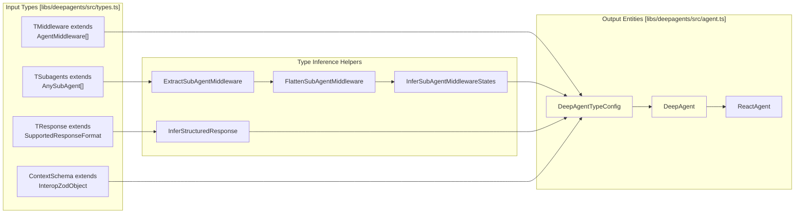

<!-- source: DeepWiki mcp.deepwiki.com · repo langchain-ai/deepagentsjs · page 9 Advanced Topics · fetched 2026-10-26 -->

# Advanced Topics

<details>
<summary>Relevant source files</summary>

The following files were used as context for generating this wiki page:

- [internal/eval-harness/CHANGELOG.md](internal/eval-harness/CHANGELOG.md)
- [libs/acp/CHANGELOG.md](libs/acp/CHANGELOG.md)
- [libs/deepagents/CHANGELOG.md](libs/deepagents/CHANGELOG.md)
- [libs/deepagents/src/agent.ts](libs/deepagents/src/agent.ts)
- [libs/deepagents/src/index.ts](libs/deepagents/src/index.ts)
- [libs/deepagents/src/middleware/async_subagents.ts](libs/deepagents/src/middleware/async_subagents.ts)
- [libs/deepagents/src/middleware/index.ts](libs/deepagents/src/middleware/index.ts)
- [libs/deepagents/src/types.ts](libs/deepagents/src/types.ts)
- [libs/providers/quickjs/CHANGELOG.md](libs/providers/quickjs/CHANGELOG.md)

</details>


This section covers advanced usage patterns and techniques for building sophisticated agent systems with DeepAgentsJS. These topics go beyond basic agent creation and explore how to build production-ready, scalable, and maintainable agent architectures.

The advanced topics covered here include hierarchical agent systems, state management strategies, approval workflows, context optimization, and custom storage implementations. For basic agent creation and configuration, see [Getting Started](#2). For detailed middleware documentation, see [Middleware Reference](#5). For backend basics, see [Backend Implementations](#6).

## Overview of Advanced Capabilities

DeepAgentsJS provides several advanced capabilities that enable sophisticated agent architectures:

| Capability | Primary API | Use Case |
|------------|-------------|----------|
| Hierarchical Agents | `CompiledSubAgent`, `createDeepAgent` | Multi-level agent delegation with type-safe communication |
| Async Subagents | `AsyncSubAgent`, `createAsyncSubAgentMiddleware` | Delegating to remote Agent Protocol servers for long-running background tasks |
| State Persistence | `checkpointer`, `store`, `StateBackend`/`StoreBackend` | Long-running conversations, memory across sessions |
| Approval Workflows | `interruptOn`, `humanInTheLoopMiddleware` | Human oversight for sensitive operations |
| Context Management | `createSummarizationMiddleware`, backend offloading | Working within model token limits |
| Custom Backend | `BackendProtocol`, `BaseSandbox` | Specialized execution or storage environments |
| Observability | `LangSmithSandbox`, `LangSmith Integration` | Tracing and debugging complex agent trajectories |

### Architecture for Advanced Features

The following diagram shows how the key components of advanced features interact within the `createDeepAgent` architecture, bridging the high-level configuration to the underlying code entities.

```mermaid
graph TB
    subgraph "createDeepAgent Configuration"
        ["CreateDeepAgentParams"]
        Subagents["subagents: SubAgent[] | CompiledSubAgent[] | AsyncSubAgent[]"]
        Checkpointer["checkpointer: BaseCheckpointSaver"]
        Store["store: BaseStore"]
        Backend["backend: BackendProtocol | BackendFactory"]
        InterruptOn["interruptOn: Record<string, InterruptOnConfig>"]
    end
    
    subgraph "Type System [libs/deepagents/src/types.ts]"
        TypeConfig["DeepAgentTypeConfig<br/>Response, State, Context,<br/>Middleware, Tools, Subagents"]
        MergedState["MergedDeepAgentState<br/>InferMiddlewareStates +<br/>InferSubAgentMiddlewareStates"]
        InferTypes["InferDeepAgentSubagents<br/>InferSubagentByName<br/>InferSubagentReactAgentType"]
    end
    
    subgraph "Middleware Pipeline [libs/deepagents/src/middleware/]"
        TodoMW["todoListMiddleware"]
        FsMW["createFilesystemMiddleware"]
        SubagentMW["createSubAgentMiddleware"]
        AsyncSubagentMW["createAsyncSubAgentMiddleware"]
        SummarizationMW["createSummarizationMiddleware"]
        HITLMW["humanInTheLoopMiddleware"]
        MemMW["createMemoryMiddleware"]
    end
    
    subgraph "Backend Layer [libs/deepagents/src/backends/]"
        StateB["StateBackend"]
        StoreB["StoreBackend"]
        FsB["FilesystemBackend"]
        SandboxB["SandboxBackend / BaseSandbox"]
        CompositeB["CompositeBackend"]
        LSmithB["LangSmithSandbox"]
    end
    
    ["CreateDeepAgentParams"] --> Subagents
    ["CreateDeepAgentParams"] --> Checkpointer
    ["CreateDeepAgentParams"] --> Store
    ["CreateDeepAgentParams"] --> Backend
    ["CreateDeepAgentParams"] --> InterruptOn
    
    Subagents --> TypeConfig
    Subagents --> MergedState
    TypeConfig --> InferTypes
    
    Backend --> FsMW
    Backend --> SummarizationMW
    Backend --> MemMW
    
    Checkpointer --> StoreB
    Store --> StoreB
    
    InterruptOn --> HITLMW
    
    Subagents --> SubagentMW
    Subagents --> AsyncSubagentMW
    
    Backend -.implements.-> StateB
    Backend -.implements.-> StoreB
    Backend -.implements.-> FsB
    Backend -.implements.-> SandboxB
    Backend -.implements.-> CompositeB
    Backend -.implements.-> LSmithB
    
    FsMW --> Backend
    SubagentMW --> Subagents
    SummarizationMW --> Backend
    
    style TypeConfig fill:none
    style MergedState fill:none
    style Backend fill:none
```

**Sources:** [libs/deepagents/src/types.ts:153-173](), [libs/deepagents/src/agent.ts:164-179](), [libs/deepagents/src/index.ts:96-152]()

### Type-Safe Advanced Configuration

The type system ensures advanced features are type-safe across the entire agent hierarchy, mapping input parameters to the `DeepAgent` class.



**Sources:** [libs/deepagents/src/types.ts:48-125](), [libs/deepagents/src/types.ts:153-196](), [libs/deepagents/src/agent.ts:143-163]()

## Advanced Topics Overview

### 9.1 Hierarchical Agent Architectures
Multi-level agent hierarchies allow you to create complex delegation patterns where agents can spawn specialized subagents. This is enabled through the `CompiledSubAgent` type, which accepts a `runnable` property containing a pre-compiled agent created with `createDeepAgent`. Additionally, `AsyncSubAgent` allows delegation to remote servers.

Key types:
- `SubAgent`: Configuration for runtime subagent creation [libs/deepagents/src/middleware/subagents.ts:13]().
- `CompiledSubAgent`: Pre-compiled agent as subagent [libs/deepagents/src/middleware/subagents.ts:29]().
- `AsyncSubAgent`: Specification for remote Agent Protocol subagents [libs/deepagents/src/middleware/async_subagents.ts:26]().

For details, see [Hierarchical Agent Architectures](#9.1).

### 9.2 State Management and Persistence
The state management system combines LangGraph's state annotation with middleware-based state schemas. State can be ephemeral (in-memory) via `StateBackend` or persisted long-term using `StoreBackend`.

Key components:
- `MergedDeepAgentState`: Combined state type from all middleware [libs/deepagents/src/types.ts:80-84]().
- `StoreBackend`: Persistent storage with namespace isolation [libs/deepagents/src/backends/index.ts:98]().
- `AsyncTaskState`: Reduced state channel for tracking background tasks [libs/deepagents/src/middleware/async_subagents.ts:102-105]().

For details, see [State Management and Persistence](#9.2).

### 9.3 Human-in-the-Loop Workflows
Human-in-the-loop (HITL) workflows allow humans to approve or edit tool calls before execution. This is configured via the `interruptOn` parameter in `createDeepAgent`.

Key components:
- `humanInTheLoopMiddleware`: Implements the approval logic [libs/deepagents/src/agent.ts:3]().
- `interruptOn`: Maps tool names to interrupt configurations [libs/deepagents/src/agent.ts:175]().

For details, see [Human-in-the-Loop Workflows](#9.3).

### 9.4 Context Window Management
Context window management prevents token limit errors through automatic conversation summarization and message offloading.

Key components:
- `createSummarizationMiddleware`: Monitors token usage and triggers summarization [libs/deepagents/src/middleware/summarization.ts:53]().
- `computeSummarizationDefaults`: Auto-computes thresholds from model profiles [libs/deepagents/src/middleware/summarization.ts:54]().

For details, see [Context Window Management](#9.4).

### 9.5 Custom Backend Implementation
Custom backends enable specialized storage or execution environments. Backends implement the `BackendProtocol` interface.

Key interfaces:
- `BackendProtocol`: Core interface for file and memory operations [libs/deepagents/src/backends/index.ts:109]().
- `BaseSandbox`: Abstract base class for sandboxed execution [libs/deepagents/src/backends/index.ts:104]().

For details, see [Custom Backend Implementation](#9.5).

### 9.6 Streaming
DeepAgentsJS supports streaming agent output, including subgraph streaming for subagents and filtering by event type. The `createCompletionCallbackMiddleware` can be used to notify systems when async tasks finish [libs/deepagents/src/middleware/index.ts:64]().

For details, see [Streaming](#9.6).

### 9.7 LangSmith Integration
LangSmith provides tracing and observability. The `LangSmithSandbox` backend allows for detailed monitoring of sandbox operations.

Key components:
- `LangSmithSandbox`: Backend for tracing sandbox execution [libs/deepagents/src/backends/index.ts:142]().

For details, see [LangSmith Integration](#9.7).

## Advanced Configuration Parameters

The following table maps `CreateDeepAgentParams` fields to their advanced use cases:

| Parameter | Type | Advanced Use Case |
|-----------|------|-------------------|
| `subagents` | `AnySubAgent[]` | Hierarchical architectures, remote Agent Protocol delegation |
| `checkpointer` | `BaseCheckpointSaver` | Conversation persistence, HITL workflows |
| `store` | `BaseStore` | Long-term memory, cross-thread knowledge |
| `backend` | `BackendProtocol \| BackendFactory` | Custom storage, sandbox execution |
| `interruptOn` | `Record<string, InterruptOnConfig>` | Approval workflows, human oversight |
| `memory` | `string[]` | Loading persistent agent context from `AGENTS.md` |
| `skills` | `string[]` | Loading tool definitions from `SKILL.md` |

**Sources:** [libs/deepagents/src/agent.ts:164-179](), [libs/deepagents/src/types.ts:153-173]()

## Best Practices for Advanced Usage

1.  **Type Safety**: Always use `as const` for `subagents` and `middleware` arrays to preserve tuple types for accurate type inference [libs/deepagents/src/types.ts:142-152]().
2.  **Tool Collision Prevention**: `createDeepAgent` throws if custom tools collide with built-ins like `ls`, `task`, `write_todos`, or `write_file` [libs/deepagents/src/agent.ts:181-191]().
3.  **Prompt Caching**: When using Anthropic models, the middleware order is automatically optimized so that memory updates do not invalidate prompt caches via `anthropicPromptCachingMiddleware` [libs/deepagents/src/agent.ts:194-202]().
4.  **Subagent Skills**: Custom subagents do NOT inherit skills from the main agent by default. If a custom subagent needs skills, it must specify its own `skills` array [libs/deepagents/src/agent.ts:205-210]().
5.  **Multimodal Support**: Backends now support multimodal files, allowing for richer data interaction in advanced workflows [libs/deepagents/CHANGELOG.md:7]().

**Sources:** [libs/deepagents/src/agent.ts:181-210](), [libs/deepagents/CHANGELOG.md:1-40]()

---

